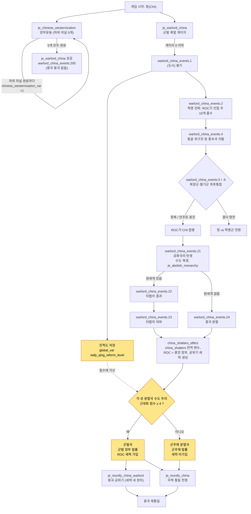
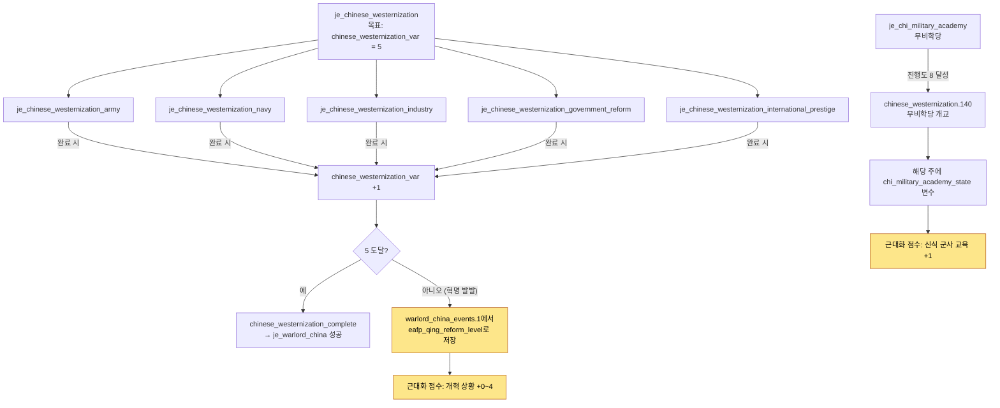
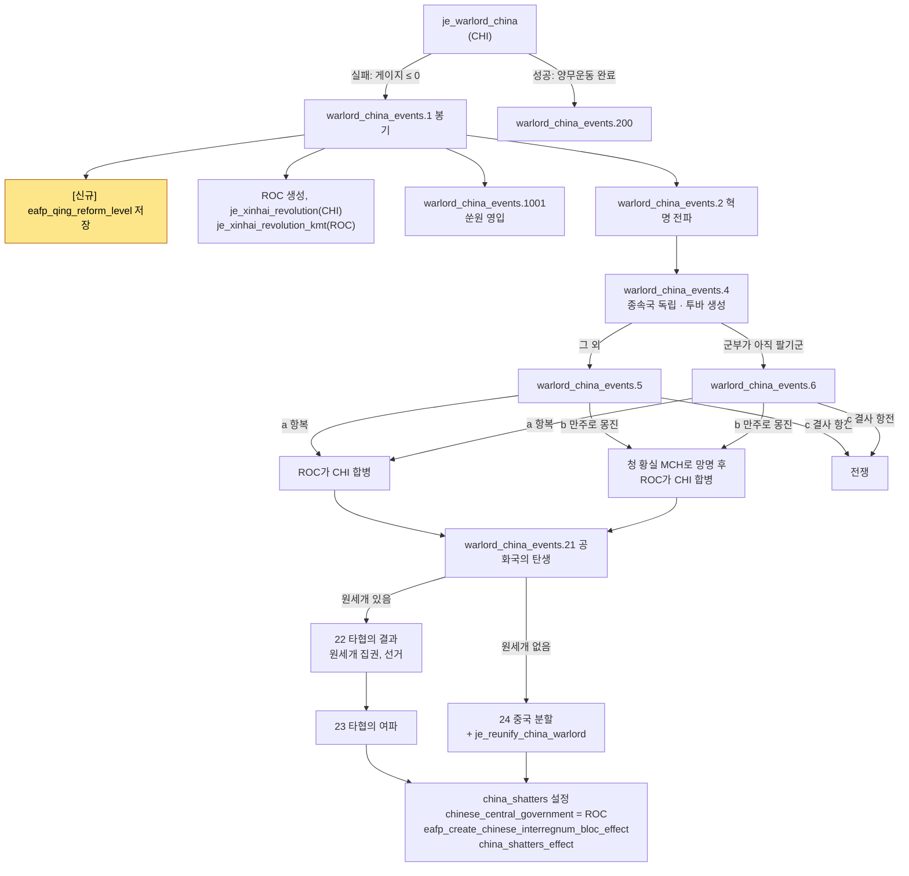
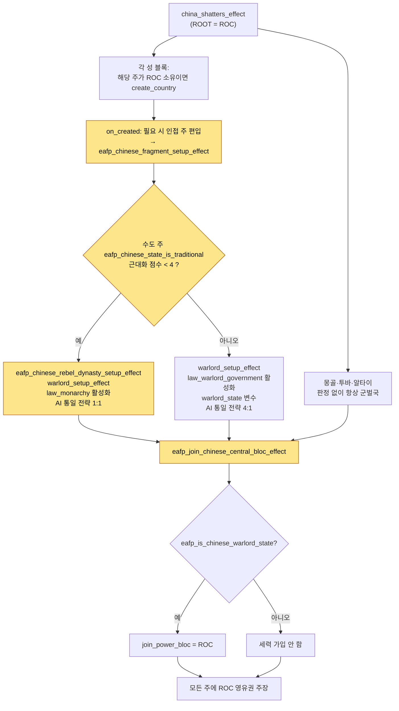
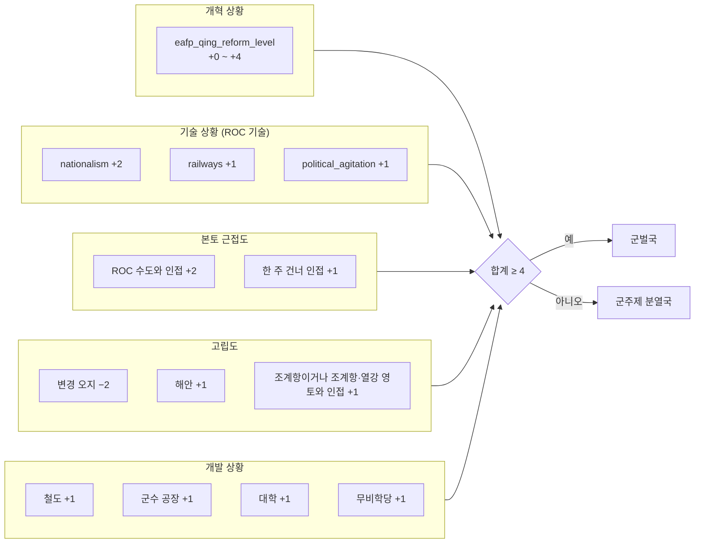
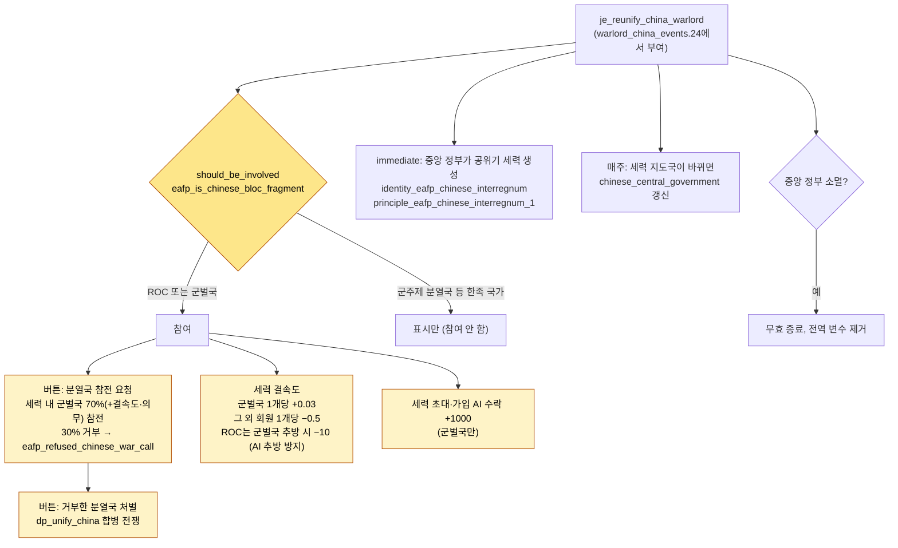
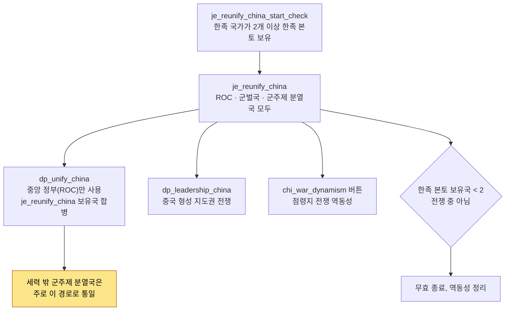

# `china-rebel-states` 브랜치 변경 사항

> 기준: `main`(2f0628da) 대비 `china-rebel-states`(fa588d0f, 커밋 1개)
> 커밋 메시지: **중국 붕괴 시 근대화 점수에 따라 군벌국·군주제 분열국으로 분열**

## 한눈에 보기

기존에는 신해혁명 뒤 중국이 붕괴하면(`china_shatters_effect`) 각 성에서 생기는 분열국이 **모두 군벌국**(군벌 정부 법률, 중화민국 세력 자동 가입)이었다.
이 브랜치에서는 분열국마다 **수도 주의 근대화 점수**를 계산해서 두 갈래로 나눈다.

| 구분 | 조건 | 법률 | 중화민국 세력 | 국명·국기 | AI 통일 전략 확률 |
|---|---|---|---|---|---|
| **군벌국** | 근대화 점수 **4 이상** | `law_warlord_government` | 자동 가입, 초대·결속도·참전 요청 대상 | 기존 군벌 국명 + **북양 오색기** | 20% (4:1) |
| **군주제 분열국** | 근대화 점수 **4 미만** | `law_monarchy` | 가입하지 않음, 세력 상호작용 대상에서 제외 | 역사 왕조명(초·대성국·후금…) + 전용 깃발 | 50% (1:1) |

두 유형 모두 중화민국(ROC)이 그 땅에 영유권 주장을 가진다.

### 변경 파일

| 파일 | 내용 |
|---|---|
| `common/script_values/eafp_chinese_fragment_values.txt` | **신규**: 근대화 점수 `eafp_chinese_fragment_modernity` |
| `common/scripted_triggers/eafp_chinese_interregnum_triggers.txt` | 신규 트리거 4개: `eafp_chinese_state_is_traditional`, `eafp_is_chinese_rebel_dynasty`, `eafp_is_chinese_warlord_state`, `eafp_is_chinese_bloc_fragment` |
| `common/scripted_effects/eafp_china_effects.txt` | 분열국 세팅을 공통 효과 3개로 정리하고 `china_shatters_effect`의 각 성 블록이 이를 호출하도록 변경. 서북(감숙) 분열국이 `YUE`로 잘못 생성되던 버그 수정(→ `XIB`) |
| `common/geographic_regions/eafp_geographic_regions.txt` | **신규** 지역 `geographic_region_eafp_chinese_hinterland`(변경 오지 14개 주) |
| `events/warlord_china_events.txt` | `warlord_china_events.1`(봉기)에서 양무운동 진척도를 전역 변수 `eafp_qing_reform_level`로 저장 |
| `common/journal_entries/eafp_00_reunify_china.txt` | `je_reunify_china_warlord` 참여 조건을 `eafp_is_chinese_bloc_fragment`로 변경 |
| `common/power_bloc_identities/…`, `common/script_values/eafp_power_bloc_values.txt`, `common/diplomatic_actions/eafp_invite_to_power_bloc.txt`, `common/scripted_buttons/eafp_chinese_interregnum_buttons.txt`, `common/scripted_effects/eafp_chinese_interregnum_effects.txt` | 세력 관련 판정을 모두 `eafp_is_chinese_fragment` → `eafp_is_chinese_bloc_fragment`로 교체 |
| `common/dynamic_country_names/eafp_china.txt` + 현지화 3종 | 군주제 분열국 국명 18개 |
| `common/flag_definitions/eafp_chi_flag_definitions.txt`, `common/coat_of_arms/coat_of_arms/eafp_china.txt` | 군벌국 오색기, 군주제 분열국 전용 깃발 18종 |

---

## 1. 전체 플레이 흐름

노란색 노드가 이 브랜치에서 새로 생기거나 바뀐 부분이다.

### 흐름 설명

1. **청 시기** — 청(CHI)은 `je_warlord_china`(군벌 폭발 게이지)와 `je_chinese_westernization`(양무운동)을 함께 진행한다. 양무운동의 하위 저널(육군·해군·산업·정부 개혁·국제적 위신) 하나를 끝낼 때마다 `chinese_westernization_var`가 1씩 오른다.
2. **분기점** — 양무운동을 다 끝내면 `je_warlord_china`가 성공으로 끝나고 중국은 붕괴하지 않는다. 그 전에 게이지가 0 이하로 떨어지면 신해혁명(`warlord_china_events.1`)이 터진다.
3. **[변경] 진척도 기록** — 봉기 이벤트가 터지는 순간의 양무운동 진척도를 `eafp_qing_reform_level` 전역 변수로 남긴다. 양무운동 저널을 시작하지 않았다면 0이다. 5를 채우면 혁명이 일어나지 않으므로 실제로 남는 값은 **0~4**다.
4. **혁명 진행** — 혁명 전파(.2) → 종속국 이탈(.4) → 최후통첩(.5/.6) → 항복 또는 몽진 시 ROC가 청을 합병하고 공화국의 탄생(.21)으로 넘어간다. 원세개 유무에 따라 .22→.23 또는 .24를 거쳐 `china_shatters_effect`가 실행된다.
5. **[변경] 분열국 유형 결정** — 각 성 분열국의 수도 주마다 근대화 점수를 계산한다. 4 이상이면 군벌국, 미만이면 군주제 분열국이 된다(아래 2.3절).
6. **공위기** — 군벌국은 ROC가 이끄는 공위기 세력에 들어가 `je_reunify_china_warlord`의 정치(참전 요청·처벌·결속도)에 참여한다. 군주제 분열국은 세력 밖에 남아 `je_reunify_china`의 무력 통일 대상이 된다.

---

## 2. 저널별 설명

### 2.1 `je_chinese_westernization` — 양무운동 (변경 없음, 근대화 점수 입력값)

이 저널 자체는 바뀌지 않았지만, 결과가 두 군데에서 근대화 점수로 들어간다.

- **개혁 상황**: 혁명 발발 시점의 진척도(0~4)를 모든 분열국 점수에 똑같이 더한다. 양무운동을 많이 진행할수록 중국 전역이 군벌국 쪽으로 기운다.
- **신식 군사 교육**: 무비학당이 세워진 주(`chi_military_academy_state`)는 +1을 받는다.

### 2.2 `je_warlord_china` / `je_xinhai_revolution` — 신해혁명 이벤트 사슬

이 사슬에서 바뀐 부분은 `warlord_china_events.1`의 `immediate` 블록뿐이다. 봉기 이벤트는 청(CHI) 스코프에서 실행되므로 청이 가진 `chinese_westernization_var`를 읽어서 `eafp_qing_reform_level`에 저장한다. 청은 곧 ROC에 합병되어 국가 변수가 사라지기 때문에 전역 변수로 남긴다.

### 2.3 중국 붕괴 — `china_shatters_effect`와 분열국 판정

#### 2.3.1 성별 처리 흐름

- 각 성 블록이 직접 쓰던 군벌 세팅 코드(법률·변수·AI 전략, 세력 가입·영유권 주장)를 `eafp_chinese_fragment_setup_effect`와 `eafp_join_chinese_central_bloc_effect`로 묶었다.
- 판정은 **새 국가의 수도 주**를 기준으로 한다. 인접 주를 함께 가져가는 분열국(안휘·호북·신강·서북·봉천 등)도 수도 주 점수 하나로 유형이 정해진다.
- **광서(GNG) 특례**: 광서가 군주제 분열국(대성국)이 되면 광동·소주 중 *각각 전통적인(점수 < 4) 주*를 대성국이 가져간다. 남은 주는 다음 블록에서 광동(YUE) 분열국이 된다.
- **버그 수정**: 영하가 없고 감숙만 남은 경우 서북 분열국이 `YUE` 태그로 생성되던 문제를 `XIB`로 고쳤다.
- 몽골(MGL)·투바(TUV)·알타이(ALI)는 판정 대상이 아니며 항상 군벌 정부 법률을 받는다.

#### 2.3.2 근대화 점수 `eafp_chinese_fragment_modernity`

주 스코프에서 계산한다(ROOT = 붕괴하는 중앙 정부 ROC). **4 이상이면 군벌국, 4 미만이면 군주제 분열국**이다.

| 항목 | 조건 | 점수 |
|---|---|---|
| 개혁 상황 | `eafp_qing_reform_level` | +0 ~ +4 |
| 기술 상황 | ROC가 `nationalism` 보유 | +2 |
| | ROC가 `railways` 보유 | +1 |
| | ROC가 `political_agitation` 보유 | +1 |
| 본토 근접도 | ROC 수도(북경) 주와 인접 | +2 |
| | (위가 아니면) 한 주 건너 수도와 인접 | +1 |
| 고립도 | `geographic_region_eafp_chinese_hinterland` 소속 | −2 |
| | 해안 주 | +1 |
| | 조계항이거나, 조계항·열강 소유 주와 인접 | +1 |
| 개발 상황 | 철도 건물 | +1 |
| | 군수 공장 | +1 |
| | 대학 | +1 |
| | 무비학당 주 (`chi_military_academy_state`) | +1 |

**변경 오지**(−2): 운남, 귀주, 광서, 사천, 중경, 서호북, 감숙, 영하, 청해, 알라샨, 톈산, 준가르, 제티수, 키르기지아

#### 2.3.3 성별 분열국과 군주제 국명·깃발

군주제 분열국의 국명·깃발은 `has_global_variable = china_shatters` + `eafp_is_chinese_rebel_dynasty = yes`(군주제 법률)일 때 우선순위 10/50으로 적용된다. 군벌국 기본 깃발은 북양 오색기(`coa = ROC`)다.

| 성 (수도 주) | 태그 | 군벌국 | 군주제 분열국 | 깃발 |
|---|---|---|---|---|
| 호남 | HNA | 호남 군벌 | **초** | 붉은 태양의 검은 깃발 |
| 광서 | GNG | 광서 군벌 | **대성국** | 천지회 홍건군의 붉은 깃발 |
| 남안휘 | AHU | 안휘 군벌 | **회남** | 염군의 황기 |
| 성경 (봉천) | MCH | 봉천 군벌 | **후금** | 팔기의 황룡기 |
| 산서 | SHN | 산서 군벌 | **진** | 흰 태양의 청색 깃발 |
| 톈산 (신강) | XIN | 신강 군벌 | **청진국** | 회민의 녹색 깃발 |
| 운남 | YUN | 운남 군벌 | **대리** | 황금 태양의 하늘색 깃발 |
| 귀주 | GUI | 귀주 군벌 | **대명** | 백호군의 흰 깃발 |
| 광동 / 소주 | YUE | 광동 군벌 | **남월** | 황금 태양의 녹색 깃발 |
| 사천 | SIH | 사천 군벌 | **순천국** | 순천군의 붉은 깃발 |
| 영하 / 감숙 | XIB | 서북 군벌 | **서하** | 회민의 흰 깃발 |
| 복건 | FJN | 복건 군벌 | **민** | 소도회의 청색 깃발 |
| 강서 | JGX | 강서 군벌 | **남당** | 황금 태양의 자주색 깃발 |
| 절강 | ZHE | 절강 군벌 | **오월** | 흰 구름의 청록색 깃발 |
| 동호북 / 서호북 | HUB | 호북 군벌 | **형남** | 검은 태양의 주황색 깃발 |
| 하남 | HEN | 하남 군벌 | **천순** | 천리교의 흰 깃발 |
| 중경 | CHQ | 중경 군벌 | **후촉** | 황룡의 갈색 깃발 |
| 서안 (섬서) | XIA | 섬서 군벌 | **대순** | 황금 태양의 검붉은 깃발 |
| 울리아스타이 / 투바 / 알타이 | MGL / TUV / ALI | 항상 군벌국 | — | — |

만주로 망명한 청 황실(`imperial_family_exiled`)은 우선순위 100인 대청 국명·깃발이 그대로 유지되어 후금으로 바뀌지 않는다.

### 2.4 `je_reunify_china_warlord` — 중국 공위기 (세력 정치)

이 저널과 딸린 세력 시스템은 이제 **ROC와 군벌국만** 대상으로 한다. 판정 기준을 한족 국가 전체(`eafp_is_chinese_fragment`)에서 `eafp_is_chinese_bloc_fragment`(중앙 정부이거나 군벌 정부 법률을 가진 한족 국가)로 바꿨다.

| 시스템 | 파일 | 변경 결과 |
|---|---|---|
| 저널 참여 | `eafp_00_reunify_china.txt` | 군주제 분열국은 저널을 볼 수는 있으나 참여하지 않음 |
| 세력 초대 외교 행동 | `eafp_invite_to_power_bloc.txt` | 군벌국만 초대 가능 |
| 결속도 정체성 | `eafp_power_bloc_identities.txt` | 군벌국만 +0.03, 군주제 분열국은 일반 외부 회원처럼 −0.5 |
| AI 가입·초대 수락 | `eafp_power_bloc_values.txt` | +1000 보너스는 군벌국만 |
| 참전 요청 버튼 | `eafp_chinese_interregnum_buttons.txt` | 군벌국만 소집. 군주제 분열국과의 전쟁도 "외부 세력과의 전쟁"으로 인정되어 버튼 사용 가능 |
| 거부 분열국 처벌 버튼 | 같은 파일 | 군벌국만 처벌 대상 |
| 평화 재통일 효과 | `eafp_chinese_interregnum_effects.txt` | 군벌국만 합병 (현재 호출하는 곳 없음) |

### 2.5 `je_reunify_china` — 무력 통일 (변경 없음)

저널 코드는 바뀌지 않았다. 다만 군주제 분열국은 공위기 세력에 들어가지 않으므로, ROC 입장에서는 이 저널의 `dp_unify_china`(합병 외교 분쟁)로 통일하는 것이 주된 방법이 된다. 군주제 분열국은 AI 통일 전략 확률이 50%로 높아서 서로 또는 ROC와 먼저 전쟁을 걸 가능성도 크다.

---

## 3. 검토 메모

- **봉천(MCH)·알타이(ALI) 블록 조건**: 두 블록은 `s:STATE_…region_state:CHI` 존재를 조건으로 한다. 항복·몽진 경로에서는 붕괴 전에 ROC가 CHI를 합병하므로 이 조건이 거의 성립하지 않는다. 이번 브랜치에서 바뀐 부분은 아니지만, 이 때문에 **후금이 실제로 등장하지 않을 수 있다**.
- **법률 변경에 따른 유형 전환**: `eafp_is_chinese_rebel_dynasty`와 `eafp_is_chinese_warlord_state`는 법률만 본다. 군벌국이 나중에 군주제로 바꾸면 세력 상호작용 대상에서 빠지고 결속도 기여가 +0.03에서 −0.5로 바뀐다. 군주제 분열국이 군주제를 폐지하면 어느 쪽에도 속하지 않는다.
- **`warlord_state` 변수**: 군벌국에만 설정되고 군주제 분열국에는 설정되지 않는다. 현재 모드 안에서는 이 변수를 읽는 곳이 없지만, 바닐라나 다른 모드가 참조하면 군주제 분열국은 그 대상에서 빠진다.
- **게임 내 미검증**: 이 문서는 코드를 읽고 작성했다. 실제 플레이에서 점수 분포(어느 성이 몇 점이 나오는지)는 확인하지 않았다.
