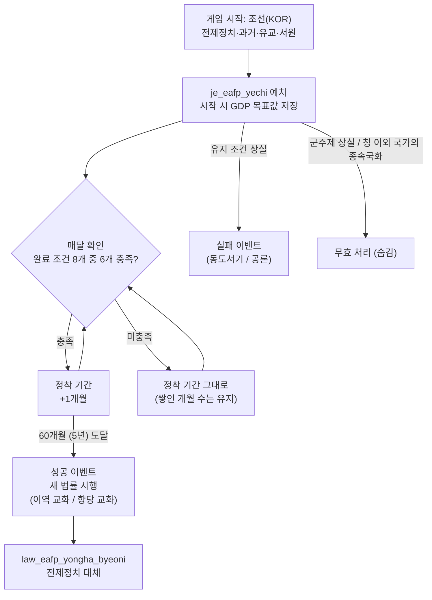

# `joseon-confucian-absolutism` 브랜치 계획: 예치 저널과 용하변이 법률

> 기준: `main`(76f2c15f)에서 분기
> 참고 원형: 바닐라 오스트리아 `je_austrian_neo_absolutism`(신 절대주의) → `law_neo_absolutism`

## 한눈에 보기

조선이 **정통 유교 체제**(전제정치·과거·유교·서원)를 끝까지 지키며 여러 조건을 채우면, 전제정치(`law_autocracy`)를 **조선 전용 하위 법률**로 바꾸는 저널을 만든다.
새 법률 **용하변이(用夏變夷)**는 일반 전제정치의 정치적 성격을 물려받되, 효과는 **종교 개종과 문화 동화**에 집중한다.

바닐라 신 절대주의와 달리 **버튼도, 진행 막대도 없다.** 체제를 지킨 채로 국가 상태(경제·왕권·유림의 지지·개종·동화·교육)를 만들어 내고, **그 상태를 5년 동안 이어 가면** 완료된다. 진행 상황은 바닐라 「덴포 위기」(`je_tenpo_crisis`)처럼 저널 본문의 **체크박스 목록**과 **정착 기간(개월)**으로 보여 준다.

| 구분 | 바닐라 오스트리아 | 이 브랜치 (조선) |
|---|---|---|
| 저널 | `je_austrian_neo_absolutism` 신 절대주의 | `je_eafp_yechi` **예치(禮治)** |
| 활성화 | 게임 시작부터 | 게임 시작부터 |
| 유지할 체제 | 전제정치 + 비밀경찰 | **전제정치 + 과거 관료제 + 유교 국교 + 서원 수정안** |
| 지지 세력 | 소부르주아가 정부에서 강력 | 유림(`ig_devout`) 또는 양반(`ig_landowners`)이 정부에서 강력, 또는 군주 소속 |
| 진행 표시 | 헌정 압력 막대 (100 도달 시 실패) | **막대 없음.** 조건별 체크박스 + 정착 기간 `N/60개월` (조건 충족 중에만 늘어남) |
| 버튼 | 교황 정교협약 / 봉건 의무 폐지 / 왕령지 자치 폐지 | **없음** |
| 완료 조건 | 6개 중 4개 충족 즉시 | **8개 중 6개를 충족한 상태로 5년** (아래 3.3·3.4절) |
| 실패 | 헌정 압력 100 등 | **유지 조건 상실** (아래 3.5절) |
| 보상 법률 | `law_neo_absolutism` (관료 정치력, 권위) | `law_eafp_yongha_byeoni` **용하변이(用夏變夷)**, 개종·동화 특화 |

---

## 1. 바닐라 원형 분석 (`05_austria_journal_entries.txt`)

| 요소 | 바닐라 구현 | 조선판에서 가져올 것 |
|---|---|---|
| `possible` | 전제정치·비밀경찰 유지, 왕령지/동군연합 종속국 없음, 소부르주아 강력 | 체제 유지 조건 + 지지 세력 조건 구조 그대로 |
| `immediate` | 시작 시 GDP를 `austrian_gdp_var`에 저장 | 시작 시점 GDP × 1.5를 목표값으로 저장 (덴포 위기의 `tenpo_gdp_goal`처럼 목표값을 저장해 본문에 그대로 보여 줌) |
| `modifiers_while_active` | `modifier_austrian_state_police` | 진행 중 상시 모디파이어 1개 |
| 진행 막대 | `default_bad` 헌정 압력. 매달 여러 요인으로 증감, 100이면 실패 | **가져오지 않음.** 막대 대신 덴포 위기식 체크박스 목록과 정착 개월 수를 본문에 표시한다 (3.3절) |
| 버튼 3개 | 누르면 변수 설정 + 막대 ±10 + 부수 효과 | **가져오지 않음.** 버튼 몫의 완료 조건은 국가 상태 조건으로 바꾼다 |
| 성공 | `calc_true_if amount >= 4` → `austria_events.1` 팝업에서 `law_neo_absolutism` 즉시 시행 선택, 전역 변수로 법률 노출 | 완료 조건을 갖춘 달이 60개월(5년) 쌓이면 성공. 노출 조건은 **국가 변수**로 (조선 전용이므로) |
| 실패 | 막대 100 / 헝가리 동군연합 / 전제정치·비밀경찰 상실 | 유지 조건 상실 (이벤트) / 군주제 상실·종속국화 (무효) |
| 법률 | `parent = law_autocracy`, `requires_law_or = law_monarchy`, `law_autocracy`의 `is_visible`에서 숨김 처리 | 같은 구조. 단 **`law_autocracy`는 재정의하지 않음** (4.4절) |

---

## 2. 기존 조선 콘텐츠와의 관계

새 체계를 따로 만들기보다 이미 있는 조선 상태를 조건과 입력값으로 재사용한다.

| 기존 요소 | 위치 | 이 저널에서의 쓰임 |
|---|---|---|
| `law_scholar_bureaucrats` (과거 관료제) | `common/laws/eafp_bureaucracy.txt` | 유지 조건 |
| `amendment_seowon` (서원 수정안) | `common/amendments/eafp_amendments_historical.txt:68`, 시작 설정 `kor - korea.txt` | 유지 조건. 이 수정안 자체가 개종·동화 +20%를 주므로 용하변이 법률과 성격이 이어진다 |
| `eafp_var_sam_all_clear` (삼정의 문란 해결) | `eafp_korean_journal.txt:764` 등 | 완료 조건 하나로 그대로 사용 |
| `je_sedo_politics` (세도정치) | `eafp_korean_journal.txt:1124` | 이 저널이 끝났으면 완료 조건 「세도정치 종식」 충족 |
| `je_korean_confu` 「유학의 왕국」 + `eafp_progress_bar_confu` (세계 인식) | `eafp_korean_journal.txt` | 실패 이벤트에서 세계 인식 막대를 +100 올린다 (3.6절) |
| 근대 개혁 저널 `je_korean_reformation_*` | `eafp_korean_reformation.txt` | **연결하지 않는다.** 두 저널은 서로 영향 없이 함께 진행할 수 있다 |

---

## 3. 저널 설계: `je_eafp_yechi` 예치(禮治)

### 3.1 흐름



### 3.2 유지 조건과 시작 조건 (`possible`)

**유지 조건**: 아래 네 가지는 시작할 때도, 진행하는 내내도 지켜야 한다. 하나라도 잃으면 실패 이벤트가 뜬다(3.5절).

| 조건 | 판정 |
|---|---|
| 전제정치 | `has_law_or_variant = law_type:law_autocracy` |
| 과거 | `has_law = law_type:law_scholar_bureaucrats` |
| 유교 | `has_law = law_type:law_state_religion` 이고 `country_has_state_religion = rel:confucian` |
| 서원 | `any_active_law = { has_amendment = amendment_type:amendment_seowon }` (모드의 기존 `has_amendment` 사용법과 같다) |

나머지 시작 조건:

- `c:KOR ?= this`
- `has_law = law_type:law_monarchy` (용하변이 법률의 `requires_law_or`)
- 유림(`ig_devout`) 또는 양반(`ig_landowners`)이 정부에 있고 `is_powerful = yes`, 또는 군주가 둘 중 한 곳 소속

시작 시 조선의 집권 IG는 양반뿐이라, 유림만 조건으로 두면 시작부터 진행할 수 없다. 그래서 양반도 지지 세력으로 넣었다.
조선 히스토리 파일은 종교 법률을 직접 지정하지 않으므로, 기본값이 `law_state_religion`인지 구현 전에 확인한다. 서원 수정안은 히스토리에서 교육 법률 그룹에 붙이는데 정의상 `parent = law_state_religion`이므로, 실제로 어느 법률에 붙는지도 구현 전에 확인한다.

`is_shown_in_lobby` / `is_shown_when_inactive`는 바닐라처럼 `c:KOR ?= this` + 군주제일 때 보이게 한다. 한 번 실패하면 다시 못 하도록 바닐라와 같은 실패 변수(`je_eafp_yechi_failed_var`)를 둔다. 실패 이력은 현재 상태로 복원할 수 없는 정보이므로 변수가 필요하다.

### 3.3 조건 체크리스트와 정착 기간

진행 막대를 쓰지 않는다. 바닐라 「덴포 위기」(`je_tenpo_crisis`)와 모드의 「삼정이정청」(`je_samjeong_ijeongcheong`)처럼, 저널 본문(`_reason`) 끝에 **조건마다 체크박스**를 붙여 보여 주고, 목록 맨 위 한 줄에 **충족한 조건 수**와 **정착 기간**을 함께 적는다. 개월 수는 조건을 6개 이상 갖춘 달만 센다.

게임 안에서는 대략 이렇게 보인다(☑ = `checkbox_ticked`, ☐ = `checkbox_unticked`).

```
예치의 정착
☑ 완료 조건을 6개 이상(현재 6/8) 갖춘 채 23/60개월을 지냄
• ☑ GDP가 £1.2M 이상임
• ☐ 삼정의 폐단이 전부 혁파됨
• ☑ 청의 종속국이 아니거나 청이 무너졌으며, 강대국 이상임
• ☑ 세도정치가 끝남
• ☑ 성리학자 세력이 정부에 있고 승인도가 10 이상임
• ☐ 한국 본토 밖의 주 하나 이상에서 한국 문화 인구가 50% 이상임
• ☑ 문해율이 30% 이상임
• ☑ 인구의 90% 이상이 유교를 믿음
```

| 항목 | 방식 |
|---|---|
| 조건 체크박스 | 조건마다 custom loc 하나. 충족이면 `checkbox_ticked`, 아니면 `checkbox_unticked` (바닐라 키, 세 언어 모두 있음) |
| 충족 개수 | 스크립트 값 `eafp_yechi_conditions_completed` (0~8) |
| 정착 기간 | 국가 변수 `eafp_var_yechi_months`. 저널 `on_monthly_pulse`에서 충족 개수가 6 이상이면 +1 |
| 조건이 깨졌을 때 | 그달은 늘지 않는다. **쌓인 개월 수는 그대로** 남고, 조건을 다시 갖추면 이어서 센다 |
| 완료 | `eafp_var_yechi_months >= 60` |

**정의가 한 곳에만 있도록** 조건 8개를 각각 scripted trigger로 만든다. 각 트리거는 스크립트 값(개수 세기)과 체크박스 custom loc 두 곳에서 쓴다. 덴포 위기는 체크박스 판정과 개수 판정을 따로 적어 "둘을 맞춰 고칠 것"이라는 주석을 달아 두었는데, 트리거로 묶으면 그럴 필요가 없다.

```
# common/scripted_triggers/eafp_kor_triggers.txt
eafp_yechi_cond_gdp = {
	has_variable = eafp_var_yechi_gdp_goal
	gdp >= var:eafp_var_yechi_gdp_goal
}
eafp_yechi_cond_samjeong = { has_variable = eafp_var_sam_all_clear }
eafp_yechi_cond_sojunghwa = { ... }
eafp_yechi_cond_sedo = { NOT = { has_journal_entry = je_sedo_politics } }
eafp_yechi_cond_devout = { ... }
eafp_yechi_cond_iyeok = { ... }
eafp_yechi_cond_literacy = { literacy_rate >= 0.3 }
eafp_yechi_cond_confucian = { ... }
# 판정 내용은 3.4절 표
```

```
# common/script_values/eafp_kor_values.txt
eafp_yechi_conditions_completed = {
	value = 0
	if = { limit = { eafp_yechi_cond_gdp = yes } add = 1 }
	if = { limit = { eafp_yechi_cond_samjeong = yes } add = 1 }
	# ... 8개 모두 같은 형식
}
```

```
# common/customizable_localization/eafp_KOR_custom_loc.txt
eafp_yechi_checkbox_gdp = {
	type = country
	text = {
		trigger = { eafp_yechi_cond_gdp = yes }
		localization_key = checkbox_ticked
	}
	text = {
		localization_key = checkbox_unticked
	}
}
# 조건 8개 + 맨 위 요약 줄(eafp_yechi_checkbox_conditions, 지금 6개 이상이면 체크)까지 9개
```

```
# 저널 je_eafp_yechi
immediate = {
	set_variable = {
		name = eafp_var_yechi_gdp_goal
		value = { value = root.gdp multiply = 1.5 }
	}
	set_variable = { name = eafp_var_yechi_months value = 0 }
}

on_monthly_pulse = {
	effect = {
		if = {
			limit = { eafp_yechi_conditions_completed >= 6 }
			change_variable = { name = eafp_var_yechi_months add = 1 }
		}
	}
}

# 성공 outcome
trigger = {
	custom_tooltip = {
		text = je_eafp_yechi_settled_tt
		var:eafp_var_yechi_months >= 60
	}
}
```

- 바닐라 덴포 위기처럼 GDP는 **목표값 자체**(시작 GDP × 1.5)를 저장한다. 그래야 본문에 목표 금액을 `[…Var('eafp_var_yechi_gdp_goal').GetValue|k0]`로 바로 보여 줄 수 있다.
- 정착 기간은 막대가 없으므로 변수에 담아야 한다. 조건이 깨져도 쌓인 값이 남아야 해서 현재 상태로 다시 계산할 수 없다.
- 성공·실패·무효 처리 때 `eafp_var_yechi_gdp_goal`, `eafp_var_yechi_months`를 지운다.
- 상태 문구(`status_desc`)도 `eafp_yechi_conditions_completed >= 6` 여부로 「멈춰 있음 / 자리를 잡아 가고 있음」을 고른다.
- 기간(5년)은 초안이다.

### 3.4 완료 조건 (8개 중 6개)

국가 상태 조건 8개 가운데 **6개 이상**을 갖춘 달에만 정착 기간이 늘어난다. 각 조건은 괄호 안의 이름으로 `eafp_yechi_cond_*` scripted trigger가 되고(3.3절), 저널 본문에 체크박스 한 줄씩으로 보인다. GDP 목표값 말고는 모두 현재 상태를 직접 읽는다.

**부국강병·체제**

| # | 조건 | 판정 (초안) | 비고 |
|---|---|---|---|
| 1 | **부국(富國)** (`_gdp`): GDP가 시작 시점의 1.5배 이상 | `gdp >= var:eafp_var_yechi_gdp_goal` (시작 GDP × 1.5) | 바닐라와 같은 배율. 덴포 위기처럼 목표값을 저장해 본문에 금액을 보여 준다 |
| 2 | **삼정 해결** (`_samjeong`) | `has_variable = eafp_var_sam_all_clear` | 기존 변수 재사용 |
| 3 | **소중화 계승** (`_sojunghwa`): 청의 종속국이 아니거나 청 붕괴 후(`china_shatters`), 독립국이고 위상 `major_power` 이상 | `is_subject = no` + 국가 위상 | 바닐라의 "열강 3위 + 프로이센 견제" 대응 |
| 4 | **세도정치 종식** (`_sedo`) | `NOT = { has_journal_entry = je_sedo_politics }` | 외척 세도가를 누르고 군주 중심 체제를 세운 상태. `je_korean_fading_power`가 쓰는 판정과 같다 |
| 5 | **유림의 지지** (`_devout`): 유림이 정부에 있고 승인도 10 이상 | `ig:ig_devout = { is_in_government = yes  ig_approval >= 10 }` | 체제를 떠받치는 사림의 지지 |

**교화·동화**

| # | 조건 | 판정 (초안) | 비고 |
|---|---|---|---|
| 6 | **이역 동화(異域同化)** (`_iyeok`): 한국 본토 밖의 주를 하나 이상 가지고, 그 주의 한국 문화 비율 50% 이상 | `any_scope_state = { NOT = { is_homeland_of_country_cultures = root }  culture_percent_state = { target = cu:korean value >= 0.5 } }` | 간도·만주 등. 고향 땅 동화(`state_allow_assimilation_in_homeland_bool`)와 짝을 이루어 **용하변이와 가장 직접 이어지는 조건** |
| 7 | **서원 교육 성과** (`_literacy`): 문해율 30% 이상 | `literacy_rate >= 0.3` | 서원을 지킨 교육의 결과 |
| 8 | **교화(敎化)** (`_confucian`): 국내 인구의 유교 신자 비율 90% 이상 | `religion_percent_country = { target = rel:confucian value >= 0.9 }` | 개종 성과 |

**구현 전 확인할 점**

- **세도정치 종식**: `je_sedo_politics`는 성공해도 남기는 변수가 없다(`eafp_var_je_sedo_politics_balance`를 지운다). 그래서 성공과 무효 종료를 구분하지 못하고 "저널이 끝났음"으로만 판정한다. 성공만 인정하려면 성공 효과에 변수 하나를 추가해야 하는데, 기존 `je_korean_fading_power`가 같은 판정을 쓰므로 그대로 따른다.
- **이역 동화**: 조선 본토의 주는 모두 한국 문화의 고향이라 해당하지 않는다. 시작 시점 조선이 본토 밖 주를 갖고 있지 않은지 확인한다.
- **기준값**: 문해율 30%, 유교 90%, 이역 동화 50%는 초안이다. 1836년 조선의 실제 문해율과 신자 비율을 게임에서 확인하고 조정한다.

### 3.5 실패 조건

| 결과 | 조건 | 처리 |
|---|---|---|
| 실패 (이벤트) | 유지 조건(전제정치·과거·유교·서원) 중 하나라도 상실 | 실패 이벤트 `eafp_kor_yechi.2`. 실패 변수 설정 |
| 무효 (숨김) | 군주제 상실, 또는 청 이외 국가의 종속국이 됨 | 실패 변수만 설정, 정리. 이벤트 없음 |

압력 막대가 없으므로, 실패는 플레이어나 AI가 체제를 바꿨을 때만 일어난다.

서원 수정안은 의회 절차로 폐지될 수 있고, AI는 `ai_will_revoke` 조건(국교·양심의 자유 법률이 아닐 때)에서 폐지한다. 폐지되면 바로 실패하므로 저널 툴팁에 경고를 띄운다.

### 3.6 이벤트 설계 (`events/eafp_kor_yechi_events.txt`)

이벤트는 두 개다. 각 이벤트의 선택지는 서로 정반대가 아니라, **같은 결말을 받아들이면서 강조점만 다르게** 짰다.

#### `eafp_kor_yechi.1` 예악이 바로 서다 (성공)

바닐라 `austria_events.1`처럼 팝업으로 띄운다. 어느 선택지를 골라도 용하변이를 시행한다. 차이는 교화를 **밖(이역)으로 넓히느냐, 안(백성)에서 다지느냐**다.

| | 공통 효과 |
|---|---|
| 해금 | 국가 변수 `eafp_yechi_law_unlocked` 설정 (전제정치로 되돌린 뒤에도 법률 화면에 남게 함) |
| 법률 | `activate_law = law_type:law_eafp_yongha_byeoni` |

| 선택지 | 방향 | 모디파이어 (`long_modifier_time`, 10년) | 효과 (초안) |
|---|---|---|---|
| `.a` 중화의 도로 이역을 바꾸리라 | 새로 얻은 땅의 동화 | `eafp_modi_yechi_iyeok_gyohwa` **이역 교화(異域敎化)** | `state_assimilation_mult` +0.25, `country_authority_add` +50 |
| `.b` 안을 먼저 바로 세운 뒤에 밖을 교화하리라 | 국내 개종과 교육 | `eafp_modi_yechi_hyangdang_gyohwa` **향당 교화(鄕黨敎化)** | `state_conversion_mult` +0.25, `state_education_access_add` +0.05, `interest_group_ig_devout_approval_add` +2 |

AI 가중치는 이역(만주·간도 등)의 주를 가지고 있으면 `.a`, 아니면 `.b` 쪽으로 준다.

#### `eafp_kor_yechi.2` 흔들리는 사문 (실패)

유지 조건 가운데 하나를 잃었을 때 뜬다. 어느 선택지를 골라도 예치는 실패한다. 차이는 개화를 **기술로만 받아들이느냐, 공론의 장에 들이느냐**다. 어느 쪽도 개화를 탄압하거나 유교를 버리지 않는다.

두 선택지 모두 이득과 손해를 함께 준다. 어느 한쪽이 "좋은 선택"이 되지 않도록, 손해가 이득과 같은 원인에서 나오게 짰다(서양 기물을 들이면 서학도 따라 들어오고, 공론을 열면 왕명의 무게가 줄어든다).

| | 공통 효과 |
|---|---|
| 실패 기록 | 실패 변수 `je_eafp_yechi_failed_var` 설정 (재시작 불가) |
| 세계 인식 | `je:je_korean_confu ?= { add_progress = { value = 100 name = eafp_progress_bar_confu } }` (「유학의 왕국」 세계 인식 막대 가속) |

| 선택지 | 방향 | 모디파이어 (`normal_modifier_time`, 5년) | 이득 | 손해 | 양면 |
|---|---|---|---|---|---|
| `.a` 서양의 기물은 취하되, 우리의 도는 지킨다 | 동도서기: 기술은 받아들이고 사상은 지킨다 | `eafp_modi_yechi_dongdo_seogi` **동도서기(東道西器)** | 주간 혁신 +5 (`country_weekly_innovation_add`), 개화파 승인도 +2 | 유림 승인도 -2, 개종 -10% (`state_conversion_mult`, 기물과 함께 서학이 들어옴), 정치 운동발 급진화 +10% (`state_radicals_from_political_movements_mult`) | — |
| `.b` 공론을 열어 양쪽의 말을 함께 듣는다 | 유생과 개화파를 함께 조정에 들인다 | `eafp_modi_yechi_gongnon` **공론(公論)** | 정통성 +5 (`country_legitimacy_base_add`) | 권위 -50 (`country_authority_add`, 왕명보다 공론이 앞섬) | 유림·개화파 정치력 각 +10% (`interest_group_ig_*_pol_str_mult`). 두 세력이 함께 커져 양반의 자리가 줄고, 조정이 둘로 갈린다 |

모디파이어 4개는 모두 `common/static_modifiers/eafp_korea_rework_modi.txt`에 추가한다. 아이콘은 「유학의 왕국」 모디파이어와 같은 `gfx/interface/icons/religion_icons/confucianism.dds`를 기본으로 쓴다. 모디파이어 키 이름은 `documentation/modifiers.log`에서 확인했다.

```
eafp_modi_yechi_iyeok_gyohwa = {	# 예치 성공 .a
	icon = gfx/interface/icons/religion_icons/confucianism.dds
	state_assimilation_mult = 0.25
	country_authority_add = 50
}
eafp_modi_yechi_hyangdang_gyohwa = {	# 예치 성공 .b
	icon = gfx/interface/icons/religion_icons/confucianism.dds
	state_conversion_mult = 0.25
	state_education_access_add = 0.05
	interest_group_ig_devout_approval_add = 2
}
eafp_modi_yechi_dongdo_seogi = {	# 예치 실패 .a
	icon = gfx/interface/icons/religion_icons/confucianism.dds
	country_weekly_innovation_add = 5
	interest_group_ig_intelligentsia_approval_add = 2
	interest_group_ig_devout_approval_add = -2
	state_conversion_mult = -0.1
	state_radicals_from_political_movements_mult = 0.1
}
eafp_modi_yechi_gongnon = {	# 예치 실패 .b
	icon = gfx/interface/icons/religion_icons/confucianism.dds
	country_legitimacy_base_add = 5
	country_authority_add = -50
	interest_group_ig_devout_pol_str_mult = 0.1
	interest_group_ig_intelligentsia_pol_str_mult = 0.1
}
```

### 3.7 이벤트 텍스트 예제

이벤트 2개와 모디파이어 4개 이름의 현지화 초안이다. 모디파이어 설명(`_desc`)은 게임에서 쓰이지 않으므로 두지 않는다. 키는 `eafp_manchuria` 등 기존 조선 이벤트와 같은 `.t/.d/.f/.a` 규칙을 따른다.

`.1`의 플레이버는 『맹자』 「등문공 상」의 실제 구절(법률 이름의 출전)이다. `.2`의 플레이버는 실존 인물이나 문헌을 인용하지 않은 창작 장면이다.

**한국어** (`localization/korean/eafp_kor_yechi_l_korean.yml`)

```yaml
l_korean:
 eafp_kor_yechi.1.t: "예악이 바로 서다"
 eafp_kor_yechi.1.d: "[ROOT.GetCountry.GetName]의 조정이 끝내 조종의 법도를 고치지 아니하고 나라를 부강하게 하다. 이에 예로 다스리는 법을 나라의 큰 법으로 삼기로 하였으나, 교화를 안에서부터 펼칠지 밖에서부터 펼칠지를 두고 신료들의 의논이 갈리다."
 eafp_kor_yechi.1.f: "\"나는 중화의 도로 오랑캐를 변화시켰다는 말은 들었어도, 오랑캐에게 변화되었다는 말은 듣지 못하였다.\"\n\n— 『맹자』 「등문공 상」"
 eafp_kor_yechi.1.a: "중화의 도로 이역을 바꾸리라."
 eafp_kor_yechi.1.b: "안을 먼저 바로 세운 뒤에 밖을 교화하리라."

 eafp_kor_yechi.2.t: "흔들리는 사문"
 eafp_kor_yechi.2.d: "개화를 요구하는 목소리에 밀려 [ROOT.GetCountry.GetName]의 조정이 끝내 조종의 법도 가운데 하나를 고치다. 젊은 관료와 유생 사이에서도 서양의 학문과 제도를 받아들여야 한다는 주장이 공공연히 나오니, 예치를 지키려던 뜻은 사실상 꺾였다. 남은 것은 이 변화를 어떤 모습으로 받아들일지다."
 eafp_kor_yechi.2.f: "성균관 명륜당 앞마당에 유생들이 모여 있었다. 한쪽에서는 척사의 상소를 올리자고 외쳤고, 다른 한쪽에서는 소매 속에 감춰 온 번역서를 만지작거렸다.\n\n늙은 대사성은 그 광경을 한참 바라보다가 말없이 돌아섰다. 그가 젊었을 때만 해도 이 마당에서 그런 책을 꺼내는 이는 없었다."
 eafp_kor_yechi.2.a: "서양의 기물은 취하되, 우리의 도는 지킨다."
 eafp_kor_yechi.2.b: "공론을 열어 양쪽의 말을 함께 듣는다."

 eafp_modi_yechi_iyeok_gyohwa: "이역 교화"
 eafp_modi_yechi_hyangdang_gyohwa: "향당 교화"
 eafp_modi_yechi_dongdo_seogi: "동도서기"
 eafp_modi_yechi_gongnon: "공론"
```

**영어** (`localization/english/eafp_kor_yechi_l_english.yml`)

```yaml
l_english:
 eafp_kor_yechi.1.t: "Rites Restored"
 eafp_kor_yechi.1.d: "The court of [ROOT.GetCountry.GetName] has made the realm rich and strong without altering a single statute of the founding kings. It now resolves to make rule by ritual the great law of the land, yet the ministers are divided on whether its civilizing work should begin at home or beyond the frontier."
 eafp_kor_yechi.1.f: "\"I have heard of men using the doctrines of our great land to change barbarians, but I have never yet heard of any being changed by barbarians.\"\n\n— Mencius, Teng Wen Gong I (trans. James Legge)"
 eafp_kor_yechi.1.a: "We shall transform the frontier by the Way of the civilized."
 eafp_kor_yechi.1.b: "First set our own house in order, then civilize what lies beyond."

 eafp_kor_yechi.2.t: "The Way Shaken"
 eafp_kor_yechi.2.d: "Yielding to the calls for enlightenment, the court of [ROOT.GetCountry.GetName] has at last altered one of the statutes of the founding kings. Even among young officials and Confucian students, voices openly urge the adoption of Western learning and institutions, and the resolve to uphold rule by ritual has all but broken. What remains is to decide what shape this change will take."
 eafp_kor_yechi.2.f: "The students had gathered in the courtyard before the Myeongnyundang. Some shouted for a memorial against heterodoxy; others fingered translated books hidden in their sleeves.\n\nThe aged rector watched for a long while, then turned away without a word. In his youth, no one would have dared bring such books into this courtyard."
 eafp_kor_yechi.2.a: "We shall take Western tools, but keep our own Way."
 eafp_kor_yechi.2.b: "Let public opinion be heard from both sides."

 eafp_modi_yechi_iyeok_gyohwa: "Civilizing the Frontier"
 eafp_modi_yechi_hyangdang_gyohwa: "Civilizing the Villages"
 eafp_modi_yechi_dongdo_seogi: "Eastern Ways, Western Machines"
 eafp_modi_yechi_gongnon: "Public Deliberation"
```

**중국어 간체** (`localization/simp_chinese/eafp_kor_yechi_l_simp_chinese.yml`)

```yaml
l_simp_chinese:
 eafp_kor_yechi.1.t: "礼乐复正"
 eafp_kor_yechi.1.d: "[ROOT.GetCountry.GetName]朝廷终未更改祖宗之法，而国以富强。于是议以礼治为国之大典，然教化当先行于内抑或先及于外，群臣议论不一。"
 eafp_kor_yechi.1.f: "“吾闻用夏变夷者，未闻变于夷者也。”\n\n——《孟子·滕文公上》"
 eafp_kor_yechi.1.a: "用夏变夷，教化四方。"
 eafp_kor_yechi.1.b: "先正其内，而后化其外。"

 eafp_kor_yechi.2.t: "斯文动摇"
 eafp_kor_yechi.2.d: "迫于开化之议，[ROOT.GetCountry.GetName]朝廷终改祖宗之法其一。年轻官员和儒生之中亦有人公开主张引进西方学问与制度，维护礼治之志实已受挫。如今只剩下一个问题：以何种方式接纳这一变化。"
 eafp_kor_yechi.2.f: "成均馆明伦堂前的院子里聚满了儒生。一边高呼要上疏斥邪，另一边却摩挲着藏在袖中的译书。\n\n年迈的大司成久久凝望着这一幕，最终一言不发地转身离去。在他年轻的时候，没有人敢在这院子里拿出那样的书。"
 eafp_kor_yechi.2.a: "取西洋之器，守吾东方之道。"
 eafp_kor_yechi.2.b: "广开公论，兼听两方之言。"

 eafp_modi_yechi_iyeok_gyohwa: "异域教化"
 eafp_modi_yechi_hyangdang_gyohwa: "乡党教化"
 eafp_modi_yechi_dongdo_seogi: "东道西器"
 eafp_modi_yechi_gongnon: "公论"
```

구현 시 확인할 점:

- 실제 파일은 UTF-8 BOM, CRLF로 저장한다. 파일명은 기존 조선 현지화 파일 규칙에 맞춰 정한다.
- 영어 `.1.f`는 James Legge의 1861년 번역(퍼블릭 도메인)이다. 구현 전에 원문 대조로 문구를 한 번 더 확인한다.
- 모디파이어 값은 초안이다. 특히 `country_weekly_innovation_add` +5는 1830~60년대 조선의 주간 혁신 수치와 비교해 조정한다.

### 3.8 저널 텍스트 예제

저널 `je_eafp_yechi`의 본문·체크리스트·툴팁 현지화 초안이다. 구조는 바닐라 `je_austrian_neo_absolutism`의 키 구성을 따른다.

**키 구성**

| 용도 | 키 | 비고 |
|---|---|---|
| 제목·사유·로비 | `je_eafp_yechi`, `_reason`, `_lobby` | 사유는 『논어』 「위정」 구절을 앞세우고, 본문은 조선 교서의 형식(「왕은 이르노라(王若曰)」로 시작해 신료에게 이르는 말로 맺음)으로 쓴다 |
| 상태 | `je_eafp_yechi_status`, `_status_1`, `_status_2` | 조건 6개 미만(정착 멈춤) / 6개 이상(정착 진행) |
| 시작·유지 조건 | `je_eafp_yechi_seowon_tt`, `je_eafp_yechi_support_tt` | 서원 수정안 판정(`any_active_law`)과 유림·양반 지지 판정은 자동 툴팁이 어색해서 `custom_tooltip`으로 감싼다 |
| 체크리스트 | `je_eafp_yechi_reason` 끝부분 | 덴포 위기·삼정이정청처럼 조건 8줄을 따로 키로 빼지 않고 본문에 바로 쓴다. 각 줄 앞의 체크박스는 `GetCustom('eafp_yechi_checkbox_*')`, 충족 개수는 `ScriptValue('eafp_yechi_conditions_completed')`, 정착 기간은 `Var('eafp_var_yechi_months')`로 읽는다. 삼정 줄은 기존 `$je_korean_land_problem_complete_cond_tt$`를 끌어다 쓴다 |
| 성공 조건 | `je_eafp_yechi_settled_tt` | 성공 outcome의 "정착 기간 60개월" 조건 |

`$amendment_seowon$`(서원), `$ig_confucian_k$`(성리학자), `$ig_yangban$`(양반 관리)는 기존 현지화 키를 끌어다 쓴다. 세 언어 모두에 키가 있는 것을 확인했다. 조선의 신앙 IG는 게임 안에서 「유림」이 아니라 「성리학자」로 표시되므로, 툴팁은 이름을 직접 쓰지 않고 이 키를 쓴다.

**한국어** (`localization/korean/eafp_kor_yechi_l_korean.yml`에 이어서)

```yaml
 je_eafp_yechi: "예치"
 je_eafp_yechi_reason: "#italic \"법령으로 이끌고 형벌로 가지런히 하면, 백성은 형벌을 면하려 할 뿐 부끄러움이 없다. 덕으로 이끌고 예로 가지런히 하면, 부끄러움을 알고 또한 바르게 된다.\"\n— 『논어』 「위정」#!\n\n왕은 이르노라. 나라를 다스리는 도는 예보다 앞서는 것이 없다. 옛 글에 이르기를 도덕과 인의도 예가 아니면 이루어지지 않고, 가르쳐 풍속을 바로잡는 일도 예가 아니면 갖추어지지 않는다 하였다. 조종께서 나라를 여신 이래 과거로 선비를 뽑아 조정을 채우고, 서원에서 성현을 받들며, 향약으로 고을의 풍속을 이끌어 왔으니, 이것이 사백여 년 종사를 지탱해 온 근본이다.\n\n근래 이양선이 바다에 출몰하고 사학이 민간에 스며들어, 혹자는 옛 법도가 지금에 맞지 않는다 하고 혹자는 저들의 기예를 좇아야 한다 하니, 사문이 어지럽고 민심이 흔들린다. 그러나 근본이 서야 도가 생긴다 하였으니, 예를 버리고 부강을 구함은 뿌리를 뽑고 가지가 무성하기를 바라는 것과 무엇이 다르겠는가. 중화의 도로 이적을 바꾼다는 말은 들었어도 이적에게 바뀌었다는 말은 듣지 못하였다.\n\n이에 대소 신료에게 이르노니, 조종의 법도를 고치지 말고 더욱 밝혀서, 안으로는 백성을 교화하고 밖으로는 이역에까지 예의를 펴도록 하라.\n\n#bold 예치의 정착#!\n[SCOPE.GetRootScope.GetCountry.GetCustom('eafp_yechi_checkbox_conditions')] 완료 조건을 #v 6#!개 이상(현재 #v [SCOPE.GetRootScope.GetCountry.MakeScope.ScriptValue('eafp_yechi_conditions_completed')|0]#!/#v 8#!) 갖춘 채 #v [SCOPE.GetRootScope.GetCountry.MakeScope.Var('eafp_var_yechi_months').GetValue|0]#!/#v 60#!개월을 지냄\n• [SCOPE.GetRootScope.GetCountry.GetCustom('eafp_yechi_checkbox_gdp')] [concept_gdp]가 @gdp!#v [SCOPE.GetRootScope.GetCountry.MakeScope.Var('eafp_var_yechi_gdp_goal').GetValue|k0]#! 이상임\n• [SCOPE.GetRootScope.GetCountry.GetCustom('eafp_yechi_checkbox_samjeong')] $je_korean_land_problem_complete_cond_tt$\n• [SCOPE.GetRootScope.GetCountry.GetCustom('eafp_yechi_checkbox_sojunghwa')] 청의 종속국이 아니거나 청이 무너졌으며, 독립국으로서 #bold 강대국#! 이상의 위상을 가짐\n• [SCOPE.GetRootScope.GetCountry.GetCustom('eafp_yechi_checkbox_sedo')] 세도정치가 끝남\n• [SCOPE.GetRootScope.GetCountry.GetCustom('eafp_yechi_checkbox_devout')] #bold $ig_confucian_k$#! 세력이 정부에 있고 승인도가 #v 10#! 이상임\n• [SCOPE.GetRootScope.GetCountry.GetCustom('eafp_yechi_checkbox_iyeok')] 한국 본토 밖의 주 하나 이상에서 한국 문화 인구가 #v 50%#! 이상임\n• [SCOPE.GetRootScope.GetCountry.GetCustom('eafp_yechi_checkbox_literacy')] 문해율이 #v 30%#! 이상임\n• [SCOPE.GetRootScope.GetCountry.GetCustom('eafp_yechi_checkbox_confucian')] 인구의 #v 90%#! 이상이 유교를 믿음"
 je_eafp_yechi_lobby: "조종의 법도를 고치지 않고 나라를 부강하게 하며, 예의 교화를 이역에까지 편다."

 je_eafp_yechi_status: "조종의 법도가 지켜지고 있음"
 je_eafp_yechi_status_1: "조건을 갖추지 못해 예치의 정착이 #bold 멈춰 있음#!"
 je_eafp_yechi_status_2: "예치가 #bold 자리를 잡아 가고 있음#!"

 je_eafp_yechi_seowon_tt: "#bold $amendment_seowon$#! 수정안이 유지됨"
 je_eafp_yechi_support_tt: "#bold $ig_confucian_k$#! 또는 #bold $ig_yangban$#! 세력이 정부에서 강력하거나, 군주가 그 소속임"
 je_eafp_yechi_settled_tt: "예치의 정착이 #v 60#!개월(#v 5#!년)에 이름"
```

**영어** (`localization/english/eafp_kor_yechi_l_english.yml`에 이어서)

```yaml
 je_eafp_yechi: "Rule by Ritual"
 je_eafp_yechi_reason: "#italic \"If the people be led by laws, and uniformity sought to be given them by punishments, they will try to avoid the punishment, but have no sense of shame. If they be led by virtue, and uniformity sought to be given them by the rules of propriety, they will have the sense of shame, and moreover will become good.\"\n— Analects, Wei Zheng (trans. James Legge)#!\n\nThe King proclaims: Of all the ways of governing a realm, none comes before propriety. It is written of old that the course of duty, virtue, benevolence, and righteousness cannot be fully carried out without the rules of propriety, nor are teachings for the rectification of manners complete without them. Since our founding kings opened this realm, we have filled the court with scholars chosen by examination, honoured the sages in the seowon, and guided the customs of every county through the village compacts. This has been the root that has upheld the dynasty for more than four hundred years.\n\nOf late, strange ships appear upon our seas and heterodox teaching seeps among the common folk. Some say the old statutes no longer suit the present age; others say we must pursue the arts of the foreigners. The Way of the scholars is thrown into disorder, and the hearts of the people waver. Yet it is said that when the root is firmly set, the Way grows. To cast aside propriety in search of wealth and strength is no different from tearing out the root and hoping the branches will flourish. We have heard of the barbarians being changed by the Way of the civilized, but never of the civilized being changed by barbarians.\n\nLet all ministers great and small therefore heed this: do not alter the statutes of our founding kings, but make them shine all the brighter. Within, civilize our people; without, spread propriety even to distant lands.\n\n#bold Settling Rule by Ritual#!\n[SCOPE.GetRootScope.GetCountry.GetCustom('eafp_yechi_checkbox_conditions')] At least #v 6#! completion conditions met (currently #v [SCOPE.GetRootScope.GetCountry.MakeScope.ScriptValue('eafp_yechi_conditions_completed')|0]#!/#v 8#!) for #v [SCOPE.GetRootScope.GetCountry.MakeScope.Var('eafp_var_yechi_months').GetValue|0]#!/#v 60#! months\n• [SCOPE.GetRootScope.GetCountry.GetCustom('eafp_yechi_checkbox_gdp')] [concept_gdp] is @gdp!#v [SCOPE.GetRootScope.GetCountry.MakeScope.Var('eafp_var_yechi_gdp_goal').GetValue|k0]#! or above\n• [SCOPE.GetRootScope.GetCountry.GetCustom('eafp_yechi_checkbox_samjeong')] $je_korean_land_problem_complete_cond_tt$\n• [SCOPE.GetRootScope.GetCountry.GetCustom('eafp_yechi_checkbox_sojunghwa')] Not a subject of Qing, or Qing has collapsed, and holds at least #bold Major Power#! rank as an independent country\n• [SCOPE.GetRootScope.GetCountry.GetCustom('eafp_yechi_checkbox_sedo')] In-law government has come to an end\n• [SCOPE.GetRootScope.GetCountry.GetCustom('eafp_yechi_checkbox_devout')] The #bold $ig_confucian_k$#! are in government with approval of at least #v 10#!\n• [SCOPE.GetRootScope.GetCountry.GetCustom('eafp_yechi_checkbox_iyeok')] At least #v 50%#! of the population is Korean in at least one state outside the Korean homeland\n• [SCOPE.GetRootScope.GetCountry.GetCustom('eafp_yechi_checkbox_literacy')] Literacy is at least #v 30%#!\n• [SCOPE.GetRootScope.GetCountry.GetCustom('eafp_yechi_checkbox_confucian')] At least #v 90%#! of the population is Confucian"
 je_eafp_yechi_lobby: "Make the realm rich and strong without altering the statutes of the founding kings, and spread the civilizing influence of propriety to distant lands."

 je_eafp_yechi_status: "The statutes of the founding kings are upheld"
 je_eafp_yechi_status_1: "Rule by ritual has #bold stalled#!, as the conditions are not met"
 je_eafp_yechi_status_2: "Rule by ritual is #bold taking root#!"

 je_eafp_yechi_seowon_tt: "The #bold $amendment_seowon$#! amendment remains in force"
 je_eafp_yechi_support_tt: "The #bold $ig_confucian_k$#! or the #bold $ig_yangban$#! are powerful in government, or the ruler belongs to one of them"
 je_eafp_yechi_settled_tt: "Rule by ritual has taken root for #v 60#! months (#v 5#! years)"
```

**중국어 간체** (`localization/simp_chinese/eafp_kor_yechi_l_simp_chinese.yml`에 이어서)

```yaml
 je_eafp_yechi: "礼治"
 je_eafp_yechi_reason: "#italic “道之以政，齐之以刑，民免而无耻；道之以德，齐之以礼，有耻且格。”\n——《论语·为政》#!\n\n王若曰：治国之道，莫先于礼。古语有云：道德仁义，非礼不成；教训正俗，非礼不备。自祖宗开国以来，以科举取士而充朝廷，以书院尊奉圣贤，以乡约导率风俗，此乃四百余年宗社所赖以维系之根本也。\n\n近来异样船出没于海上，邪学渗入于民间。或曰旧法不合于今，或曰当效彼之技艺，斯文淆乱，民心动摇。然本立而道生，弃礼而求富强，何异于拔其根而望其枝叶之茂乎？吾闻用夏变夷者，未闻变于夷者也。\n\n兹告大小臣僚：勿改祖宗之法，而益明之。内以教化百姓，外以礼义及于异域。\n\n#bold 礼治之定#!\n[SCOPE.GetRootScope.GetCountry.GetCustom('eafp_yechi_checkbox_conditions')] 满足至少#v 6#!项完成条件（当前#v [SCOPE.GetRootScope.GetCountry.MakeScope.ScriptValue('eafp_yechi_conditions_completed')|0]#!/#v 8#!），已持续#v [SCOPE.GetRootScope.GetCountry.MakeScope.Var('eafp_var_yechi_months').GetValue|0]#!/#v 60#!个月\n• [SCOPE.GetRootScope.GetCountry.GetCustom('eafp_yechi_checkbox_gdp')] [concept_gdp]达到@gdp!#v [SCOPE.GetRootScope.GetCountry.MakeScope.Var('eafp_var_yechi_gdp_goal').GetValue|k0]#!以上\n• [SCOPE.GetRootScope.GetCountry.GetCustom('eafp_yechi_checkbox_samjeong')] $je_korean_land_problem_complete_cond_tt$\n• [SCOPE.GetRootScope.GetCountry.GetCustom('eafp_yechi_checkbox_sojunghwa')] 不是清朝的附庸，或清朝已经崩溃，且作为独立国家至少拥有#bold 强国#!地位\n• [SCOPE.GetRootScope.GetCountry.GetCustom('eafp_yechi_checkbox_sedo')] 势道政治已经终结\n• [SCOPE.GetRootScope.GetCountry.GetCustom('eafp_yechi_checkbox_devout')] #bold $ig_confucian_k$#!在政府中且认可度至少为#v 10#!\n• [SCOPE.GetRootScope.GetCountry.GetCustom('eafp_yechi_checkbox_iyeok')] 朝鲜本土以外至少一个州的朝鲜文化人口达到#v 50%#!以上\n• [SCOPE.GetRootScope.GetCountry.GetCustom('eafp_yechi_checkbox_literacy')] 识字率至少为#v 30%#!\n• [SCOPE.GetRootScope.GetCountry.GetCustom('eafp_yechi_checkbox_confucian')] 至少#v 90%#!的人口信仰儒教"
 je_eafp_yechi_lobby: "不改祖宗之法而使国家富强，并将礼义教化推及异域。"

 je_eafp_yechi_status: "祖宗之法仍得遵守"
 je_eafp_yechi_status_1: "条件未满足，礼治之定#bold 停滞#!"
 je_eafp_yechi_status_2: "礼治#bold 正在扎根#!"

 je_eafp_yechi_seowon_tt: "#bold $amendment_seowon$#!修正案仍然有效"
 je_eafp_yechi_support_tt: "#bold $ig_confucian_k$#!或#bold $ig_yangban$#!在政府中强势，或君主属于其中之一"
 je_eafp_yechi_settled_tt: "礼治之定达到#v 60#!个月（#v 5#!年）"
```

구현 시 확인할 점:

- 사유 본문은 특정 교서를 옮긴 것이 아니라 교서 형식을 빌린 창작이다. 다만 안에 녹인 구절은 모두 실제 고전에서 왔다.
  - 「도덕과 인의도 예가 아니면 이루어지지 않고…」: 『예기』 「곡례 상」 道德仁義 非禮不成 敎訓正俗 非禮不備
  - 「근본이 서야 도가 생긴다」: 『논어』 「학이」 本立而道生
  - 「중화의 도로 이적을 바꾼다는 말은 들었어도…」: 『맹자』 「등문공 상」 用夏變夷 (법률 이름의 출전)
- 영어판의 『논어』 인용과 『예기』 구절은 James Legge의 번역(퍼블릭 도메인)을 바탕으로 했다. 기억에 의존한 문구이므로 구현 전에 원문 대조로 확인한다.
- `#italic` 안의 줄바꿈과 인용 출전 표기는 바닐라 `je_austrian_neo_absolutism_reason`의 형식을 따랐다.

---

## 4. 법률 설계: `law_eafp_yongha_byeoni` 용하변이(用夏變夷)

### 4.1 이름: 용하변이(用夏變夷)와 검토한 후보

**용하변이로 확정했다.** 아래 표는 검토했던 후보 기록이다.

| 후보 | 출전 | 원문 | 뜻과 어울림 |
|---|---|---|---|
| **용하변이(用夏變夷)** | 『맹자』 등문공 상 | 吾聞用夏變夷者 未聞變於夷者也 | 중화의 문명으로 오랑캐를 바꾼다. 조선 후기 소중화 의식의 핵심 구절이라 **동화 특화 법률과 가장 직접 맞는다** |
| **화민성속(化民成俗)** | 『예기』 학기 | 君子如欲化民成俗 其必由學乎 | 백성을 교화해 풍속을 이룬다. 교육·교화를 통한 개종·동화라는 점이 드러난다. 어감이 온건하다 |
| **일도동속(一道同俗)** | 『예기』 왕제 | 一道德以同俗 | 도덕을 하나로 하여 풍속을 같게 한다. 종교(도덕)와 문화(풍속)를 함께 통일한다는 점에서 두 효과를 모두 담는다 |
| **동문동궤(同文同軌)** | 『중용』 28장 | 車同軌 書同文 行同倫 | 수레 궤도·문자·윤리를 하나로. 제도적 통일 느낌이 강해 문화 동화 쪽에 무게가 실린다 |
| **왕화(王化)** | 『시경』 모시서 | 正始之道 王化之基 | 임금의 덕이 퍼져 교화된다. 가장 짧고 전제정치 하위 법률이라는 점이 잘 드러난다 |
| 소중화(小中華) | 조선 후기 문집·실록의 자칭 | — | 청 대신 문명을 잇는다는 이념. 법률보다는 국가 정체성에 가까워 이름으로는 덜 맞는다 |

용하변이는 동화 특화가 가장 선명하고, 이름 자체가 "중화(유교)로 이적을 바꾼다"는 법률 효과를 설명한다.

### 4.2 정의 초안

```
law_eafp_yongha_byeoni = {
	group = lawgroup_distribution_of_power
	parent = law_autocracy
	icon = (전용 아이콘 또는 autocracy.dds 임시)
	progressiveness = -100
	requires_law_or = { law_monarchy }
	is_visible = {
		OR = {
			has_law = law_type:law_eafp_yongha_byeoni
			has_variable = eafp_yechi_law_unlocked
		}
	}
	on_activate = { scripted_effect_parties_disappearence = yes }
	modifier = { ... 아래 표 ... }
	ai_enact_weight_modifier = { 바닐라 neo_absolutism과 동일 방식 }
	ai_impose_chance = { value = 0 }
}
```

### 4.3 모디파이어 초안

| 분류 | 모디파이어 | 값 (초안) | 의도 |
|---|---|---|---|
| 전제정치 기본 | `country_legitimacy_headofstate_add` | 30 | 바닐라 전제정치와 동일 |
| | `country_legitimacy_govt_total_clout_add` | 120 | 동일 |
| | `country_legitimacy_ideological_incoherence_mult` | 0.5 | 동일 |
| | `country_authority_add` | 200 | 전제정치(200) 유지. 신 절대주의(250)보다 낮게 |
| 정치 세력 | `country_devout_pol_str_mult` 또는 유림 IG 정치력 | +0.25 | 관료 대신 유림이 체제의 축 |
| | `country_aristocrats_pol_str_mult` | 0.5 | 전제정치와 동일 |
| **동화·개종** | `state_conversion_mult` | +0.5 | 국교(유교) 개종 가속. 서원 수정안(+0.2)과 합산 |
| | `state_assimilation_mult` | +0.5 | 주 문화 동화 가속. 서원 수정안(+0.2)과 합산 |
| | `country_allow_conversion_second_rate_citizen_bool` / `..._open_prejudice_bool` | yes | 낮은 수용도 집단도 개종 대상에 포함 |
| | `country_allow_assimilation_second_rate_citizen_bool` / `..._open_prejudice_bool` | yes | 낮은 수용도 집단도 동화 대상에 포함 |
| | `state_allow_assimilation_in_homeland_bool` | yes | 간도·만주 등 다른 민족의 본거지에서도 동화. 만주 진출(`je_gando_ambition`, `je_eafp_manchurian_policy`)과 맞물려 강력하다 |

별도의 대가 모디파이어는 두지 않는다. 법률의 부담은 전제정치에서 물려받는 IG 입장(전제정치에 반대하는 IG의 불만)으로만 남는다.

모디파이어 이름과 수용도 bool의 기본 동작은 `documentation/modifiers.log`와 바닐라 `00_discrimination` 관련 파일로 구현 전에 검증한다.

### 4.4 기존 법률 체계와의 연결

| 위치 | 바닐라 처리 | 이 법률의 처리 |
|---|---|---|
| `law_autocracy`의 `is_visible` | `law_neo_absolutism`, `law_bakufu`일 때 숨김 | **재정의하지 않는다.** 새 법률을 쓰는 동안에도 전제정치가 법률 화면에 보이고, 다시 전제정치로 되돌리는 제정도 가능하다. 바닐라 파일과 충돌하지 않는다 |
| `01_economic_system.txt` 명령 경제 `unlocking_laws` | `law_neo_absolutism` 명시 | 새 법률은 명시되지 않으므로 명령 경제 불가. 전통 체제 성격상 그대로 둔다 |
| `00_code_on_actions.txt` 법률 변경 시 봄 혁명 변수 정리 | 유형 명시 | 조선은 해당 변수와 무관하므로 수정하지 않는다 |
| `law_eafp_military_headquarters` | 같은 전제정치 하위 법률 | 충돌 없음. 대상 국가가 다르다 |

---

## 5. 변경 예정 파일

| 파일 | 내용 |
|---|---|
| `common/journal_entries/eafp_korean_yechi.txt` | **신규** 저널 `je_eafp_yechi` |
| `common/scripted_triggers/eafp_kor_triggers.txt` | 완료 조건 8개 `eafp_yechi_cond_*` (스크립트 값과 체크박스 두 곳에서 사용) |
| `common/script_values/eafp_kor_values.txt` | 충족 개수 `eafp_yechi_conditions_completed` |
| `common/customizable_localization/eafp_KOR_custom_loc.txt` | 체크박스 `eafp_yechi_checkbox_*` 9개 (조건 8개 + 맨 위 요약 줄) |
| `common/laws/eafp_distribution_of_power.txt` | 새 법률 추가 |
| `common/static_modifiers/eafp_korea_rework_modi.txt` | 저널 진행 중 모디파이어, 이벤트 선택지 모디파이어 4개 (3.6절) |
| `events/eafp_kor_yechi_events.txt` | **신규** 성공 `.1`·실패 `.2` 이벤트 (`eafp_kor_yechi` 네임스페이스) |
| `localization/{korean,english,simp_chinese}/…` | 저널·체크리스트·법률·이벤트·툴팁 문자열 |
| `gfx/interface/icons/law_icons/` | (선택) 법률 아이콘 |

새 상태는 네 가지만 둔다: GDP 목표값, 정착 개월 수, 실패 변수, 법률 해금 변수. 정착 개월 수는 막대가 없고, 조건이 깨져도 쌓인 값이 남아야 해서 변수가 필요하다. 나머지는 모두 기존 상태(법률, 수정안, 기존 변수·저널, IG 승인도, 문해율, 문화·신자 비율)를 직접 읽는다.

---

## 6. 결정 사항

| 항목 | 결정 |
|---|---|
| 저널 이름 | 예치(禮治), `je_eafp_yechi` |
| 법률 이름 | 용하변이(用夏變夷), `law_eafp_yongha_byeoni` (출전: 『맹자』 등문공 상) |
| 활성화 시점 | 게임 시작부터 |
| 유지 조건 | 전제정치·과거·유교·서원을 모두 유지. 하나라도 잃으면 실패 이벤트 |
| 버튼 | 없음. 완료 조건은 모두 국가 상태로 판정 |
| 완료 조건 | 8개 중 6개: 부국, 삼정 해결, 소중화 계승, 세도정치 종식, 유림의 지지, 이역 동화, 서원 교육 성과, 교화(유교 비율) |
| 완료 방식 | 막대 없음. 완료 조건 6개 이상을 갖춘 달이 60개월(5년) 쌓이면 성공. 조건이 깨지면 개월 수가 늘지 않고, 쌓인 값은 유지 |
| 진행 표시 | 덴포 위기식 체크박스 목록. 충족 개수(N/8)와 정착 기간(N/60개월)도 본문에 함께 표시 |
| 근대 개혁 저널과의 관계 | 함께 진행 가능. 서로 영향 없음 |
| `law_autocracy` 처리 | 재정의하지 않고 그대로 둔다 |
| 고향 땅 동화 | `state_allow_assimilation_in_homeland_bool = yes` 포함 |
| AI 조선 | AI도 진행한다. 성공 이벤트에서는 이역의 주가 있으면 `.a`, 없으면 `.b`를 고르며, 법률에는 바닐라 신 절대주의처럼 `ai_enact_weight_modifier`를 준다. AI가 서원 수정안을 폐지하지 않도록 저널 진행 중에는 `ai_will_revoke`를 막는다 |

---

## 7. 작업 순서

1. 법률 `law_eafp_yongha_byeoni` 정의와 현지화 (변수 조건으로 노출 확인)
2. 완료 조건 트리거 `eafp_yechi_cond_*` 8개와 스크립트 값 `eafp_yechi_conditions_completed`
3. 체크박스 custom loc `eafp_yechi_checkbox_*`
4. 저널 본체 (`possible`, `immediate`, 실패·성공 조건)
5. 서원 수정안 `ai_will_revoke`에 예치 저널 진행 중 예외 추가
6. 성공·실패 이벤트
7. 현지화 3개 언어 (UTF-8 BOM, CRLF)
8. 검증: 키 중복·누락 현지화 `rg` 확인, 게임 실행 후 `error.log` 확인, 1836년 문해율·신자 비율 확인 후 기준값 조정, 체크박스가 조건에 맞게 바뀌는지, 콘솔로 조건을 채워 정착 기간이 매달 늘고 조건이 깨지면 멈추며 60개월에 성공하는지와 유지 조건을 잃었을 때 실패하는지 테스트
