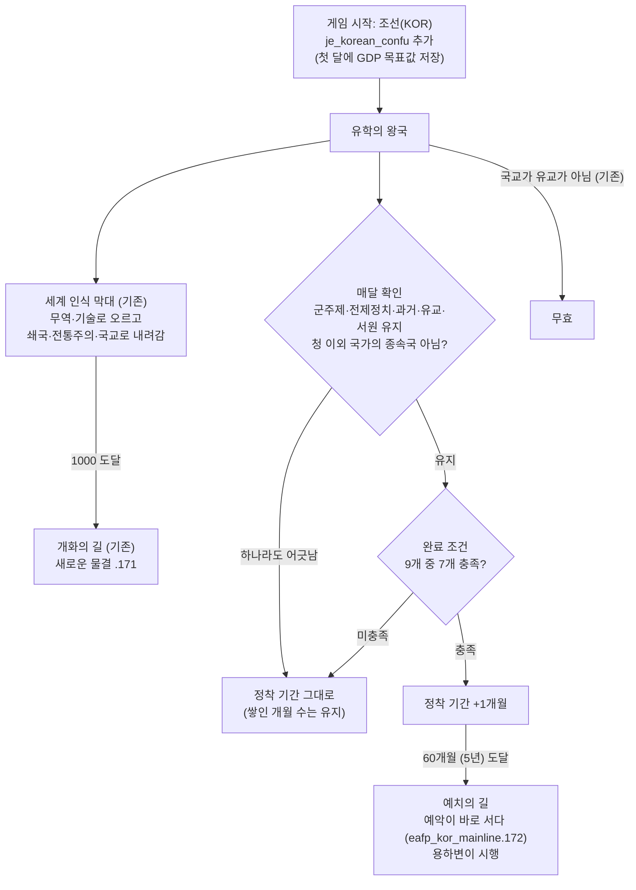
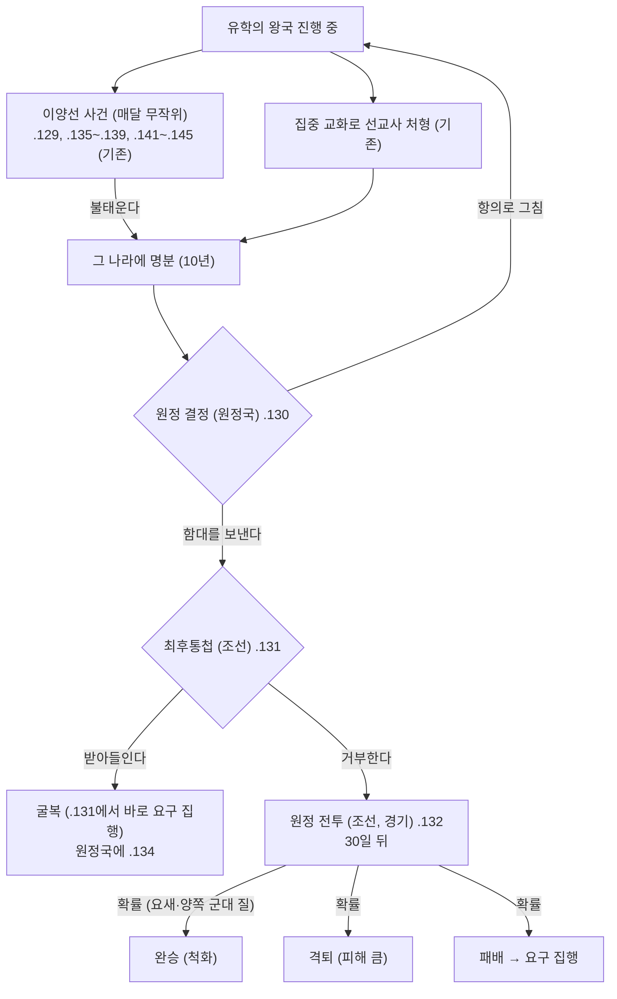

# 「유학의 왕국」 저널 계획

> 브랜치: `joseon-confucian-absolutism` (`main`(76f2c15f)에서 분기)
> 수정 대상: 조선 저널 `je_korean_confu` 「유학의 왕국」 (`common/journal_entries/eafp_korean_journal.txt`)

예치의 길, 양요, 선교사 세 계획 문서를 하나로 합친 문서다. 절 번호는 부마다 따로 센다. 같은 부 안에서는 "3.5절"처럼, 다른 부는 "2부 5절"처럼 부를 붙여 가리킨다.

| 부 | 내용 | 상태 |
|---|---|---|
| 1부 예치의 길과 용하변이 법률 | 유학의 왕국에 두 번째 결말 **예치의 길**을 더하고, 보상 법률 **용하변이(用夏變夷)**를 둔다 | 구현됨 |
| 2부 양요(洋擾) | 명분 → 원정 결정 → 최후통첩 → 강화 원정 전투를 이벤트로만 처리한다. 예치의 길에 「해안 방비」 조건을 더한다 | 구현됨 (게임 안 검증 전) |
| 3부 선교사 | 선교사를 숨은 역할 「선교사」로 분리하고, 포교는 소문으로만 드러나며, 박해는 「집중 교화」로만 일어난다 | 구현됨 |

세 부는 서로 이어진다. 집중 교화에서 외국 선교사를 처형하면(3부 6절) 그 출신국이 양요 명분을 얻고(2부 3절), 양요를 막는 경기 해군 요새(2부 4.3절)는 예치의 길 완료 조건 「해안 방비」(1부 3.5절, 2부 5절)가 된다.

---

## 1부. 예치의 길과 용하변이 법률

> 참고 원형: 바닐라 오스트리아 `je_austrian_neo_absolutism`(신 절대주의) → `law_neo_absolutism`
> 상태: **구현됨**

### 한눈에 보기

새 저널을 따로 만들지 않고, 기존 「유학의 왕국」에 **두 번째 결말**을 더한다.

- **개화의 길 (기존)**: 세계 인식 막대가 1000에 이르면 「새로운 물결」(`eafp_kor_mainline.171`)로 끝난다. 지금 저널이 가진 유일한 결말이다.
- **예치(禮治)의 길 (신규)**: **정통 유교 체제**(전제정치·과거·유교·서원)를 지키며 완료 조건 9개 중 7개를 갖춘 달이 **60개월(5년)** 쌓이면 끝난다. 전제정치(`law_autocracy`)를 **조선 전용 하위 법률 용하변이(用夏變夷)**로 바꾼다. 이 법률은 전제정치의 정치적 성격을 물려받되, 효과는 **종교 개종과 문화 동화**에 집중한다.

두 길은 **경주**한다. 무역과 기술이 세계 인식을 끌어올리는 동안, 조선은 체제를 지킨 채 예치의 조건을 채워야 한다. 네 체제 가운데 하나라도 고쳐져 있는 동안은 예치의 정착이 멈춘다. 체제를 되돌리면 쌓인 개월 수에서 이어서 센다.

예치 쪽 진행은 바닐라 「덴포 위기」(`je_tenpo_crisis`)처럼 저널 본문의 **체크박스 목록**과 **정착 기간(개월)**으로 보여 준다. 새 막대나 버튼은 없다.

| 구분 | 바닐라 오스트리아 | 수정된 「유학의 왕국」 |
|---|---|---|
| 저널 | `je_austrian_neo_absolutism` 신 절대주의 | 기존 `je_korean_confu` **유학의 왕국**을 수정 (새 저널 없음) |
| 활성화 | 게임 시작부터 | 그대로. 조선 히스토리(`kor - korea.txt:102`)에서 추가 |
| 결말 | 성공 1개 / 실패 | **개화의 길**(기존) / **예치의 길**(신규) / 무효(기존, 국교가 유교가 아님) |
| 유지할 체제 | 전제정치 + 비밀경찰 | 예치의 길을 위해 **전제정치 + 과거 관료제 + 유교 국교 + 서원 수정안** |
| 지지 세력 | 소부르주아가 정부에서 강력 | 따로 두지 않는다. 완료 조건 「유림의 지지」가 대신한다 |
| 진행 표시 | 헌정 압력 막대 (100 도달 시 실패) | 기존 **세계 인식 막대**(개화의 길) + 예치 **체크박스**와 정착 기간 `N/60개월` |
| 버튼 | 교황 정교협약 / 봉건 의무 폐지 / 왕령지 자치 폐지 | 기존 「집중 교화」만. 새 버튼 없음 |
| 예치 완료 | 6개 중 4개 충족 즉시 | **9개 중 7개를 갖춘 달이 60개월** (3.4·3.5절) |
| 예치 실패 | 헌정 압력 100 등 | 세계 인식 1000(개화 결말)에 먼저 이르면 예치의 길도 끝난다. **유지 조건 상실**은 실패가 아니라 정착을 멈출 뿐이다 (3.6절) |
| 보상 법률 | `law_neo_absolutism` (관료 정치력, 권위) | `law_eafp_yongha_byeoni` **용하변이(用夏變夷)**, 개종·동화 특화 |

---

### 1. 바닐라 원형 분석 (`05_austria_journal_entries.txt`)

| 요소 | 바닐라 구현 | 조선판에서 가져올 것 |
|---|---|---|
| `possible` | 전제정치·비밀경찰 유지, 왕령지/동군연합 종속국 없음, 소부르주아 강력 | 체제 유지 조건 구조만 가져와 **정착 기간이 늘 수 있는 조건**으로 쓴다. 유학의 왕국은 히스토리에서 바로 추가되므로 시작 조건과 지지 세력 조건은 두지 않는다 |
| `immediate` | 시작 시 GDP를 `austrian_gdp_var`에 저장 | 유학의 왕국의 **첫 월간 처리**에서 GDP × 1.5 목표값을 저장한다. 이 저널은 히스토리에서 GDP가 계산되기 전에 추가되므로 `immediate`에서는 GDP가 0이다. 덴포 위기도 같은 이유로 `tenpo_gdp_goal`을 게임 시작 후 on_action에서 저장한다 |
| `modifiers_while_active` | `modifier_austrian_state_police` | 기존 `eafp_modi_confucian_state` 「성리학 국가」를 그대로 쓴다 |
| 진행 막대 | `default_bad` 헌정 압력. 매달 여러 요인으로 증감, 100이면 실패 | **기존 세계 인식 막대가 이 역할을 맡는다.** 1000에 이르면 개화 결말로 저널이 끝나 예치의 길도 사라진다. 예치 쪽 진행은 막대 없이 체크박스와 정착 개월 수로 보여 준다 (3.4절) |
| 버튼 3개 | 누르면 변수 설정 + 막대 ±10 + 부수 효과 | **가져오지 않음.** 기존 「집중 교화」 버튼만 남고, 버튼 몫의 완료 조건은 국가 상태 조건으로 바꾼다 |
| 성공 | `calc_true_if amount >= 4` → `austria_events.1` 팝업에서 `law_neo_absolutism` 즉시 시행 선택, 전역 변수로 법률 노출 | 완료 조건을 갖춘 달이 60개월(5년) 쌓이면 성공. 노출 조건은 **국가 변수**로 (조선 전용이므로) |
| 실패 | 막대 100 / 헝가리 동군연합 / 전제정치·비밀경찰 상실 | 세계 인식 1000(개화 결말). 유지 조건 상실·군주제 상실·종속국화는 그동안 정착을 멈출 뿐 길을 닫지 않는다 |
| 법률 | `parent = law_autocracy`, `requires_law_or = law_monarchy`, `law_autocracy`의 `is_visible`에서 숨김 처리 | 같은 구조. 단 **`law_autocracy`는 재정의하지 않음** (4.4절) |

---

### 2. 기존 조선 콘텐츠와의 관계

새 체계를 따로 만들기보다 이미 있는 조선 상태를 조건과 입력값으로 재사용한다.

| 기존 요소 | 위치 | 이 저널에서의 쓰임 |
|---|---|---|
| `law_scholar_bureaucrats` (과거 관료제) | `common/laws/eafp_bureaucracy.txt` | 유지 조건 |
| `amendment_seowon` (서원 수정안) | `common/amendments/eafp_amendments_historical.txt:68`, 시작 설정 `kor - korea.txt` | 유지 조건. 이 수정안 자체가 개종·동화 +20%를 주므로 용하변이 법률과 성격이 이어진다 |
| `eafp_var_sam_all_clear` (삼정의 문란 해결) | `eafp_korean_journal.txt:764` 등 | 완료 조건 하나로 그대로 사용 |
| `je_sedo_politics` (세도정치) | `eafp_korean_journal.txt:1124` | 이 저널이 끝났으면 완료 조건 「세도정치 종식」 충족 |
| `je_korean_confu` 「유학의 왕국」 + `eafp_progress_bar_confu` (세계 인식) | `eafp_korean_journal.txt:1382`, 막대 `eafp_kor_progress_bars.txt:642` | **수정 대상.** 예치의 길을 두 번째 결말로 더한다 (3장) |
| 근대 개혁 저널 `je_korean_reformation_*` | `eafp_korean_reformation.txt` | **연결하지 않는다.** 두 저널은 서로 영향 없이 함께 진행할 수 있다 |

---

### 3. 저널 수정: `je_korean_confu` 유학의 왕국에 예치의 길 더하기

#### 3.1 지금의 유학의 왕국과 바뀌는 점

| 요소 | 지금 | 수정 후 |
|---|---|---|
| 막대 | 세계 인식 `eafp_progress_bar_confu` (0~1000). 매달 기본 +2.5, 무역(최대 +20), 기술 습득 시 +20, 쇄국·전통주의·국교 법률마다 -5, AI +7.5 | **그대로** |
| 결말 | 세계 인식 1000 → `eafp_kor_mainline.171` 「새로운 물결」 | 그대로 두고 헤더만 「개화의 길 달성 조건 / 달성 시」로 구분. **예치의 길 결말을 추가** |
| 무효 | 국교가 유교가 아님 | 그대로. 예치 변수 정리만 더한다 |
| 버튼 | 「집중 교화」 | 그대로 |
| 월간 처리 | 천주교 확산, 선교사 생성, 무작위 이벤트 | 그대로 두고 **예치의 길 확인**(유지 조건 검사, 정착 기간 세기)을 더한다 |
| 본문 | 서학을 둘러싼 조정의 논쟁, 천주교 역병 설명 | 그대로 두고 끝에 **예치의 길 단락과 체크리스트**를 붙인다 |

#### 3.2 흐름



#### 3.3 체제 유지 조건

**유지 조건**: 아래 네 가지를 모두 지키는 달에만 정착 기간이 늘 수 있다. 하나라도 어긋나면 그동안은 정착이 멈추고, 되돌리면 이어서 센다(3.6절).

| 조건 | 판정 |
|---|---|
| 전제정치 | `has_law_or_variant = law_type:law_autocracy` |
| 과거 | `has_law = law_type:law_scholar_bureaucrats` |
| 유교 | `has_law = law_type:law_state_religion` 이고 `country_has_state_religion = rel:confucian` |
| 서원 | `any_active_law = { has_amendment = amendment_type:amendment_seowon }` (모드의 기존 `has_amendment` 사용법과 같다) |

이 밖에 **군주제**(`law_monarchy`, 용하변이 법률의 `requires_law_or`)를 잃거나 **청 이외 국가의 종속국**이 되어도 똑같이 멈춘다. 이 여섯 판정은 scripted trigger `eafp_yechi_pillars_kept` 하나로 묶어, 월간 처리와 체크리스트 요약 줄 두 곳에서 쓴다.

유학의 왕국은 게임 시작 때 히스토리에서 바로 추가되므로, 앞선 계획의 시작 조건(`possible`)과 지지 세력 조건(유림 또는 양반이 정부에서 강력)은 두지 않는다. 체제를 떠받치는 세력의 지지는 완료 조건 「유림의 지지」(3.5절 5번)가 맡는다.

조선 히스토리 파일은 종교 법률을 직접 지정하지 않으므로, 기본값이 `law_state_religion`인지 구현 전에 확인한다. 서원 수정안은 히스토리에서 교육 법률 그룹에 붙이는데 정의상 `parent = law_state_religion`이므로, 실제로 어느 법률에 붙는지도 구현 전에 확인한다.


#### 3.4 조건 체크리스트와 정착 기간

예치 쪽에는 새 막대를 두지 않는다. 바닐라 「덴포 위기」(`je_tenpo_crisis`)와 모드의 「삼정이정청」(`je_samjeong_ijeongcheong`)처럼, 유학의 왕국 본문(`je_korean_confu_reason`) 끝에 **조건마다 체크박스**를 붙여 보여 주고, 목록 맨 위 한 줄에 **충족한 조건 수**와 **정착 기간**을 함께 적는다. 개월 수는 조건을 7개 이상 갖춘 달만 센다.

게임 안에서는 대략 이렇게 보인다(☑ = `checkbox_ticked`, ☐ = `checkbox_unticked`).

```
예치의 길
☑ 완료 조건을 7개 이상(현재 7/9) 갖춘 채 23/60개월을 지냄
• ☑ GDP가 £1.2M 이상임
• ☐ 삼정의 폐단이 전부 혁파됨
• ☑ 청의 종속국이 아니거나 청이 무너졌으며, 강대국 이상임
• ☑ 세도정치가 끝남
• ☑ 성리학자 세력이 정부에 있고 승인도가 10 이상임
• ☐ 한국 본토 밖의 주 하나 이상에서 한국 문화 인구가 50% 이상임
• ☑ 문해율이 30% 이상임
• ☑ 인구의 90% 이상이 유교를 믿음
• ☐ 경기의 해군 요새 5단계 이상
```

| 항목 | 방식 |
|---|---|
| 조건 체크박스 | 조건마다 custom loc 하나. 충족이면 `checkbox_ticked`, 아니면 `checkbox_unticked` (바닐라 키, 세 언어 모두 있음) |
| 충족 개수 | 스크립트 값 `eafp_yechi_conditions_completed` (0~9). 필요 개수는 스크립트 값 `eafp_yechi_conditions_required`(7) |
| 정착 기간 | 국가 변수 `eafp_var_yechi_months`. 유학의 왕국 `on_monthly_pulse`에서 체제를 유지하고(`eafp_yechi_pillars_kept`) 충족 개수가 필요 개수(7) 이상이면 +1 |
| 조건·체제가 깨졌을 때 | 그달은 늘지 않는다. **쌓인 개월 수는 그대로** 남고, 조건을 다시 갖추면 이어서 센다 |
| 완료 | `eafp_var_yechi_months >= 60` |

**정의가 한 곳에만 있도록** 조건 9개를 각각 scripted trigger로 만든다. 각 트리거는 스크립트 값(개수 세기)과 체크박스 custom loc 두 곳에서 쓴다. 덴포 위기는 체크박스 판정과 개수 판정을 따로 적어 "둘을 맞춰 고칠 것"이라는 주석을 달아 두었는데, 트리거로 묶으면 그럴 필요가 없다.

```
# common/scripted_triggers/eafp_kor_triggers.txt
eafp_yechi_cond_gdp = {
	has_variable = eafp_var_yechi_gdp_goal
	gdp >= var:eafp_var_yechi_gdp_goal
}
eafp_yechi_cond_samjeong = { has_variable = eafp_var_sam_all_clear }
eafp_yechi_cond_sojunghwa = { ... }
eafp_yechi_cond_sedo = { NOT = { has_journal_entry = je_sedo_politics } }
eafp_yechi_cond_devout = { ... }
eafp_yechi_cond_iyeok = { ... }
eafp_yechi_cond_literacy = { literacy_rate >= 0.3 }
eafp_yechi_cond_confucian = { ... }
eafp_yechi_cond_haebang = { ... }	# 2부 5절
# 판정 내용은 3.5절 표
```

```
# common/script_values/eafp_kor_values.txt
eafp_yechi_conditions_completed = {
	value = 0
	if = { limit = { eafp_yechi_cond_gdp = yes } add = 1 }
	if = { limit = { eafp_yechi_cond_samjeong = yes } add = 1 }
	# ... 9개 모두 같은 형식
}
```

```
# common/customizable_localization/eafp_KOR_custom_loc.txt
eafp_yechi_checkbox_gdp = {
	type = country
	text = {
		trigger = { eafp_yechi_cond_gdp = yes }
		localization_key = checkbox_ticked
	}
	text = {
		localization_key = checkbox_unticked
	}
}
# 조건 9개 + 맨 위 요약 줄(eafp_yechi_checkbox_conditions, 체제를 유지하고 지금 7개 이상이면 체크)까지 10개
```

유학의 왕국 본체에는 아래를 더한다. 기존 코드는 그대로 둔다.

```
je_korean_confu = {
	...
	outcome = {	# 개화의 길 (기존 결말, 헤더만 바꿈)
		header = je_korean_confu_blossom_cond_header
		effect_header = je_korean_confu_blossom_header
		...
		effect = {
			trigger_event = { id = eafp_kor_mainline.171 }	# 정리 효과는 .171 선택지에서
		}
		event_outcome_effect_desc = {	# .171 선택지 효과(정리 효과 포함)를 저널에서 미리 보여 줌
			header = eafp_kor_mainline.171.oa
			effect = { eafp_effect_confu_cleanup = yes  ... }
		}
	}

	outcome = {	# 예치의 길 (신규)
		header = je_korean_confu_yechi_cond_header
		effect_header = je_korean_confu_yechi_header
		color = "gold_positive"
		conclusion_desc = je_standard_completion_conclusion_desc
		trigger = {
			custom_tooltip = {
				text = eafp_yechi_settled_tt
				has_variable = eafp_var_yechi_months
				var:eafp_var_yechi_months >= 60
			}
		}
		effect = {
			eafp_effect_confu_cleanup = yes
			trigger_event = { id = eafp_kor_mainline.172 popup = yes }
		}
	}

	outcome = {	# 무효 (기존)
		...
		effect = { eafp_effect_confu_cleanup = yes }
	}

	on_monthly_pulse = {
		effect = {
			... 기존 천주교 처리 ...
			# 예치의 길
			if = {	# 첫 달에 한 번
				limit = { NOT = { has_variable = eafp_var_yechi_gdp_goal } }
				set_variable = { name = eafp_var_yechi_gdp_goal value = { value = gdp multiply = 1.5 } }
				set_variable = { name = eafp_var_yechi_months value = 0 }
			}
			if = {
				limit = {
					eafp_yechi_pillars_kept = yes
					eafp_yechi_conditions_completed >= eafp_yechi_conditions_required
				}
				change_variable = { name = eafp_var_yechi_months add = 1 }
			}
		}
		events = { ... 기존 ... }
	}
}
```

- **결말 정리 효과 묶기**: 지금 두 outcome(완료·무효)이 똑같은 정리(천주교 역병 모디파이어 제거, 무역 변수 제거, 선교사 제거)를 반복한다. 예치 결말까지 세 곳이 되므로 scripted effect `eafp_effect_confu_cleanup`으로 묶고, 예치 변수 두 개(`eafp_var_yechi_gdp_goal`, `eafp_var_yechi_months`)도 여기서 지운다. 개화 결말에서는 이 효과를 저널이 아니라 결말 이벤트 `.171`의 선택지에서 실행하고, 저널은 `event_outcome_effect_desc`로 미리 보여 준다.
- 체제가 어긋나도 길은 닫히지 않는다. 이벤트나 세계 인식 변화도 없고, 그달 정착 기간만 늘지 않는다.
- 바닐라 덴포 위기처럼 GDP는 **목표값 자체**(첫 달 GDP × 1.5)를 저장한다. 그래야 본문에 목표 금액을 `[…Var('eafp_var_yechi_gdp_goal').GetValue|k0]`로 바로 보여 줄 수 있다. 게임 시작 직후에는 GDP가 계산되기 전이라 `immediate`가 아니라 첫 월간 처리에서 저장하고, 정착 개월 수도 그때 0으로 둔다. 그래서 첫 달 전까지는 본문의 GDP 목표가 0으로 보인다.
- 정착 기간은 막대가 없으므로 변수에 담아야 한다. 조건이 깨져도 쌓인 값이 남아야 해서 현재 상태로 다시 계산할 수 없다.
- 기간(5년)은 초안이다.

#### 3.5 완료 조건 (9개 중 7개)

체제를 유지하는 동안, 국가 상태 조건 9개 가운데 **7개 이상**을 갖춘 달에만 정착 기간이 늘어난다. 각 조건은 괄호 안의 이름으로 `eafp_yechi_cond_*` scripted trigger가 되고(3.4절), 저널 본문에 체크박스 한 줄씩으로 보인다. GDP 목표값 말고는 모두 현재 상태를 직접 읽는다.

**부국강병·체제**

| # | 조건 | 판정 (초안) | 비고 |
|---|---|---|---|
| 1 | **부국(富國)** (`_gdp`): GDP가 시작 시점의 1.5배 이상 | `gdp >= var:eafp_var_yechi_gdp_goal` (첫 달 GDP × 1.5) | 바닐라와 같은 배율. 덴포 위기처럼 목표값을 저장해 본문에 금액을 보여 준다 |
| 2 | **삼정 해결** (`_samjeong`) | `has_variable = eafp_var_sam_all_clear` | 기존 변수 재사용 |
| 3 | **소중화 계승** (`_sojunghwa`): 청의 종속국이 아니거나 청 붕괴 후(`china_shatters`), 독립국이고 위상 `major_power` 이상 | `is_subject = no` + 국가 위상 | 바닐라의 "열강 3위 + 프로이센 견제" 대응 |
| 4 | **세도정치 종식** (`_sedo`) | `NOT = { has_journal_entry = je_sedo_politics }` | 외척 세도가를 누르고 군주 중심 체제를 세운 상태. `je_korean_fading_power`가 쓰는 판정과 같다 |
| 5 | **유림의 지지** (`_devout`): 유림이 정부에 있고 승인도 10 이상 | `ig:ig_devout = { is_in_government = yes  ig_approval >= 10 }` | 체제를 떠받치는 사림의 지지 |

**교화·동화**

| # | 조건 | 판정 (초안) | 비고 |
|---|---|---|---|
| 6 | **이역 동화(異域同化)** (`_iyeok`): 한국 본토 밖의 주를 하나 이상 가지고, 그 주의 한국 문화 비율 50% 이상 | `any_scope_state = { NOT = { is_homeland_of_country_cultures = root }  culture_percent_state = { target = cu:korean value >= 0.5 } }` | 간도·만주 등. 고향 땅 동화(`state_allow_assimilation_in_homeland_bool`)와 짝을 이루어 **용하변이와 가장 직접 이어지는 조건** |
| 7 | **서원 교육 성과** (`_literacy`): 문해율 30% 이상 | `literacy_rate >= 0.3` | 서원을 지킨 교육의 결과 |
| 8 | **교화(敎化)** (`_confucian`): 국내 인구의 유교 신자 비율 90% 이상 | `religion_percent_country = { target = rel:confucian value >= 0.9 }` | 개종 성과 |
| 9 | **해안 방비** (`_haebang`): 경기의 해군 요새 5단계 이상 | `state_has_building_type_levels = { target = bt:building_naval_fortification value >= 5 }` (경기 `STATE_SEOUL`) | 2부 양요의 원정 전투와 같은 해군 요새를 본다 |

**구현 전 확인할 점**

- **세도정치 종식**: `je_sedo_politics`는 성공해도 남기는 변수가 없다(`eafp_var_je_sedo_politics_balance`를 지운다). 그래서 성공과 무효 종료를 구분하지 못하고 "저널이 끝났음"으로만 판정한다. 성공만 인정하려면 성공 효과에 변수 하나를 추가해야 하는데, 기존 `je_korean_fading_power`가 같은 판정을 쓰므로 그대로 따른다.
- **이역 동화**: 조선 본토의 주는 모두 한국 문화의 고향이라 해당하지 않는다. 시작 시점 조선이 본토 밖 주를 갖고 있지 않은지 확인한다.
- **기준값**: 문해율 30%, 유교 90%, 이역 동화 50%는 초안이다. 1836년 조선의 실제 문해율과 신자 비율을 게임에서 확인하고 조정한다.

#### 3.6 예치의 정착이 멈추거나 끝나는 경우

| 결과 | 조건 | 처리 |
|---|---|---|
| 정착 멈춤 | 유지 조건(전제정치·과거·유교·서원) 중 하나라도 어긋남, 군주제 상실, 또는 청 이외 국가의 종속국이 됨 | 그동안 정착 기간이 늘지 않는다. 쌓인 개월 수는 남고, 체제를 되돌리면 이어서 센다. 이벤트·세계 인식 변화 없음 |
| 저널 종료 | 세계 인식 1000 (개화 결말) / 국교가 유교가 아님 (무효) | 기존 결말대로 저널이 끝나고, 정리 효과가 예치 변수도 지운다 |

예치의 길은 **닫히지 않는다.** 저널이 이어지는 한 언제든 체제를 되돌려 정착을 이어 갈 수 있고, 저널은 개화의 길·예치의 길·무효 가운데 하나로 끝난다.

서원 수정안은 의회 절차로 폐지될 수 있고, AI는 `ai_will_revoke` 조건(국교·양심의 자유 법률이 아닐 때)에서 폐지한다. 폐지되면 정착이 멈춘다. 저널 본문에는 따로 경고 문장을 두지 않는다.

#### 3.7 이벤트 설계 (`events/eafp_kor_events/eafp_kor_mainline.txt`)

예치 결말 이벤트 하나만 둔다. 유학의 왕국 이벤트(`eafp_kor_mainline.120`~`.171`)와 같은 `eafp_kor_mainline` 네임스페이스에 두고, 번호는 개화 결말 `.171` 바로 뒤의 `.172`다. 예치의 길이 닫힐 때는 이벤트를 띄우지 않는다(3.6절).

선택지는 서로 정반대가 아니라, **같은 결말을 받아들이면서 강조점만 다르게** 짰다.

##### `eafp_kor_mainline.172` 예악이 바로 서다 (예치의 길 결말)

유학의 왕국의 예치 결말에서 바닐라 `austria_events.1`처럼 팝업으로 띄운다. 어느 선택지를 골라도 용하변이를 시행한다. 차이는 교화를 **밖(이역)으로 넓히느냐, 안(백성)에서 다지느냐**다.

| | 공통 효과 |
|---|---|
| 해금 | 국가 변수 `eafp_var_yechi_law_unlocked` 설정 (전제정치로 되돌린 뒤에도 법률 화면에 남게 함) |
| 법률 | `activate_law = law_type:law_eafp_yongha_byeoni` |

| 선택지 | 방향 | 모디파이어 (`long_modifier_time`, 10년) | 효과 (초안) |
|---|---|---|---|
| `.oa` 중화의 도로 이역을 바꾸리라 | 새로 얻은 땅의 동화 | `eafp_modi_yechi_iyeok_gyohwa` **이역 교화(異域敎化)** | `state_assimilation_mult` +0.25, `country_authority_add` +50 |
| `.ob` 안을 먼저 바로 세운 뒤에 밖을 교화하리라 | 국내 개종과 교육 | `eafp_modi_yechi_hyangdang_gyohwa` **향당 교화(鄕黨敎化)** | `state_conversion_mult` +0.25, `state_education_access_add` +0.05, `interest_group_ig_devout_approval_add` +2 |

AI 가중치는 이역(만주·간도 등)의 주를 가지고 있으면 `.oa`, 아니면 `.ob` 쪽으로 준다. 이역의 주 보유 판정은 scripted trigger `eafp_yechi_has_iyeok_state`로 둔다.

모디파이어 2개는 모두 `common/static_modifiers/eafp_korea_rework_modi.txt`에 추가한다. 아이콘은 「유학의 왕국」 모디파이어와 같은 `gfx/interface/icons/religion_icons/confucianism.dds`를 기본으로 쓴다. 모디파이어 키 이름은 `documentation/modifiers.log`에서 확인했다.

```
eafp_modi_yechi_iyeok_gyohwa = {	# 예치 성공 .a
	icon = gfx/interface/icons/religion_icons/confucianism.dds
	state_assimilation_mult = 0.25
	country_authority_add = 50
}
eafp_modi_yechi_hyangdang_gyohwa = {	# 예치 성공 .b
	icon = gfx/interface/icons/religion_icons/confucianism.dds
	state_conversion_mult = 0.25
	state_education_access_add = 0.05
	interest_group_ig_devout_approval_add = 2
}
```

#### 3.8 이벤트 텍스트 예제

이벤트와 모디파이어 2개 이름의 현지화 초안이다. 모디파이어 설명(`_desc`)은 게임에서 쓰이지 않으므로 두지 않는다. 키는 같은 네임스페이스의 기존 유학의 왕국 이벤트와 같은 `.mt/.md/.mf/.oa/.ob` 규칙을 따른다.

`.172`의 플레이버는 『맹자』 「등문공 상」의 실제 구절(법률 이름의 출전)이다.

**한국어** (`localization/korean/eafp_kor_rework_l_korean.yml`에 추가)

```yaml
eafp_kor_mainline.172.mt: "예악이 바로 서다"
 eafp_kor_mainline.172.md: "[ROOT.GetCountry.GetName]의 조정이 끝내 예와 악을 바로세웠다."
 eafp_kor_mainline.172.mf: "\"나는 중화의 도로 오랑캐를 변화시켰다는 말은 들었어도, 오랑캐에게 변화되었다는 말은 듣지 못하였다.\"\n\n— \"맹자\" '등문공 상'"
 eafp_kor_mainline.172.oa: "중화의 도로 이역을 바꾸리라."
 eafp_kor_mainline.172.ob: "안을 먼저 바로 세운 뒤에 밖을 교화하리라."

 eafp_modi_yechi_iyeok_gyohwa: "이역 교화"
 eafp_modi_yechi_hyangdang_gyohwa: "향당 교화"
```

**영어** (`localization/english/eafp_kor_rework_l_english.yml`에 추가)

```yaml
eafp_kor_mainline.172.mt: "Rites Restored"
 eafp_kor_mainline.172.md: "The court of [ROOT.GetCountry.GetName] has at last set rites and music aright."
 eafp_kor_mainline.172.mf: "\"I have heard of men using the doctrines of our great land to change barbarians, but I have never yet heard of any being changed by barbarians.\"\n\n— Mencius, Teng Wen Gong I (trans. James Legge)"
 eafp_kor_mainline.172.oa: "We shall transform the frontier by the Way of the civilized."
 eafp_kor_mainline.172.ob: "First set our own house in order, then civilize what lies beyond."

 eafp_modi_yechi_iyeok_gyohwa: "Civilizing the Frontier"
 eafp_modi_yechi_hyangdang_gyohwa: "Civilizing the Villages"
```

**중국어 간체** (`localization/simp_chinese/eafp_kor_rework_l_simp_chinese.yml`에 추가)

```yaml
eafp_kor_mainline.172.mt: "礼乐复正"
 eafp_kor_mainline.172.md: "[ROOT.GetCountry.GetName]朝廷终于使礼乐归于正道。"
 eafp_kor_mainline.172.mf: "“吾闻用夏变夷者，未闻变于夷者也。”\n\n——《孟子·滕文公上》"
 eafp_kor_mainline.172.oa: "用夏变夷，教化四方。"
 eafp_kor_mainline.172.ob: "先正其内，而后化其外。"

 eafp_modi_yechi_iyeok_gyohwa: "异域教化"
 eafp_modi_yechi_hyangdang_gyohwa: "乡党教化"
```

구현 시 확인할 점:

- 실제 파일은 UTF-8 BOM, CRLF로 저장한다. 이벤트 키는 `eafp_kor_mainline.171` 키 바로 뒤에, 모디파이어 이름은 `eafp_modi_confucian_state_reverse` 바로 뒤에 둔다.
- 영어 `.172.mf`는 James Legge의 1861년 번역(퍼블릭 도메인)이다. 구현 전에 원문 대조로 문구를 한 번 더 확인한다.
- 모디파이어 값은 초안이다. 특히 `country_weekly_innovation_add` +5는 1830~60년대 조선의 주간 혁신 수치와 비교해 조정한다.

#### 3.9 저널 텍스트 예제

유학의 왕국 현지화에서 바꾸거나 더할 부분이다. 저널 이름(`je_korean_confu`)과 기존 본문은 그대로 둔다.

**키 구성**

| 용도 | 키 | 파일 | 비고 |
|---|---|---|---|
| 본문 | `je_korean_confu_reason` | 기존 `eafp_kor_rework_l_*.yml` | 기존 본문(서학 논쟁, 천주교 역병) **뒤에** 예치의 길 단락을 이어 붙인다 |
| 결말 조건 헤더 | `je_korean_confu_blossom_cond_header`, `je_korean_confu_yechi_cond_header` | 기존 `eafp_kor_rework_l_*.yml` | 결말이 둘이 되므로 두 outcome의 `header`를 표준 「완료 조건:」 대신 길 이름으로 바꾼다 |
| 결말 효과 헤더 | `je_korean_confu_blossom_header`, `je_korean_confu_yechi_header` | 같은 파일 | 두 outcome의 `effect_header`를 표준 「완료 시:」 대신 길 이름으로 바꾼다. 바닐라 `je_standard_on_completion_header`처럼 `$EFFECT$`를 담는다 |
| 예치 결말 조건 | `eafp_yechi_settled_tt` | 같은 파일 | 예치 outcome의 "정착 기간 60개월" 조건 |

체크리스트는 덴포 위기·삼정이정청처럼 조건 8줄을 따로 키로 빼지 않고 본문에 바로 쓴다. 각 줄 앞의 체크박스는 `GetCustom('eafp_yechi_checkbox_*')`, 충족 개수는 `ScriptValue('eafp_yechi_conditions_completed')`, 정착 기간은 `Var('eafp_var_yechi_months')`로 읽는다. 삼정 줄은 기존 `$je_korean_land_problem_complete_cond_tt$`를 끌어다 쓴다.

`$law_autocracy$`(전제 정치), `$law_scholar_bureaucrats$`(사대부제), `$law_state_religion$`(국교), `$amendment_seowon$`(서원), `$ig_confucian_k$`(성리학자)는 기존 현지화 키를 끌어다 쓴다. 세 언어 모두에 키가 있는 것을 확인했다. 한국어 문장은 키 바로 뒤에 조사가 붙지 않도록 짰다.

앞선 계획에서 따로 쓴 예치 저널의 제목·로비·교서 형식 본문과 시작 조건 툴팁(`je_eafp_yechi`, `_lobby`, `_seowon_tt`, `_support_tt`)은 쓰지 않는다. 유학의 왕국의 기존 본문이 같은 내용(서학을 두고 갈린 조정)을 이미 담고 있기 때문이다.

**한국어**

```yaml
# eafp_kor_rework_l_korean.yml — 기존 je_korean_confu_reason 값 끝에 이어 붙임
"(기존 본문)...$eafp_modi_catholic_plague_desc$\n\n#bold 예치의 길#!\n[SCOPE.GetRootScope.GetCountry.GetCustom('eafp_yechi_checkbox_conditions')] 완료 조건을 #v 7#!개 이상(현재 #v [SCOPE.GetRootScope.GetCountry.MakeScope.ScriptValue('eafp_yechi_conditions_completed')|0]#!/#v 9#!) 갖춘 채 #v [SCOPE.GetRootScope.GetCountry.MakeScope.Var('eafp_var_yechi_months').GetValue|0]#!/#v 60#!개월을 지냄\n• [SCOPE.GetRootScope.GetCountry.GetCustom('eafp_yechi_checkbox_gdp')] [concept_gdp]가 @gdp!#v [SCOPE.GetRootScope.GetCountry.MakeScope.Var('eafp_var_yechi_gdp_goal').GetValue|k0]#! 이상임\n• [SCOPE.GetRootScope.GetCountry.GetCustom('eafp_yechi_checkbox_samjeong')] $je_korean_land_problem_complete_cond_tt$\n• [SCOPE.GetRootScope.GetCountry.GetCustom('eafp_yechi_checkbox_sojunghwa')] 청의 종속국이 아니거나 청이 무너졌으며, 독립국으로서 #bold 강대국#! 이상의 위상을 가짐\n• [SCOPE.GetRootScope.GetCountry.GetCustom('eafp_yechi_checkbox_sedo')] 세도정치가 끝남\n• [SCOPE.GetRootScope.GetCountry.GetCustom('eafp_yechi_checkbox_devout')] #bold $ig_confucian_k$#! 세력이 정부에 있고 승인도가 #v 10#! 이상임\n• [SCOPE.GetRootScope.GetCountry.GetCustom('eafp_yechi_checkbox_iyeok')] 한국 본토 밖의 주 하나 이상에서 한국 문화 인구가 #v 50%#! 이상임\n• [SCOPE.GetRootScope.GetCountry.GetCustom('eafp_yechi_checkbox_literacy')] 문해율이 #v 30%#! 이상임\n• [SCOPE.GetRootScope.GetCountry.GetCustom('eafp_yechi_checkbox_confucian')] 인구의 #v 90%#! 이상이 유교를 믿음\n• [SCOPE.GetRootScope.GetCountry.GetCustom('eafp_yechi_checkbox_haebang')] 경기의 $building_naval_fortification$ #v 5#!단계 이상"

# eafp_kor_rework_l_korean.yml — 세계 인식 막대 키 뒤에 추가
 je_korean_confu_blossom_cond_header: "#b 개화의 길#! 달성 조건"
 je_korean_confu_yechi_cond_header: "#b 예치의 길#! 달성 조건"
 je_korean_confu_blossom_header: "#b 개화의 길#! 달성 시:\n$EFFECT$"
 je_korean_confu_yechi_header: "#b 예치의 길#! 달성 시:\n$EFFECT$"
 eafp_yechi_settled_tt: "예치의 정착이 #v 60#!개월(#v 5#!년)에 이름"
```

**영어**

```yaml
# eafp_kor_rework_l_english.yml — appended to the existing je_korean_confu_reason value
"(existing text)...$eafp_modi_catholic_plague_desc$\n\n#bold The Path of Rule by Ritual#!\n[SCOPE.GetRootScope.GetCountry.GetCustom('eafp_yechi_checkbox_conditions')] At least #v 7#! completion conditions met (currently #v [SCOPE.GetRootScope.GetCountry.MakeScope.ScriptValue('eafp_yechi_conditions_completed')|0]#!/#v 9#!) for #v [SCOPE.GetRootScope.GetCountry.MakeScope.Var('eafp_var_yechi_months').GetValue|0]#!/#v 60#! months\n• [SCOPE.GetRootScope.GetCountry.GetCustom('eafp_yechi_checkbox_gdp')] [concept_gdp] is @gdp!#v [SCOPE.GetRootScope.GetCountry.MakeScope.Var('eafp_var_yechi_gdp_goal').GetValue|k0]#! or above\n• [SCOPE.GetRootScope.GetCountry.GetCustom('eafp_yechi_checkbox_samjeong')] $je_korean_land_problem_complete_cond_tt$\n• [SCOPE.GetRootScope.GetCountry.GetCustom('eafp_yechi_checkbox_sojunghwa')] Not a subject of Qing, or Qing has collapsed, and holds at least #bold Major Power#! rank as an independent country\n• [SCOPE.GetRootScope.GetCountry.GetCustom('eafp_yechi_checkbox_sedo')] In-law government has come to an end\n• [SCOPE.GetRootScope.GetCountry.GetCustom('eafp_yechi_checkbox_devout')] The #bold $ig_confucian_k$#! are in government with approval of at least #v 10#!\n• [SCOPE.GetRootScope.GetCountry.GetCustom('eafp_yechi_checkbox_iyeok')] At least #v 50%#! of the population is Korean in at least one state outside the Korean homeland\n• [SCOPE.GetRootScope.GetCountry.GetCustom('eafp_yechi_checkbox_literacy')] Literacy is at least #v 30%#!\n• [SCOPE.GetRootScope.GetCountry.GetCustom('eafp_yechi_checkbox_confucian')] At least #v 90%#! of the population is Confucian"

# eafp_kor_rework_l_english.yml — added after the worldview bar keys
 je_korean_confu_blossom_cond_header: "Conditions for the #b Path of Enlightenment#!"
 je_korean_confu_yechi_cond_header: "Conditions for the #b Path of Rule by Ritual#!"
 je_korean_confu_blossom_header: "Upon achieving the #b Path of Enlightenment#!:\n$EFFECT$"
 je_korean_confu_yechi_header: "Upon achieving the #b Path of Rule by Ritual#!:\n$EFFECT$"
 eafp_yechi_settled_tt: "Rule by ritual has taken root for #v 60#! months (#v 5#! years)"
```

**중국어 간체**

```yaml
# eafp_kor_rework_l_simp_chinese.yml — 接在现有 je_korean_confu_reason 值的末尾
"(现有正文)...$eafp_modi_catholic_plague_desc$\n\n#bold 礼治之路#!\n[SCOPE.GetRootScope.GetCountry.GetCustom('eafp_yechi_checkbox_conditions')] 满足至少#v 7#!项完成条件（当前#v [SCOPE.GetRootScope.GetCountry.MakeScope.ScriptValue('eafp_yechi_conditions_completed')|0]#!/#v 9#!），已持续#v [SCOPE.GetRootScope.GetCountry.MakeScope.Var('eafp_var_yechi_months').GetValue|0]#!/#v 60#!个月\n• [SCOPE.GetRootScope.GetCountry.GetCustom('eafp_yechi_checkbox_gdp')] [concept_gdp]达到@gdp!#v [SCOPE.GetRootScope.GetCountry.MakeScope.Var('eafp_var_yechi_gdp_goal').GetValue|k0]#!以上\n• [SCOPE.GetRootScope.GetCountry.GetCustom('eafp_yechi_checkbox_samjeong')] $je_korean_land_problem_complete_cond_tt$\n• [SCOPE.GetRootScope.GetCountry.GetCustom('eafp_yechi_checkbox_sojunghwa')] 不是清朝的附庸，或清朝已经崩溃，且作为独立国家至少拥有#bold 强国#!地位\n• [SCOPE.GetRootScope.GetCountry.GetCustom('eafp_yechi_checkbox_sedo')] 势道政治已经终结\n• [SCOPE.GetRootScope.GetCountry.GetCustom('eafp_yechi_checkbox_devout')] #bold $ig_confucian_k$#!在政府中且认可度至少为#v 10#!\n• [SCOPE.GetRootScope.GetCountry.GetCustom('eafp_yechi_checkbox_iyeok')] 朝鲜本土以外至少一个州的朝鲜文化人口达到#v 50%#!以上\n• [SCOPE.GetRootScope.GetCountry.GetCustom('eafp_yechi_checkbox_literacy')] 识字率至少为#v 30%#!\n• [SCOPE.GetRootScope.GetCountry.GetCustom('eafp_yechi_checkbox_confucian')] 至少#v 90%#!的人口信仰儒教"

# eafp_kor_rework_l_simp_chinese.yml — 添加在世界认知进度条键之后
 je_korean_confu_blossom_cond_header: "#b 开化之路#!达成条件"
 je_korean_confu_yechi_cond_header: "#b 礼治之路#!达成条件"
 je_korean_confu_blossom_header: "达成#b 开化之路#!时：\n$EFFECT$"
 je_korean_confu_yechi_header: "达成#b 礼治之路#!时：\n$EFFECT$"
 eafp_yechi_settled_tt: "礼治之定达到#v 60#!个月（#v 5#!年）"
```

구현 시 확인할 점:

- 기존 본문 끝이 `$eafp_modi_catholic_plague_desc$`인지 영어·중국어 파일에서도 확인하고, 그 뒤에 붙인다.
- 개화의 길 헤더 문구는 기존 결말의 동작(세계 인식 1000)을 바꾸지 않는다. header·effect_header 키만 바뀐다.

---

### 4. 법률 설계: `law_eafp_yongha_byeoni` 용하변이(用夏變夷)

#### 4.1 이름: 용하변이(用夏變夷)와 검토한 후보

**용하변이로 확정했다.** 아래 표는 검토했던 후보 기록이다.

| 후보 | 출전 | 원문 | 뜻과 어울림 |
|---|---|---|---|
| **용하변이(用夏變夷)** | 『맹자』 등문공 상 | 吾聞用夏變夷者 未聞變於夷者也 | 중화의 문명으로 오랑캐를 바꾼다. 조선 후기 소중화 의식의 핵심 구절이라 **동화 특화 법률과 가장 직접 맞는다** |
| **화민성속(化民成俗)** | 『예기』 학기 | 君子如欲化民成俗 其必由學乎 | 백성을 교화해 풍속을 이룬다. 교육·교화를 통한 개종·동화라는 점이 드러난다. 어감이 온건하다 |
| **일도동속(一道同俗)** | 『예기』 왕제 | 一道德以同俗 | 도덕을 하나로 하여 풍속을 같게 한다. 종교(도덕)와 문화(풍속)를 함께 통일한다는 점에서 두 효과를 모두 담는다 |
| **동문동궤(同文同軌)** | 『중용』 28장 | 車同軌 書同文 行同倫 | 수레 궤도·문자·윤리를 하나로. 제도적 통일 느낌이 강해 문화 동화 쪽에 무게가 실린다 |
| **왕화(王化)** | 『시경』 모시서 | 正始之道 王化之基 | 임금의 덕이 퍼져 교화된다. 가장 짧고 전제정치 하위 법률이라는 점이 잘 드러난다 |
| 소중화(小中華) | 조선 후기 문집·실록의 자칭 | — | 청 대신 문명을 잇는다는 이념. 법률보다는 국가 정체성에 가까워 이름으로는 덜 맞는다 |

용하변이는 동화 특화가 가장 선명하고, 이름 자체가 "중화(유교)로 이적을 바꾼다"는 법률 효과를 설명한다.

#### 4.2 정의 초안

```
law_eafp_yongha_byeoni = {
	group = lawgroup_distribution_of_power
	parent = law_autocracy
	icon = (전용 아이콘 또는 autocracy.dds 임시)
	progressiveness = -100
	requires_law_or = { law_monarchy }
	is_visible = {
		OR = {
			has_law = law_type:law_eafp_yongha_byeoni
			has_variable = eafp_var_yechi_law_unlocked
		}
	}
	on_activate = { scripted_effect_parties_disappearence = yes }
	modifier = { ... 아래 표 ... }
	ai_enact_weight_modifier = { 바닐라 neo_absolutism과 동일 방식 }
	ai_impose_chance = { value = 0 }
}
```

#### 4.3 모디파이어 초안

| 분류 | 모디파이어 | 값 (초안) | 의도 |
|---|---|---|---|
| 전제정치 기본 | `country_legitimacy_headofstate_add` | 30 | 바닐라 전제정치와 동일 |
| | `country_legitimacy_govt_total_clout_add` | 120 | 동일 |
| | `country_legitimacy_ideological_incoherence_mult` | 0.5 | 동일 |
| | `country_authority_add` | 200 | 전제정치(200) 유지. 신 절대주의(250)보다 낮게 |
| 정치 세력 | `interest_group_ig_devout_pol_str_mult` (유림 IG 정치력) | +0.25 | 관료 대신 유림이 체제의 축 |
| | `country_aristocrats_pol_str_mult` | 0.5 | 전제정치와 동일 |
| **동화·개종** | `state_conversion_mult` | +0.5 | 국교(유교) 개종 가속. 서원 수정안(+0.2)과 합산 |
| | `state_assimilation_mult` | +0.5 | 주 문화 동화 가속. 서원 수정안(+0.2)과 합산 |
| | `country_allow_conversion_second_rate_citizen_bool` / `..._open_prejudice_bool` | yes | 낮은 수용도 집단도 개종 대상에 포함 |
| | `country_allow_assimilation_second_rate_citizen_bool` / `..._open_prejudice_bool` | yes | 낮은 수용도 집단도 동화 대상에 포함 |
| **유학의 왕국 계승** | `state_pop_support_law_freedom_of_conscience_add` / `state_pop_support_law_total_separation_add` | -0.5 | 예치 결말로 저널이 끝나면 「성리학 국가」(`eafp_modi_confucian_state`)가 사라지므로, 같은 값을 법률이 이어받는다 |
| | `state_allow_assimilation_in_homeland_bool` | yes | 간도·만주 등 다른 민족의 본거지에서도 동화. 만주 진출(`je_gando_ambition`, `je_eafp_manchurian_policy`)과 맞물려 강력하다 |

별도의 대가 모디파이어는 두지 않는다. 법률의 부담은 전제정치에서 물려받는 IG 입장(전제정치에 반대하는 IG의 불만)으로만 남는다.

모디파이어 이름과 수용도 bool의 기본 동작은 `documentation/modifiers.log`와 바닐라 `00_discrimination` 관련 파일로 구현 전에 검증한다.

#### 4.4 기존 법률 체계와의 연결

| 위치 | 바닐라 처리 | 이 법률의 처리 |
|---|---|---|
| `law_autocracy`의 `is_visible` | `law_neo_absolutism`, `law_bakufu`일 때 숨김 | **재정의하지 않는다.** 새 법률을 쓰는 동안에도 전제정치가 법률 화면에 보이고, 다시 전제정치로 되돌리는 제정도 가능하다. 바닐라 파일과 충돌하지 않는다 |
| `01_economic_system.txt` 명령 경제 `unlocking_laws` | `law_neo_absolutism` 명시 | 새 법률은 명시되지 않으므로 명령 경제 불가. 전통 체제 성격상 그대로 둔다 |
| `00_code_on_actions.txt` 법률 변경 시 봄 혁명 변수 정리 | 유형 명시 | 조선은 해당 변수와 무관하므로 수정하지 않는다 |
| `law_eafp_military_headquarters` | 같은 전제정치 하위 법률 | 충돌 없음. 대상 국가가 다르다 |

---

### 5. 변경 예정 파일

| 파일 | 내용 |
|---|---|
| `common/journal_entries/eafp_korean_journal.txt` | **수정** `je_korean_confu`: 예치 결말 outcome, 결말 헤더, `on_monthly_pulse` 예치 확인 (3.4절) |
| `common/scripted_effects/eafp_korea_effects.txt` | 결말 정리 효과 `eafp_effect_confu_cleanup` (기존 두 outcome의 중복 정리 + 예치 변수 정리) |
| `common/scripted_triggers/eafp_kor_triggers.txt` | 완료 조건 9개 `eafp_yechi_cond_*` (스크립트 값과 체크박스 두 곳에서 사용), 예치 결말 이벤트 AI용 `eafp_yechi_has_iyeok_state` |
| `common/script_values/eafp_kor_values.txt` | 충족 개수 `eafp_yechi_conditions_completed` |
| `common/customizable_localization/eafp_KOR_custom_loc.txt` | 체크박스 `eafp_yechi_checkbox_*` 10개 (조건 9개 + 맨 위 요약 줄) |
| `common/amendments/eafp_amendments_historical.txt` | 서원 수정안 `ai_will_revoke`에 "유학의 왕국 진행 중" 예외 |
| `common/laws/eafp_distribution_of_power.txt` | 새 법률 추가 |
| `common/static_modifiers/eafp_korea_rework_modi.txt` | 예치 결말 이벤트 선택지 모디파이어 2개 (3.7절) |
| `events/eafp_kor_events/eafp_kor_mainline.txt` | 예치 결말 `.172` 이벤트를 `.171` 뒤에 추가 |
| `localization/{korean,english,simp_chinese}/eafp_kor_rework_l_*.yml` | `je_korean_confu_reason` 끝에 예치의 길 단락, 결말 헤더·법률·이벤트·모디파이어·툴팁 문자열 추가 |
| `gfx/interface/icons/law_icons/` | (선택) 법률 아이콘 |

새 상태는 세 가지만 둔다: GDP 목표값, 정착 개월 수, 법률 해금 변수. 정착 개월 수는 막대가 없고 조건이 깨져도 쌓인 값이 남아야 해서 변수가 필요하다. 나머지는 모두 기존 상태(법률, 수정안, 기존 변수·저널, IG 승인도, 문해율, 문화·신자 비율)를 직접 읽는다.

---

### 6. 결정 사항

| 항목 | 결정 |
|---|---|
| 저널 | 새 저널 없이 기존 `je_korean_confu` 「유학의 왕국」에 예치의 길을 더한다 |
| 결말 | 개화의 길(기존, 세계 인식 1000) / 예치의 길(신규) / 무효(기존). 두 길이 경주한다 |
| 법률 이름 | 용하변이(用夏變夷), `law_eafp_yongha_byeoni` (출전: 『맹자』 등문공 상) |
| 활성화 시점 | 게임 시작부터 (유학의 왕국과 같음) |
| 유지 조건 | 군주제·전제정치·과거·유교·서원 유지, 청 이외 국가의 종속국 아님. 어긋나 있는 동안은 정착이 멈추고, 되돌리면 이어서 센다. 길이 닫히지 않으며 이벤트·세계 인식 변화도 없다 |
| 시작·지지 조건 | 두지 않음. 지지는 완료 조건 「유림의 지지」가 맡는다 |
| 버튼 | 새 버튼 없음. 기존 「집중 교화」만 남는다 |
| 완료 조건 | 9개 중 7개: 부국, 삼정 해결, 소중화 계승, 세도정치 종식, 유림의 지지, 이역 동화, 서원 교육 성과, 교화(유교 비율), 해안 방비(경기 해군 요새 5단계) |
| 완료 방식 | 새 막대 없음. 완료 조건 7개 이상을 갖춘 달이 60개월(5년) 쌓이면 예치 결말. 조건이 깨지면 개월 수가 늘지 않고, 쌓인 값은 유지 |
| 진행 표시 | 유학의 왕국 본문 끝에 덴포 위기식 체크박스 목록. 맨 위 한 줄에 충족 개수(N/9)와 정착 기간(N/60개월) |
| 근대 개혁 저널과의 관계 | 함께 진행 가능. 서로 영향 없음 |
| `law_autocracy` 처리 | 재정의하지 않고 그대로 둔다 |
| 고향 땅 동화 | `state_allow_assimilation_in_homeland_bool = yes` 포함 |
| AI 조선 | AI도 진행한다. 예치 결말 이벤트에서는 이역의 주가 있으면 `.oa`, 없으면 `.ob`를 고르며, 법률에는 바닐라 신 절대주의처럼 `ai_enact_weight_modifier`를 준다. AI가 서원 수정안을 폐지하지 않도록 유학의 왕국이 진행 중인 동안 `ai_will_revoke`를 막는다 |

---

### 7. 작업 순서

1. 법률 `law_eafp_yongha_byeoni` 정의와 현지화 (변수 조건으로 노출 확인)
2. 완료 조건 트리거 `eafp_yechi_cond_*` 9개와 스크립트 값 `eafp_yechi_conditions_completed`
3. 체크박스 custom loc `eafp_yechi_checkbox_*`
4. 결말 정리 효과 `eafp_effect_confu_cleanup`로 기존 두 outcome의 중복 정리 묶기
5. 유학의 왕국 수정 (예치 결말 outcome, 결말 헤더, `on_monthly_pulse` 예치 확인)
6. 서원 수정안 `ai_will_revoke`에 예치의 길 예외 추가
7. 예치 결말 이벤트
8. 현지화 3개 언어 (UTF-8 BOM, CRLF): 기존 유학의 왕국 현지화 파일에 추가
9. 검증
   - 키 중복·누락 현지화 `rg` 확인, 게임 실행 후 `error.log` 확인
   - 1836년 문해율·신자 비율 확인 후 기준값 조정
   - 체크박스가 조건에 맞게 바뀌는지
   - 콘솔로 조건을 채워 정착 기간이 매달 늘고, 조건이 깨지면 멈추며, 60개월에 예치 결말이 나는지
   - 유지 조건이 어긋나면 정착 기간이 멈추고 요약 줄 체크가 풀리는지, 되돌리면 이어서 세는지
   - 세계 인식 1000 도달 시 기존 개화 결말이 그대로 동작하고 예치 변수가 지워지는지

---

## 2부. 양요(洋擾)

> 참고 원형: 바닐라 일본의 가고시마 포격(`ep2_meiji_pulse.2`, 모드판 `events/000_eafp_japan_overrides.txt:1097`)
> 상태: **구현함** (게임 안 검증 전). 앞서 만든 국제 저널·외교 플레이·제한전 방식은 모두 걷어 냈다 (7절). 계획과 달라진 점은 10절

### 한눈에 보기

양요를 **이벤트만으로** 처리한다. 저널·외교 플레이·전쟁은 만들지 않는다.

1. **명분**: 조선이 선교사를 처형하거나 이양선을 불태우면, 그 나라가 조선을 칠 명분을 얻는다. (기존 그대로)
2. **원정**: 명분을 가진 열강이 함대를 보내기로 하면, 조선에 **최후통첩**이 온다.
3. **최후통첩**: 조선은 요구를 받아들이거나(굴복) 거부한다.
4. **원정 전투**: 거부하면 얼마 뒤 함대가 강화 앞바다에서 포대를 친다. 결과는 **확률**로 정해지며, 확률은 **경기(한성, `STATE_SEOUL`)의 해군 요새(`building_naval_fortification`)**, **원정국의 군대 질**, **조선의 군대 질**을 함께 따져 정한다.

가고시마 포격(생맥 사건 → 배상 요구 → 거부 → 포격)의 흐름을 그대로 가져오고, 포격의 결과만 이 확률로 가른다. 해군 요새는 바닐라 덴포 위기(`tenpo_checkbox_naval_size`)도 조건으로 쓰는 건물이다.

예치의 길에는 같은 해군 요새를 보는 완료 조건 「해안 방비」를 더한다(5절).

---

### 1. 바닐라 가고시마 포격에서 가져올 것

| 요소 | 바닐라·모드 구현 | 양요에서 |
|---|---|---|
| 발단 | 생맥 사건: 다이묘 행렬이 영국인을 해침 | 선교사 처형, 이양선 소각 → 원정국의 명분 (기존 `eafp_var_yangyo_grievance`) |
| 요구 | 모드판: 배상 요구를 받아들이면 `eafp_namamugi_compensation_paid`, 거부하면 `_refused` | 최후통첩 이벤트(`.131`)에서 받아들임 / 거부 |
| 포격 | 거부했을 때만 `ep2_meiji_pulse.2` 포격. `placement`가 해당 주, 주에 `add_devastation = 15`, 영주에 `modifier_bombardment_of_domain` | 거부했을 때만 원정 전투(`.132`). `placement`는 경기, 주에 황폐화. **결과는 해군 요새와 양쪽 군대 질로 정한 확률에 따라 셋으로 갈림** |
| 전쟁 | 없음 (이벤트로만) | 없음 |

---

### 2. 흐름



원정국에도 각 단계마다 알림 이벤트가 간다(4절).

---

### 3. 원정의 조건과 요구

**원정할 수 있는 나라** (기존 `eafp_yangyo_can_launch` 유지): 이해관계가 있는 열강(강대국 이상, 동북아 관심 표시, 조선이 아니고 조선과 전쟁 중이 아님) + 명분 변수.

**조선 쪽 조건** (`eafp_yangyo_can_start` 수정):

- 유학의 왕국이 진행 중
- 조선이 경기(`STATE_SEOUL`)를 가지고 있음
- 다른 원정이 진행 중이 아님: 조선 변수 `eafp_var_yangyo_aggressor`(원정국을 담음)가 없음. 최후통첩~원정 전투 사이에만 두고, `days = 120`으로 두어 꼬여도 저절로 풀림
- 「조선 쟁탈전」이 진행 중이 아님 (기존 그대로)

전역 변수 `eafp_yangyo_aggressor`는 더 쓰지 않는다. 원정국은 조선 변수 `eafp_var_yangyo_aggressor`에 담고, 각 이벤트의 `immediate`에서 `scope:yangyo_aggressor`로 꺼낸다(30일 지연된 이벤트에도 스코프가 확실히 남도록).

**요구** (최후통첩에 적히고, 굴복·패배 때 집행됨). 외교 플레이가 없으므로 효과로 바로 집행한다. **조약항은 요구하지 않는다.**

| 요구 | 조건 | 집행 효과 |
|---|---|---|
| 쇄국 해제 | 조선이 쇄국 (`law_isolationism`) | 조선의 무역 정책을 자유무역(`law_free_trade`)으로 바꿈 |
| 배상금 | 언제나 | 조선 국고에서 원정국으로 일시금. 금액은 조선 GDP에 비례 (「집중 교화」 버튼 비용과 같은 꼴의 계산, 배율은 초안) |

조선이 이미 쇄국이 아니면 배상금만 요구한다. 두 요구는 공유 효과 `eafp_effect_yangyo_enforce_demands`(원정국은 `scope:yangyo_aggressor`)로 묶어 굴복(`.131` 받아들임)과 패배(`.132`) 두 곳에서 쓴다.

기존 트리거 `eafp_yangyo_can_demand_port`는 쓰지 않으므로 지운다.

---

### 4. 이벤트

번호는 기존 양요 번호 `.129`~`.134`를 다시 쓴다. 이양선 사건 `.135`~`.145`는 그대로 둔다.

| 번호 | 받는 나라 | 내용 |
|---|---|---|
| `.129` 이양선 출몰 | 조선 | 기존 그대로 (명분의 발단) |
| `.130` 조선 원정 결정 | 원정국 | 기존과 같지만, 「함대를 보낸다」가 외교 플레이 대신 **조선에 `.131`을 보낸다** |
| `.131` 최후통첩 | 조선 | 요구 내용을 보여 주고 받아들일지 묻는다 |
| `.132` 강화에 닥친 양요 (강화 원정) | 조선 (`placement` = 경기) | `.131`에서 거부하면 30일 뒤. 해군 요새와 양쪽 군대 질로 정한 확률로 결과가 갈린다 |
| `.133` 조선의 거부 | 원정국 | `.131`에서 거부했을 때 알림 |
| `.134` 원정 결과 | 원정국 | 조선의 굴복(`.131` 받아들임)·원정 전투 결과를 알림. 원정국 변수 `eafp_var_yangyo_outcome`(0 굴복, 1 패배 = 원정 성공, 2·3 격퇴 = 원정 실패, 30일)으로 갈래를 나눔 |

#### 4.1 `.130` 원정 결정 (원정국) — 수정

| 선택지 | 효과 |
|---|---|
| `.oa` 함대를 보내 개항을 요구한다 | 명분 제거, 조선에 `eafp_var_yangyo_aggressor`, 원정국을 `scope:yangyo_aggressor`로 저장해 조선에 `.131` |
| `.ob` 외교적 항의로 그친다 | 명분 제거, 관계 -10 (기존) |

#### 4.2 `.131` 최후통첩 (조선)

본문에 원정국 이름과 요구(3절 표에서 해당하는 것)를 적는다. 요구는 선택지 툴팁(`show_as_tooltip`)으로 보인다.

| 선택지 | 효과 | AI |
|---|---|---|
| `.oa` 요구를 받아들인다 | 요구 집행, 「불평등 조약」, 세계 인식 +200. 원정국에 `.134`(굴복) | 승산(4.3절)이 낮을수록 높음 |
| `.ob` 거부하고 포대를 지킨다 | 원정국과 관계 -30. 30일 뒤 조선에 `.132`. 원정국에 `.133`(거부 알림) | 승산이 높을수록 높음 |

선택지 `.ob`의 툴팁(`eafp_yangyo_odds_tt`)에 계산식과 값을 적는다. 꼴은 바닐라 진행 막대 툴팁(`PROGRESS_BAR_BREAKDOWN`: 제목, 총계 줄, 구분선, `#title 원인:#!` 아래 들여 쓴 `○○에서: +값` 항목)과 스크립트 값 항목(`SCRIPT_VALUE_KEY_AFTER_FORMAT`: `값: 항목`)을 그대로 따른다. 영어는 바닐라처럼 `+값 from 항목`, 중국어는 `+值来自项目` 순서다.

```
강화 양요의 승산
현재 조선 승산 57% (30일 뒤 원정군이 들이닥칠 때 다시 계산)
──────────
현재 조선 방어력 105
원인:
   경기 해군 요새 10단계에서: +60
   해군 요새 생산 방식에서: +0
   조선 육군 질에서: +45
──────────
현재 원정국 공격력 80
원인:
   원정국 해군 질에서: +30
   원정국 육군 질에서: +50
──────────
조선 승산 = 조선 방어력 ÷ (조선 방어력 + 원정국 공격력), 5%~95%
결과:
   7%: 완승 (승산 − 50%)
   50%: 격퇴
   43%: 패배 (요구 집행)
```

원정국 쪽 값은 `[SCOPE.sCountry('yangyo_aggressor').MakeScope.ScriptValue(...)]`, 조선 쪽 값은 `[ROOT.GetCountry.MakeScope.ScriptValue(...)]`로 읽는다. 원정국 공격력은 `immediate`에서 조선 변수 `eafp_var_yangyo_attack`에 담아 승산 계산과 툴팁이 같은 값을 쓰게 한다. 30일 동안 요새를 짓거나 군대를 바꾸면 승산이 바뀌므로, 확률은 원정 전투이 일어나는 순간(`.132`의 `immediate`)에 다시 계산한다.

#### 4.3 `.132` 강화 원정 (조선) — 핵심

조선이 받는 이벤트이므로 제목은 「강화에 닥친 양요」(Western Disturbance at Ganghwa, 江华洋扰), 승산 툴팁 제목은 「강화 양요의 승산」이다. 원정국 쪽 이벤트(`.133`·`.134`)와 문서에서는 이 싸움을 「강화 원정」이라 부른다.

`immediate`에서 세 요소로 확률을 계산하고 무작위로 결과를 정한다. 본문·선택지는 결과에 따라 갈린다(`triggered_desc`, 선택지 `trigger`).

**군대 질: 실제 부대의 스탯** (스크립트 값)

군대 질은 병력 수가 아니라 **지금 가진 부대·함선의 평균 스탯**으로 본다. 원정은 함대 일부만 오므로 전체 규모는 맞지 않는다.

| 점수 | 계산 |
|---|---|
| 육군 질 `eafp_yangyo_army_quality` (나라 스코프) | 모든 육군 부대(`every_military_formation` → `every_combat_unit`)의 **기본 공격 + 기본 방어** 평균 × (1 + 그 나라의 `unit_offense_mult`·`unit_defense_mult` 평균). 부대 종류별 기본값은 바닐라 `combat_unit_types`에서 가져온다 |
| 해군 질 `eafp_yangyo_navy_quality` (나라 스코프) | 모든 함선(`every_scope_ship`)의 **선체 화력 + 장갑** 평균. 함선 종류별 기본값은 바닐라 `ship_types`에서 가져온다 |
| 요새 점수 `eafp_yangyo_fort_score` (조선) | 경기 해군 요새 단계 × 6. 생산 방식이 강화(`pm_naval_fortification_reinforced`)면 +15, 최신(`pm_naval_fortification_advanced`)이면 +30 |

스크립트에서 부대의 실제 공격·방어 수치를 직접 읽을 수는 없다(현지화 함수로만 보임). 그래서 부대·함선마다 **종류**(`has_unit_type`, `is_ship_type`)를 보고 바닐라 기본값을 더한 뒤 수로 나누어 평균을 낸다. 기술·법률로 붙는 공격·방어 배율은 나라의 모디파이어 값(`modifier:unit_offense_mult` 등)으로 곱한다.

종류별 기본값 (바닐라 1.15.2, 공격+방어 / 화력+장갑):

| 육군 | 값 | 해군 | 값 |
|---|---|---|---|
| 비정규 보병 | 20 | 전열함 | 37 |
| 선형 보병 | 45 | 프리깃 | 25 |
| 산병 보병 | 60 | 철제 프리깃 | 47 |
| 참호 보병 | 70 | 초기 철갑함 | 110 |
| 분대 보병 | 90 | 모니터함 | 80 |
| 기계화 보병 | 110 | 해안 방어함 | 100 |
| 대포 포병 | 40 | 현대 철갑함 | 185 |
| 기동 포병 | 45 | 어뢰정 | 54 |
| 유산탄 포병 | 70 | 방호 순양함 | 158 |
| 공성 포병 | 85 | 전드레드노트 | 230 |
| 경기병(후사르) | 25 | 그 밖의 후기 함선 | 바닐라 값 그대로 |
| 용기병 | 45 |  |  |
| 흉갑기병 | 45 |  |  |
| 창기병 | 50 |  |  |
| 해병(하·중·상) | 45 / 60 / 70 |  |  |

수송선·보급선은 전투함이 아니므로 해군 평균에서 뺀다.

**확률**

- 원정국 공격력 = 원정국 해군 질 + 원정국 육군 질
- 조선 방어력 = 요새 점수 + 조선 육군 질
- 조선 승산(완승 + 격퇴) = 방어력 ÷ (방어력 + 공격력), 5~95%로 자름 (`eafp_yangyo_repel_chance`)
- 그 가운데 완승 = 승산 − 50을 넘는 몫. 승산이 50 이하면 완승은 없음
- 나머지는 패배

예 (1840년대): 조선은 요새 없음, 비정규 보병 위주(방어력 20). 원정국은 프리깃·전열함(해군 질 약 30), 선형 보병(육군 질 약 45 × 1.1)으로 공격력 약 80 → 승산 20%. 조선이 경기에 해군 요새 10단계(60)를 짓고 선형 보병(45)으로 바꾸면 방어력 105 → 승산 57% (완승 7%, 격퇴 50%).

`random_list`의 가중치를 이 스크립트 값으로 준다(`modifier = { add = ... }`). 정해진 결과는 조선 변수 `eafp_var_yangyo_result`(3 완승, 2 격퇴, 1 패배)에 담고, 원정 전투이 끝나면 원정국 변수 `eafp_var_yangyo_outcome`으로 넘겨 `.134`를 보낸다.

| 결과 | 조선 효과 | 원정국 |
|---|---|---|
| **완승** | 「척화」(10년: 정통성 +, 유림 승인도 +, 쇄국 지지 +). 경기 황폐화 +5 | `.134` 원정 실패: 위신 -, 조선과 관계 - |
| **격퇴** | 「척화」(5년), 경기 황폐화 +15 (가고시마와 같은 값) | `.134` 원정 실패 |
| **패배** | 요구 집행(3절), 경기 황폐화 +20, 「불평등 조약」(5년), 세계 인식 +200 | `.134` 원정 성공: 위신 + |

- 조선은 게임 시작 때 경기에 해군 요새가 없다(바닐라·모드 히스토리 모두). 요새도 군대 질도 낮으면 승산이 크게 떨어진다.
- 완승·격퇴 때 선택지는 기존 `.133`처럼 둘: 척화비를 세운다 / 저들의 무기부터 알아야 한다(혁신 +).
- 원정 전투이 끝나면 조선의 `eafp_var_yangyo_aggressor`를 지운다.

#### 4.4 `.133` 조선의 거부 (원정국)

조선이 최후통첩을 거부했다는 알림. 효과 없음.

#### 4.5 `.134` 원정 결과 (원정국)

굴복·원정 성공이면 「조선 굴복」(위신 +), 원정 실패면 「원정 실패」(위신 -)와 조선과 관계 -20. 갈래는 `eafp_var_yangyo_outcome`으로 나눈다.

---

### 5. 예치의 길: 「해안 방비」 조건 추가

| 항목 | 내용 |
|---|---|
| 조건 | **해안 방비** (`_haebang`): 경기의 해군 요새가 **5단계 이상** |
| 트리거 | `eafp_yechi_cond_haebang = { s:STATE_SEOUL.region_state:KOR ?= { state_has_building_type_levels = { target = bt:building_naval_fortification value >= 5 } } }` |
| 체크박스 | `eafp_yechi_checkbox_haebang` (custom loc) |
| 충족 개수 | `eafp_yechi_conditions_completed`에 한 줄 추가. 조건이 **9개**가 된다 |
| 본문 | 유학의 왕국 체크리스트에 한 줄 추가, 요약 줄의 `/#v 8#!`을 `/#v 9#!`로 |
| 필요 개수 | **9개 중 7개** (조건이 하나 늘었으므로 필요 개수도 하나 늘림) |

필요 개수 6 → 7에 맞춰 바뀌는 곳: 유학의 왕국 월간 처리의 `eafp_yechi_conditions_completed >= 6`, 요약 줄 체크박스 `eafp_yechi_checkbox_conditions`, 세 언어 본문의 `#v 6#!개 이상`. 같은 숫자가 세 곳에 흩어져 있으므로 스크립트 값 `eafp_yechi_conditions_required`(7) 하나로 묶는다.

1부 3.4·3.5절과 체크리스트 예시도 함께 고친다 (반영함).

---

### 6. 디버그 결단

| 결단 | 처리 |
|---|---|
| `kor_yangyo_make_interested_power`, `_fire_ship_event`, `_grant_grievance`, `_become_aggressor` | 그대로 |
| `kor_yangyo_launch_now` | 원정국 하나를 골라 `.130`의 「함대를 보낸다」와 같은 처리(조선에 `.131`) |
| `kor_yangyo_set_fort_level` **신규** | 경기 해군 요새를 0 → 5 → 10단계로 누를 때마다 바꿈. 승산 변화와 예치 조건 확인용 |
| `kor_yangyo_force_result` **신규** | 다음 원정 전투의 결과를 완승 → 격퇴 → 패배 순으로 고정(조선 변수). 확률과 상관없이 세 결과의 효과를 확인하는 용도 |
| `kor_yangyo_make_opened` | 그대로 (배상금 요구 갈래 확인용) |
| `kor_yangyo_reset` | 조선의 `eafp_var_yangyo_aggressor`만 지움 |
| `kor_yangyo_gauge_near_escalation`, `_gauge_near_repel` | **삭제** (게이지 없음) |
| `kor_yechi_complete` | 그대로 |

---

### 7. 걷어 낼 기존 구현 (국제 저널·외교 플레이·제한전)

| 파일 | 걷어 낼 것 |
|---|---|
| `common/journal_entries/eafp_korean_yangyo.txt` | 파일 삭제 (국제 저널 `je_eafp_yangyo`) |
| `common/diplomatic_plays/eafp_diplomatic_plays.txt` | `dp_eafp_yangyo`, `dp_eafp_yangyo_free` |
| `common/battle_conditions/eafp_yangyo_battle_conditions.txt` | 파일 삭제 (전용 전술 6개) |
| `common/script_values/occupation_values.txt` | 파일 삭제 (바닐라 덮어쓰기 해제) |
| `common/scripted_progress_bars/eafp_kor_progress_bars.txt` | `eafp_progress_bar_yangyo` |
| `common/on_actions/korea_code_on_actions.txt` | `eafp_yangyo_battle_score`, `eafp_yangyo_on_back_down`, `eafp_yangyo_on_wargoal_enforced` |
| `common/on_actions/00_code_on_actions_definition.txt` | `on_battle_won` 블록, `on_diplo_play_back_down`·`on_wargoal_enforced`에 넣은 양요 줄 |
| `common/scripted_triggers/eafp_kor_triggers.txt` | `eafp_yangyo_war_over`, `eafp_yangyo_korean_commander`, `eafp_yangyo_expedition_commander`, `eafp_yangyo_can_demand_port` |
| `common/scripted_effects/eafp_korea_effects.txt` | `eafp_effect_yangyo_launch`(외교 플레이 생성)를 최후통첩 방식으로 재작성, `eafp_effect_yangyo_war_begins`·`eafp_effect_yangyo_cleanup` 삭제 |
| `common/static_modifiers/eafp_korea_rework_modi.txt` | `eafp_modi_yangyo_outgunned` 삭제. 척화·양이의 무기·불평등 조약·원정 실패·조선 굴복은 재사용 |
| `events/eafp_kor_events/eafp_kor_mainline.txt` | `.130`~`.134` 재작성 |
| 현지화 (세 언어) | 저널·막대·외교 플레이·전투 조건·점령 점수 키 삭제, `.130`~`.134` 문구 재작성, 해안 방비 조건·디버그 결단 키 추가 |

남기는 것: 명분 변수와 선교사 처형 연결, 이해관계 열강·원정 조건 트리거, 이양선 사건 `.129`·`.135`~`.145`와 그 모디파이어, 「집중 교화」 툴팁.

새 상태: 조선의 `eafp_var_yangyo_aggressor`(120일, 최후통첩~원정 전투) 하나. 디버그용 결과 고정 변수는 디버그 결단에서만 쓴다. 전역 변수와 제한전 변수는 없어진다.

---

### 8. 정할 것

| 항목 | 제안 | 다른 안 |
|---|---|---|
| 점수 배율 | 요새 단계 × 6, 생산 방식 +15/+30, 부대·함선 평균 스탯 그대로 | 게임에서 승산을 보고 조정 |
| 승산 공식 | 방어력 ÷ (방어력 + 공격력) | 차이 기반 (50 + 방어력 − 공격력) |
| 완승 비중 | 승산 − 50 | 승산의 일정 비율 (예: 승산의 1/3) |
| 포격까지 시간 | 30일 | 즉시 / 90일 (그사이 요새를 지을 시간) |
| 배상금 배율 | 「집중 교화」 비용 계산의 몇 배 | 원정국 수입 기준 |

### 9. 구현 전 확인할 점

- `STATE_SEOUL`의 해군 요새 최대 단계(`has_max_level = yes`). 요새 점수의 최대치(40)가 실제로 닿는지 확인한다.
- 건물의 생산 방식을 이벤트에서 읽는 방법(`has_active_production_method` 등).
- `random_list` 가중치에 스크립트 값을 쓰는 방식(`modifier = { add = ... }`)이 동작하는지.
- 스크립트 값 안에서 `every_military_formation` → `every_combat_unit`, `every_scope_ship`으로 합계를 내는 방식(바닐라 `je_values.txt`·`ai_script_values.txt`가 쓰는 꼴)과, 부대 수로 나누는 평균 계산.
- 나라 스코프에서 `modifier:unit_offense_mult` 같은 모디파이어 값을 읽을 수 있는지(바닐라 `00_diplomacy_values.txt`는 `modifier:country_liberty_desire_add`를 읽음).
- 부대·함선이 하나도 없는 나라: 평균을 0으로 두고, 원정국에 함선이 없으면 원정 결정(`.130`) 자체를 막는다.
- 이벤트 사슬에서 저장한 스코프(`scope:yangyo_aggressor`)가 30일 지연된 `.132`까지 넘어가는지. 안 되면 조선 변수에 원정국을 담는다.
- 원정국이 그사이 조선과 전쟁을 벌이거나 사라지면 `.132`를 취소한다(`cancellation_trigger`).

### 10. 구현 메모 (계획과 달라진 점)

| 항목 | 계획 | 구현 |
|---|---|---|
| 원정 진행 표시 | 조선 변수 `eafp_var_yangyo_in_progress` | 같은 자리에 원정국 자체를 담는 `eafp_var_yangyo_aggressor`(120일). 진행 표시와 원정국 전달을 한 변수로 함 |
| 굴복 이벤트 | `.134`를 조선·원정국 양쪽에 | 조선 쪽 처리는 `.131` 「받아들인다」 선택지에서 바로 하고, `.134`는 원정국 전용 결과 이벤트로 씀 |
| `.133` | 원정국의 거부·결과 알림 | 거부 알림만. 결과는 `.134` |
| 디버그 「이미 개항한 조선 만들기」 | 쇄국 해제 + 조약항 | 조약항 요구가 없어졌으므로 쇄국 해제만 (`kor_yangyo_make_opened`) |
| 원정 가능 조건 | — | 원정국에 전투함이 하나 이상 있어야 함 (`eafp_yangyo_warship_count > 0`) |
| 배상금 | 「집중 교화」 비용 계산의 몇 배 | 같은 계산의 2배, 최소 1000 (`eafp_yangyo_indemnity`) |

---

## 3부. 선교사

> 상태: **구현됨** (12절에 계획과 달라진 점)

### 한눈에 보기

지금 유학의 왕국의 선교사는 **선동가**(`is_agitator = yes`)이고, 지도자 이념 `ideology_eafp_missionary`로 구분한다. 선동가라서 플레이어가 언제든 인물 목록에서 누가 몇 명 있는지 볼 수 있다. 박해는 역사 이벤트(기해박해·병오박해 등)와 「집중 교화」 버튼 두 갈래로 일어난다.

이를 다음처럼 바꾼다.

1. **독립된 역할**: 선교사는 선동가가 아니라 새 인물 역할 **「선교사」**(`character_role_eafp_missionary`)를 받는다.
2. **숨김**: 선교사를 공허에 두어 인물 목록에서 숨긴다. 활동 기간이 끝나면 공허에서 조용히 제거한다.
3. **간접 확인**: 선교사가 포교하면 해당 주의 소문이 **알림**으로 뜬다. 저널에는 최근 1년 안에 접수한 마지막 소문이 표시된다. 두 화면에 공개하는 정보는 포교가 보고된 지역이다.
4. **직접 확인은 박해로만**: 실제로 어떤 선교사가 몇 명 있는지는 「집중 교화」 버튼으로 박해를 벌였을 때 **잡힌 선교사**로 드러난다. 박해 이벤트 문구는 잡힌 선교사가 누구냐에 따라 달라진다.
5. **박해는 선택**: 「집중 교화」에서 검거와 판결이 이루어진다. 시작 쿨타임을 없애고 재사용 쿨타임은 1년으로 둔다. 양요 상소에서 검거 준비를 앞당길 수 있다.

---

### 1. 지금 구조

| 요소 | 위치 | 내용 |
|---|---|---|
| 선교사 인물 | 템플릿 `eafp_kor_*_character_template` (`eafp_character_templates_KOR.txt:382~`) | 앵베르, 모방, 김대건, 최양업. 모두 `is_agitator = yes`, `ideology = ideology_eafp_missionary` |
| 시작 선교사 | `common/history/characters/kor - korea.txt:85` | 모방(1836년 입국)을 시작부터 둠 |
| 생성 | `eafp_effect_missionary_spawn` (유학의 왕국 월간) | 날짜가 되면 앵베르(1837)·김대건(1845)·최양업(1850)을 만들고, 가끔 이름 없는 프랑스인·조선인 선교사를 만듦 |
| 포교 | `eafp_effect_catholic_spread` (유학의 왕국 월간) | 선교사 한 명마다 매달 모든 주의 인구를 아주 조금씩 천주교로 바꿈 (상류층 0.003%, 그 밖 0.007%) |
| 위기감 | `eafp_effect_cal_catholic_modi_mult`, 모디파이어 「이데올로기적 위기감」 | 천주교·개신교 비율에 따라 세짐. 그대로 둔다 |
| 운동 | `eafp_movement_rel_catholic` (`zz_eafp_ideological_movements.txt`) | 선교사 이념을 가진 인물이 크게 지지 |
| 박해 효과 | `eafp_effect_catholic_purge` | 쿨타임 4년, 천주교 인구 10% 처형·10% 개종, **모든 선교사 처형**, 선교사 출신국 관계 -20·명분, 천주교·개신교 국가 관계 감소 |
| 버튼 | `eafp_scripted_button_educating` → `.170` | 「집중 교화」. 비용, 게임 시작과 버튼 사용 뒤 각각 쿨타임 4년 |
| 불사 처리 | `korea_on_character_creation` | 선교사는 `set_character_busy_and_immortal = yes` |

**역사 박해 이벤트** (유학의 왕국 월간 `events`, 또는 이벤트 사슬)

| 번호 | 내용 | 박해 |
|---|---|---|
| `.120` 이지연의 상소문 | 기해박해 시작 (1839~) | 선택지 둘이 박해, 하나는 보호 |
| `.121` 박해의 끝? | `.120`에 이어 척사윤음 반포 | — (`.123`으로 이어짐) |
| `.123` 이재학의 탄핵 | `.121`에 이어 세도정치 갈등 | — |
| `.124` 사목활동 발각 | 병오박해 시작, 김대건 체포 (1846~) | 김대건을 가둠 |
| `.125` 불길한 배 | `.120`에서 7년 뒤, 프랑스 함대의 서한 | — |
| `.126` 결정의 시간 | 김대건 판결 | 처형 / 가둠 / 풀어 줌 |
| `.127` 서학도 색출 | 포도대장의 독단적 색출 (1860~) | 한 선택지가 박해 |
| `.128` 대남의 비보 | 서양의 대남 침공 소식 | 유일한 선택지가 박해 |
| (양요) `.144` 사학을 다스리라는 상소 | 이양선 무작위 사건 | 한 선택지가 박해 |

---

### 2. 새 역할 「선교사」

`common/character_roles/eafp_character_roles.txt` (신규)

```
character_role_eafp_missionary = {
	texture = "gfx/interface/icons/character_role_icons/notable.dds"	# 임시. 전용 아이콘을 둘 수 있음
	priority = 10
	can_be_interest_group_leader = no
	title_format = from_name
	character_modifier = {}
	character_background = {
		texture = "gfx/interface/character_panel/backgrounds/char_role_politician.dds"
	}
}
```

- 바닐라 설명대로 **원형(archetype) 없이** 스크립트로만 다루는 역할이다(`type`을 두지 않음). 선동가·정치인·장군 어느 목록에도 들어가지 않는다.
- 선교사는 `create_character`로 만든 뒤 `add_character_role = character_role_eafp_missionary`를 준다. 템플릿의 `is_agitator = yes`는 지운다.
- 판별은 이념(`ideology_eafp_missionary`) 대신 역할(`has_role = character_role_eafp_missionary`)로 한다. 이념은 남겨 두어도 되지만, 판별 기준은 하나로 정한다.

### 3. 숨김

선교사는 생성 직후 `place_character_in_void = 1200`으로 공허에 넣는다. `every_character_in_void`에서 `has_role = character_role_eafp_missionary`인 인물을 찾는다. 이 역할은 조선 콘텐츠에서 쓴다. 공허 보관 기간은 1,200개월로 넉넉하게 두고, 활동 만료 시점은 4.2절에 따라 판정한다.

- 디버그 명단의 이름과 인원은 공허의 선교사를 순회해 구한다.
- `korea_on_character_creation`의 선교사 불사 처리를 제거한다. 공허 보관 효과는 생성 때 한 번 적용한다.
- 운동 지지: 공허의 인물은 정치 운동을 지지하지 않는다. `eafp_movement_rel_catholic`의 선교사 가중치는 쓸모가 없어지므로 지우고, 운동은 천주교 인구로만 움직이게 둔다.
- 유학의 왕국 결말 정리(`eafp_effect_confu_cleanup`)의 선교사 제거도 공허를 돌도록 바꾼다.

### 4. 생성

#### 4.1 선교사 등장

`eafp_effect_missionary_spawn`의 틀(무작위 목록, 날짜가 된 역사 인물 우선, 가끔 이름 없는 선교사)은 그대로 두고, 만든 인물에 역할을 주고 공허에 넣는다. 역사 인물을 늘린다.

활동 중인 선교사 수에 따른 생성 상한을 없앤다. 무작위 선교사를 막던 `>= 5` 조건과 선교사가 1·2·3명 이상일 때 미생성 항목의 가중치를 올리던 조건을 함께 뺀다. 이 조건에 쓰이던 `eafp_val_total_missionary`도 삭제한다. 무작위 생성에 걸려 있던 고립주의·열강 조건도 없앤다. 생성 시기는 무작위 확률과 역사 인물별 중복 생성 방지만으로 정해진다.

| 인물 | 템플릿 | 조선에 들어온 때 | 역사상 활동 종료 | 게임 내 활동 만료일 |
|---|---|---|---|---|
| 모방 (Pierre Maubant) | 있음 | 1836년 1월 | 1839년 9월 기해박해 순교 | 1839.12.1 |
| 샤스탕 (Jacques Chastan) | **신규** | 1837년 1월 | 1839년 9월 기해박해 순교 | 1839.12.1 |
| 앵베르 주교 (Laurent Imbert) | 있음 | 1837년 12월 | 1839년 9월 기해박해 순교 | 1839.12.1 |
| 페레올 주교 (Jean-Joseph Ferréol) | **신규** | 1845년 10월 (김대건과 함께) | 1853년 2월 병사 | 1853.5.1 |
| 다블뤼 (Antoine Daveluy) | **신규** | 1845년 10월 | 1866년 3월 병인박해 순교 | 1866.6.1 |
| 김대건 | 있음 | 1845년 | 1846년 9월 병오박해 순교 | 1846.12.1 |
| 최양업 | 있음 | 1849년 말 | 1861년 6월 병사 | 1861.9.1 |
| 베르뇌 주교 (Siméon-François Berneux) | **신규** | 1856년 | 1866년 3월 병인박해 순교 | 1866.6.1 |
| 리델 (Félix-Clair Ridel) | **신규** | 1861년 | 1866년 7월 첫 조선 탈출 | 1866.10.1 |

활동 종료 기준월은 한국천주교주교회의와 서울대교구 기록을 따른다. 입국일을 스크립트에 넣기 전에 인물별 날짜를 다시 대조한다. [기해·병오박해 기록](https://cbck.or.kr/koreanmartyrs/Board/1?no=20250341) · [서울대교구 역대교구장](https://aos.catholic.or.kr/con421) · [최양업 신부 생애](https://cbck.or.kr/koreanmartyrs/CHOE-Yang-eop/Life) · [리델의 첫 출국 기록](https://cbck.or.kr/koreanmartyrs/133-Martyrs/131)

#### 4.2 활동 기간과 퇴장

- **역사 선교사**의 만료일은 역사상 조선 내 활동이 끝난 달의 1일에 **달력상 3개월**을 더한 날이다. 예를 들어 기해박해의 세 사람은 1839년 9월이 기준이므로 1839년 12월 1일에 활동을 마친다. 이 여유 기간에는 플레이어가 세 사람을 검거할 수 있다. 생성이 늦어져도 만료일은 템플릿의 날짜로 판정하고, 그 날짜부터 해당 인물은 생성 후보에서 제외한다.
- **비역사 선교사**는 생성할 때 **36·48·60·72·84·96개월** 중 하나를 같은 확률로 한 번 뽑는다. 만료 기준은 **실제 생성일 + 뽑힌 개월 수**다. 예를 들어 1850년 4월에 생성된 인물에게 60개월이 뽑히면 1855년 4월에 만료된다. 인물에 해당 기간의 만료형 변수를 부여해 기한을 저장한다. 일반 생성과 디버그 생성이 같은 규칙을 쓰며, 저장·불러오기 뒤에도 뽑힌 기간을 사용한다.
- 「유학의 왕국」 월간 처리에서 포교와 생성에 앞서 만료된 인물을 확인한다. 만료자는 포교와 새 검거에 참여할 수 없고, 공허에서 `free_character_from_void = no`로 제거한다. 이미 검거된 인물은 판결 때까지 공허에 두며, 그전에 활동 기간이 만료되어도 판결에 필요한 스코프를 유지한다. 만료 여부는 월간 처리·검거·디버그 포교에서 같은 조건으로 판정한다.
- 만료 처리에서는 공허의 인물만 조용히 제거한다. 순교를 전하는 문구와 박해의 인구·외교 효과는 집중 교화의 판결에서 처리한다. 저널이 끝나면 공허에 남은 선교사를 결말 정리에서 제거한다.

### 5. 포교 활동과 알림

지금의 "매달 모든 주를 아주 조금씩"을 **"가끔 한 곳에서 눈에 띄게"**로 바꾼다.

| 항목 | 내용 |
|---|---|
| 빈도 | 유학의 왕국 월간 처리에서 선교사마다 **5%** 확률 (선교사 1명이면 평균 20개월에 한 번) |
| 장소 | 조선의 편입 주 가운데 천주교가 아닌 인구가 있는 주 하나를 **같은 확률**로 뽑는다. 대상 주가 없으면 그 포교 활동을 건너뛴다 |
| 효과 | 그 주의 천주교가 아닌 인구 **0.5%**를 천주교로 (`change_pop_religion`) |
| 알림 | 새 알림 `eafp_message_missionary_activity` (`common/messages/eafp_kor_messages.txt`, `type = state`, `notification_type = feed`). "**○○에서 서학을 믿는 이가 늘었다는 소문이 돈다**" |
| 저널 | 「유학의 왕국」 본문에 **최근 포교 소문** 한 줄을 둔다. 예시 문구는 “최근 ○○에서 서학을 믿는 이가 늘었다는 소문이 접수되었다.” |

포교로 천주교 인구가 실제로 늘어나면 조선에 해당 주를 12개월 동안 기록한다. 새 소문이 오면 주를 바꾸고 기간을 갱신한다. 한 달에 여러 건이 오면 알림에는 각 주가 나오고, 저널에는 마지막으로 처리한 소문이 남는다. 기록이 만료되거나 주가 조선 소유에서 벗어나면 “최근 접수된 포교 소문이 없다.”로 표시한다. 저널 결말에서 기록을 정리한다. 알림과 저널 문구에는 선교사의 이름과 수를 숨긴다.

기존 `eafp_effect_catholic_spread`를 `eafp_effect_missionary_activity`로 대체한다. 새 효과는 저널의 월간 처리와 디버그 결단에서 함께 쓴다. 위기감 모디파이어는 천주교·개신교 인구 비율을 반영한다.

### 6. 박해: 「집중 교화」 버튼만

#### 6.1 검거

버튼을 누르면 `.170`의 `immediate`에서 활동 중인 선교사마다 잡힐지를 한 번 정한다. 조선 시작 히스토리에서 초기 `eafp_var_button_educating_cooltime` 설정을 지운다. 버튼을 누르는 순간 같은 변수로 **12개월** 쿨타임을 걸고, 박해 효과에 있던 쿨타임 설정은 제거한다. 양요 상소에서 검거 준비를 앞당기면 남은 기간이 끝난다(7.2절).

집중 교화는 국교법을 시행 중이고 군주가 12세 이상이어야 쓸 수 있다. 헌종이 군주로 있는 경우 1839년 9월 8일에 나이 조건을 충족한다.

| 항목 | 내용 |
|---|---|
| 잡힐 확률 | 선교사마다 **70%**. 서양인·조선인, 역사 인물·이름 없는 인물을 가리지 않고 모두 같다 |
| 잡힌 선교사 | 공허에 둔 채 이벤트 스코프 목록(`add_to_list = eafp_caught_missionaries`)에 담는다. 판결을 기다리는 동안 수감 표식으로 포교와 추가 검거 대상에서 제외한다 |
| 안 잡힌 선교사 | 그대로 공허에 남아 활동을 이어 간다. 이벤트에는 나오지 않는다 |

이벤트 본문과 초상은 공허에 있는 명단을 읽는다. 바닐라 덴포 위기에서 오시오 헤이하치로를 같은 방식으로 표시한다. 판결은 선택지 처리에서 집행한다. 처형 대상은 그때 `free_character_from_void = yes`로 꺼내 처형한다. 추방 대상은 `free_character_from_void = no`로 공허에서 삭제한다. 이벤트가 종료되면 임시 수감 표식도 정리한다.

#### 6.2 이벤트 문구: 잡힌 사람에 따라 달라짐

`.170`의 `desc`를 여러 조각으로 짠다. `first_valid`로 하나만 고르지 않고, **조건이 맞는 조각을 모두 이어 붙인다**(`triggered_desc`를 나란히 둠).

| 조각 | 조건 | 내용 (초안, 기존 이벤트와 사료에서) |
|---|---|---|
| 도입 | 언제나 | "각 지방에 사학을 믿는 무리와 이를 부추기는 양인이 있다는 보고가 끊이지 않아 대대적인 검거령이 내려졌다." (기존 `.170.mf`) |
| 앵베르·모방·샤스탕 | 셋 가운데 잡힌 이가 있음 | 서양 신부들이 숨어 지내다 신자들을 지키려 스스로 나왔다는 이야기 (기해박해, 기존 `.120` 문구 참고) |
| 김대건 | 잡힘 | 조선인 신부가 서양 배와 연락하다 붙잡혔다는 이야기 (병오박해, 기존 `.124`·`.126` 문구 참고) |
| 페레올·다블뤼 | 잡힘 | 주교와 신부가 몰래 들어와 오래 숨어 지냈다는 이야기 |
| 최양업 | 잡힘 | 전국을 걸어 다니며 교우촌을 돌던 조선인 신부 이야기 |
| 베르뇌·리델 | 잡힘 | 서양 주교가 도성 안에 숨어 있었다는 이야기 (병인박해) |
| 이름 없는 선교사 | 잡힌 이 가운데 역사 인물이 아닌 사람이 있음 | "이름을 밝히지 않은 양인과 조선인 전교자 #v N#!명도 함께 붙잡혔다." |
| 아무도 없음 | 잡힌 선교사가 없음 | "신자들은 여럿 붙잡혔으나, 그들을 이끄는 자는 끝내 찾지 못했다." |

조각 키는 `eafp_kor_mainline.170.d_intro`, `.d_imbert`, `.d_daegeon`, … 처럼 둔다. 문구는 기존 `.120`·`.124`·`.126`의 한국어 문구를 살려 다듬고, 영어·중국어는 그에 맞춰 쓴다. 사료가 필요한 부분(인물별 체포 정황)은 구현 때 찾아 보강한다.

#### 6.3 선택지

| 선택지 | 효과 |
|---|---|
| 잡힌 자를 모두 처형한다 | 천주교 인구 처형·개종, 선교사 출신국 관계 -20·**명분**, 천주교·개신교 국가 관계 감소. 외국 선교사를 한 명 이상 처형하면 유림 승인도 **+3을 12개월** 적용 |
| 양인은 나라 밖으로 내쫓고 조선인 전교자만 벌한다 | 천주교 인구 처형·개종은 같음. 서양 선교사는 죽이지 않고 지움(추방). 출신국 관계 -5, **명분 없음**. 조선인 선교사는 처형 |

검거 인원이 0명이면 신자 인구에 대한 박해 효과만 적용한다.

유림 승인도 보상은 조정이 강경한 척사 요구를 받아들였다는 반응이다. 외국 선교사를 여러 명 처형해도 보상은 집중 교화 한 번에 한 차례 적용한다. 「예치의 길」의 유림 승인도 10 조건에 반영된다. 처형은 국내 지지를 얻는 대신 외교 관계 악화와 양요 위험을 감수하는 선택이다.

#### 6.4 버튼 설명

`eafp_scripted_button_educating_desc`에 "숨어 있는 선교사를 찾아낼 수 있으나, 모두 잡힌다는 보장은 없다"를 더한다. 쿨타임 툴팁은 “마지막 집중 교화에서 1년이 지나야 합니다.”로 고친다.

#### 6.5 「불길한 배」 항의문

처형 선택지에서 프랑스 선교사를 한 명 이상 실제로 처형했을 때 `.125`를 7년 뒤로 예약한다. 같은 집중 교화에서 앵베르·샤스탕·모방 세 사람이 모두 처형됐는지 인물을 제거하기 전에 판정하고, 해당 여부를 예약 이벤트에 전달한다. `.125`는 한 플레이에서 한 번 발동하며, 도착 시 프랑스가 존재할 때 해당 항의문을 보여 준다.

| 항의문 | 조건 | 현지화 방향 |
|---|---|---|
| 기해박해 세 사람 전용 | 같은 집중 교화에서 앵베르·샤스탕·모방 모두 처형 | “귀국에서 앵베르 주교와 샤스탕·모방 두 신부를 처형하였다는 소식을 들었습니다. 다른 나라에서 온 사람들을 본국으로 돌려보내면서 프랑스 전교자 세 사람에게는 어찌하여 사형을 내렸는지 묻습니다.” |
| 범용 | 위 조건을 충족하지 않는 프랑스 선교사 처형 | “귀국에서 프랑스 전교자를 처형하였다는 소식을 들었습니다. 귀국 조정은 무슨 죄목으로 이 판결을 내렸는지 밝히기 바랍니다.” |

제목 「불길한 배」는 공용으로 쓰고, 서한 본문은 두 현지화 키로 제작한다. 범용 서한의 발신자는 프랑스 파견함대로 표기한다. 양요 원정 판정은 처형 때 부여한 명분을 사용한다.

### 7. 역사 박해 이벤트 정리와 후속 사건

| 번호 | 처리 |
|---|---|
| `.120` 이지연의 상소문 | 남기되 박해 선택지를 대체: 상소 수용은 세도 균형 -30과 집중 교화 쿨타임 해제, 사학토치령은 유림 승인도 +2 (12개월), 보호 선택지는 그대로. `.121`·`.125` 연쇄는 끊음 |
| `.121` 박해의 끝? | 삭제 (`.120`에서 이어지던 사슬) |
| `.123` 이재학의 탄핵 | 「세도정치」의 독립 이벤트로 옮기고 탄핵을 처리하는 선택지로 개편 (7.1절) |
| `.124` 사목활동 발각 (병오박해) | 삭제. 김대건의 결말은 박해 이벤트 문구로 옮김 |
| `.126` 결정의 시간 (김대건 판결) | 삭제 |
| `.127` 서학도 색출 | 삭제 |
| `.128` 대남의 비보 | 남기되 박해 선택지를 빼고 "경계를 늦추지 말라" 같은 선택지로 바꿈 (위기감 정도의 효과) |
| `.125` 불길한 배 | 프랑스 선교사 처형 뒤 예약. 기해박해 세 사람 전용과 범용 항의문을 분기 (6.5절) |
| (양요) `.144` 사학을 다스리라는 상소 | 직접 박해하던 선택지를 다음 집중 교화 준비를 앞당기는 선택지로 교체 (7.2절) |

`.122` 윤상도의 옥(김정희)은 박해와 무관하므로 그대로 둔다. 삭제하는 이벤트의 현지화 키도 세 언어에서 지운다.

#### 7.1 `.123` 이재학의 탄핵

1840년 10월부터 `je_sedo_politics` 월간 `events`에서 한 번 발동한다. 헌종 6년 음력 9월의 탄핵 상소를 바탕으로, 대간이 이지연의 권한 남용을 문제 삼고 조정에 처분을 청하는 내용이다. 본문에서 탄핵한 인물은 **이재학**, 탄핵받는 인물은 **이지연**으로 정리한다. 집중 교화 내역과 관계없이 발동할 수 있다. [헌종실록 6년 9월 기사 목록](https://sillok.history.go.kr/search/inspectionDayList.do?id=kxa_106090)

| 선택지 | 효과 (12개월) |
|---|---|
| 대간의 상소를 받아들이고 이지연을 파직한다 | **정통성 +5, 권위 −50**. 조정의 감찰을 받아들이는 대가로 왕실의 재량이 줄어든다 |
| 처분을 보류하고 왕실에서 다시 심의한다 | **권위 +50, 양반 승인도 −2**. 왕실이 처분권을 행사하면서 대간과 그 지지층의 반발을 산다 |

두 효과는 기간제 모디파이어로 적용한다. AI 기본 선택지는 탄핵 수용으로 둔다.

#### 7.2 `.144` 사학을 다스리라는 상소

양요 무작위 사건으로 남긴다. 기존 발동 조건인 천주교 인구 비율 0.1% 초과와 이벤트 자체의 10년 쿨타임을 적용한다.

| 선택지 | 효과 |
|---|---|
| 각 고을의 보고를 모아 다음 검거를 앞당겨라 | 진행 중인 집중 교화 쿨타임을 해제한다. 실제 검거는 플레이어 또는 AI가 저널 버튼을 눌러 진행한다 |
| 서둘러 나설 일은 아니다 | 기존 「유림의 불만」을 짧게 적용한다 |

### 8. 변경 예정 파일

| 파일 | 내용 |
|---|---|
| `common/character_roles/eafp_character_roles.txt` | **신규** `character_role_eafp_missionary` |
| `common/character_templates/eafp_character_templates_KOR.txt` | 선교사 템플릿에서 `is_agitator` 제거, 샤스탕·페레올·다블뤼·베르뇌·리델 추가 |
| `common/history/characters/kor - korea.txt` | 시작 선교사 모방: 역할 부여·공허에 넣기 |
| `common/history/countries/kor - korea.txt` | 시작 시 부여하는 집중 교화 쿨타임 제거 |
| `common/scripted_buttons/eafp_korea_buttons.txt` | 집중 교화를 누를 때 12개월 쿨타임 적용 |
| `common/scripted_effects/eafp_korea_effects.txt` | 생성 인원 제한 제거, 역할·공허·비역사 인물의 만료 시점 초기화, 포교 효과 교체, 박해 효과의 중복 쿨타임 제거, 결말에서 선교사·소문 정리 |
| `common/scripted_triggers/eafp_kor_triggers.txt` | 역사 인물의 템플릿별 날짜와 비역사 인물의 기간 변수를 사용해 활동 만료 여부 판정 |
| `common/script_values/eafp_kor_values.txt` | 생성 제한에 쓰던 `eafp_val_total_missionary` 삭제 |
| `common/journal_entries/eafp_korean_journal.txt` | 「유학의 왕국」 월간 처리에 선교사 만료 확인과 포교 연결, 역사 박해 이벤트 제거, 「세도정치」 월간 목록에 `.123` 추가 |
| `common/on_actions/korea_code_on_actions.txt` | 선교사 불사 처리 정리 |
| `common/political_movements/zz_eafp_ideological_movements.txt` | 선교사 가중치 제거 |
| `common/messages/eafp_kor_messages.txt` | `eafp_message_missionary_activity` |
| `events/eafp_kor_events/eafp_kor_mainline.txt` | `.170` 검거 명단과 선택지 처리, `.125` 항의문 분기, `.120`·`.121`·`.124`·`.126`·`.127` 삭제, `.123`·`.128`·`.144` 수정 |
| `common/customizable_localization/eafp_KOR_custom_loc.txt` | 최근 포교 소문의 주 표시와 기록 만료 시 문구 분기 |
| `common/static_modifiers/eafp_korea_rework_modi.txt` | 처형 유림 승인도 보상과 `.123`의 두 기간제 효과 정의 |
| 현지화 (세 언어) | 역할·템플릿 이름, 알림·저널 소문 문구, 1년 쿨타임 툴팁, `.170` 검거 문구, `.125` 항의문 두 종류, `.123` 탄핵과 `.144` 상소 문구, 삭제 이벤트 키 정리 |
| `common/decisions/eafp_debug_decision.txt` | 디버그 결단 (9절) |

### 9. 디버그 결단

| 결단 | 효과 |
|---|---|
| `kor_missionary_list` 「숨은 선교사 보기」 | 공허의 선교사 이름과 수를 툴팁·알림으로 보여 줌 (박해 없이 확인) |
| `kor_missionary_spawn` 「선교사 들이기」 | 이름 없는 선교사 하나를 만듦 |
| `kor_missionary_activity_now` 「포교 활동 일으키기」 | 선교사 한 명의 포교 활동을 바로 일으켜 알림과 저널의 최근 소문 확인 |
| `kor_missionary_reset_purge_cooldown` 「집중 교화 쿨타임 초기화」 | 박해를 바로 다시 해 볼 수 있게 |

### 10. 확정한 설계

| 항목 | 적용 기준 |
|---|---|
| 숨김 | 공허에 보관 |
| 포교 | 선교사마다 월 5%, 선정된 한 주의 비천주교 인구 0.5% 개종 |
| 검거 | 활동 중인 선교사마다 70% |
| 처형 보상 | 외국 선교사 처형 시 유림 승인도 +3, 12개월 |
| `.123` 이재학의 탄핵 | 세도정치에서 독립 발동, 탄핵 수용과 왕실 재심의 정치적 효과 |
| `.144` 양요 상소 | 다음 검거 준비를 앞당겨 남은 집중 교화 쿨타임 해제 |
| 선교사 퇴장 | 역사 인물은 실제 활동 종료 월을 기준으로 만료, 비역사 인물은 생성일부터 3~8년 뒤 만료 |

### 11. 구현 전 확인할 점

- 공허에서 역할·이념·문화·출신이 유지되는지. 비역사 인물의 만료형 변수가 공허에서도 실제 시간에 따라 만료되고 저장·불러오기로 기간이 바뀌지 않는지.
- 역사·비역사 선교사가 만료 뒤 포교·신규 검거 대상에서 빠지고 조용히 제거되는지. 이미 검거된 인물이 만료 시점을 지나도 판결을 마칠 수 있는지.
- `.170`을 연 뒤 시간을 보내거나 저장·불러오기를 해도, 공허의 검거 명단이 유지되고 판결 전까지 수감자가 포교하지 않는지. 그 사이 저널이 끝났다면 정리된 인물을 다시 처리하지 않는지.
- 시작 쿨타임 없이 나이·법률 조건을 충족하는 즉시 집중 교화를 쓸 수 있는지. 통상 12개월 뒤, `.144`에서 기간을 해제하면 즉시 다시 쓸 수 있는지.
- 무작위 생성의 법률·등급 조건을 충족하면 선교사가 다섯 명을 넘어서도 생성되는지. 포교 대상 주의 인구가 달라도 추첨 가중치가 같은지.
- `type = state` 알림과 저널에 올바른 주 이름이 표시되는지. 여러 지역에서 잇따라 포교할 때 최근 기록이 갱신되고 12개월 후 사라지는지.
- 프랑스인 처형 없이 항의문이 예약되지 않는지. 세 사람 전원 처형, 일부 처형, 다른 프랑스인 처형에서 각각 맞는 서한이 한 번 나오는지.
- 원형 없는 역할을 `add_character_role`로 줄 수 있는지(바닐라 `character_role_notable`과 같은 꼴).
- 역사 인물의 정확한 입국일(4.1절 표)과 `.123`의 독립 발동 및 두 효과(7.1절).

### 12. 구현 메모 (계획과 달라진 점)

| 항목 | 구현 |
|---|---|
| 수감 표식 | 이벤트 목록 대신 인물 변수 `eafp_var_missionary_jailed`를 쓴다. 저장·불러오기와 판결 전 시간 경과에도 유지된다. `.170`의 `after`에서 남은 표식을 지운다 |
| `.170` 본문 | `triggered_desc`를 나란히 두는 바닐라 선례가 없어, 커스텀 로컬 문단(`eafp_purge_desc_*`)을 한 키 `eafp_kor_mainline.170.d`에 이어 붙였다. 조각 키는 `.d_intro`, `.d_gihae`(앵베르·모방·샤스탕), `.d_daegeon`, `.d_ferreol`(페레올·다블뤼), `.d_yangup`, `.d_byeongin`(베르뇌·리델), `.d_unnamed`, `.d_none` |
| `.170` 선택지 | 조건별 세 갈래: 잡힌 사람이 있으면 `oa` 모두 처형, 양인이 잡혔으면 `ob` 양인 추방·조선인 처형, 아무도 없으면 `oc` 신자 인구 박해만 |
| `.170` 초상 | 잡힌 역사 인물 → 잡힌 사람 → 군주 순으로 고른다 (`event_window_1char_tabloid`) |
| 외국인 판정 | 한국 문화가 아닌 선교사를 외국인으로 본다. 유림 승인도 보상과 양요 명분 툴팁은 외국인 처형이 있을 때만 |
| `.125` | 처형 선택지에서 프랑스 문화 선교사를 처형하면 `years = 7`로 예약 (전역 변수로 한 번만). 기해박해 세 사람 전원 처형이면 조선에 `eafp_var_missionary_letter_gihae`를 두어 기존 세실 제독 서한을, 아니면 범용 서한을 보인다. 항의 촉매는 프랑스가 조선에 건다 |
| 역할 | 일본 역할과 같은 꼴로 `auto_assigned = no`, `spawn_characters_to_pool = no`를 더했다 |
| 알림 아이콘 | 바닐라에 종교 알림 아이콘이 없어 `notification_icons/pops.dds` |
| 운동 | `eafp_movement_rel_catholic`의 `character_ideologies` 목록은 그대로 두었다 (해당 이념을 가진 인물이 없어 효과 없음) |
| 디버그 명단 | 알림 대신 결단 설명 툴팁에 인원(공허·활동 중·이름 없음)과 역사 인물별 상태(활동 중/수감 중/만료됨/없음)를 보인다 |
| `.128` | 박해 효과만 빼고 기존 세도정치 효과(태도·균형)는 남겼다 |
