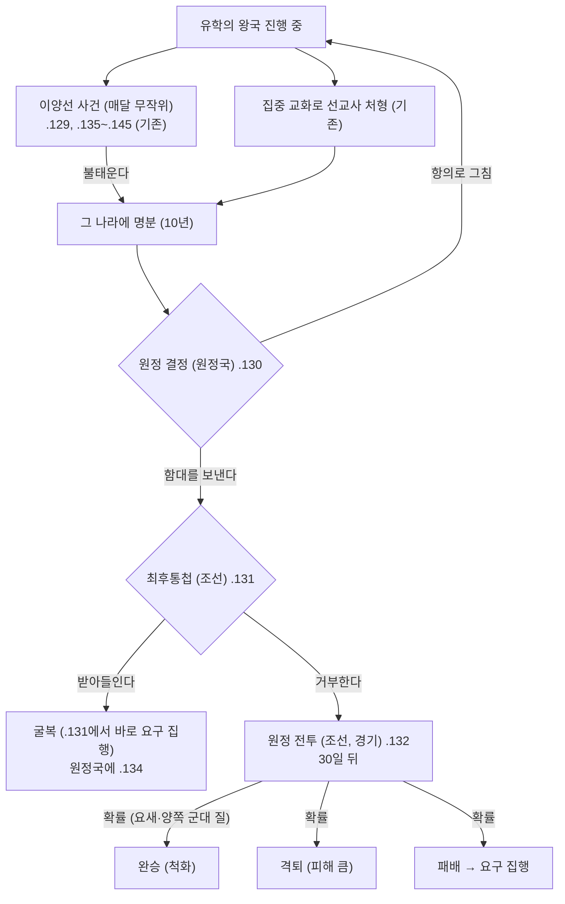

# 「유학의 왕국」 양요(洋擾) 계획 (이벤트 방식, 재작성)

> 브랜치: `joseon-confucian-absolutism`
> 수정 대상: 조선 저널 `je_korean_confu` 「유학의 왕국」 (`common/journal_entries/eafp_korean_journal.txt`)
> 참고 원형: 바닐라 일본의 가고시마 포격(`ep2_meiji_pulse.2`, 모드판 `events/000_eafp_japan_overrides.txt:1097`)
> 상태: **구현함** (게임 안 검증 전). 앞서 만든 국제 저널·외교 플레이·제한전 방식은 모두 걷어 냈다 (7절). 계획과 달라진 점은 10절

## 한눈에 보기

양요를 **이벤트만으로** 처리한다. 저널·외교 플레이·전쟁은 만들지 않는다.

1. **명분**: 조선이 선교사를 처형하거나 이양선을 불태우면, 그 나라가 조선을 칠 명분을 얻는다. (기존 그대로)
2. **원정**: 명분을 가진 열강이 함대를 보내기로 하면, 조선에 **최후통첩**이 온다.
3. **최후통첩**: 조선은 요구를 받아들이거나(굴복) 거부한다.
4. **원정 전투**: 거부하면 얼마 뒤 함대가 강화 앞바다에서 포대를 친다. 결과는 **확률**로 정해지며, 확률은 **경기(한성, `STATE_SEOUL`)의 해군 요새(`building_naval_fortification`)**, **원정국의 군대 질**, **조선의 군대 질**을 함께 따져 정한다.

가고시마 포격(생맥 사건 → 배상 요구 → 거부 → 포격)의 흐름을 그대로 가져오고, 포격의 결과만 이 확률로 가른다. 해군 요새는 바닐라 덴포 위기(`tenpo_checkbox_naval_size`)도 조건으로 쓰는 건물이다.

예치의 길에는 같은 해군 요새를 보는 완료 조건 「해안 방비」를 더한다(5절).

---

## 1. 바닐라 가고시마 포격에서 가져올 것

| 요소 | 바닐라·모드 구현 | 양요에서 |
|---|---|---|
| 발단 | 생맥 사건: 다이묘 행렬이 영국인을 해침 | 선교사 처형, 이양선 소각 → 원정국의 명분 (기존 `eafp_var_yangyo_grievance`) |
| 요구 | 모드판: 배상 요구를 받아들이면 `eafp_namamugi_compensation_paid`, 거부하면 `_refused` | 최후통첩 이벤트(`.131`)에서 받아들임 / 거부 |
| 포격 | 거부했을 때만 `ep2_meiji_pulse.2` 포격. `placement`가 해당 주, 주에 `add_devastation = 15`, 영주에 `modifier_bombardment_of_domain` | 거부했을 때만 원정 전투(`.132`). `placement`는 경기, 주에 황폐화. **결과는 해군 요새와 양쪽 군대 질로 정한 확률에 따라 셋으로 갈림** |
| 전쟁 | 없음 (이벤트로만) | 없음 |

---

## 2. 흐름



원정국에도 각 단계마다 알림 이벤트가 간다(4절).

---

## 3. 원정의 조건과 요구

**원정할 수 있는 나라** (기존 `eafp_yangyo_can_launch` 유지): 이해관계가 있는 열강(강대국 이상, 동북아 관심 표시, 조선이 아니고 조선과 전쟁 중이 아님) + 명분 변수.

**조선 쪽 조건** (`eafp_yangyo_can_start` 수정):

- 유학의 왕국이 진행 중
- 조선이 경기(`STATE_SEOUL`)를 가지고 있음
- 다른 원정이 진행 중이 아님: 조선 변수 `eafp_var_yangyo_aggressor`(원정국을 담음)가 없음. 최후통첩~원정 전투 사이에만 두고, `days = 120`으로 두어 꼬여도 저절로 풀림
- 「조선 쟁탈전」이 진행 중이 아님 (기존 그대로)

전역 변수 `eafp_yangyo_aggressor`는 더 쓰지 않는다. 원정국은 조선 변수 `eafp_var_yangyo_aggressor`에 담고, 각 이벤트의 `immediate`에서 `scope:yangyo_aggressor`로 꺼낸다(30일 지연된 이벤트에도 스코프가 확실히 남도록).

**요구** (최후통첩에 적히고, 굴복·패배 때 집행됨). 외교 플레이가 없으므로 효과로 바로 집행한다. **조약항은 요구하지 않는다.**

| 요구 | 조건 | 집행 효과 |
|---|---|---|
| 쇄국 해제 | 조선이 쇄국 (`law_isolationism`) | 조선의 무역 정책을 `law_mercantilism`으로 바꿈 |
| 배상금 | 언제나 | 조선 국고에서 원정국으로 일시금. 금액은 조선 GDP에 비례 (「집중 교화」 버튼 비용과 같은 꼴의 계산, 배율은 초안) |

조선이 이미 쇄국이 아니면 배상금만 요구한다. 두 요구는 공유 효과 `eafp_effect_yangyo_enforce_demands`(원정국은 `scope:yangyo_aggressor`)로 묶어 굴복(`.131` 받아들임)과 패배(`.132`) 두 곳에서 쓴다.

기존 트리거 `eafp_yangyo_can_demand_port`는 쓰지 않으므로 지운다.

---

## 4. 이벤트

번호는 기존 양요 번호 `.129`~`.134`를 다시 쓴다. 이양선 사건 `.135`~`.145`는 그대로 둔다.

| 번호 | 받는 나라 | 내용 |
|---|---|---|
| `.129` 이양선 출몰 | 조선 | 기존 그대로 (명분의 발단) |
| `.130` 조선 원정 결정 | 원정국 | 기존과 같지만, 「함대를 보낸다」가 외교 플레이 대신 **조선에 `.131`을 보낸다** |
| `.131` 최후통첩 | 조선 | 요구 내용을 보여 주고 받아들일지 묻는다 |
| `.132` 강화에 닥친 양요 (강화 원정) | 조선 (`placement` = 경기) | `.131`에서 거부하면 30일 뒤. 해군 요새와 양쪽 군대 질로 정한 확률로 결과가 갈린다 |
| `.133` 조선의 거부 | 원정국 | `.131`에서 거부했을 때 알림 |
| `.134` 원정 결과 | 원정국 | 조선의 굴복(`.131` 받아들임)·원정 전투 결과를 알림. 원정국 변수 `eafp_var_yangyo_outcome`(0 굴복, 1 패배 = 원정 성공, 2·3 격퇴 = 원정 실패, 30일)으로 갈래를 나눔 |

### 4.1 `.130` 원정 결정 (원정국) — 수정

| 선택지 | 효과 |
|---|---|
| `.oa` 함대를 보내 개항을 요구한다 | 명분 제거, 조선에 `eafp_var_yangyo_aggressor`, 원정국을 `scope:yangyo_aggressor`로 저장해 조선에 `.131` |
| `.ob` 외교적 항의로 그친다 | 명분 제거, 관계 -10 (기존) |

### 4.2 `.131` 최후통첩 (조선)

본문에 원정국 이름과 요구(3절 표에서 해당하는 것)를 적는다. 요구는 선택지 툴팁(`show_as_tooltip`)으로 보인다.

| 선택지 | 효과 | AI |
|---|---|---|
| `.oa` 요구를 받아들인다 | 요구 집행, 「불평등 조약」, 세계 인식 +200. 원정국에 `.134`(굴복) | 승산(4.3절)이 낮을수록 높음 |
| `.ob` 거부하고 포대를 지킨다 | 원정국과 관계 -30. 30일 뒤 조선에 `.132`. 원정국에 `.133`(거부 알림) | 승산이 높을수록 높음 |

선택지 `.ob`의 툴팁(`eafp_yangyo_odds_tt`)에 **계산식과 값**을 그대로 적는다.

```
강화 원정 승산 (30일 뒤 원정군이 들이닥칠 때에 다시 계산)
원정국 공격력 = 해군 질 30 + 육군 질 50 = 80
조선 방어력 = 요새 점수 60 (경기 해군 요새 단계 10 × 6 + 생산 방식 0) + 육군 질 45 = 105
조선 승산 = 방어력 ÷ (방어력 + 공격력) = 57% (5~95%)
• 완승 (승산 − 50) 7%
• 격퇴 50%
• 패배 43% (요구 집행)
```

원정국 쪽 값은 `[SCOPE.sCountry('yangyo_aggressor').MakeScope.ScriptValue(...)]`, 조선 쪽 값은 `[ROOT.GetCountry.MakeScope.ScriptValue(...)]`로 읽는다. 원정국 공격력은 `immediate`에서 조선 변수 `eafp_var_yangyo_attack`에 담아 승산 계산과 툴팁이 같은 값을 쓰게 한다. 30일 동안 요새를 짓거나 군대를 바꾸면 승산이 바뀌므로, 확률은 원정 전투이 일어나는 순간(`.132`의 `immediate`)에 다시 계산한다.

### 4.3 `.132` 강화 원정 (조선) — 핵심

조선이 받는 이벤트이므로 제목은 「강화에 닥친 양요」(Western Disturbance at Ganghwa, 江华洋扰), 승산 툴팁 제목은 「강화 양요의 승산」이다. 원정국 쪽 이벤트(`.133`·`.134`)와 문서에서는 이 싸움을 「강화 원정」이라 부른다.

`immediate`에서 세 요소로 확률을 계산하고 무작위로 결과를 정한다. 본문·선택지는 결과에 따라 갈린다(`triggered_desc`, 선택지 `trigger`).

**군대 질: 실제 부대의 스탯** (스크립트 값)

군대 질은 병력 수가 아니라 **지금 가진 부대·함선의 평균 스탯**으로 본다. 원정은 함대 일부만 오므로 전체 규모는 맞지 않는다.

| 점수 | 계산 |
|---|---|
| 육군 질 `eafp_yangyo_army_quality` (나라 스코프) | 모든 육군 부대(`every_military_formation` → `every_combat_unit`)의 **기본 공격 + 기본 방어** 평균 × (1 + 그 나라의 `unit_offense_mult`·`unit_defense_mult` 평균). 부대 종류별 기본값은 바닐라 `combat_unit_types`에서 가져온다 |
| 해군 질 `eafp_yangyo_navy_quality` (나라 스코프) | 모든 함선(`every_scope_ship`)의 **선체 화력 + 장갑** 평균. 함선 종류별 기본값은 바닐라 `ship_types`에서 가져온다 |
| 요새 점수 `eafp_yangyo_fort_score` (조선) | 경기 해군 요새 단계 × 6. 생산 방식이 강화(`pm_naval_fortification_reinforced`)면 +15, 최신(`pm_naval_fortification_advanced`)이면 +30 |

스크립트에서 부대의 실제 공격·방어 수치를 직접 읽을 수는 없다(현지화 함수로만 보임). 그래서 부대·함선마다 **종류**(`has_unit_type`, `is_ship_type`)를 보고 바닐라 기본값을 더한 뒤 수로 나누어 평균을 낸다. 기술·법률로 붙는 공격·방어 배율은 나라의 모디파이어 값(`modifier:unit_offense_mult` 등)으로 곱한다.

종류별 기본값 (바닐라 1.15.2, 공격+방어 / 화력+장갑):

| 육군 | 값 | 해군 | 값 |
|---|---|---|---|
| 비정규 보병 | 20 | 전열함 | 37 |
| 선형 보병 | 45 | 프리깃 | 25 |
| 산병 보병 | 60 | 철제 프리깃 | 47 |
| 참호 보병 | 70 | 초기 철갑함 | 110 |
| 분대 보병 | 90 | 모니터함 | 80 |
| 기계화 보병 | 110 | 해안 방어함 | 100 |
| 대포 포병 | 40 | 현대 철갑함 | 185 |
| 기동 포병 | 45 | 어뢰정 | 54 |
| 유산탄 포병 | 70 | 방호 순양함 | 158 |
| 공성 포병 | 85 | 전드레드노트 | 230 |
| 경기병(후사르) | 25 | 그 밖의 후기 함선 | 바닐라 값 그대로 |
| 용기병 | 45 |  |  |
| 흉갑기병 | 45 |  |  |
| 창기병 | 50 |  |  |
| 해병(하·중·상) | 45 / 60 / 70 |  |  |

수송선·보급선은 전투함이 아니므로 해군 평균에서 뺀다.

**확률**

- 원정국 공격력 = 원정국 해군 질 + 원정국 육군 질
- 조선 방어력 = 요새 점수 + 조선 육군 질
- 조선 승산(완승 + 격퇴) = 방어력 ÷ (방어력 + 공격력), 5~95%로 자름 (`eafp_yangyo_repel_chance`)
- 그 가운데 완승 = 승산 − 50을 넘는 몫. 승산이 50 이하면 완승은 없음
- 나머지는 패배

예 (1840년대): 조선은 요새 없음, 비정규 보병 위주(방어력 20). 원정국은 프리깃·전열함(해군 질 약 30), 선형 보병(육군 질 약 45 × 1.1)으로 공격력 약 80 → 승산 20%. 조선이 경기에 해군 요새 10단계(60)를 짓고 선형 보병(45)으로 바꾸면 방어력 105 → 승산 57% (완승 7%, 격퇴 50%).

`random_list`의 가중치를 이 스크립트 값으로 준다(`modifier = { add = ... }`). 정해진 결과는 조선 변수 `eafp_var_yangyo_result`(3 완승, 2 격퇴, 1 패배)에 담고, 원정 전투이 끝나면 원정국 변수 `eafp_var_yangyo_outcome`으로 넘겨 `.134`를 보낸다.

| 결과 | 조선 효과 | 원정국 |
|---|---|---|
| **완승** | 「척화」(10년: 정통성 +, 유림 승인도 +, 쇄국 지지 +). 경기 황폐화 +5 | `.134` 원정 실패: 위신 -, 조선과 관계 - |
| **격퇴** | 「척화」(5년), 경기 황폐화 +15 (가고시마와 같은 값) | `.134` 원정 실패 |
| **패배** | 요구 집행(3절), 경기 황폐화 +20, 「불평등 조약」(5년), 세계 인식 +200 | `.134` 원정 성공: 위신 + |

- 조선은 게임 시작 때 경기에 해군 요새가 없다(바닐라·모드 히스토리 모두). 요새도 군대 질도 낮으면 승산이 크게 떨어진다.
- 완승·격퇴 때 선택지는 기존 `.133`처럼 둘: 척화비를 세운다 / 저들의 무기부터 알아야 한다(혁신 +).
- 원정 전투이 끝나면 조선의 `eafp_var_yangyo_aggressor`를 지운다.

### 4.4 `.133` 조선의 거부 (원정국)

조선이 최후통첩을 거부했다는 알림. 효과 없음.

### 4.5 `.134` 원정 결과 (원정국)

굴복·원정 성공이면 「조선 굴복」(위신 +), 원정 실패면 「원정 실패」(위신 -)와 조선과 관계 -20. 갈래는 `eafp_var_yangyo_outcome`으로 나눈다.

---

## 5. 예치의 길: 「해안 방비」 조건 추가

| 항목 | 내용 |
|---|---|
| 조건 | **해안 방비** (`_haebang`): 경기의 해군 요새가 **5단계 이상** |
| 트리거 | `eafp_yechi_cond_haebang = { s:STATE_SEOUL.region_state:KOR ?= { state_has_building_type_levels = { target = bt:building_naval_fortification value >= 5 } } }` |
| 체크박스 | `eafp_yechi_checkbox_haebang` (custom loc) |
| 충족 개수 | `eafp_yechi_conditions_completed`에 한 줄 추가. 조건이 **9개**가 된다 |
| 본문 | 유학의 왕국 체크리스트에 한 줄 추가, 요약 줄의 `/#v 8#!`을 `/#v 9#!`로 |
| 필요 개수 | **9개 중 7개** (조건이 하나 늘었으므로 필요 개수도 하나 늘림) |

필요 개수 6 → 7에 맞춰 바뀌는 곳: 유학의 왕국 월간 처리의 `eafp_yechi_conditions_completed >= 6`, 요약 줄 체크박스 `eafp_yechi_checkbox_conditions`, 세 언어 본문의 `#v 6#!개 이상`. 같은 숫자가 세 곳에 흩어져 있으므로 스크립트 값 `eafp_yechi_conditions_required`(7) 하나로 묶는다.

`docs/joseon_confucian_absolutism.md`의 3.4·3.5절과 체크리스트 예시도 함께 고친다.

---

## 6. 디버그 결단

| 결단 | 처리 |
|---|---|
| `kor_yangyo_make_interested_power`, `_fire_ship_event`, `_grant_grievance`, `_become_aggressor` | 그대로 |
| `kor_yangyo_launch_now` | 원정국 하나를 골라 `.130`의 「함대를 보낸다」와 같은 처리(조선에 `.131`) |
| `kor_yangyo_set_fort_level` **신규** | 경기 해군 요새를 0 → 5 → 10단계로 누를 때마다 바꿈. 승산 변화와 예치 조건 확인용 |
| `kor_yangyo_force_result` **신규** | 다음 원정 전투의 결과를 완승 → 격퇴 → 패배 순으로 고정(조선 변수). 확률과 상관없이 세 결과의 효과를 확인하는 용도 |
| `kor_yangyo_make_opened` | 그대로 (배상금 요구 갈래 확인용) |
| `kor_yangyo_reset` | 조선의 `eafp_var_yangyo_aggressor`만 지움 |
| `kor_yangyo_gauge_near_escalation`, `_gauge_near_repel` | **삭제** (게이지 없음) |
| `kor_yechi_complete` | 그대로 |

---

## 7. 걷어 낼 기존 구현 (국제 저널·외교 플레이·제한전)

| 파일 | 걷어 낼 것 |
|---|---|
| `common/journal_entries/eafp_korean_yangyo.txt` | 파일 삭제 (국제 저널 `je_eafp_yangyo`) |
| `common/diplomatic_plays/eafp_diplomatic_plays.txt` | `dp_eafp_yangyo`, `dp_eafp_yangyo_free` |
| `common/battle_conditions/eafp_yangyo_battle_conditions.txt` | 파일 삭제 (전용 전술 6개) |
| `common/script_values/occupation_values.txt` | 파일 삭제 (바닐라 덮어쓰기 해제) |
| `common/scripted_progress_bars/eafp_kor_progress_bars.txt` | `eafp_progress_bar_yangyo` |
| `common/on_actions/korea_code_on_actions.txt` | `eafp_yangyo_battle_score`, `eafp_yangyo_on_back_down`, `eafp_yangyo_on_wargoal_enforced` |
| `common/on_actions/00_code_on_actions_definition.txt` | `on_battle_won` 블록, `on_diplo_play_back_down`·`on_wargoal_enforced`에 넣은 양요 줄 |
| `common/scripted_triggers/eafp_kor_triggers.txt` | `eafp_yangyo_war_over`, `eafp_yangyo_korean_commander`, `eafp_yangyo_expedition_commander`, `eafp_yangyo_can_demand_port` |
| `common/scripted_effects/eafp_korea_effects.txt` | `eafp_effect_yangyo_launch`(외교 플레이 생성)를 최후통첩 방식으로 재작성, `eafp_effect_yangyo_war_begins`·`eafp_effect_yangyo_cleanup` 삭제 |
| `common/static_modifiers/eafp_korea_rework_modi.txt` | `eafp_modi_yangyo_outgunned` 삭제. 척화·양이의 무기·불평등 조약·원정 실패·조선 굴복은 재사용 |
| `events/eafp_kor_events/eafp_kor_mainline.txt` | `.130`~`.134` 재작성 |
| 현지화 (세 언어) | 저널·막대·외교 플레이·전투 조건·점령 점수 키 삭제, `.130`~`.134` 문구 재작성, 해안 방비 조건·디버그 결단 키 추가 |

남기는 것: 명분 변수와 선교사 처형 연결, 이해관계 열강·원정 조건 트리거, 이양선 사건 `.129`·`.135`~`.145`와 그 모디파이어, 「집중 교화」 툴팁.

새 상태: 조선의 `eafp_var_yangyo_aggressor`(120일, 최후통첩~원정 전투) 하나. 디버그용 결과 고정 변수는 디버그 결단에서만 쓴다. 전역 변수와 제한전 변수는 없어진다.

---

## 8. 정할 것

| 항목 | 제안 | 다른 안 |
|---|---|---|
| 점수 배율 | 요새 단계 × 6, 생산 방식 +15/+30, 부대·함선 평균 스탯 그대로 | 게임에서 승산을 보고 조정 |
| 승산 공식 | 방어력 ÷ (방어력 + 공격력) | 차이 기반 (50 + 방어력 − 공격력) |
| 완승 비중 | 승산 − 50 | 승산의 일정 비율 (예: 승산의 1/3) |
| 포격까지 시간 | 30일 | 즉시 / 90일 (그사이 요새를 지을 시간) |
| 배상금 배율 | 「집중 교화」 비용 계산의 몇 배 | 원정국 수입 기준 |

## 9. 구현 전 확인할 점

- `STATE_SEOUL`의 해군 요새 최대 단계(`has_max_level = yes`). 요새 점수의 최대치(40)가 실제로 닿는지 확인한다.
- 건물의 생산 방식을 이벤트에서 읽는 방법(`has_active_production_method` 등).
- `random_list` 가중치에 스크립트 값을 쓰는 방식(`modifier = { add = ... }`)이 동작하는지.
- 스크립트 값 안에서 `every_military_formation` → `every_combat_unit`, `every_scope_ship`으로 합계를 내는 방식(바닐라 `je_values.txt`·`ai_script_values.txt`가 쓰는 꼴)과, 부대 수로 나누는 평균 계산.
- 나라 스코프에서 `modifier:unit_offense_mult` 같은 모디파이어 값을 읽을 수 있는지(바닐라 `00_diplomacy_values.txt`는 `modifier:country_liberty_desire_add`를 읽음).
- 부대·함선이 하나도 없는 나라: 평균을 0으로 두고, 원정국에 함선이 없으면 원정 결정(`.130`) 자체를 막는다.
- 이벤트 사슬에서 저장한 스코프(`scope:yangyo_aggressor`)가 30일 지연된 `.132`까지 넘어가는지. 안 되면 조선 변수에 원정국을 담는다.
- 원정국이 그사이 조선과 전쟁을 벌이거나 사라지면 `.132`를 취소한다(`cancellation_trigger`).

## 10. 구현 메모 (계획과 달라진 점)

| 항목 | 계획 | 구현 |
|---|---|---|
| 원정 진행 표시 | 조선 변수 `eafp_var_yangyo_in_progress` | 같은 자리에 원정국 자체를 담는 `eafp_var_yangyo_aggressor`(120일). 진행 표시와 원정국 전달을 한 변수로 함 |
| 굴복 이벤트 | `.134`를 조선·원정국 양쪽에 | 조선 쪽 처리는 `.131` 「받아들인다」 선택지에서 바로 하고, `.134`는 원정국 전용 결과 이벤트로 씀 |
| `.133` | 원정국의 거부·결과 알림 | 거부 알림만. 결과는 `.134` |
| 디버그 「이미 개항한 조선 만들기」 | 쇄국 해제 + 조약항 | 조약항 요구가 없어졌으므로 쇄국 해제만 (`kor_yangyo_make_opened`) |
| 원정 가능 조건 | — | 원정국에 전투함이 하나 이상 있어야 함 (`eafp_yangyo_warship_count > 0`) |
| 배상금 | 「집중 교화」 비용 계산의 몇 배 | 같은 계산의 2배, 최소 1000 (`eafp_yangyo_indemnity`) |

