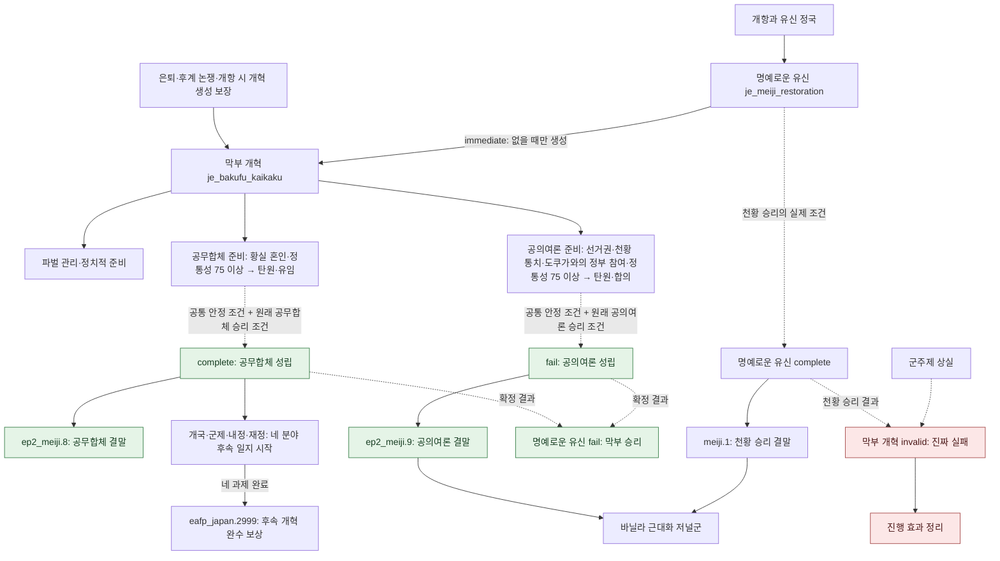
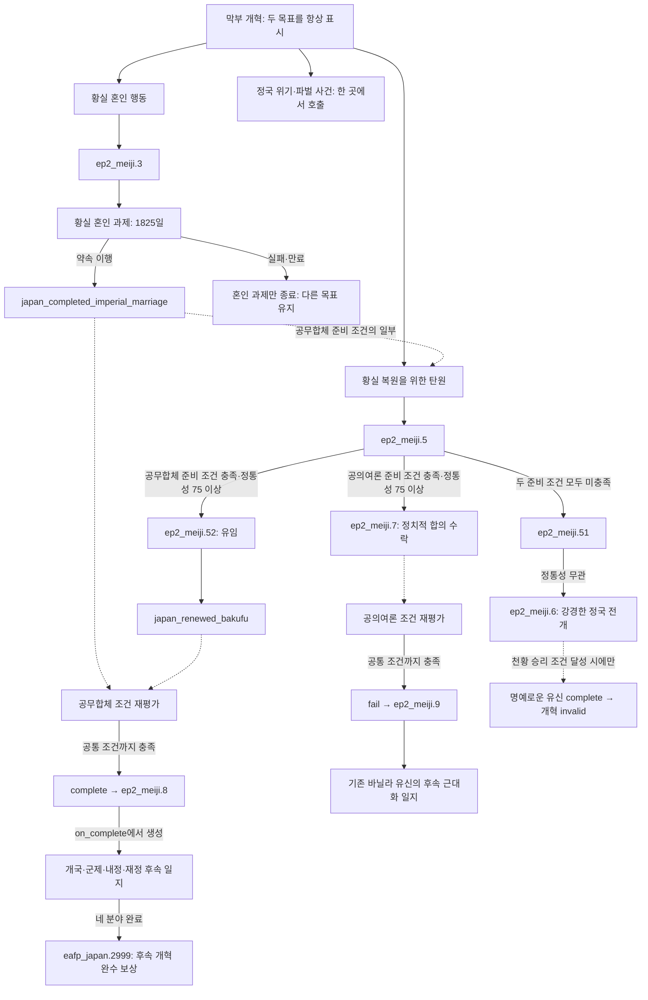

# 막부 개혁 저널 리워크 계획

이 문서는 `je_bakufu_kaikaku`의 별도 리워크 설계안이다. **2026-10-27 게임 스크립트에 반영했다.** 현재 구현은 `japan_content.md`에서 설명하며, 이 계획에서는 막부의 정치적 승리를 공무합체와 공의여론으로 나누고 두 목표를 동시에 추진하게 한다.

2026-10-27 보완: 저널 제목·본문은 공통으로 유지하고 세 분기는 header로만 구분한다. 공무합체 이후 네 분야 일지 연결을 명시하고, 별도 결과 변수에 flag 값을 저장하는 설계는 제거했다. `C:/Users/user/Documents/GitHub/Vic3-vanilla`의 유신 JE·전략 버튼·결말 이벤트·공무합체 업적을 직접 확인하고, 바닐라의 `set_variable = 이름` / `has_variable = 이름` 방식으로 상태를 기록하도록 수정했다. 참조본과 실제 플레이할 게임 버전의 일치 여부는 구현 시 확인한다.

## 설계 원칙

- `complete`는 **공무합체 성립**, `fail`은 **공의여론 성립**이다. 둘 다 막부 개혁의 성공이다.
- 진짜 실패는 `invalid`와 `on_invalid`에서 처리한다. 명예로운 유신의 천황 승리는 반드시 이 경로로 연결한다.
- 개혁 방향을 미리 선택하거나 전환하는 버튼은 사용하지 않는다. 혼인 교섭, 막부 쇄신, 선거권 확대와 정국 협상을 병행할 수 있다.
- 현재 명예로운 유신의 막부 승리 조건에서 **사전 노선 지정 부분만 제거**하고, 실질적인 국가 상태·혼인·쇄신·정통성·운동·내전 조건은 보존한다.
- 명예로운 유신에 붙어 있는 막부의 정치적 대응, 개혁 관련 사건과 결말 처리는 막부 개혁으로 모은다. 명예로운 유신은 천황 승리와 유신 정국의 공통 상태를 담당한다.
- 두 저널이 서로의 종료를 기다리는 구조를 만들지 않는다. **막부 개혁이 실제 승리 조건을 판정하고 결말을 확정하면, 명예로운 유신이 그 결과를 받아 막부 승리로 종료**한다.
- 네 분야 일지 `je_bakufu_kaikoku`·`je_bakufu_guntai`·`je_bakufu_naibu`·`je_bakufu_zaisei`는 **공무합체 성공 후 시작하는 후속 개혁**으로 옮긴다. 공의여론 성공은 기존 바닐라 유신의 근대화 저널군으로 이어진다. 두 정치 목표의 병행 추진은 그대로 유지한다.
- 결과는 바닐라의 개별 변수 존재 여부로 확인한다. `kobu_gattai`·`kogi_yoron`은 결말 확정 시 설정하고, `japan_restoration_complete`·`japan_emperor_restored`와 기존 EAFP 완료 변수를 필요한 의미에 맞게 조합한다. 별도 결과 enum이나 같은 결과를 복제하는 신규 변수를 만들지 않는다.

## 현재 구현에서 해결할 문제

| 현재 구현 | 리워크 방향 |
| --- | --- |
| 네 분야 개혁 완료만으로 `eafp_japan.2999`를 호출하고 전체 개혁 완료 변수 설정 | 정치적 성공을 먼저 판정하고, 공무합체 성공 후 네 분야 일지 시작. 네 분야 완료 보상은 후속 단계에서 별도 처리 |
| 명예로운 유신에서 `kobu_gattai`·`kogi_yoron`을 선택하고 한 노선만 검사 | 막부 개혁에 두 목표를 항상 표시하고 각각 검사 |
| 막부 개혁 `invalid`가 막부법·막번체제 저널 상실을 즉시 실패로 취급 | 공의여론 추진 중에는 두 조건을 유지 요건으로 삼지 않음 |
| `on_invalid`도 `bakufu_kaikaku_complete_var`를 설정 | 성공 표식과 진짜 실패 결과를 분리 |
| `japan_restoration_complete`가 천황 승리·막부 승리·군주제 상실에 모두 설정됨 | 이 변수만으로 막부 개혁의 성공·실패를 판정하지 않음 |
| `japan_emperor_restored`가 천황 승리와 공의여론 양쪽에 설정됨 | 이 변수도 진짜 실패 판정으로 사용하지 않음 |
| 황실 혼인 실패 시 공의여론을 강제로 선택 | 혼인 과제의 실패만 처리하고 다른 목표 진행도는 그대로 유지 |
| 두 저널에서 같은 사건·결말을 호출할 가능성 | 결말별 실행 주체를 한곳으로 고정하고 재호출 방지 |

## 저널과 결말의 역할

| 저널 | 엔진 분기 | 화면에 보일 의미 | 주된 실행 내용 |
| --- | --- | --- | --- |
| 막부 개혁 | `complete` / `on_complete` | 공무합체 성립 — 개혁 성공 | 공무합체 결과 기록, `ep2_meiji.8` 호출, 네 분야 후속 일지 시작 |
| 막부 개혁 | `fail` / `on_fail` | 공의여론 성립 — 개혁 성공 | 공의여론 결과 기록, `ep2_meiji.9` 호출 및 기존 바닐라 근대화 연결 유지 |
| 막부 개혁 | `invalid` / `on_invalid` | 막부 개혁 좌절 — 진짜 실패 | 임시 효과 정리, 별도 실패 알림 없이 종료 |
| 명예로운 유신 | `complete` / `on_complete` | 천황 승리 | 천황 승리 결과 기록, `meiji.1` 호출, 막부 개혁 무효화 조건 성립 |
| 명예로운 유신 | `fail` / `on_fail` | 막부 승리 | 막부 개혁의 공무합체·공의여론 확정 결과를 받아 종료 |
| 명예로운 유신 | `invalid` / `on_invalid` | 군주제 기반 상실 | 공통 정리, 막부 개혁의 진짜 실패 조건 성립 |

`fail`이라는 스크립트 이름이 공의여론의 실패를 뜻하지 않도록 조건·효과 header를 공의여론으로 표시한다. 류큐 경쟁의 일본 승리/중국 승리처럼 하나의 저널에서 다른 두 결말을 표현하며, 분기별 제목·설명 세트는 추가하지 않는다.

## 성공 조건

### 공통 조건

두 성공 분기에 다음 조건을 공통으로 적용한다.

1. 명예로운 유신이 활성화된 유신 정국이며, 아직 최종 결말이 확정되지 않았다.
2. 군주제를 유지한다.
3. 정부 정통성 `legitimacy >= 75`.
4. 진행 중인 내전이 없다. 현재 바닐라의 `NOT = { any_civil_war = { civil_war_progress > 0 } }` 판정을 보존한다.
5. 유신파 운동이 존재하면 해당 운동의 지지가 5% 미만 **또는** 급진성이 50% 미만이다. 운동이 없으면 이 조건은 충족한다.
6. 명예로운 유신의 천황 승리 조건이 성립하지 않았다.

개혁 저널이 이에나리 은퇴·후계 논쟁 등으로 개항 전에 생성되더라도 파벌 관리 등 정치적 준비만 진행한다. 네 분야 후속 일지는 아직 시작하지 않는다. 최종 성공은 유신 정국에서 판정하여 개항 전 조기 종료를 막는다.

### 공무합체: `complete`

공통 조건에 더해 다음을 모두 만족한다.

- `law_bakufu`를 유지한다.
- `japan_completed_imperial_marriage`가 있다.
- 정통성이 75 이상인 상태에서 나머지 준비 조건을 갖추고 **황실 복원을 위한 탄원**을 실행했다.
- 탄원에 대한 유임 응답으로 `japan_renewed_bakufu`를 얻었다. 조건만 갖추거나 탄원만 실행해서는 완료되지 않는다.

명예로운 유신의 실질 조건을 바탕으로, 준비 완료 → 탄원 → 유임 응답 순서를 적용한다. `has_variable = kobu_gattai`는 선행 조건에서 제거한다. 혼인과 쇄신은 **달성한 성과**이며 노선 선택 표식이 아니다.

### 공의여론: `fail`

공통 조건에 더해 다음을 모두 만족한다.

- `country_has_voting_franchise = yes`.
- 다이묘 이해집단이 정부에 참여한다.
- 그 이해집단 지도자가 `house_tokugawa`를 가진다.
- 통치자가 `house_yamato`를 가진다.
- 정통성 75 이상과 위 준비 조건을 갖춘 상태에서 탄원하고, `.7`의 정치적 합의를 수락하여 `japan_taikunate_var`를 얻었다.

현재 명예로운 유신의 공의여론 승리 조건에 해당한다. `has_variable = kogi_yoron`은 선행 조건에서 제거한다. **막부법 유지는 요구하지 않는다.** 천황이 통치하더라도 도쿠가와가 정부의 핵심으로 남아 준비 조건을 갖추면 탄원할 수 있다. 탄원 응답을 수락하기 전에는 개혁이 성공하지 않는다.

### 병행 추진과 결말 우선순위

황실 혼인을 추진하면서 선거권 확대와 정부 구성을 준비할 수 있다. 한쪽 행동을 했다는 이유로 다른 버튼이나 목표를 숨기지 않으며, 혼인 실패도 공의여론 자동 선택이나 개혁 전체 실패를 일으키지 않는다.

다만 최종 정치 체제는 하나만 확정한다. 탄원 클릭 시 두 준비 조건을 평가하고, 해당 응답을 수락한 뒤 **모든 성공 조건**을 충족해야 결말이 성립한다. 다른 노선의 일부 성과만으로 저널을 종료하지 않는다. 두 조건이 같은 평가에서 모두 참인 예외 상황에는 공무합체를 우선한다. 공의여론의 최종 판정에 `NOT = { 공무합체 최종 조건 }`을 넣어 엔진의 `complete`·`fail` 평가 순서에 의존하지 않는다. 이 우선순위는 사전 노선 선택이 아니라 중복 결말 방지 규칙이다.

## 진짜 실패와 정상적인 체제 변화의 구분

`invalid`는 다음 상황을 다룬다.

- 명예로운 유신의 천황 승리 조건이 성립했거나 천황 승리 결과가 확정되었다.
- 군주제가 사라져 공무합체와 공의여론 모두 성립할 수 없다.
- 저널이 소유할 수 없는 국가로 넘어간 경우 등 구조적으로 진행 불가능한 상태. 원국의 정상 진행 실패와 잘못 전달된 저널의 정리 모두 별도 실패 알림 없이 처리한다.

다음은 단독 실패 조건으로 사용하지 않는다.

- 막부법 폐지.
- `je_bakuhantaisei` 종료.
- 천황의 통치 시작.
- 황실 혼인 과제의 실패·기한 만료.
- 정통성·운동 진정 조건의 일시적 미충족.
- `japan_restoration_complete` 또는 `japan_emperor_restored`의 존재만으로 판단하는 경우.

천황 승리 판정은 명예로운 유신의 실제 `complete` 조건을 공용 판정으로 재사용한다. 현행 기준은 천황 특성의 군주, 막부법 부재, 내전 부재, 도쿠가와가 아닌 다이묘 이해집단 지도자, 해당 상태에서 누적된 `restoration_timer_var >= 6`이다. 공의여론의 도쿠가와 지도자 조건과 구별되므로 천황 즉위만으로 개혁이 실패하지 않는다.

공무합체·공의여론이 이미 확정된 후의 법률 변화가 과거 개혁 성공을 뒤집지 않도록 한다. 실패 시에는 `bakufu_kaikaku_complete_var`를 설정하지 않는다.

## 전체 저널 흐름

실선은 생성·결말 실행, 점선은 조건 판정 또는 결과 전달을 뜻한다. 한 줄에 놓인 사건이 항상 시간순으로 발생한다는 의미는 아니다.



공무합체에서는 개혁 `on_complete`가 네 분야 EAFP 후속 일지를 생성한다. `ep2_meiji.8`에는 같은 생성 처리를 중복 추가하지 않으며 바닐라 근대화 저널군을 새로 연결하지 않는다. 공의여론의 `ep2_meiji.9`와 천황 승리의 `meiji.1`이 가진 바닐라 근대화 연결을 보존한다. 여기서 공의여론의 유신 연결은 종료된 `je_meiji_restoration` 본체의 재생성이 아니라 기존 후속 근대화 일지로의 연결이다.

## 막부 개혁으로 모을 기능

| 현재 위치·항목 | 계획상의 담당과 조치 |
| --- | --- |
| 유신 저널의 막부 승리 `fail` 조건 | 공무합체·공의여론의 실질 조건을 개혁 저널 두 분기로 분리. 유신 `fail`에는 확정 결과 수신만 남김 |
| 유신 `on_fail`의 `.8`·`.9` 호출과 결과 표시 | 개혁 `on_complete`·`on_fail` 및 각 `event_outcome_*_effect_desc`로 이동 |
| 유신의 `decide_shogunate_strategy` 버튼과 `ep2_meiji.2` | 사전 노선 결정·전환 기능을 폐지. `.2`는 정상 진행에서 호출하지 않음 |
| 유신의 황실 혼인 버튼·`ep2_meiji.3`·혼인 저널 | 개혁 저널의 공무합체 과제로 관리. 혼인 버튼의 `kobu_gattai` 선행 조건 제거 |
| 황실 복원 탄원 버튼·`ep2_meiji.5 → .52 / .7 / .51 → .6` | 개혁 저널의 실제 정국 행동으로 배치. 사전 노선 flag 분기와 노선 강제 전환 제거 |
| `japan_renewed_bakufu`·혼인 달성 상태 | 개혁 저널의 성과 판정으로 모으고 UI에 표시 |
| 유신의 월간 정국 사건 풀 | 막부 통치에 대한 위기·대응 사건의 호출을 개혁 저널로 모음. 원래 유신 정국에서만 발생하던 시점 조건은 별도로 유지 |
| 막부 승리 후 `japan_restoration_complete`·공의여론의 `japan_emperor_restored` 설정 | 개혁의 각 성공 콜백에서 한 번만 실행 |
| 막부 승리 후 에조 AI 국가 병합 조건 | 기존 공의여론 성공 부속 처리를 개혁의 공의여론 콜백으로 이동. 천황 승리·군주제 상실 때의 유신 처리는 유지 |
| `modifier_meiji_interregnum`의 JE 부착·참조 | 개혁 사건에서 발생하는 정국 효과이므로 개혁 JE에 부착하도록 대상 스코프 변경 |
| 유신 설명의 막부 전략 안내·노선별 효과 미리보기 | 개혁의 공통 본문과 공무합체·공의여론 header 아래 조건·효과 미리보기로 모음 |

명예로운 유신에는 천황 위젯, 천황 승리 조건·6개월 계산, 유신파 생성, 천황 승리 이벤트, 혁명·보신전쟁의 공통 연결을 남긴다. `번과 다이묘` 위젯과 캐시는 양측 정국에서 사용하는 공통 정보이므로 유지한다. 개혁 생성 보장 호출과 결말 결과 수신은 두 저널을 연결하는 데 필요한 최소 연결이다.

### 월간 사건 호출의 담당

개혁 저널이 다음 최초 호출 후보를 담당한다.

- `ep2_meiji_pulse.1` 나마무기 사건과 그 후속 `.11 → eafp_japan.4006 → .2`.
- `ep2_meiji_pulse.3` 시모노세키, `.4` 공사관 방화, `.5` 이이 나오스케 암살.
- `ep2_meiji_pulse.6` 이케다야, `.7 → .8` 금문의 변·조슈 정벌, `.9` 양이 명령.
- `eafp_japan.4004` 후지산 등반, `.4008` 낭인의 외국인 습격.

기존 개혁의 파벌 사건 `.2181~.2184`도 개혁 JE가 계속 담당한다. `.4008`처럼 양쪽 풀에 있던 사건은 호출 항목을 하나만 남긴다. 후속 사건을 월간 후보로 새로 넣지 않는다.

유신 정국 사건은 `has_journal_entry = je_meiji_restoration`을 추가 진입 조건으로 삼아 개혁의 조기 생성 때문에 발생 시점이 앞당겨지지 않게 한다. 이벤트 고유 trigger·cooldown·외국 수신국을 보존한다. 두 풀을 합칠 때 기존 무사건 가중치까지 고려하여 월간 총 발생 빈도가 과도하게 늘지 않도록 별도 비교한다.

## 두 목표를 병행하는 행동 설계

### 황실 혼인

황실 혼인 버튼은 개혁 저널에 배치하고 `.3`의 기존 혼인·파벌 효과를 사용한다. 막부법, 정통성 50 초과, 섭정 아님, 내전 아님, 기존 1회 실행 제한은 유지한다. 사전 `kobu_gattai` 지정만 제거한다.

`je_meiji_imperial_marriage`는 별도 과제로 유지하되 상위 진행 여부를 막부 개혁에 연결한다. 관련 조약 해소, 국경 폐쇄, 자유무역 부재, 본토 조약항 부재 및 1825일 기한을 보존한다. 완료 시 `japan_completed_imperial_marriage`를 설정한다.

실패·기한 만료 시 혼인 상태와 관련 효과만 정리한다. `remove_variable = kobu_gattai`·`set_variable = kogi_yoron`과 강제 노선 전환 문구는 제거한다. 상위 개혁이 종료되면 미완료 혼인 과제를 정리하며, 이 정리가 상위 저널의 다른 결말을 일으켜서는 안 된다.

### 황실 복원을 위한 탄원과 결말 확정

황실 혼인과 공의여론의 정치적 준비는 병행한다. 별도의 막부 쇄신 승인 버튼은 두지 않고, 기존 **황실 복원을 위한 탄원**을 두 결말의 공통 정국 행동으로 사용한다. 버튼을 누른 순간의 조건을 사건 범위의 값으로 전달하며, 사전 노선 선택이나 국가 변수에 flag를 저장하는 방식은 사용하지 않는다.

| 탄원 클릭 시점의 국가 상태 | 사건 | 결과 |
| --- | --- | --- |
| 공무합체 준비 조건 충족: 황실 혼인 완료·막부법 유지·정통성 75 이상·공통 조건 | `ep2_meiji.5 → .52` | 쇼군 유임 응답에서 `japan_renewed_bakufu` 설정. 완료 조건을 유지하면 개혁 `complete` |
| 공의여론 준비 조건 충족: 선거권·천황 통치·도쿠가와 지도자의 다이묘 이해집단 정부 참여·정통성 75 이상·공통 조건 | `ep2_meiji.5 → .7` | 정치적 합의 응답에서 기존 `japan_taikunate_var` 설정. 완료 조건을 유지하면 개혁 `fail`로 공의여론 성공 |
| 두 준비 조건 모두 미충족 | `ep2_meiji.5 → .51 → .6` | 정통성이 높아도 강경한 정국 전개. 대기 중 조건을 갖춰도 온건한 합의로 바뀌지 않음 |

두 준비 조건이 동시에 충족되면 공무합체를 우선한다. 분기는 클릭 시점에 고정되지만, 최종 저널 완료에는 실제 국가 상태와 응답 수락을 모두 요구한다. 두 결말 모두 준비 조건만 갖추거나 탄원만 실행해서는 완료되지 않는다.

공무합체 준비 판정에는 `japan_renewed_bakufu`를, 공의여론 준비 판정에는 `japan_taikunate_var`를 요구하지 않는다. 최종 완료 판정에서만 탄원 실행 표식과 각 응답 표식을 요구한다. 버튼 실행 시 두 과거 성과 표식을 지워 새 답변 전에 완료되는 것을 막고, 기존 탄원 1회 제한은 유지한다.

막부법을 유지하는 국가와 이미 천황이 통치하는 국가 모두 탄원할 수 있다. 준비 조건 미달 자체는 버튼을 막지 않으며, 섭정·내전·군주제 상실과 재실행은 제한한다. `.52`의 유임과 `.7`의 정치적 합의는 각각 선택지에서 기록한다. 부모 저널이 종료되었으면 지연 사건을 취소한다.

공의여론은 이미 천황 통치와 선거권을 갖춘 상태이므로 `.51`의 과두제 전환을 거치지 않는다. `.7`도 기존 선거권 법률을 지주 선거제로 되돌리지 않으며, 지주 선거제일 때만 기존 대군제 수정안을 적용한다. `.51`은 두 조건 모두 미충족한 탄원의 처리로 한정하고 항상 `.6`으로 연결한다. 강경 사건 자체로 개혁을 즉시 무효화하지 않으며, 진짜 실패는 천황 승리 등 기존 `invalid` 조건에서 확정한다.

### 공무합체 이후의 네 분야 개혁

기존 `je_bakufu_kaikoku`(개국), `je_bakufu_guntai`(군제), `je_bakufu_naibu`(내정), `je_bakufu_zaisei`(재정)를 **공무합체 성립 이후의 후속 일지**로 전환한다. 공무합체·공의여론을 준비하는 동안에는 생성하지 않으며, 두 정치적 성공의 선행 조건으로도 사용하지 않는다.

**시작 처리:** 개혁 `on_complete`에서 `set_variable = kobu_gattai`, `set_variable = bakufu_kaikaku_complete_var`, `set_variable = japan_restoration_complete`를 실행한 뒤 전용 시작 effect를 호출하여 네 일지를 함께 시작한다. 이 effect는 세 변수의 존재와 `kogi_yoron`의 부재를 확인한다. 기존 `kaikaku_start`를 후속 일지 시작 표식으로 재사용하여 생성 전에 설정하고, 이후 재호출은 건너뛴다. 각 일지가 이미 활성화되었거나 해당 완료 변수가 있으면 다시 생성하지 않는다. `on_fail`과 `on_invalid`에서는 이 effect를 호출하지 않는다.

현재 `japan_bakufu_kaikaku_button`은 정치적 결말 전에 네 일지를 생성하므로 개혁 JE에서 제거하고 기존 생성 경로를 폐지한다. 시작 처리는 성공 콜백으로 옮긴다. 기존 버튼의 파벌 비율 50% 초과 조건은 정치적 결말이 난 뒤의 추가 관문으로 재사용하지 않으며, 부모 JE 종료 후 사라진 버튼을 눌러야 하는 구조도 만들지 않는다. 기존 `kaikaku_start` 참조는 전체 검색하여 정치적 준비 상태와 후속 개혁 시작 상태를 혼동하지 않도록 정리한다.

**쇄신 선행 조건:** `japan_renewed_bakufu`는 공무합체 준비 조건을 충족한 뒤 탄원하여 `ep2_meiji.5 → .52`의 유임 응답에서 얻는다. 네 과제 완료를 통해 이 변수를 얻는 경로는 사용하지 않는다. 공무합체 성공을 위해 공무합체 이후 일지를 먼저 완료해야 하는 순환 의존을 막는다.

**부모 종료 후 유지:** 네 일지의 `invalid`에 있는 `NOT = { has_journal_entry = je_bakufu_kaikaku }`는 제거하고 위의 세 변수 존재·`kogi_yoron` 부재 조합을 유지 근거로 사용한다. `je_bakuhantaisei`·`je_meiji_restoration`의 활성 여부에도 의존하지 않는다. 이들 일지는 이제 공무합체 전용이므로 기존 막부법 유지 조건과 내정 일지의 막부법·군주제·정부·교육·행정 조건은 유지한다. 공의여론을 위해 네 일지의 법률 조건을 완화하던 이전 설계는 폐기한다. 후일 막부법을 상실하면 해당 후속 일지만 기존 방식으로 무효화하며, 이미 확정된 공무합체 성공은 뒤집지 않는다.

**완료와 보상:** 네 개 기존 완료 변수와 각 일지의 보상은 유지한다. 각 `on_complete`가 자기 완료 변수를 기록한 뒤 공용 완료 점검 effect를 호출한다. 이 effect는 공무합체 결과·네 완료 변수·보상 미지급 여부를 확인하고, 보상 표식을 먼저 설정한 다음 `eafp_japan.2999`를 한 번 호출한다. 부모 JE는 이미 종료되었으므로 부모의 pulse나 `on_complete`에서 네 분야 완수를 기다리지 않는다. `.2999`의 제목·설명은 공무합체 이후 근대화 개혁의 완수를 설명하도록 바꾸고 기존 생산·외교 보상은 유지한다. 여기서는 `bakufu_kaikaku_complete_var`·`japan_restoration_complete`·정치적 결말을 다시 기록하지 않는다.

부패 효과와 후속 개혁 사건은 해당 일지의 완료·무효화 때 정리한다. 부모의 성공 후 정리가 새로 생성한 네 일지나 그 진행 효과를 지우지 않도록 구분한다. 공의여론에서는 네 EAFP 일지를 생성하지 않고 `ep2_meiji.9`를 통한 기존 바닐라 유신의 후속 근대화 일지와 보상을 그대로 사용한다.

## 이벤트 흐름



## 공통 제목·본문과 분기별 header

참고 대상은 바닐라 `common/journal_entries/01_ryukyu_rivalry.txt`와 `localization/korean/ep2_01_l_korean.yml`이다. 류큐는 `custom_completion_header`·`custom_failure_header`로 두 승리 조건을 구분하고, `custom_on_completion_header`·`custom_on_failure_header` 및 `event_outcome_*_effect_desc`로 각 승리의 효과를 설명한다. 진짜 실패 조건은 reason 본문에 별도로 안내한다.

막부 개혁에도 같은 실제 필드를 사용한다. 지원 여부를 확인하지 않은 `complete_desc`·`fail_desc`·`custom_invalid_header` 같은 필드를 임의로 추가하지 않는다.

```text
custom_completion_header = je_bakufu_kaikaku_kobu_gattai_header
custom_on_completion_header = je_bakufu_kaikaku_on_kobu_gattai_header
custom_failure_header = je_bakufu_kaikaku_kogi_yoron_header
custom_on_failure_header = je_bakufu_kaikaku_on_kogi_yoron_header
```

저널 제목은 **막부 개혁**, 설명은 공통 `je_bakufu_kaikaku_reason` 하나로 유지한다. 세 분기에 독립적인 `title`·`desc` 키를 만들거나 본문에 세 개의 서술 블록을 나열하지 않는다. 두 성공 목표는 항상 함께 표시하고, 조건·효과 구역의 header만 다르게 둔다.

| 분기 | 조건 header | 효과 header | 표시 방식 |
| --- | --- | --- | --- |
| `complete` | 공무합체 성립 조건 | 공무합체 성립 시 | `custom_completion_header`·`custom_on_completion_header` |
| `fail` | 공의여론 성립 조건 | 공의여론 성립 시 | `custom_failure_header`·`custom_on_failure_header` |
| `invalid` | 막부 개혁 실패 조건 | 별도 효과 header 없음 | 공통 reason 안에 실패 조건의 header를 참조하고 조건만 간단히 안내 |

header 현지화 초안은 다음과 같다. 별도 분기 제목 키를 참조하지 않고 header 자체에 표시 문구를 둔다.

```yaml
je_bakufu_kaikaku_kobu_gattai_header: "#bold 공무합체#! 성립 조건:\n"
je_bakufu_kaikaku_kogi_yoron_header: "#bold 공의여론#! 성립 조건:\n"
je_bakufu_kaikaku_on_kobu_gattai_header: "#bold 공무합체#! 성립 시:\n$EFFECT$"
je_bakufu_kaikaku_on_kogi_yoron_header: "#bold 공의여론#! 성립 시:\n$EFFECT$"
je_bakufu_kaikaku_invalid_header: "#bold 막부 개혁 실패 조건:#!\n"
```

`je_bakufu_kaikaku_reason`에는 공통 도입과 두 목표의 병행 가능 여부를 적고, `$je_bakufu_kaikaku_invalid_header$` 아래에 천황 측 최종 승리·군주제 상실 등 실제 실패 조건만 짧게 안내한다. 별도 분기 설명 키는 참조하지 않는다. `invalid_header`는 공통 본문에서 사용하는 현지화 키이며, 확인되지 않은 `custom_invalid_header` 엔진 필드를 추가한다는 뜻이 아니다. 실제 성공 조건 수치는 `complete`·`fail`의 trigger tooltip에서 표시하고 후속 일지의 차이는 각 효과 미리보기에 표시한다. 기존 결말 이벤트 `.8`·`.9`의 제목·본문은 그대로 사용하며 JE용 분기 제목·설명으로 다시 정의하지 않는다.

- 공무합체 효과 미리보기: `.8`의 조정·막부 국가 효과, 천황의 특성·개인 효과, 네 분야 후속 일지 시작, EAFP 정치적 정국 정리. `.2999`의 네 분야 완수 보상은 즉시 보상으로 표시하지 않는다.
- 공의여론 효과 미리보기: `.9`의 근대화 JE 연결과 현대화 운동, 선택지별 국가·도쿠가와 인물 효과, EAFP 성공 후 정리.
- 진짜 실패: reason에서 조건을 설명하고 `on_invalid`에서 별도 실패 알림 없이 임시 효과를 정리한다. `event_outcome_failed_effect_desc`는 공의여론 성공에 사용하므로 진짜 실패 설명을 여기에 넣지 않는다.
- 미리보기는 실제 이벤트·선택지 효과와 일치시킨다. 표시용 `event_outcome_*_effect_desc`를 별도 실제 보상 경로로 사용하지 않는다.
- 한국어·영어·중국어 간체의 공통 본문과 header 현지화를 함께 작성한다. 외부 이름·전략용 custom localization도 사전 노선 선택에 의존하지 않도록 점검한다.

## 결과 기록과 저널 간 동기화

### 바닐라에서 확인한 기록 방식

- `events/japan_events/ep2_meiji_restoration.txt`의 `ep2_meiji.2`는 선택지에서 `set_variable = kobu_gattai` 또는 `set_variable = kogi_yoron`을 실행한다. 값을 담는 결과 변수는 없다.
- `common/journal_entries/00_meiji_restoration.txt`의 `on_fail`은 `has_variable`로 두 변수를 읽어 `.8`·`.9` 중 하나를 호출하고 `japan_restoration_complete`를 설정한다. 공의여론에서는 `japan_emperor_restored`도 설정한다.
- 같은 JE의 천황 승리 `on_complete`는 `japan_emperor_restored`와 `japan_restoration_complete`를 설정한다. 군주제 상실의 `on_invalid`도 `japan_restoration_complete`를 설정하므로 이 변수 하나는 승자나 성공을 나타내지 않는다.
- `common/achievements/ep2_achievements.txt`의 공무합체 업적은 `kobu_gattai`와 `japan_restoration_complete`의 존재 및 `modifier_court_and_shogunate`를 확인한다.

**저장·조회 문법과 기존 변수 이름은 이 방식을 그대로 사용한다.** 다만 병행 추진 요구에 맞추어 `kobu_gattai`·`kogi_yoron`의 설정 시점은 바닐라의 사전 전략 선택에서 각 결말의 성공 콜백으로 옮긴다. 진행 중 두 변수를 모두 설정하여 병행을 표현하지 않는다. 대신 혼인·쇄신·선거권·정부 구성의 실제 상태를 독립적으로 검사한다.

### 사용할 변수와 판정

| 기존 변수 | 계획에서의 의미와 설정 주체 |
| --- | --- |
| `kobu_gattai` | 개혁 `on_complete`에서 공무합체 확정 시 설정. 반대 변수 `kogi_yoron`은 제거 |
| `kogi_yoron` | 개혁 `on_fail`에서 공의여론 확정 시 설정. 반대 변수 `kobu_gattai`는 제거 |
| `japan_restoration_complete` | 정치적 유신 정국의 종료. 개혁의 두 성공 콜백, 유신의 천황 승리·군주제 상실 콜백에서 설정 |
| `japan_emperor_restored` | 바닐라대로 천황 승리와 공의여론에서 설정. 공무합체는 설정하지 않음 |
| `bakufu_kaikaku_complete_var` | 기존 EAFP 연동용 개혁 성공 표식. 공무합체·공의여론에서만 설정하고 `on_invalid`에서는 설정하지 않음 |
| `eafp_japan_reform_journal_started` | 기존 부모 JE 생성 방지 표식. 성공·실패 후에도 유지 |
| `kaikaku_start` | 기존 네 분야 일지 시작 표식. 공무합체 성공 후 시작 effect에서 설정 |

공무합체 확정은 아래 조합으로 검사한다. 공의여론은 두 노선 변수의 위치를 바꾸고 `japan_emperor_restored`의 존재도 확인한다. 공용 scripted trigger로 묶어 재사용하되, 판정 결과를 별도 변수로 다시 저장하지 않는다.

```text
has_variable = bakufu_kaikaku_complete_var
has_variable = japan_restoration_complete
has_variable = kobu_gattai
NOT = { has_variable = kogi_yoron }
```

명예로운 유신 `fail`은 위 공무합체 확정 조합 또는 공의여론 확정 조합만 검사한다. 노선 변수 하나나 `japan_restoration_complete` 하나만으로 성공을 판정하지 않는다. 결말 이벤트가 아직 열려 있어도 후속 처리가 가능하도록 일시적인 보상 modifier는 종료 판정에 사용하지 않는다.

천황 측이 먼저 승리한 경우는 `japan_restoration_complete`와 `japan_emperor_restored`가 있고 EAFP 개혁 성공 표식이 없는 상태로 구별한다. 유신 JE가 아직 처리되기 전에는 공용 천황 승리 조건을 직접 검사한다. 군주제 상실은 실제 법률 상태로 판정한다. 개혁 `on_invalid`는 별도 실패 알림 없이 정리만 실행하며, 천황 승리·체제 붕괴를 나타내는 별도 결과 변수는 추가하지 않는다.

`eafp_japan_ensure_reform_journal`은 기존 시작 표식을 유지하고 `bakufu_kaikaku_complete_var` 및 `japan_restoration_complete`가 없는지도 확인한다. 시작 표식이 부모 JE의 진짜 실패 후 재생성을 막고, 유신 종료 표식이 정국 종료 후 신규 생성을 막는다. `.2999` 보상 중복 방지에 필요한 추가 표식은 결과 분류용이 아닌 1회 실행 여부로만 사용하며 바닐라와 같은 변수 존재 검사 문법을 쓴다.

두 노선 변수를 사전 선택으로 읽거나 강제로 바꾸던 버튼·이벤트·혼인 JE·custom localization은 모두 교체한다. 바닐라 업적이 읽는 기존 이름과 최종 성공 상태는 보존한다. 바닐라가 전략 선택에 사용하던 변수의 **설정 시점 변경**은 이 리워크의 의도적인 차이로 문서화한다.

### 실행 주체와 순서

**막부 승리:**

1. 개혁 JE가 공용 공통 조건과 각 승리 조건을 검사한다.
2. 해당 성공 콜백에서 실제 승리 조건과 미종료 상태를 재확인한다. `bakufu_kaikaku_complete_var` 또는 `japan_restoration_complete`가 이미 있으면 결말을 재실행하지 않는다.
3. 해당 노선 변수를 `set_variable`로 설정하고 반대 노선 변수는 제거한다. `bakufu_kaikaku_complete_var`와 `japan_restoration_complete`를 설정한다. 공의여론에서는 기존 `japan_emperor_restored`·에조 처리도 적용한다. 표식 설정 이후 같은 미종료 조건을 다시 검사하여 자신의 후속 처리를 막지 않도록 한다.
4. `.8` 또는 `.9`를 한 번만 호출한다. 공무합체에서는 `on_complete`가 네 분야 후속 일지 시작 effect도 한 번 실행한다. 공의여론에서는 `.9`의 기존 바닐라 근대화 연결을 유지한다. 필요한 통치자·전 쇼군·천황 스코프와 생존 인물은 결과 이벤트가 읽을 때까지 보존한다.
5. 명예로운 유신의 `fail`은 확정된 두 성공 결과만 검사한다. 그 `on_fail`에서 결과 이벤트·보상·근대화 JE를 다시 만들지 않는다.
6. 막부 인사·파벌·지역 관리와 미완료 혼인 과제는 기존 종료 처리와 연결하되, 결과 이벤트에 필요한 인물이나 이해집단 지도자를 먼저 은퇴시키지 않도록 정리 순서를 확인한다. 새로 시작한 네 분야 후속 일지와 그 진행 효과는 정치적 정국의 종료 정리에서 제외한다.

**천황 승리:**

1. 유신 `complete`와 개혁 `invalid`가 같은 천황 승리 trigger를 참조한다. 막부 성공 trigger는 이 조건을 명시적으로 제외한다.
2. 유신이 먼저 평가되면 `on_complete`가 바닐라의 두 변수 `japan_emperor_restored`·`japan_restoration_complete`를 설정하고 `meiji.1`을 호출한다. 다음 개혁 평가에서는 두 변수 존재와 개혁 성공 표식 부재를 확인해 `invalid`로 종료한다.
3. 개혁이 먼저 평가되면 `on_invalid`가 실제 천황 승리 조건에 따라 별도 실패 알림 없이 정리만 처리한다. 여기서 유신의 두 종료 변수를 대신 설정하지 않으며 천황 승리 판정에 쓰는 타이머·법률·인물을 변경하지 않는다. 유신은 기존 천황 승리 조건으로 종료하여 자신의 변수를 설정하고 `meiji.1`을 호출한다.
4. 개혁 `on_invalid`에서는 `meiji.1`을 호출하지 않는다. 개혁과 유신 어느 쪽에서도 별도의 개혁 실패 알림을 호출하지 않는다.
5. 군주제 상실 시 개혁은 법률 조건에 따라 무효화하고, `japan_restoration_complete`의 설정은 바닐라대로 유신 `on_invalid`가 담당한다. 개혁의 실패 정리는 노선 변수나 성공 표식을 새로 설정하지 않는다. 이미 공무합체·공의여론 확정 조합을 만족하면 개혁의 무효화 대상에서 제외하고 해당 변수들을 보존한다.

명예로운 유신의 천황 승리를 `japan_restoration_complete`로 판별하거나, 개혁의 성공을 유신 `fail` 발생 후에만 허용하는 순환 구조는 사용하지 않는다. `remove_journal_entry`만 실행하여 `on_invalid`가 실행될 것이라고 가정하지도 않는다.

## 파일별 구현 범위

| 파일·정의 | 작업 |
| --- | --- |
| `common/journal_entries/eafp_japan.txt` | 개혁의 두 성공 분기·무효화·표시·사건 풀, 공무합체 후 네 분야 일지 시작, 네 일지의 부모 활성 의존 제거와 완료 점검 연결 |
| `common/journal_entries/eafp_00_meiji_restoration.txt` | 막부 행동·결말 효과를 개혁으로 옮기고, 천황 승리 및 확정 결과 수신 유지. 혼인 JE의 필요한 변경도 같은 관련 파일에 정의 |
| `common/scripted_buttons/eafp_japan_buttons.txt` | 혼인·탄원 버튼 변경, 별도 쇄신 승인 버튼 제거, 사전 전략 선택 호출 및 기존 네 분야 개혁 시작 버튼 경로 제거 |
| 일본 관련 `common/scripted_effects/` | 공무합체 후 네 분야 일지의 중복 없는 시작 effect, 각 일지 완료 후 `.2999`의 1회 보상을 판정하는 공용 effect |
| 일본 관련 `common/scripted_triggers/` | 천황 승리·공통 안정·공무합체·공의여론 판정을 각각 한곳에 정의하여 JE·미리보기·사건이 공유 |
| `common/scripted_effects/eafp_japan_succession_effects.txt` | 개혁 생성 보장 조건에 최종 결과 반영. 쇼군 후계자의 뜻·승계 계산은 유지 |
| `events/000_eafp_japan_overrides.txt` | 이미 존재하는 일반 ID 교체 사건은 그 정의를 수정. `.3`·`.52` 등의 현행 EAFP 추가 효과 보존 |
| 바닐라 `.5`·`.51`·필요한 `.6/.7` 교체 정의 | 전략 flag 의존 제거, 스코프·정국 JE modifier 대상을 개혁으로 변경. 실제 군주·정부 구성 효과는 보존 |
| `events/eafp_jap_events/eafp_japan.txt` | `.2999`를 공무합체 후 네 분야 개혁 완수 성과로 수정, 정국 사건 및 후속 개혁 사건의 활성 조건 점검 |
| 일본 `customizable_localization`·GUI | 공통 제목·본문 유지, 두 목표의 header와 조건·효과를 함께 표시. 파벌의 기존 명망·평균 충성도 계산 유지 |
| `localization/{korean,english,simp_chinese}/` | 공통 reason·분기별 header·버튼·후속 일지 효과 미리보기·네 분야 완수 이벤트 문구. JE 분기별 title·desc는 추가하지 않음 |
| `documentation/japan_content.md` | 구현 완료 후에만 현재 콘텐츠와 흐름도 갱신 |

이벤트 로더는 `REPLACE:`를 지원하지 않으므로 바닐라 교체 사건은 `000_eafp_japan_overrides.txt`에 일반 ID로만 정의한다. 동일 ID를 다른 파일에 중복 추가하지 않는다. 바닐라 수정 부분의 주석은 저장소의 기존 `#수정`·`#추가` 및 원문 보존 방식에 맞춘다. 저널·버튼·custom localization의 바닐라 교체에는 저장소의 `REPLACE:` 방식을 사용한다.

## 구현 순서

1. 바닐라의 변수 존재 검사에 맞춰 공용 승리 조건과 확정 상태 조합을 정의한다. 별도 결과 enum을 도입하지 않고, 실패 시 EAFP 성공 표식을 설정하는 현재 경로부터 분리한다.
2. 개혁 JE의 `complete`·`fail`·`invalid`와 유신 JE의 결과 수신을 함께 수정한다. 한쪽만 적용한 상태를 완성으로 보지 않는다.
3. 노선 선택을 제거하고 혼인·탄원·유임 또는 정권 반환의 흐름을 연결한다. 기존 버튼의 visible·possible·selected·AI 조건까지 수정한다.
4. 네 분야 개혁을 공무합체 이후로 옮기고 시작·유지·완료 집계를 부모 JE에서 분리한다. `.52`의 선행 쇄신과 `.2999`의 후속 개혁 완수 보상을 구분하고 혼인 과제의 종료 처리를 맞춘다. 공의여론의 기존 바닐라 근대화 연결을 보존한다.
5. 월간 사건 호출을 모으고 기존 풀의 중복을 제거한다. 법률·인물·이념에 따른 실제 사건 효과는 보존한다.
6. 공통 제목·본문과 류큐 방식의 조건·효과 header, 효과 미리보기를 정리한다. 진짜 실패 시 별도 알림은 표시하지 않는다. 분기별 제목·설명 세트는 만들지 않는다.
7. 정적 검사와 게임 내 두 저널의 동시 종료 시험을 마친 뒤 통합 문서를 갱신한다.

## 검증 기준

| 시험 상황 | 기대 결과 |
| --- | --- |
| 개항 전 개혁 저널 생성 | 정치적 준비 가능, 네 분야 후속 일지 미생성, 최종 성공은 아직 불가 |
| 혼인과 선거권 확대를 함께 추진 | 두 목표 표시와 진행이 유지됨. 선택 flag로 상대 행동을 잠그지 않음 |
| 정치적 결말 전 기존 개혁 시작 버튼·생성 경로 확인 | 네 분야 일지를 조기 생성할 수 없음. 유임은 준비 조건 충족 후 탄원의 `.52` 응답으로 달성 |
| 공무합체 후 네 분야 모두 완료 | 부모 JE가 없어도 `.2999`와 기존 생산·외교 보상 1회, 정치적 결말은 재실행하지 않음 |
| 어느 목표든 정통성 75 미만 | 탄원 시 `.51 → .6` 강경 경로 |
| 혼인·공통 조건 충족, 정통성 75 이상, 탄원 전 | 공무합체 미성립, 두 목표 준비 계속 가능 |
| 같은 조건에서 탄원 후 유임 응답 전 | 공무합체 미성립, `.52` 응답 대기 |
| 유임 응답 수락, 완료 조건 유지 | 개혁 `complete`, `.8` 및 네 후속 일지 1회 |
| 공무합체 조건 전부 충족 | 개혁 `complete`, `.8` 1회, 네 EAFP 후속 일지 시작, 유신은 막부 승리 종료 |
| 공무합체 후 부모 개혁·막번체제·유신 JE 종료 | 네 분야 일지가 즉시 무효화되지 않고 독립적으로 진행됨 |
| 후속 일지 시작 effect 재호출 | 활성·완료·기종료 일지 재생성 없음, 내정 진행도 초기화 없음 |
| 공무합체 후 막부법 상실 | 미완료 후속 일지만 무효화 및 부패 효과 정리. 과거 정치적 성공은 유지 |
| 공의여론 준비 조건 충족, 막부법 없음, 탄원 전 | 버튼 사용 가능, 저널은 아직 미완료 |
| 공의여론 조건을 갖춰 탄원한 뒤 `.7` 합의 수락 | 개혁 `fail`이 성공으로 표시, `.9` 1회, 기존 바닐라 근대화 일지 연결, 네 EAFP 일지 미생성 |
| 정통성 100이지만 두 준비 조건 모두 미충족 | `.51 → .6`, 이후 조건을 갖춰도 `.7`로 바뀌지 않음 |
| 탄원 후 조건·정통성 변동 | 클릭 시 분기는 유지, 실제 완료는 국가 상태와 응답 수락을 재확인 |
| 천황 즉위, 도쿠가와 IG 지도자 유지 | 즉위만으로 개혁이 무효화되지 않음 |
| 막부법 폐지·막번체제 종료 후 공의여론 준비 | 정치적 개혁 저널 유지, 막부 보직 종료와 분리. 네 분야 후속 일지는 아직 없음 |
| 유신의 천황 승리 조건 충족 | 유신 `complete`, `meiji.1` 1회, 개혁 `invalid`, 개혁 성공 표식 없음 |
| 군주제 상실 | 진짜 실패 처리, 성공 보상 없음 |
| 혼인 과제 실패·기한 만료 | 과제만 종료, 공의여론 자동 선택 및 개혁 전체 실패 없음 |
| 두 성공 조건 동시 충족 | 공무합체만 확정, 네 EAFP 후속 일지만 생성, 공의여론 보상·바닐라 근대화 일지 중복 생성 없음 |
| 정치적 결말 전 변수 확인 | `kobu_gattai`·`kogi_yoron`이 모두 없어도 두 목표를 병행하고 달성 가능 |
| 결말별 변수 확인 | 공무합체·공의여론은 해당 노선 변수 하나와 두 완료 표식 존재. 천황 승리·군주제 상실에는 EAFP 성공 표식 없음 |
| 종료 변수의 의미 확인 | `japan_restoration_complete`만으로 성공 판정하지 않음. `japan_emperor_restored`가 있는 공의여론을 천황 승리로 오인하지 않음 |
| 저널 평가 순서를 바꿔 재현 | 어느 순서에서도 결말·보상 각 1회, 별도 실패 알림 없음 |
| 결과 이벤트가 열린 상태에서 JE 정리 | 전 쇼군·천황 등 스코프와 인물 유지, 빈 초상화·효과 누락 없음 |
| 내전 발생·혁명국 생성 | 원국과 혁명국이 같은 막부 결말을 중복 실행하지 않음. 바닐라 보신전쟁 경로 유지 |
| 성공·실패 뒤 개혁 생성 effect 재호출 | 종료한 개혁이 다시 생성되지 않음 |
| 정국 사건 월간 호출 조사 | 각 최초 사건은 한 풀에서만 호출, 후속 사건과 외국 응답 경로 유지 |
| UI·현지화 검사 | 공통 제목·본문을 유지하고 분기별 header만 구분함. 별도 분기 title·desc 키 없음. 두 성공 조건을 함께 표시하고 공의여론을 실패로 안내하지 않음. 조건·결과 알림·선택지별 효과가 실제 결과와 일치 |

정적 검사에서는 사전 `kobu_gattai`·`kogi_yoron` 참조 잔존, 개혁의 막부법 강제 유지 조건, `.8/.9/.2999`의 호출 중복, `bakufu_kaikaku_complete_var`의 실패 경로 기록, 미리보기와 실제 효과의 차이를 검색한다. 실제 엔진에서는 `fail` 완료 알림·로그의 기본 표현까지 확인한다. 사용자 정의 헤더로 바뀌지 않는 공의여론 알림은 해당 알림·현지화를 별도로 조정하며, 모든 JE의 실패 표시를 전역 변경하지 않는다.

## 확인한 원본

- EAFP: `common/journal_entries/eafp_japan.txt`, `eafp_00_meiji_restoration.txt`, `common/scripted_buttons/eafp_japan_buttons.txt`, `common/scripted_effects/eafp_japan_succession_effects.txt`, `events/000_eafp_japan_overrides.txt`, `events/eafp_jap_events/eafp_japan.txt`.
- 바닐라: `common/journal_entries/00_meiji_restoration.txt`, `01_ryukyu_rivalry.txt`, `common/scripted_buttons/07_meiji_buttons.txt`, `events/japan_events/ep2_meiji_restoration.txt`, `common/customizable_localization/victoria_ep2_custom_loc.txt`, `common/achievements/ep2_achievements.txt`.
- 바닐라 현지화: `localization/korean/ep2_01_l_korean.yml`, `ep2_04_l_korean.yml`.
- 이번에 직접 읽은 바닐라 참조본: `C:/Users/user/Documents/GitHub/Vic3-vanilla`. 주요 근거는 `ep2_meiji.2`의 개별 노선 변수 설정, 유신 JE의 세 종료 콜백, `.9`의 `je_meiji_main` 및 후속 개혁 연결, 공무합체 업적의 변수 존재 검사다.

## 적용 및 검증 상태

- 두 성공 분기, 실제 실패, 바닐라 변수 기록, 세 독립 행동, 혼인 실패의 강제 전환 제거를 적용했다.
- 공무합체 후 네 EAFP 일지 시작 및 개별 완료 집계, 공의여론의 기존 바닐라 근대화 연결을 적용했다.
- 정국 사건의 호출 주체를 개혁 JE로 옮기되 기존 무사건 120·사건 합 75 가중치를 보존했다.
- 공통 본문·분기 header와 후속 개혁 완수 문구를 한국어·영어·중국어 간체에 반영했다.
- 정적 검사와 제한된 상태 모형 검사는 `tools/validate_japan_reform.py`에서 수행한다. 실제 게임에서의 동시 종료, 알림·초상화·보신전쟁 및 세이브 호환성은 아직 플레이 검증하지 않았다.
