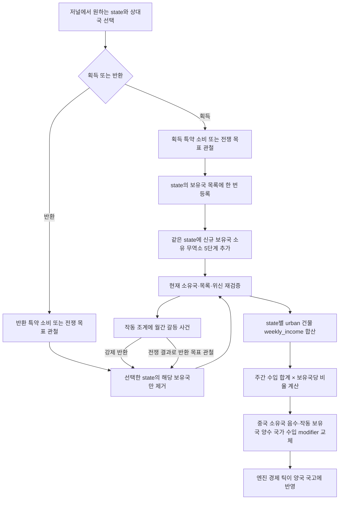
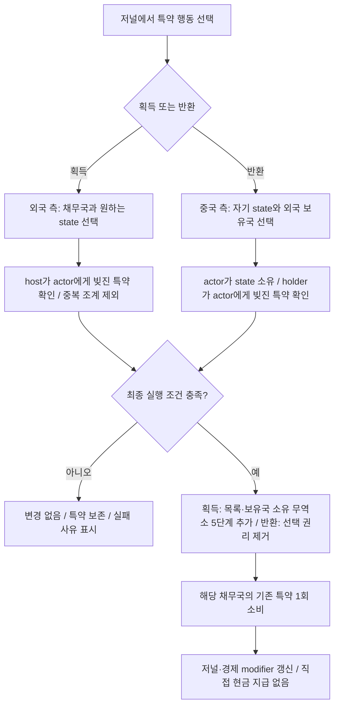
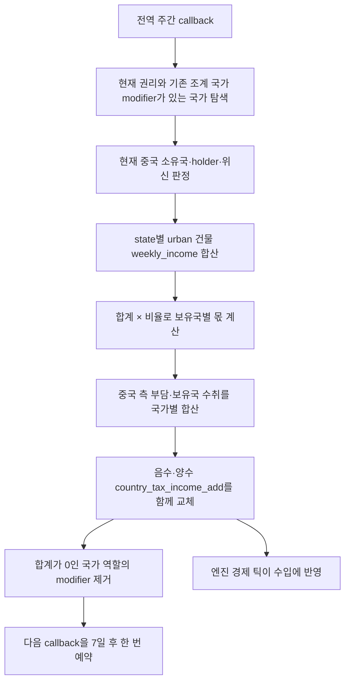
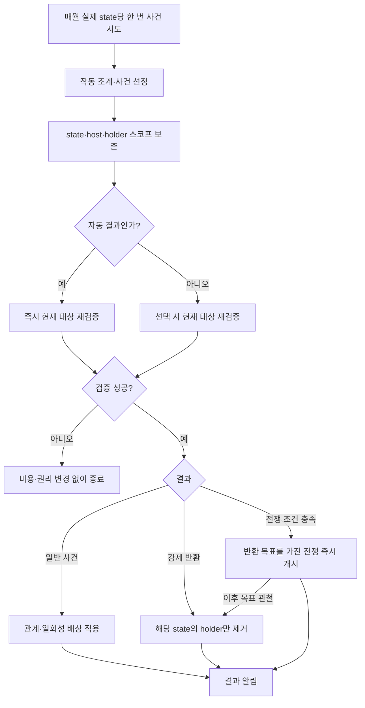

# 중국 조계지 설계·구현 계획

수정일: 2026-10-18. 최신 수정사항을 반영한 코드 작성용 명세다. 이번 작업은 계획 문서 수정이며 게임 스크립트를 활성화하거나 변경하지 않는다. 예시 비율과 사건 가중치는 밸런스 초안이고, 로컬 문법 확인과 게임 실행 검증은 구분한다.

## 1. 확정 규칙

1. 외국 측 저널에서 특약을 소비해 원하는 state의 조계를 획득한다. 중국 측 저널에서는 자신이 현재 소유하는 state의 외국 조계를 반대 방향의 특약으로 반환한다.
2. 획득·반환 전쟁 목표, 월간 사건의 자동 전쟁·강제 반환은 유지한다.
3. 대상 지리는 기존 `geographic_region_han_homelands`를 사용한다. 별도의 관내18성 주 ID 목록이나 프로빈스 거점을 만들지 않는다.
4. 권리의 원본은 실제 state의 `concession_owner_varlist`다. state와 외국 보유국의 조합은 하나뿐이며 규모·확대·상한·주권 침해량을 계산하지 않는다.
5. 현재 주 소유국 위신이 보유국보다 높으면 해당 조계의 경제 효과와 신규 사건을 중단한다. 동률이면 작동하며, 중단된 권리도 반환할 수 있다.
6. 영향받는 건물은 게임 분류상 `category = urban`에 속하는 **도시 건물 전체**다. 도심지·공장 외에도 해당 분류에 속하는 건물을 포함한다.
7. 각 state의 도시 건물 전체 `weekly_income` 합계를 기준으로 보유국별 조계 수입을 계산한다. 해당 주의 중국 소유국에는 음수, 작동 중인 외국 보유국에는 같은 금액의 양수 `country_tax_income_add` modifier를 적용한다.
8. 건물의 수입·산출량·투입량·임금·지분은 조계 경제 효과로 변경하지 않는다. 경제 부담과 이익은 양국의 국가 수입 modifier로만 처리하며, 기본 조계 수입에 직접 현금 지급 효과를 추가하지 않는다.
9. 매주 갱신하는 것은 현금 지급이 아니라 **modifier 값**이다. 기존 값을 교체하므로 여러 번 갱신해도 누적 지급이 생기지 않는다. 월간 갈등 사건은 별도 처리한다.
10. 영속 변경번호·지급 완료 표시·버전 저장값을 두지 않는다. 현재 주·소유국·보유국 목록·위신을 직접 검사하고, 기록된 과거 상태와 비교하는 체계를 만들지 않는다.
11. 직접 조회 가능한 수치는 계산식으로 읽는다. 조계 규모·추정 세원·유지비·사건 수입 배율·위신 상한 같은 설정 변수도 만들지 않는다.
12. 국가가 해당 state의 조계를 새로 획득할 때, 같은 state에 그 국가가 직접 소유하는 무역소(`building_trade_center`) 5단계를 추가로 부여한다. 특약·획득 전쟁 목표에 동일하게 적용하고, 이미 보유한 조계의 중복 처리·작동 재개·정기 갱신에서는 부여하지 않는다.



이 문서는 실행 가능한 API가 확인된 부분과 아직 확인되지 않은 부분을 구분한다. 건물 수입을 낮추는 modifier는 필요 없다. 남은 필수 확인 사항은 건물 `weekly_income`의 스크립트 조회와 양수·음수 `country_tax_income_add`의 금액 단위 및 실제 예산 반영이다.

## 2. 대상 지리와 실제 state

### 2.1. 기존 geographic region 사용

이 저장소의 `concept_china_proper_desc`는 중국 본토·관내18성을 한족 본토 주 지역으로 설명하며, 관련 코드도 `geographic_region_han_homelands`를 사용한다. 따라서 설치·반환 화면·경제 처리·사건의 공통 지리 조건을 다음으로 통일한다.

```paradox
# 현재 스코프: 실제 state
is_in_geographic_region = geographic_region_han_homelands
```

정의는 기본 게임 `common/geographic_regions/04_geographic_regions_asia.txt`에 있다. 현재 설치본의 이 지역에는 `STATE_SHENGJING`과 `STATE_FORMOSA`도 포함되어 있다. 이번 명세는 사용자가 지정한 **기존 geographic region을 사용한다는 규칙**을 우선하여 이 정의를 그대로 따른다.

주 지역 수를 상수로 고정하지 않는다. 생성이 필요한 지역별 반환 전쟁 목표도 해당 geographic region의 최종 정의에서 지역 목록을 얻는다. 다른 모드가 지역 정의를 바꾼다면 런타임 지리 검사와 생성된 목표 목록이 일치하는지 검증한다.

권리와 계산은 실제 state 단위다. 같은 state_region이 여러 국가로 나뉘어 있으면 각 state의 건물과 권리 목록을 독립 처리한다. 신규 설치에서 조약항 state를 제외하는 기존 자격 조건은 유지한다.

### 2.2. 스코프 계약

| 스코프 | 타입 | 의미 |
| --- | --- | --- |
| `concession_state` | state | 사용자가 선택한 주. 권리와 도시 건물 수입 합산의 기준 |
| `concession_host` | country | 현재 `concession_state.owner` |
| `concession_holder` | country | 해당 주의 외국 보유국 또는 신규 획득국 |
| `concession_actor` | country | 획득 버튼에서는 holder, 특약 반환 버튼에서는 host |
| `concession_region` | state_region | 지리와 반환 목표 ID용 파생값. 권리 저장소가 아님 |

특약 반환 버튼은 중국 국가이면서 현재 해당 state 소유자일 때만 활성화한다. 중국 국가 판정은 청 태그와 기존 중국 중앙정부·분열국 판정을 재사용한다. `eafp_is_chinese_fragment`는 한족 주류문화 조건이므로 청과 다른 지원 대상 후계 정부가 누락되지 않는지 확인한다.

신규 획득은 기존 열강·전략지역 이해관계 조건을 사용한다. 이미 보유한 권리는 순위 하락만으로 삭제하지 않는다. 위신이 낮아 즉시 작동 중단될 수 있는 경우는 선택 화면에서 설명한다.

## 3. 저널과 특약 버튼

### 3.1. 저널 접근성과 배치

기존 두 저널과 두 버튼의 ID를 재사용한다.

| 저널 | 역할 | 연결할 버튼 |
| --- | --- | --- |
| `je_concessions_in_china2` | 외국의 조계 보유·획득 화면 | `establish_concession_button` |
| `je_concessions_in_china` | 주 소유국의 조계 현황·반환 화면 | `return_concession_button` |

`scripted_button = establish_concession_button`, `scripted_button = return_concession_button`을 각 JE에 실제로 연결한다. GUI에만 버튼을 만들거나 저널 설명에만 적는 것으로 완료 처리하지 않는다.

외국 측은 **조계를 아직 하나도 얻지 않았어도** 획득 자격과 특약 대상이 있으면 저널에 접근할 수 있어야 한다. 기존의 “보유 조계가 없으면 즉시 완료” 조건을 그대로 쓰면 최초 획득 버튼이 사라지므로 수정한다. 관련 조계나 획득 후보가 있는 동안 접근 가능하게 한다.

주 소유국 측 저널은 자신의 state에 조계 기록이 있으면 표시한다. 위신으로 중단된 조계도 포함한다. 외국으로 영토가 넘어가도 새 소유국이 현황을 확인할 수 있지만, **특약 반환 버튼은 중국 국가이고 해당 state의 현재 소유자일 때만** 활성화한다. 주간 경제 modifier 갱신은 이 JE의 존재에 의존하지 않는다.

### 3.2. 특약으로 획득

1. 외국 측 저널에서 **특약으로 조계 획득**을 누른다.
2. 자신에게 특약을 빚진 국가를 선택한다.
3. 그 국가가 실제 소유한 관내18성 내 state 가운데 원하는 주를 선택한다.
4. 해당 주에 자신이 이미 조계를 갖고 있으면 선택할 수 없다. 재획득·확대·규모 증가로 처리하지 않는다.
5. 주 소유국, 특약 방향·유효성, 열강·이해관계, 대상 주 자격을 다시 검증한다.
6. 하나의 동기식 효과에서 보유국을 주 목록에 추가하고, 해당 state에 **획득국 직접 소유의 무역소 5단계**를 부여한 뒤 **주 소유국이 획득국에 빚진 특약**을 한 번 소비한다.
7. 상태·저널·중국 측과 보유국의 국가 수입 modifier를 갱신한다. 현금을 직접 선지급하지 않는다.

국가와 주를 무작위로 선택하지 않는다. 버튼 클릭은 선택창을 열고, 최종 실행은 선택된 정확한 state와 국가를 전달하는 scripted GUI 또는 선택 이벤트로 처리한다.

### 3.3. 특약으로 반환

1. 중국 측 저널에서 **특약으로 조계 반환**을 누른다.
2. **자신이 현재 소유한 state**를 선택한다.
3. 그 주에 조계를 보유하며 자신에게 특약을 빚진 외국을 선택한다.
4. 자기 소유 여부, 해당 외국의 조계 존재, 특약 방향·유효성을 다시 검증한다.
5. 해당 state의 해당 외국 조계만 제거하고 **외국 보유국이 주 소유국에 빚진 특약**을 한 번 소비한다.
6. 다른 국가의 조계, 같은 외국이 다른 주에 가진 조계는 유지한다.

위신으로 중단된 조계도 반환할 수 있다. 위신 우위는 작동만 중단시키며 반환 대신 특약을 무료로 소비하지 않게 해 주는 조건은 아니다.

### 3.4. 특약 방향과 원자적인 실행

| 행동 | 채무국: 특약을 빚진 국가 | 채권국: 버튼 실행국 | 성공 시 |
| --- | --- | --- | --- |
| 획득 | 주 소유국 | 외국 획득국 | 선택 주에 권리와 획득국 소유 무역소 5단계 추가, 채무국의 특약 제거 |
| 반환 | 외국 조계 보유국 | 해당 주의 중국 소유국 | 선택 주의 권리 제거, 채무국의 특약 제거 |



검증과 실행 사이에 날짜 지연·추가 선택지를 두지 않는다. 엔진에 범용 롤백 트랜잭션이 있다고 가정하지 말고 모든 실패 가능 조건을 먼저 검사한 후 권리 변경과 소비를 한 효과 체인에서 처리한다. 실행 시 대상이 바뀌면 아무것도 소비하지 않는다.

다음은 방향을 보여 주는 스코프 골격이다. 실제 설치·반환 helper 및 최종 조건 검증 뒤에 사용한다.

```paradox
# 획득 성공: 주 소유국이 획득국에 빚진 특약 소비
scope:concession_host = {
    set_owes_obligation_to = {
        country = scope:concession_holder
        setting = no
    }
}
# 반환 성공: 외국 보유국이 주 소유국에 빚진 특약 소비
scope:concession_holder = {
    set_owes_obligation_to = {
        country = scope:concession_host
        setting = no
    }
}
```

### 3.5. 신규 획득 시 무역소 5단계

무역소 부여는 `eafp_concession_grant_effect` 안에서 신규 권리 등록과 함께 처리한다. 건물은 **선택된 실제 `concession_state` 안**에 있고, 추가되는 5단계의 소유자는 **`concession_holder` 국가 자체**다. 중국 주 소유국이나 외국의 금융 지구·기업에 소유권을 주지 않으며, state의 영토 소유권도 바꾸지 않는다.

“5단계 획득”은 기존 소유분에 **5단계 추가**한다는 뜻이다. 기존 무역소가 없으면 5단계를 생성하고, 있으면 총단계를 5만큼 늘리면서 새 단계 전부를 신규 보유국 소유로 만든다. 기존 소유자의 단계는 빼앗지 않는다. 예를 들어 총 12단계 중 획득국이 2단계를 소유했다면 성공 후 총 17단계, 획득국 소유 7단계가 된다. 여러 보유국은 각자 조계를 처음 등록하는 실행에서 5단계씩 얻는다.

특약과 전쟁 목표 모두 같은 부여 경로를 호출한다. 즉시 건물 단계를 제공하며 건설 대기열이나 별도 현금 보상으로 바꾸지 않는다. 신규 생성 건물에는 유효한 기본 생산 방식을 적용하고, 기존 건물을 확장할 때는 생산 방식·현금 보유고·타국 소유분을 임의 초기화하지 않는다.

#### 확인한 생성 문법과 기존 건물 처리

`documentation/effects.log`의 `create_building`은 state 스코프에서 `add_ownership`으로 국가 소유 단계를 지정하는 문법을 제공한다. 저장소 `events/000_eafp_japan_overrides.txt`에도 국가 소유 무역소 생성 예제가 있다. **해당 state에 무역소가 없는 경우**의 출발점은 다음과 같다.

```paradox
scope:concession_state = {
    create_building = {
        building = building_trade_center
        add_ownership = {
            country = {
                country = scope:concession_holder
                levels = 5
            }
        }
    }
}
```

`level`과 `add_ownership`은 함께 지정하지 않는다. 생성 문서상 일반 `level = 5`는 기존 건물이 있을 때 기존 단계와 5 중 큰 값을 사용하므로 **항상 5단계 추가하는 구현이 아니다**. 기존 무역소에 `add_ownership`을 적용했을 때 총단계와 지정 국가 소유 단계가 각각 정확히 5씩 증가하는지는 실행 검증한다. 이 동작이 보장되지 않으면 검증된 확장·국가 소유권 지정 API를 조합한다. 건물을 삭제 후 재생성하거나 기존 소유 지분을 덮어쓰는 방식은 사용하지 않는다.

#### 중복 실행과 수명

- 획득 직전 해당 holder가 권리 목록에 없을 때만 부여한다. 이미 있으면 권리·무역소·특약 모두 변경하지 않는다.
- 신규 획득 직후 위신 때문에 조계 수입이 중단되어도 최초 5단계는 부여한다. 이후 위신 회복·주간 갱신·저널 재표시에서는 추가하지 않는다.
- 분할·합병·양도 때 기존 권리를 승계하는 것은 신규 획득이 아니므로 무역소를 지급하지 않는다. 해당 처리에서 신규 획득 helper를 호출하지 않는다.
- 조계 반환은 권리 제거로 처리한다. 별도 몰수 요구가 없으므로 이미 부여한 무역소를 자동 철거·국유화하지 않는다. 이후 같은 국가가 특약이나 전쟁 목표로 그 주의 조계를 새로 획득하면 다시 5단계를 추가한다. 과거 최초 획득 이력을 저장하는 변수를 만들지 않는다.
- 현재 권리의 중복 검사와 부여는 지연 없는 한 효과 체인으로 처리한다. 부여 성공에 필요한 조건을 권리 등록·특약 소비 전에 검증하고, 실패 시 권리만 생기거나 특약만 소비되는 경로를 만들지 않는다. 범용 롤백이 있다고 가정하지 않는다.

무역소는 기존 urban 수입 필터와 별개인 획득 보상이다. 현재 게임에서 `bg_trade`는 development 계열이므로 5단계를 부여해도 도시 건물 `weekly_income` 합계에 자동 추가하지 않는다. 최종 category가 urban으로 바뀐 경우에만 기존 공통 필터에 따라 포함한다.

## 4. 도시 건물 전체와 수입 값

### 4.1. 대상은 게임의 urban 분류

건물 그룹의 `category = urban`과 부모 그룹 상속을 기준으로 한다. “도시 건물”을 도심지·제조업 두 종류로 축소하거나 `urbanization`을 생산하는 모든 건물로 확대하지 않는다.

현재 기본 게임에서 확인한 urban 계열은 다음과 같다.

| 계열 | 포함 내용 |
| --- | --- |
| `bg_manufacturing`와 urban을 상속한 하위 그룹 | 경공업·중공업·군수공업·조선 등 제조업 |
| `bg_service` | 도심지 |
| `bg_urban_facilities`와 urban 하위 그룹 | 미술 등 도시 시설 |
| `bg_owner_buildings`와 urban 하위 그룹 | 금융 지구·기업 본사 등 소유 건물. 장원도 실제 최종 분류가 urban이면 포함 |

발전소·철도·항구·무역소 등은 이름이나 외형으로 판단하지 않는다. 설치된 게임에서 해당 그룹의 최종 category가 development이면 이 필터에서는 제외하고, 게임/모드가 urban으로 바꾸면 포함한다. 농업·채굴 등 rural 분류는 제외한다.

런타임 category 조회 트리거는 이번 조사에서 확정하지 못했다. 사용 가능한 직접 판정이 있으면 그것을 쓴다. 없으면 실제 building group 정의와 부모 상속을 따라 urban인 최종 그룹을 도출해 하나의 공통 building 필터를 만든다. 알려지지 않은 `is_building_category` 같은 트리거를 임의로 쓰지 않는다. 숫자가 아닌 그룹 정의를 기준으로 하므로 커스텀 urban 건물도 반영한다.

각 건물을 한 번 순회하면서 OR 조건으로 검사한다. 부모·하위 그룹을 별도 루프로 돌려 같은 건물의 수입을 여러 번 합산하지 않는다.

### 4.2. 기준값은 weekly_income

도시 건물의 **주간 수입 `weekly_income`**을 조계 부담액 산정의 기준으로 읽는다. 건물 수입 자체를 깎지 않으며, 순이익 `weekly_profit`이나 중국 정부의 기존 세금 수입을 대신 기준으로 삼지 않는다.

로컬 생성 문서에서 확인한 건물 값은 `weekly_profit`이며, `weekly_income`이라는 이름의 스크립트 조회값은 아직 확인하지 못했다. 실제 사용할 조회 API는 건물 화면의 주간 수입과 같은 정의·통화·기간인지 검증한다. GUI 표시 함수만 있으면 효과나 script value에서도 그대로 호출할 수 있다고 가정하지 않는다.

구현 시작 시 다음을 확인한다.

1. 건물 주간 수입을 효과/script value에서 읽는 정확한 API, 값의 정의와 경제 틱 갱신 시점.
2. 실제 state에 속한 모든 urban 건물을 한 번씩 합산하는 방법. 소유 건물도 자체 주간 수입을 포함하되 그 건물이 소유한 타 state의 생산 건물을 다시 순회하지 않는다.
3. 국가 `country_tax_income_add`의 금액 단위와 modifier multiplier 적용, 음수 값의 실제 국고 반영.
4. 한 번 계산한 동일한 부담액이 중국 측 감소와 보유국 증가에 같은 경제 기간으로 반영되는지.

수입 직접 조회가 없으면 엔진이 제공하는 구성 값으로 동일한 주간 수입을 산출할 수 있는지 확인한다. 어느 경로도 검증되지 않았다면 수입 조회를 미해결 항목으로 남긴다. `weekly_profit`으로 대체하거나 추정 수입을 확정값처럼 취급하지 않는다. 건물 직접 감액 modifier 탐색은 이 설계의 선행 조건이 아니다.

### 4.3. 읽기 전용 합산

state에서 도시 건물 전체의 주간 수입을 합산하는 계산식과, country에서 지급 부담 또는 수취 몫을 합산하는 계산식을 둔다. 직접 조회 가능한 값은 영속 변수로 복제하지 않는다. 같은 갱신 안의 임시 계산값은 사용할 수 있으며, 양쪽 금액은 같은 계산 결과에서 만든다.

금융 지구·기업 본사 등 urban 소유 건물의 수입도 사용자가 지정한 “도시 건물 전체의 수입 합계”에 포함한다. 생산 건물 매출과 소유 건물 배당 수입을 국민계정처럼 상계하지 않는다. 따라서 이 합계는 GDP나 중복 없는 최종 부가가치가 아니라 건물별 주간 수입의 단순 합이다.

국가 modifier만 변경하므로 건물 수입을 복원하기 위해 modifier를 제거할 필요가 없다. 엔진이 마지막으로 확정한 동일 경제 시점의 건물 값을 읽고, 해당 주간 갱신의 부담액을 확정한다. 다음 주에는 그때의 수입으로 다시 계산한다.

UI는 계산 결과와 현재 적용된 modifier를 읽기만 한다. UI를 열어서 modifier·권리·국고·사건 결과를 변경하지 않는다.

## 5. 중국 측과 보유국의 국가 수입 modifier

### 5.1. 주간 수입 합계와 보유국별 몫

각 state의 도시 건물 주간 수입 합계에 보유국당 비율을 곱한다. 작동 보유국마다 같은 몫을 받으며 중국 측 부담액은 그 몫들의 합계다.

기본 비율은 앞선 문서의 **보유국당 5%를 임시 밸런스안**으로 유지한다. 확정값은 아니며 계산식 한 곳의 리터럴로 둔다. 별도 설정 변수·조계 크기·수용량을 만들지 않는다.

아래 기호는 설명용이며 저장 변수나 실제 엔진 키가 아니다.

```text
U(s) = state s의 모든 urban 건물 weekly_income 합계
N(s) = state s의 작동 중인 서로 다른 외국 보유국 수
P(s) = max(0, U(s)) × 0.05

작동 보유국 h의 해당 주 수취액:
    R(s, h) = P(s)
    미보유·중단 상태이면 0

해당 주의 중국 소유국 부담액:
    D(s) = sum(R(s, h), active holders) = P(s) × N(s)

국가 c의 음수 modifier 기준 금액:
    c가 현재 소유한 적격 state들의 D(s) 합계

국가 c의 양수 modifier 기준 금액:
    c가 작동 조계를 가진 모든 state의 R(s, c) 합계
```

U(s)를 먼저 합산하고 그 합계가 0 이하일 때 해당 주의 부담액·수취액을 0으로 둔다. 건물마다 양수 수입만 따로 골라 합산하지 않는다. 보유국 수가 증가하면 중국 측 부담액도 증가한다. 정해진 총액을 보유국 수로 나누지 않는다.

| 도시 건물의 주간 수입 합계 | 작동국 수 | 중국 측 국가 수입 변화 | 보유국별 국가 수입 변화 |
| --- | --- | --- | --- |
| £10,000 | 1 | -£500/주 | +£500/주 |
| £10,000 | 2 | -£1,000/주 | +£500/주 |
| £10,000 | 3 | -£1,500/주 | +£500/주 |
| £10,000 | 0 | £0 | £0 |

건물의 주간 수입 합계는 **과세 기준에 해당하는 게임상 계산 기준**이며 조계 효과로 실제 감소시키는 금액이 아니다. 건물의 매출·상품·임금·배당을 이 처리에서 변경하지 않는다. 중국 측 부담은 정부 예산에 발생한다.

고정소수점 정밀도로 보유국별 몫을 한 번 확정한 뒤 중국 측 부담액을 그 몫들의 합으로 만든다. 양쪽을 서로 다른 순서로 반올림하여 차액이 생기게 하지 않는다. 정부 현금 보유액이나 기존 세금 수입으로 부담액을 임의 제한하지 않는다. 국가 수입 modifier의 엔진 하한이 음수 적용을 막는다면 실제 동작을 확인해야 하며, 중국 측에는 적용되지 않은 금액을 보유국에 지급한 채 완료 처리하지 않는다.

### 5.2. 두 국가 modifier

기존 역할에 맞춰 다음 ID를 재사용하되 내용은 새 명세로 교체한다.

```paradox
# 중국 측: 양의 부담액을 multiplier로 전달
concession_payment = {
    country_tax_income_add = -1
}

# 조계 보유국: 양의 수취액을 multiplier로 전달
concession_paid = {
    country_tax_income_add = 1
}
```

`concession_payment`에 남아 있는 옛 `country_expenses_add`는 제거한다. `concession_paid`의 기존 경제 효과도 위 키와 중복되지 않도록 교체한다. 국가 수입 modifier 패턴은 저장소의 `likin_tax_income_modifier`에서도 확인된다. 양수·음수 적용과 주간 통화 단위는 실행 검증한다.

각 국가에 역할별 modifier를 최대 하나씩 둔다. 중국 소유국의 여러 주 부담은 `concession_payment` 하나에, 보유국의 여러 주 수입은 `concession_paid` 하나에 합산한다. 같은 국가가 지급과 수취 역할을 모두 갖는 경우 두 modifier를 독립 유지한다. 주마다 같은 ID를 반복 추가하여 마지막 주만 남게 하거나 값을 누적시키지 않는다.

`concession_building_modifier`는 이 경제 경로에 적용하지 않는다. 건물 생산량·투입량·임금·지분·수입 감소 modifier를 함께 붙이지 않는다.

### 5.3. 갱신과 예산 반영

기본 조계 수입에는 `add_treasury`를 사용하지 않는다. `country_expenses_add`를 더하여 중국 측에 같은 비용을 이중 청구하지 않는다. 엔진이 음수·양수 국가 수입 modifier를 예산과 국고에 반영하도록 한다.

매주 현재 권리·위신·도시 건물 수입을 읽고 모든 국가의 부담액·수취액을 먼저 계산한다. 같은 효과 체인에서 기존 modifier를 제거 후 재적용하거나 검증된 방식으로 대체한다. 양쪽 갱신 사이에 날짜 지연을 두지 않는다. 같은 상태에서 여러 번 갱신해도 같은 금액으로 끝나며 일회성 현금 거래가 발생하지 않는다.

주간 갱신에서 확정한 양쪽 금액을 다음 갱신까지 유지한다. 주중 시장 가격이나 건물 수입이 달라져도 한쪽만 실시간 재계산하지 않는다. 획득·반환·소유 변경 등으로 즉시 갱신할 때도 두 역할의 전체 합계를 같이 갱신한다.

검증식은 다음과 같다.

`모든 중국 측 조계 modifier의 수입 감소 절댓값 합계 = 모든 보유국 조계 modifier의 수입 증가 합계`

이는 두 조계 modifier의 직접 효과에 관한 식이다. 국가 전체 예산의 흑자·적자, 다른 세금·지출과 혼동하지 않는다. 건물 수입은 계산 기준으로만 사용하며 감소했는지 검증하는 대상이 아니다.

과거 수입을 소급 지급·환수하지 않는다. 월간 사건의 일회성 배상금은 별도 사건 결과이며 정기 조계 수입을 대신하거나 중복 지급하지 않는다.

## 6. 작동 판정과 기타 효과

| 조건 | 권리 | 경제 modifier와 신규 사건 |
| --- | --- | --- |
| host가 중국 국가가 아님 | 유지 | 신규 경제 부담·수취 및 사건 중단 |
| host 위신 > holder 위신 | 유지 | 해당 holder 몫 제외 |
| host 위신 <= holder 위신 | 유지 | 작동 |
| 현재 state/국가 스코프 유실 | 임의 복구하지 않음 | 해당 몫 보류·효과 정리 |
| holder가 해당 state 소유자가 됨 | 자기 조계 기록 제거 | 제외 |
| holder 소멸, 명확한 승계 없음 | 해당 기록 정리 | 제외 |

중국 측은 고정된 청 태그가 아니라 해당 state의 현재 중국 소유국이다. 지원하는 중국 중앙정부·분열국 판정을 재사용한다. 비중국 국가로 주가 넘어가면 권리 기록은 보존하되 해당 주의 정기 경제 효과와 신규 사건은 중단하고 이전 중국 소유국의 부담에서 제거한다.

위신은 갱신 직전 실제 값을 읽고, 월간 사건 후보와 선택 실행 시에도 검사한다. 하나의 holder가 중단되면 중국 측 부담액과 해당 holder의 수취액에서 같은 몫을 뺀다. 모든 holder가 중단되면 그 주의 경제 기여는 0이다. 국가가 다른 주에서 갖는 부담·수입은 합산하여 유지한다.

기존 위신 이점은 필요하면 작동 조계가 하나 이상인 국가에 고정 `country_prestige_add = 1`인 modifier 하나로 표현한다. 이 값은 밸런스 초안이며 조계 수·규모에 곱하지 않는다. 관련 국가의 위신을 먼저 임시로 읽어 자격을 모두 판정한 뒤 modifier를 일괄 갱신한다. 같은 갱신 안에서 자기 위신 효과 때문에 판정을 반복하지 않는다.

주권 침해량·규모별 modifier·긴장도·시정 운영 체계는 만들지 않는다. 행정권·사법권 갈등은 월간 사건으로 표현한다.

## 7. 저장 데이터와 공용 처리

### 7.1. 영속 데이터는 권리 목록

각 실제 state의 `concession_owner_varlist`만 조계 권리의 원본으로 사용한다. 현재 소유국·작동국 수·위신·경제 수치는 엔진 상태와 계산식에서 얻는다. 변경 이력 번호, 정산 완료 flag, 기능 버전, 기간별 지급 기록을 저장하지 않는다.

경제 효과는 실제 modifier로 표현되므로 별도의 “지급됨” 변수가 필요 없다. 갱신은 현금 거래가 아니라 같은 효과값으로의 교체다. 무효 권리를 정리한 뒤 모든 영향받은 국가의 부담·수취 modifier를 다시 계산한다.

### 7.2. 공용 helper 계약

| 제안 ID | 입력 | 책임 |
| --- | --- | --- |
| `eafp_concession_can_grant` | state, host, holder | geographic region·소유·생존·중복 없음 확인 |
| `eafp_concession_grant_effect` | state, holder | 신규 등록 여부와 무역소 부여 가능 조건 검증, 권리와 holder 직접 소유 무역소 5단계 추가, 저널·경제 효과 갱신 |
| `eafp_concession_return_effect` | state, holder | 특약·목표·사건에서 해당 원소만 제거 |
| `eafp_concession_refresh_effect` | 현재 조계 및 이전 modifier가 남은 대상 전체 | 권리 정리와 중국 측·보유국 국가 수입 modifier 재계산. 현금 지급·사건 추첨 없음 |
| `eafp_concession_is_urban_building` | building | 최종 urban category 필터. 실제 API 또는 정의로부터 도출한 그룹 조건 사용 |

특약 소비는 획득/반환 helper의 바깥 특약 경로에만 둔다. 전쟁 목표·자동 반환이 특약까지 지우지 않는다. 이미 없는 조계의 반환은 무동작으로 끝내며, 특약 경로는 그 전에 권리 존재를 확인해 소비하지 않는다.

마지막 조계를 잃은 보유국과 주를 양도한 이전 중국 소유국도 기존 국가 modifier가 있는지 확인하고 재계산한다. 현재 권리 목록에 있는 국가만 조회하면 반환 뒤 수입이나 양도 뒤 부담이 남으므로 두 국가 modifier의 `has_modifier` 조건도 탐색에 포함한다. 합계가 0인 역할의 modifier는 제거한다.

### 7.3. 오래 열린 사건의 재검증

이벤트에는 선택된 state, 당시 host, holder 스코프만 보존한다. 실행 시 state 존재, 현재 owner 일치, holder 생존, 현재 목록 포함, 위신과 사건별 조건을 재검증한다. 실패하면 비용·권리 변경 없이 종료한다.

동일한 국가가 같은 주에 조계를 반환했다가 다시 얻은 사실을 별도 이력으로 판별하지 않는다. 실행 시 현재 조건이 충족되면 현재 조계에 사건을 적용한다. 과거 권리와 새 권리를 구분하기 위한 다른 이름의 번호·타임스탬프·세대 변수를 추가하지 않는다.

## 8. 주간 modifier 갱신과 월간 사건

### 8.1. 주간 단일 진입점

일반 주간 코드 hook은 확인되지 않았으므로 이름을 임의로 만들지 않는다. 저장소의 on-action 문서에는 `trigger_event = { on_action = … days = … }` 지연 호출이 있다. **새 게임 시작 후 한 번 시작하는 전역 7일 on-action 체인**으로 주간 전체 갱신을 예약하는 구현안을 사용한다.

`on_game_started_after_lobby`에서 한 번 예약하고, 주간 callback은 modifier를 갱신한 뒤 자신을 7일 후 한 번만 예약한다. 이 연결을 일반 로드·월간 pulse·국가별 JE pulse·획득/반환 helper에 중복 배치하지 않는다. 예약된 on-action이 저장·재로드 후 이어지는지 확인한다. 별도 시작 flag나 지급 기록은 만들지 않는다. 이는 API 적용을 시험해야 하는 구현안이며, 전역 무루트 지연 호출의 저장 동작이 확인되어야 한다.

스케줄러와 refresh는 분리한다. 획득·반환·소유권 변화가 refresh를 호출해도 다음 주 예약을 추가하지 않는다. 국가별 저널은 UI 역할을 맡고 독립적인 현금 지급 루프를 갖지 않는다.

### 8.2. 갱신 순서



```text
weekly callback:
    refresh all concession modifiers
    schedule this callback once after 7 days

refresh all concession modifiers:
    gather states with rights and countries with either concession income modifier
    resolve current owners and distinct living holders; remove self rights
    read relevant prestige before changing any prestige modifier
    determine active holders for each eligible Chinese-owned state
    sum weekly_income of every urban building once per state
    calculate each holder's share from max(0, state income sum) * ratio
    sum the same shares into current Chinese host debits and holder credits
    finish calculating all totals before replacing country modifiers
    replace concession_payment using total debit and concession_paid using total credit
    remove each role's modifier when its total is zero
    update read-only UI lists
    discard temporary calculation scopes
```

같은 상태로 refresh를 반복하면 동일한 국가 modifier 값으로 끝나야 한다. 완료 기록·시간 비교를 이용해 중복 지급을 막는 구조가 아니다. 직접 지급 자체가 없다. 영구 소유권 변화를 처리하는 hook은 갱신만 호출한다.

### 8.3. 월간 사건

기존 글로벌 `on_monthly_pulse`의 조계 handler는 실제 state당 월 한 번 사건을 시도한다. 작동 조계가 있는 state의 초기 시도 확률은 5%다. holder 수만큼 추첨을 반복하지 않는다. 조건에 맞는 사건과 작동 holder 하나를 고른다.

월간 사건·UI·로드는 주간 callback을 새로 예약하지 않는다. 사건이 조계를 제거하면 즉시 refresh를 호출하지만 과거 수입을 소급 환수하거나 추가 현금을 지급하지 않는다.

## 9. 전쟁 목표

### 9.1. 획득

`common/war_goal_types/eafp_concessions_war_goals.txt`에 `eafp_acquire_concession`을 둔다.

| 항목 | 구현 |
| --- | --- |
| `kind` | `custom` |
| `target_type` | `state` |
| `contestion_type` | `control_target_state` |
| `ROOT` | 조계 획득국 |
| `scope:target_state` | 선택된 실제 state |
| `scope:target_country` | 해당 state의 현재 소유국 |
| 결과 | 해당 state의 보유국 목록에 ROOT 추가 및 같은 state에 ROOT 직접 소유 무역소 5단계 추가 |
| 금지 | 영토 이전, 같은 국가의 중복 조계, 규모 확대, 일반 승리 보상 자동 지급 |

`possible`과 `valid`에서 지리 필터, 현재 소유국, 외국 관계, 이미 보유하지 않음, 신규 등록 시 열강·이해관계를 확인한다. `on_enforced`에서 대상 소유가 여전히 일치하는지 다시 확인한 뒤 설치 helper를 한 번 호출한다. 동일 목표가 중복 관철되어도 이미 목록에 있으면 아무것도 늘지 않는다.

무혈 수락·외교전 양보·평화 협정의 목표 관철에서 권리와 무역소 5단계가 정확히 한 번 부여되는지 각각 검증한다. 일반 `on_wargoal_enforced`나 항복 알림에서 다시 지급하지 않는다. 백지 평화나 목표가 빠진 평화는 권리와 무역소를 변경하지 않는다.

### 9.2. 반환

기본 `target_type = state`는 적국 소유 state를 나열하므로 자기 주 안의 외국 조계 반환에는 맞지 않는다. 기존의 지역별 country-target 목표 방식을 유지하되, 대상은 **요구국이 현재 소유하는 실제 state**로 해석한다.

예: `eafp_return_concession_eastern_hubei`의 `ROOT`는 요구국, `scope:target_country`는 조계 보유국이다. 동부 후베이 state_region 안에서 ROOT가 소유한 state를 찾고 그 state의 해당 외국 기록만 반환한다. 같은 지역에 있는 다른 정부 소유 state에는 적용하지 않는다. 일반적인 엔진 구조에서 같은 국가가 같은 region에 가지는 state는 하나지만, 판정이 모호하면 무작위로 고르지 않고 실패한다.

| 항목 | 구현 |
| --- | --- |
| `kind` / `target_type` | `custom` / `country` |
| `contestion_type` | `control_own_capital` 초안 |
| 조건 | 요구국이 해당 state 소유, 적국이 그 state에 조계 보유 |
| 위신 | 중단 조계도 반환 가능 |
| 효과 | 현재 소유와 기록을 재검증하여 해당 state·holder만 제거 |

기존 geographic region에 포함되는 각 state_region의 반환 목표와 대응 외교전은 최종 지역 정의에서 생성한다. 별도 대상 주 목록을 원본으로 유지하거나 거점 프로빈스 데이터를 만들지 않는다. 별도의 일반 조약 조항으로 권리를 중복 저장하지 않는다.

### 9.3. 외교전과 비용

`dp_eafp_acquire_concession`과 지역별 `dp_eafp_return_concession_<region>`을 정의하고 대응 목표에 연결한다. 첫 밸런스 초안은 획득 기동 10·악명 5, 반환 기동 10·악명 0이며 전쟁 목표 정의의 리터럴로 둔다. 이는 조계 수입 설정 변수가 아니다.

자동 전쟁도 같은 목표와 play 정의를 사용한다. 일반 전쟁 승리로 조계를 자동 주거나, 반환 요구 없이 모든 외국 조계를 지우는 옛 on-action은 활성화하지 않는다.

## 10. 월간 갈등 사건

### 10.1. 사건 데이터와 실행 검증

기존 `concessions_in_china` 네임스페이스에서 비어 있는 `.200`대 ID를 사용한다. 구현 전 중복을 검색한다. 이벤트에는 선택된 실제 state, 당시 host, holder 스코프를 보존한다. 임시 스코프가 아닌 이벤트 수명 동안 유지되는 스코프를 사용한다.

선택지가 열려 있는 동안 소유권·권리·위신이 바뀔 수 있으므로 효과 시작 시 다시 검사한다. state가 사라졌거나 현재 owner가 당시 host와 다르거나 해당 조계가 현재 존재하지 않으면 비용·특약 소비 없이 취소한다. 같은 주·국가에 조계가 다시 존재하면 별도 이력 구분 없이 현재 조건으로 판단한다. 다른 state나 holder를 대신 선택하지 않는다.

### 10.2. 사건 초안

경제 결과는 관계 변화·일회성 비용/배상으로 표현한다. 별도 수입 배율·정비 유지비·대표 참여 계수는 없다. 아래의 배상 기준액은 선택한 주에서 해당 보유국의 수입 modifier에 기여하는 **현재 주간 수입액**이며 영속 변수로 저장하지 않는다.

| ID / 수신자 | 조건·초기 가중치 | 선택과 결과 |
| --- | --- | --- |
| `.200` 용의자의 조계 도피 / holder | 작동 조계, 20 | 공동 조사: 관계 +5. 인도 거부: 관계 -10 |
| `.201` 경찰과 관헌 충돌 / host | 작동 조계, 20 | 배상: holder가 host에 배상 기준액 1회분 이전. 항의: 관계 -10. 무력 해결: 조건 충족 시 반환 전쟁 개시 |
| `.202` 중국인 대표 참여 요구 / holder | 작동 조계, 20 | 허용: 관계 +10. 거부: 관계 -5. 운영 방침·수입 비율 변경 없음 |
| `.203` 시정 시설 보수 / holder | 작동 조계, 15 | 보수 지원: holder가 host에 배상 기준액 1회분 이전, 관계 +5. 유보: 현 상태 유지 |
| `.204` 조계 행정 붕괴 / host 알림 | 관계 -50 이하, 작동 조계, 2 | 자동으로 해당 state의 해당 holder 조계를 즉시 반환 |
| `.205` 발포와 군사 충돌 / host 알림 | 관계 -50 이하, 전쟁 생성 조건 충족, 1 | host가 holder에게 해당 주 반환 목표를 가진 전쟁을 자동 개시 |
| `.206` 내전 피난민 / holder | host가 실제 내전 중, 10 | 구호: 배상 기준액 1회분을 host에 이전, 관계 +5. 통제 강화: 관계 -5 |
| `.207` 다른 주의 조계 진출 요구 / holder | 자신이 미보유한 적격 state 존재, 10 | 저널에서 원하는 주를 골라 특약 획득 또는 획득 전쟁 목표 요구. 무료 획득·기존 주 확대 없음 |

자동 결과는 사건 처리 시 실행하고 이후 알림을 보낸다. 사용자가 알림을 닫을 때 전쟁/반환 효과를 다시 실행하지 않는다. 사건 조건과 비용은 UI 툴팁에도 동일하게 표시한다.



### 10.3. 자동 전쟁

방향은 `initiator = host`, `target = holder`, 목표는 해당 주 지역의 반환 목표다. 전쟁 시작만으로 조계를 미리 반환하지 않는다. 즉시 강제 반환은 `.204`의 별도 결과다.

실행 전에 국가 생존·서로 다름, 현재 state 소유권, 조계 존재와 실제 위신 조건, 동일 양국 간 기존 전쟁/외교전 부재, 엔진의 외교 자격을 확인한다. 휴전·동맹·종속 관계를 임의로 해제하지 않는다. 전쟁 생성이 불가능하면 해당 자동 전쟁 후보를 제외하거나 선택지의 불가 사유를 표시한다.

로컬 생성 문서에는 `create_diplomatic_play`의 `war`와 외교전 스코프의 `set_war = yes`가 있다. 실제 호출 방향과 목표 전달 필드는 작은 시험에서 확인한다. 생성과 즉시 전쟁 전환을 하나의 검증된 경로로 구현하고, 다른 외교전을 무작위로 찾아 전쟁으로 바꾸지 않는다. 단순 외교전 상태가 아니라 실제 전쟁 상태·당사국·목표가 맞는지 검사한다.

## 11. 소유권 변화와 권리 수명

### 11.1. 반환 공통 처리

```text
return(state, holder):
    verify state and exactly this holder's current right exist
    remove only holder from state.concession_owner_varlist
    preserve existing trade center levels and their ownership
    refresh all affected Chinese host debit and holder credit modifiers
    refresh journals and UI
    do not transfer cash or create a new weekly schedule
```

특약 경로는 실행 직전 현재 소유권·특약 방향을 확인하고 같은 효과 체인에서 해당 특약을 한 번 소비한다. 목표 관철·자동 반환에는 특약 소비가 없다. 어느 반환 경로도 무역소의 철거·소유권 이전을 자동 실행하지 않는다.

### 11.2. 분할·통일·양도

| 상황 | 처리 |
| --- | --- |
| 전쟁 중 점령 | 법적 state owner가 그대로면 권리 유지 |
| 실제 state 소유국 변경 | 해당 state 목록 유지, 새 owner의 중국 국가 여부·위신 판정, 이전/새 소유국 부담과 보유국 수입 재계산 |
| state 분할·내전 | 실제 분할 관계가 확인되는 새 state에 원래 권리 목록 승계, 각자의 도시 건물 수입만 합산 |
| 같은 region의 state 통일 | 보유국 목록을 중복 없는 합집합으로 합침, 통합 state의 도시 건물 수입을 한 번씩 합산 |
| holder가 해당 state 소유자가 됨 | 자기 조계 기록 제거 및 그 몫의 중국 측 부담·보유국 수입 정리 |
| holder 소멸 | 확인 가능한 후계가 없으면 권리·국가 효과 정리 |
| state/건물 삭제 | 사라진 대상의 수입 기여 제거, 나머지 국가 합계 재계산 |
| 건물 category 변경 | 현재 urban 조건에서 빠지면 그 건물 수입을 합계에서 제외하고 양국 modifier 갱신 |

분할 전후 스코프는 엔진 hook에서 확인하며, 같은 region이라는 이유만으로 무관한 state에 권리를 복제하지 않는다. 건물은 자신이 실제 속한 state에서만 계산한다. 변경 중 정확한 대응을 찾지 못하면 무작위 대상을 고르지 않고 영향받은 경제 효과를 보류한다.

합병·분할 뒤 국가 modifier를 통째로 복사해서 같은 부담·수입이 두 배가 되게 하지 않는다. 권리 목록을 먼저 확정하고 현재 실제 도시 건물 수입과 작동국에서 양국의 modifier를 다시 만든다. 보정용 현금 지급이나 과거 정산 상태 승계는 필요 없다.

## 12. UI·AI·현지화

### 12.1. 행과 툴팁

각 행은 **실제 state** 하나를 나타낸다. 같은 state_region이 나뉘어 있으면 현재 소유국을 표시하여 구분한다. 보유국 국기를 하위 행으로 보여 주고, 각 국가의 작동 여부와 실제 양국 위신을 표시한다.

경제 툴팁에는 대상 도시 건물 전체의 주간 수입 합계, 보유국당 비율, 작동국 수, 해당 주의 중국 측 국가 수입 감소액과 보유국별 수입 증가액을 보여 준다. 건물 수입은 산정 기준이며 건물 자체에는 감액이 없음을 설명한다. 주간 갱신 시 정한 현재 적용값과 엔진 경제 틱 반영 시점을 구분한다. 존재하지 않는 월간 유지비·순수입·권리 비중·주권 침해량을 표시하지 않는다.

두 특약 버튼은 해당 저널에서 직접 접근 가능해야 한다. 획득 확인창에는 선택 주와 함께 “획득국 직접 소유 무역소 +5단계”를 표시한다. 반환 확인창에는 조계권만 반환하고 기존 무역소 소유권은 유지됨을 표시한다. 선택된 실제 state를 `GuiScope` 또는 이벤트 스코프로 전달한다. 목록 원소가 state인데 region/province로 잘못 해석하지 않는다.

기존 GUI의 `GetGlobalList('concession_candidate_states_gvarlist')`를 재사용한다면 원소는 실제 state로 유지한다. 목록은 UI 표시용이며 권리의 원본이 아니다. `State.MakeScope.GetList('concession_owner_varlist')`에서 해당 주의 국기 목록을 읽는다.

### 12.2. AI

AI도 같은 자격·특약 방향·소유권 검사와 공용 설치/반환 효과를 사용한다. 기존 버튼의 `ai_chance = { base = 0 }`을 그대로 두면 AI가 사용하지 못하므로 실제 저널 버튼/AI 실행 경로를 연결한다.

- 획득: 미보유 주의 예상 주간 수입·무역소 5단계의 가치·전략 가치·위신과 특약의 다른 사용처를 비교한다.
- 특약 반환: 현재 소유 주의 조계를 반환하여 줄일 수 있는 국가 수입 차감액을 기준으로 후보를 평가한다. 중단 조계도 장래 재개 가능성을 고려할 수 있다.
- 전쟁 목표: 수입·부담과 군사력·동맹·관계를 함께 판단한다.
- 사건: 일회성 비용과 군사 위험을 판단한다. 자동 결과는 AI 선택에 의존하지 않는다.

한 번 소비한 특약으로 여러 주의 조계를 동시에 획득/반환하지 않는다. AI 전용 무료 경로를 만들지 않는다.

### 12.3. 현지화

`localization/korean/eafp_china_l_korean.yml`, `localization/english/eafp_china_l_english.yml`, `localization/simp_chinese/eafp_china_l_simp_chinese.yml`을 함께 갱신한다.

필수 문구는 두 특약 버튼과 선택 화면, 특약 방향·1회 소비, 자신이 소유한 주만 반환 가능, 이미 보유함, 위신 중단·동률 작동, 도시 건물 수입 기준·중국 측 음수 세금 수입·보유국 양수 세금 수입·국가별 합계, 전쟁 목표·자동 전쟁·강제 반환 알림이다. `concept_concession_desc`의 TODO와 영토 할양을 암시하는 옛 설명도 수정한다.
신규 획득 시 보유국 직접 소유 무역소 5단계 추가, 기존 보유분 유지, 반환 시 무역소 유지 안내도 세 언어에 반영한다.

## 13. 구현 근거와 파일별 변경

### 13.1. 확인한 근거와 미확정 API

기준 게임 루트는 `D:/SteamLibrary/steamapps/common/Victoria 3/game`이며 앞선 조사에서 런처 `rawVersion=1.13.11`을 확인했다. 아래는 파일·문서 확인 결과이며 이번 문서 수정에서 실제 게임을 실행한 것은 아니다.

| 자료 | 확인 내용 |
| --- | --- |
| `localization/korean/eafp_china_l_korean.yml`의 `concept_china_proper_desc` | 관내18성과 한족 본토 지역의 연결 |
| 게임 `common/geographic_regions/04_geographic_regions_asia.txt` | `geographic_region_han_homelands`의 실제 정의 |
| 게임 `common/building_groups/00_building_groups.txt` | urban category, 제조업·서비스·도시시설·소유 건물 및 상속 |
| `documentation/triggers.log` | `weekly_profit` 확인. `weekly_income` 직접 조회는 미확인 |
| `documentation/modifiers.log` | 국가 `country_tax_income_add`와 세금 수입의 순 보너스/불이익 설명 확인 |
| `common/static_modifiers/eafp_chi_modifiers.txt`의 `likin_tax_income_modifier` | `country_tax_income_add = 1` 패턴 |
| `common/on_actions/_on_actions.md` | `trigger_event`로 지연 on-action 호출 |
| 게임 `common/on_actions/00_code_on_actions.txt` | 신규 게임 시작 후 `on_game_started_after_lobby` |
| `events/russo_chinese_events.txt` | 채무국에서 `setting = no`로 특약 소비 |
| 게임 `common/war_goal_types/war_goal_types.md`, `29_restore_union.txt` | `kind = custom`, `on_enforced` |
| `documentation/effects.log` | `create_diplomatic_play`, `set_war` |
| `documentation/effects.log`의 `create_building` | 국가 `add_ownership`, `levels`, 일반 `level`과의 배타 관계 및 기존 건물 단계 처리 |
| `events/000_eafp_japan_overrides.txt` | 국가 소유 무역소 생성 예제 |
| 게임 `common/buildings/11_private_infrastructure.txt` | `building_trade_center`, `bg_trade`, `ownership_type = self` |
| `common/scripted_triggers/eafp_chinese_interregnum_triggers.txt` | 중국 국가 판정·실제 위신 비교 |

건물 `weekly_income` 조회와 국가 수입 modifier의 양수·음수 적용 및 예산 단위를 확인하는 것이 첫 구현 단계다. 건물 감액 키는 필요 없다. 수입 조회 실패를 숨기고 순이익이나 생산량으로 계산 기준을 바꾸지 않는다.

### 13.2. 기존 코드 교체

- 두 특약 버튼의 무작위 국가·주 선택과 반대 방향 특약 생성 코드를 제거한다. 원하는 state 선택과 기존 특약 소비로 바꾼다.
- 옛 `je_concession_calc`와 임의 AI 정산 담당자 방식은 사용하지 않는다.
- 옛 `concessions_in_china.1`의 직접 지급·중복 경제 효과를 새 modifier 갱신으로 대체한다.
- `concession_building_modifier`는 경제 처리에 적용하지 않고 옛 정부 지분 변경 코드도 되살리지 않는다.
- `concession_payment`는 `country_tax_income_add = -1`로 교체한다. 옛 `country_expenses_add`와 동시에 사용하지 않는다.
- `concession_paid`는 `country_tax_income_add = 1`로 통일한다. 양국 모두 국가별 합산값으로 교체한다.
- 일반 전쟁 승리·항복에서 목표와 무관하게 조계를 지급·반환하는 경로는 연결하지 않는다.
- 국가별 JE 주간 지급과 전역 주간 예약 체계를 동시에 운용하지 않는다.

### 13.3. 향후 편집 파일

| 파일 | 작업 |
| --- | --- |
| `common/journal_entries/eafp_concessions_in_china.txt` | 양측 JE와 두 특약 버튼, 최초 획득 전 접근성 |
| `common/scripted_buttons/eafp_concessions_in_china_buttons.txt` | 획득·반환 선택 화면 |
| `common/scripted_guis/concessions_in_china_sgui.txt` | 실제 state와 국가의 현재 조건·실행 |
| `gui/eafp_concessions_in_china_gui.gui` | 도시 건물 수입 기준·양국 예산 변화·위신·특약 상태 |
| `common/script_values/eafp_concessions_values.txt` | urban 주간 수입 합계·중국 측 부담·보유국 몫 계산식 |
| `common/scripted_triggers/eafp_concessions_triggers.txt` | 기존 geographic region, urban 건물, 권리·위신 판정 |
| `common/scripted_effects/eafp_concessions_effects.txt` | 신규 설치 시 국가 소유 무역소 5단계 부여, 반환·경제 modifier 전체 재계산 |
| `common/static_modifiers/eafp_chi_modifiers.txt` | 음수·양수 `country_tax_income_add` 국가 modifier |
| `common/on_actions/concessions_code_on_actions.txt` | 단일 주간 예약 callback, 월간 사건, 소유 변경 갱신 |
| `common/on_actions/00_code_on_actions_definition.txt` | 신규 게임 시작 예약·기존 월간 호출 연결 |
| `common/war_goal_types/eafp_concessions_war_goals.txt` | 획득 및 기존 geographic region에서 도출한 반환 목표 |
| `common/diplomatic_plays/eafp_concessions_diplomatic_plays.txt` | 목표별 외교전·자동 전쟁 |
| `events/eafp_chi_events/eafp_concessions_in_china_events.txt` | 선택 이벤트·월간 사건·자동 결과 알림 |
| 세 언어의 `eafp_china_l_*.yml` | 도시 건물 주간 수입을 기준으로 중국 측 세금 수입 감소/보유국 세금 수입 증가 설명 |

지역별 반환 목표를 생성할 때에는 기존 geographic region 정의를 입력으로 사용한다. 별도 국가 목록·프로빈스 매핑을 대상의 원본으로 만들지 않는다. urban 필터 생성이 필요하면 게임/모드 building group의 최종 category 상속에서 도출한다.

활성 게임 파일 작성 시 UTF-8 BOM/CRLF 규칙을 따르고 비활성 파일은 필요한 것만 재작성하여 활성화한다. 이 문서 수정으로 게임 파일을 활성화하지 않는다.

## 14. 검증 시나리오

### 14.1. 정적 검사

- 권리 저장은 실제 state의 국가 목록뿐이며 변경번호·지급 완료·버전 데이터가 없다.
- 지리 필터는 기존 `geographic_region_han_homelands`와 일치하고 독립적인 주 ID 예외표를 사용하지 않는다.
- 도시 건물 필터는 실제 최종 urban 분류와 일치하고 도심·제조업 외 urban 건물도 포함한다.
- 기준값은 도시 건물 `weekly_income` 합계이며 순이익·정부 세수로 대체하지 않는다.
- 기본 조계 경제 효과는 국가 `country_tax_income_add`의 음수·양수 한 쌍이다. 건물 modifier·`country_expenses_add`·`add_treasury`를 함께 적용하지 않는다.
- 국가별 지급/수취 역할마다 modifier 하나를 합산값으로 교체한다. 같은 국가에 두 역할이 있으면 독립 합산한다.
- 주간 스케줄러는 새 게임 시작 한 곳과 자기 예약 한 곳만 갖는다. 획득·반환·로드·UI에서 예약하지 않는다.
- 두 특약 버튼이 실제 JE에 연결되어 있고 미보유 외국의 최초 획득도 가능하다.
- 무역소 부여는 신규 획득 helper 한 곳에만 있고, 주간 갱신·권리 승계·일반 전쟁 승리에 중복 연결되지 않는다. 국가 소유 단계와 해당 state 총단계를 각각 5만큼 추가한다.

### 14.2. 실행 테스트

| 번호 | 상황 | 기대 결과 |
| --- | --- | --- |
| T01 | 기존 geographic region의 모든 state와 경계 밖 state 검사 | 기존 지역 정의대로만 대상 판정 |
| T02 | 제조업·도심·미술·금융/기업 소유 건물 검사 | 최종 category가 urban인 건물의 자체 수입 모두 포함 |
| T03 | rural/development 건물 검사 | urban이 아니면 제외, 명칭만으로 포함하지 않음 |
| T04 | 도시 건물 주간 수입 합계 £10,000, 작동국 1/2/3 | 중국 측 -£500/-£1,000/-£1,500, 보유국별 +£500/주 |
| T05 | 양쪽 국가 예산·국고 경제 틱 비교 | 중국 측 조계 수입 감소 절댓값 합과 보유국 조계 수입 증가 합 일치 |
| T06 | 같은 조건에서 조계 적용 전후 건물 비교 | 조계가 건물 수입·생산·투입·임금·지분을 직접 변경하지 않음 |
| T07 | 같은 상태에서 refresh 여러 번 | 같은 modifier 값, 누적 modifier·직접 현금 지급 없음 |
| T08 | 다음 주에도 도시 건물 수입 동일 | 같은 부담·수취 금액 유지, 이전 국가 차감액을 기준 수입에서 다시 빼지 않음 |
| T09 | 건물 주간 수입과 순이익이 서로 다름 | 순이익이 아닌 주간 수입 합계 사용 |
| T10 | 한 국가가 여러 state에 보유 또는 소유 | 해당 역할의 모든 몫이 국가 modifier 하나에 반영 |
| T11 | 중국 host 위신 100, holder 99/100/101 | 중단/작동/작동 |
| T12 | 여러 holder 중 하나 중단 | 중국 측 부담과 중단국 수취에서 같은 한 몫 제거 |
| T13 | 모든 holder 중단 또는 마지막 권리 반환 | 해당 주의 부담·수취 0, 역할별 합계가 0인 국가 modifier 제거 |
| T14 | 특약 획득·반환 각각 실행 | 올바른 채무국 특약 1회 소비, 선택 state만 변경 |
| T15 | 무특약·반대 방향·타국 소유 주 반환·중복 획득 | 아무 권리나 특약도 변경하지 않음 |
| T16 | 버튼 연속 클릭 | 현재 목록·특약 검사로 첫 성공 후 재실행 무효 |
| T17 | 사건 중 state 소유국/권리 소멸 | 현재 스코프 검사로 비용 없이 취소 |
| T18 | 같은 주·국가에 반환 후 재설치하고 옛 사건 실행 | 현재 조건으로 처리, 별도 권리 이력 판정 없음 |
| T19 | 획득/반환 목표 수락·양보·관철 | 정확한 state의 해당 권리만 한 번 변경 |
| T20 | 일반 승리·백지 평화 | 목표와 무관한 조계 변경 없음 |
| T21 | 자동 강제 반환/자동 전쟁 | 알림 전에 결과 적용, 실제 전쟁과 반환 목표 확인 |
| T22 | 분할·통일·정식 양도·holder 자기 병합 | 현재 목록과 도시 건물 수입에서 재계산, 이전 소유국 부담 정리 |
| T23 | 도시 건물 철거·category 변경 | 현재 도시 건물 수입 합계로 중국 측 부담·보유국 수취 동시 갱신 |
| T24 | 한 주간 callback 뒤 저장·재로드 | 기존 예약 한 개가 이어짐, 로드로 새 체인 생성 없음 |
| T25 | 모든 AI 소멸 | 전역 예약 체인으로 갱신 지속 |
| T26 | UI·월간 사건·소유 변경 refresh | 추가 주간 예약 없음, 사건 배상 외 직접 현금 지급 없음 |
| T27 | 도시 건물 주간 수입 합계가 0 이하 | 해당 주의 양쪽 경제 기여 0, 반대 방향 송금 없음 |
| T28 | 세 언어 저널·예산 툴팁 | 건물 수입 기준과 중국 측/보유국 세금 수입 변화 설명 일치 |
| T29 | 주간 갱신 사이의 시장 가격 변화 | 양쪽 적용 금액을 함께 유지하고 다음 갱신에서 함께 변경 |
| T30 | 국가가 지급과 수취 역할을 동시에 가짐 | 두 역할의 국가 modifier 독립 유지, 각 합계·순효과 정확 |
| T31 | 중국 host의 주가 다른 중국 국가 또는 비중국 국가로 양도 | 이전 host 부담 제거, 새 중국 host면 재판정, 비중국 host면 해당 주 효과 중단 |
| T32 | 부담액이 중국 측 기존 세금 수입·현금 보유액보다 큼 | 요청한 음수 효과의 실제 적용 검증, 엔진 제한으로 양쪽 금액이 어긋나면 구현 실패로 기록 |
| T33 | 무역소가 없는 주에서 특약으로 신규 획득 | 해당 실제 state에 무역소 총 5단계 생성, 획득국 직접 소유 5단계, 특약 1회 소비 |
| T34 | 기존 무역소 총 12단계, 획득국 소유 2단계인 주에서 신규 획득 | 총 17단계·획득국 소유 7단계, 타 소유자 단계·기존 생산 방식 유지 |
| T35 | 같은 주에서 다른 국가가 새로 조계 획득 | 새 보유국 소유 5단계 추가, 먼저 보유한 국가의 소유 단계 유지 |
| T36 | 획득 helper·버튼·목표 관철 중복 실행 | 최초 성공만 +5단계, 이미 권리가 있으면 추가 없음 |
| T37 | 신규 획득 직후 위신 중단, 이후 재개·주간 갱신 | 최초 획득 때만 +5단계, 재개·갱신 시 변화 없음 |
| T38 | 조계 반환 후 같은 주·국가가 다시 정식 획득 | 반환 때 무역소 유지, 재획득 때 +5단계, 이력 변수 없음 |
| T39 | 권리의 분할·통일·양도 승계 | 무역소 보상 추가 없음, 실제 건물·소유권의 엔진 이전 결과 유지 |
| T40 | 무역소 부여 가능 조건 미충족 | 특약·권리만 변경되는 부분 성공 없음, 불가 사유 표시 |
| T41 | 획득 전쟁 목표 수락·양보·평화 관철 | 정확한 state에 획득국 직접 소유 +5단계가 각각 한 번 적용 |

### 14.3. 구현 전 필수 확인

| 미확정 항목 | 검증 기준 |
| --- | --- |
| 건물 주간 수입 스크립트 조회 또는 동등 계산 | 실제 건물 수입 화면과 같은 값·기간·정의. 순이익 대체 불가 |
| 국가 `country_tax_income_add` 금액 단위 | 같은 주간 통화 금액의 음수·양수 효과가 같은 경제 기간에 반영 |
| 음수 적용과 엔진 하한 | 중국 측 실제 감소액과 외국 실제 증가액 일치, 적자·부채 상황에서도 검증 |
| urban category 직접 검사 또는 상속 필터 | 최종 게임 분류와 모든 건물의 포함 여부 일치 |
| 무루트 지연 on-action 체인 | 신규 게임 1회 시작, 7일 주기, 저장·재로드 후 한 체인 유지 |
| 국가별 modifier 교체와 제거 | 반환·중단·소유권 이전 후 잔여 부담·수입 없음 |
| 국가 직접 소유 무역소 신규 생성·기존 건물 확장 | 같은 실제 state의 총단계와 holder 소유 단계가 각각 +5, 기존 타국 단계·생산 방식 보존 |
| 건물 부여와 권리 등록의 실행 조건 | 외국 국가 소유 가능 여부·생성 제한 확인, 지연 없는 효과 체인에서 부분 성공 방지 |

건물 수입 조회나 국가 modifier의 음수 적용이 확인되지 않은 상태에서는 해당 부분을 구현 완료라고 보고하지 않는다. 건물 직접 감액 API는 이 설계에 필요 없다. 계획 문서 수정과 실제 실행 검증을 구분한다.

## 15. 역사 자료와 게임상 추상화

| 자료 | 유지하는 설계 의미 |
| --- | --- |
| [1862년 영국 공사의 서신, FRUS](https://history.state.gov/historicaldocuments/frus1863p2/d257) | 중국 주 소유권과 외국 조계권을 구별 |
| [1928년 상하이 중국인 대표 참여, Hansard](https://api.parliament.uk/historic-hansard/commons/1928/may/02/shanghai-municipal-council) | 대표 참여를 월간 사건 소재로 사용 |
| [1927년 한커우 반환, FRUS](https://history.state.gov/historicaldocuments/frus1927v02/d438) | 조계 반환과 모든 치외법권 폐지를 동일시하지 않음 |
| [1925년 상하이 사건과 국제 조사, FRUS](https://history.state.gov/historicaldocuments/frus1925v01/d552) | 경찰 충돌·공동 조사·전쟁 가능성을 사건으로 표현 |

외교문서는 작성국의 시각을 담으며 권리 주장의 정당성을 판정하는 자료로 쓰지 않는다. 도시 건물의 주간 수입 합계를 기준으로 중국 측 국가 수입을 차감하고 같은 금액을 외국 국가 수입에 더하는 것은 조계의 경제적 부담과 이익을 표현하는 게임 규칙이며, 실제 역사적 시정 예산이나 민간 배당의 정기 국고 송금을 그대로 재현한다는 뜻은 아니다.
