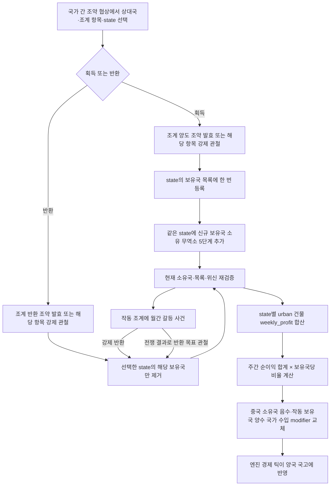
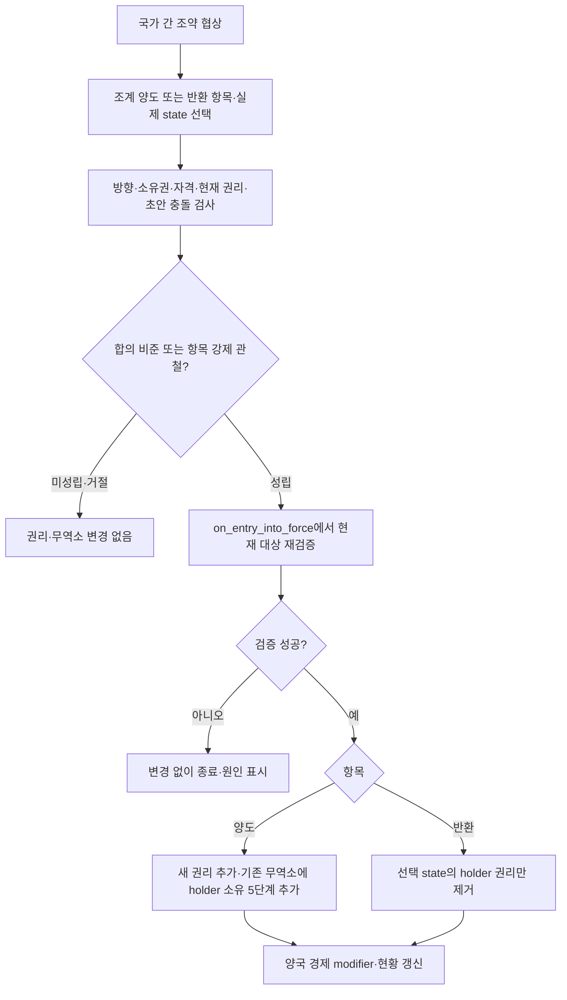
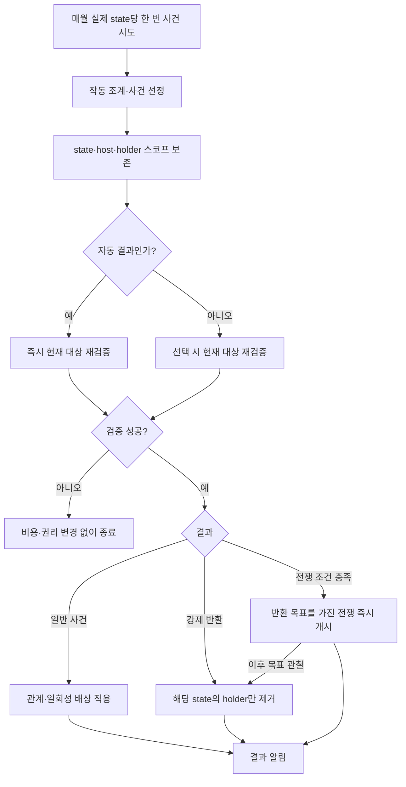

# 중국 조계지 설계·구현 계획

수정일: 2026-10-19. 최신 수정사항을 반영한 코드 작성용 명세다. 본 계획에 따라 활성 게임 스크립트를 작성했다. 코드 반영과 게임 실행 검증은 별개이며 남은 검증은 16절에 명시한다. 예시 비율과 사건 가중치는 밸런스 초안이고, 로컬 문법 확인과 게임 실행 검증은 구분한다.

## 1. 확정 규칙

1. 국가 간 조약 협상의 조계 양도·조계 반환 항목에서 원하는 실제 state를 선택한다. 바닐라 무역항처럼 조약 비준·발효 또는 조약 항목 강제로 처리하며, 특약 보유·소비를 조건으로 하는 저널 버튼은 제거한다.
2. 획득·반환은 해당 조약 항목의 강제 관철 전쟁 목표로도 작동한다. 월간 사건의 자동 전쟁·강제 반환은 유지한다.
3. 대상 지리는 기존 `geographic_region_han_homelands`를 사용한다. 별도의 관내18성 주 ID 목록이나 프로빈스 거점을 만들지 않는다.
4. 권리의 원본은 실제 state의 `concession_owner_varlist`다. state와 외국 보유국의 조합은 하나뿐이며 규모·확대·상한·주권 침해량을 계산하지 않는다.
5. 현재 주 소유국 위신이 보유국보다 높으면 해당 조계의 경제 효과와 신규 사건을 중단한다. 동률이면 작동하며, 중단된 권리도 반환할 수 있다.
6. 영향받는 건물은 게임 분류상 `category = urban`에 속하는 **도시 건물 전체**다. 도심지·공장 외에도 해당 분류에 속하는 건물을 포함한다.
7. 각 state의 도시 건물 전체 `weekly_profit` 합계를 기준으로 보유국별 조계 수입을 계산한다. 해당 주의 중국 소유국에는 음수, 작동 중인 외국 보유국에는 같은 금액의 양수 `country_tax_income_add` modifier를 적용한다.
8. 건물의 수입·산출량·투입량·임금·지분은 조계 경제 효과로 변경하지 않는다. 경제 부담과 이익은 양국의 국가 수입 modifier로만 처리하며, 기본 조계 수입에 직접 현금 지급 효과를 추가하지 않는다.
9. 매주 갱신하는 것은 현금 지급이 아니라 **modifier 값**이다. 기존 값을 교체하므로 여러 번 갱신해도 누적 지급이 생기지 않는다. 월간 갈등 사건은 별도 처리한다.
10. 영속 변경번호·지급 완료 표시·버전 저장값을 두지 않는다. 현재 주·소유국·보유국 목록·위신을 직접 검사하고, 기록된 과거 상태와 비교하는 체계를 만들지 않는다.
11. 직접 조회 가능한 수치는 계산식으로 읽는다. 조계 규모·추정 세원·유지비·사건 수입 배율·위신 상한 같은 설정 변수도 만들지 않는다.
12. 국가가 해당 state의 조계를 새로 획득할 때, 같은 state에 그 국가가 직접 소유하는 무역소(`building_trade_center`) 5단계를 추가로 부여한다. 조계 양도 조약의 합의 발효·강제 관철에 동일하게 적용하고, 이미 보유한 조계의 중복 처리·작동 재개·정기 갱신에서는 부여하지 않는다.



이 문서는 실행 가능한 API가 확인된 부분과 아직 확인되지 않은 부분을 구분한다. 건물 수입을 낮추는 modifier는 필요 없다. 건물 `weekly_profit` 조회 문법은 확인했다. 남은 실행 확인 사항은 양수·음수 `country_tax_income_add`의 금액 단위 및 실제 예산 반영이다.

## 2. 대상 지리와 실제 state

### 2.1. 기존 geographic region 사용

이 저장소의 `concept_china_proper_desc`는 중국 본토·관내18성을 한족 본토 주 지역으로 설명하며, 관련 코드도 `geographic_region_han_homelands`를 사용한다. 따라서 설치·반환 화면·경제 처리·사건의 공통 지리 조건을 다음으로 통일한다.

```paradox
# 현재 스코프: 실제 state
is_in_geographic_region = geographic_region_han_homelands
```

정의는 기본 게임 `common/geographic_regions/04_geographic_regions_asia.txt`에 있다. 현재 설치본의 이 지역에는 `STATE_SHENGJING`과 `STATE_FORMOSA`도 포함되어 있다. 이번 명세는 사용자가 지정한 **기존 geographic region을 사용한다는 규칙**을 우선하여 이 정의를 그대로 따른다.

주 지역 수를 상수로 고정하지 않는다. 양도·반환 조약 항목의 state 입력 필터에서 기존 geographic region을 직접 검사한다. 지역별 반환 전쟁 목표를 별도로 생성하지 않는다.

권리와 계산은 실제 state 단위다. 같은 state_region이 여러 국가로 나뉘어 있으면 각 state의 건물과 권리 목록을 독립 처리한다. 신규 설치에서 조약항 state를 제외하는 기존 자격 조건은 유지한다.

### 2.2. 스코프 계약

| 스코프 | 타입 | 의미 |
| --- | --- | --- |
| `concession_state` | state | 사용자가 선택한 주. 권리와 도시 건물 순이익 합산의 기준 |
| `concession_host` | country | 현재 `concession_state.owner` |
| `concession_holder` | country | 해당 주의 외국 보유국 또는 신규 획득국 |
| `article_options` | treaty_article_options | 발효 시 조약 항목의 실제 source/target 국가와 input_state를 제공 |
| `concession_region` | state_region | 지리 판정용 파생값. 권리 저장소가 아님 |

반환 조약의 수취국은 중국 국가이면서 현재 해당 state 소유자여야 한다. 중국 국가 판정은 청 태그와 기존 중국 중앙정부·분열국 판정을 재사용한다. `eafp_is_chinese_fragment`는 한족 주류문화 조건이므로 청과 다른 지원 대상 후계 정부가 누락되지 않는지 확인한다.

신규 획득은 기존 열강·전략지역 이해관계 조건을 사용한다. 이미 보유한 권리는 순위 하락만으로 삭제하지 않는다. 위신이 낮아 즉시 작동 중단될 수 있는 경우는 선택 화면에서 설명한다.

## 3. 국가 간 조약 항목과 저널

### 3.1. 조약 협상으로 진입

기본 국가 간 조약 협상 화면에 `eafp_grant_concession`(조계 양도)과 `eafp_return_concession`(조계 반환)을 추가한다. 정의 파일은 `common/treaty_articles/eafp_concessions_treaty_articles.txt`다. 바닐라 `treaty_port`와 같은 조약 항목·state 입력·비준·강제 관철 시스템을 사용한다.

기존 `establish_concession_button`, `return_concession_button`의 JE 연결과 특약 기반 실행 경로는 제거한다. 특약 방향·보유·생성·소비를 조계 항목의 조건이나 효과에 넣지 않는다. 사용자가 별도로 구성하는 바닐라 조약의 다른 교환 항목과 조계의 필수 조건은 구별한다.

| 기존 저널 | 남길 역할 |
| --- | --- |
| `je_concessions_in_china2` | 외국의 보유 조계·경제 수입·위신 중단 현황 |
| `je_concessions_in_china` | 주 소유국의 조계 현황·국가 수입 부담·보유국 목록 |

조약 항목은 JE가 없거나 조계를 아직 보유하지 않아도 자격이 맞으면 사용 가능해야 한다. 저널은 현황 표시용이며 조계 획득·반환을 직접 실행하는 버튼을 갖지 않는다. 주간 경제 갱신도 JE 존재에 의존하지 않는다.

### 3.2. 두 조약 항목의 방향과 입력

두 항목 모두 `kind = directed`, `required_inputs = { state }`로 정의한다. source는 권리를 내주는 국가, target은 권리를 받는 국가다. 조약을 제안한 국가와 source가 항상 같다고 가정하지 않는다.

| 항목 | source_country | target_country | input_state | 발효 결과 |
| --- | --- | --- | --- | --- |
| `eafp_grant_concession` | 현재 중국 주 소유국 host | 외국 획득국 holder | host가 소유한 적격 실제 state | holder 권리 추가, 같은 무역소에 holder 소유 +5단계 |
| `eafp_return_concession` | 기존 외국 보유국 holder | 현재 중국 주 소유국 host | host가 소유하고 source의 조계가 있는 실제 state | 그 state의 source 권리만 제거 |

국가·주를 무작위로 선택하지 않는다. 조약 협상 화면에서 실제 state를 선택하며, 같은 region이 분할되어 있으면 현재 소유국을 함께 표시한다. 반환 항목의 state는 source 소유지가 아니라 **target 소유지**다. 엔진의 state 선택 목록과 `state_valid_trigger`가 이 방향을 지원하는지 반드시 실행 검증한다. 미확인 상태에서 region별 대체 목표나 임의 선택을 완성된 구현으로 넣지 않는다.

양도는 기존 지리·중국 소유국·외국 획득국·열강·이해관계·미보유·무역소 부여 가능 조건을 검사한다. 반환은 지리·target의 현재 소유권·source의 현재 권리를 검사한다. 위신 때문에 중단된 권리도 반환할 수 있다. 양도 직후 위신으로 경제 효과가 중단될 경우 조약 툴팁에 표시한다.

### 3.3. 조약 정의와 검증 단계

바닐라 파일에서 확인한 구조를 다음과 같이 사용한다.

| 필드 | 조계 항목에 적용할 계약 |
| --- | --- |
| `kind` | `directed` |
| `required_inputs` | `state` |
| `usage_limit` | `once_per_side_with_same_inputs`, 초안 내 충돌 검사는 별도 보강 |
| `flags` | `can_be_enforced`. 즉시 권리 변경 효과이므로 `can_be_renegotiated`는 넣지 않음 |
| `cost` | 0 초안. 기존 설계에 없던 조약 유지 비용을 추가하지 않음 |
| `maintenance_paid_by` | 양도는 `target_country`, 반환은 `source_country`. 비용 0이어도 directed 필드 지정 |
| `visible` / `possible` | 항목 표시와 두 국가 사이 후보 존재 여부. 입력이 아직 없을 수 있음을 고려 |
| `state_valid_trigger` | `scope:input`의 실제 state·지리·owner·조계 여부 검사 |
| `can_ratify` | `scope:article.input_state`와 source/target에서 최종 자격·충돌 검사 |
| `on_entry_into_force` | 양도/반환 공용 효과를 실행하는 유일한 조약 callback |
| `on_enforced` | 권리와 무역소를 추가로 변경하지 않음. 강제 관철 시 앞 callback도 실행되기 때문 |
| `wargoal` | 해당 조약 항목 강제 관철의 기동·악명·전쟁 점수 조건 |
| `source_modifier` / `target_modifier` | 정기 조계 수입을 중복 적용하지 않음. 5절의 국가별 합산 방식 유지 |

무역항의 `is_treaty_port`, `causes_state_transfer`, `cede_treaty_port` 및 영토 변경 효과는 사용하지 않는다. 해안·무역항 가능 province 같은 바닐라 조건도 조계 대상 규칙에 덧붙이지 않는다. 조계권은 실제 state의 목록에 기록하며 영토를 이전하지 않는다.

같은 초안의 동일 state·source·target 중복 항목은 명시적으로 거부한다. 신규 양도와 반환은 현재 권리의 미보유/보유 조건이 서로 배타적이므로 동시에 비준할 수 없다. 이미 발효한 잠긴 양도 항목은 새 반환 항목의 충돌로 취급하지 않는다. 반환 후 재획득은 새 조약의 양도로 처리할 수 있으며, 같은 기존 조약에 동일 항목을 다시 넣는 것은 바닐라 usage_limit을 따른다.

각 단계의 스코프가 다르다. 입력 필터에서는 `root`가 source, `scope:other_country`가 반대편 국가이며, 발효 효과에서는 바닐라와 같이 `scope:article_options.source_country`, `target_country`, `input_state`로부터 공용 효과의 스코프를 구성한다. 입력 미지정 상태에서 무조건 역참조하지 않는다.

### 3.4. 발효·강제 관철과 권리 수명



합의와 강제 관철 모두 `on_entry_into_force`에서만 신규 권리 및 무역소 부여 또는 반환을 수행한다. 제안·미리보기·초안 작성·거절 시에는 실행하지 않는다. 실제 발효 직전에 state 생존·owner·양국·현재 권리·건물 부여 조건을 다시 확인한다. 범용 롤백을 가정하지 말고 실패 가능 조건을 변경 전에 검사한다.

바닐라 무역항의 즉시 이전 효과처럼 **발효 때 권리를 변경하는 조항**으로 설계한다. 조약 탈퇴·기간 변화·해체 자체가 이미 부여한 조계권이나 무역소를 자동으로 되돌리지 않는다. 반환은 별도 반환 조항의 발효·강제 관철 또는 기존 월간 강제 반환 사건으로 처리한다. `on_withdrawal`·`on_break`에서 권리·무역소를 재변경하지 않는다. 조약 전체의 일반 탈퇴 규칙과 불이익은 바닐라 처리에 맡긴다.

`can_be_renegotiated`가 없는 즉시 효과 조항은 재협상에서 입력 변경이 제한되고 발효 효과가 재실행되지 않는다는 로컬 문서 설명을 따른다. 변경되지 않은 기존 항목을 재협상할 때 신규 획득용 “미보유” 검사를 잘못 적용해 조약 전체를 막지 않도록 검증 단계와 활성/초안 스코프를 구분한다. 반대로 새 항목은 반드시 신규 자격을 검사한다. 재협상·저장 후 로드·강제 관철의 중복 callback에서도 현재 목록 검사로 무역소 추가 지급을 막는다.

`requirement_to_maintain`에는 양도의 “현재 미보유”나 반환의 “현재 보유” 같은 실행 전 조건을 넣지 않는다. 발효 직후 자기 효과 때문에 조건이 뒤집혀 조약이 자동 파기될 수 있기 때문이다. 신규 실행 자격은 입력·비준·발효 직전 검사에 두고, 위신 조건 역시 조약 유지 조건으로 넣지 않는다.

조약은 권리 변경의 외교적 기록이며, 현재 경제·사건의 원본은 state의 `concession_owner_varlist`다. 월간 사건으로 반환되었거나 주가 양도되어도 과거 양도 항목을 읽어 권리를 다시 생성하지 않는다. 위신 우위는 경제·신규 사건만 중단시키며 조약 위반이나 권리 자동 반환으로 바꾸지 않는다.

### 3.5. 신규 획득 시 무역소 5단계

무역소 부여는 `eafp_concession_grant_effect` 안에서 신규 권리 등록과 함께 처리한다. 건물은 **선택된 실제 `concession_state` 안**에 있고, 추가되는 5단계의 소유자는 **`concession_holder` 국가 자체**다. 중국 주 소유국이나 외국의 금융 지구·기업에 소유권을 주지 않으며, state의 영토 소유권도 바꾸지 않는다.

“5단계 획득”은 기존 소유분에 **5단계 추가**한다는 뜻이다. 해당 실제 state에 무역소가 있으면 **그 기존 무역소 건물에 획득국 직접 소유인 5단계를 추가**한다. 기존 무역소와 별개의 건물을 생성하지 않는다. 해당 state에 무역소가 없을 때만 획득국 직접 소유의 5단계 무역소를 새로 생성한다.

기존 무역소의 총단계와 획득국 소유 단계는 각각 5씩 증가하고, 다른 소유자의 단계는 그대로 유지한다. 예를 들어 총 12단계 중 획득국이 2단계를 소유했다면 **동일한 무역소 건물**이 총 17단계·획득국 소유 7단계가 된다. 획득국의 기존 소유분이 0이어도 같은 건물에 해당 국가 소유 5단계를 추가한다. 여러 보유국은 각각 신규 획득할 때 동일한 주의 무역소에 자기 소유 5단계씩을 추가한다.

처리 분기는 다음과 같다. 아래는 실제 API 이름이 아닌 구현 계약을 나타내는 의사코드다.

```text
if holder already has a concession in selected state:
    do not grant building levels
else if selected state already contains a trade center:
    select that existing trade center
    add 5 new levels owned directly by holder to the same building
    preserve all pre-existing ownership levels and production methods
else:
    create a 5-level trade center in selected state, owned directly by holder
```

양도 조약의 합의 발효와 강제 관철 모두 같은 부여 경로를 호출한다. 즉시 건물 단계를 제공하며 건설 대기열이나 별도 현금 보상으로 바꾸지 않는다. 신규 생성 건물에는 유효한 기본 생산 방식을 적용하고, 기존 건물을 확장할 때는 생산 방식·현금 보유고·타국 소유분을 임의 초기화하지 않는다.

#### 확인한 생성 문법과 기존 건물 처리

`documentation/effects.log`의 `create_building`은 state 스코프에서 `add_ownership`으로 국가 소유 단계를 지정하는 문법을 제공한다. 저장소 `events/000_eafp_japan_overrides.txt`에도 국가 소유 무역소 생성 예제가 있다. **해당 state에 무역소가 없는 경우**의 출발점은 다음과 같다.

```paradox
scope:concession_state = {
    create_building = {
        building = building_trade_center
        activate_production_methods = { pm_trade_center_trade_quantity_normal }
        add_ownership = {
            country = {
                country = scope:concession_holder
                levels = 5
            }
        }
    }
}
```

신규 생성 예제의 생산 방식은 기존 무역소 생성 코드에서 사용 중인 `pm_trade_center_trade_quantity_normal`이다. 이미 무역소가 있는 경우에는 이 초기화 블록을 그대로 실행하지 않고 기존 생산 방식을 유지한다. 5단계는 즉시 부여하는 건물·국가 소유 단계이며 고용 인원이나 실제 무역량을 보장하는 값은 아니다.

`level`과 `add_ownership`은 함께 지정하지 않는다. 생성 문서상 일반 `level = 5`는 기존 건물이 있을 때 기존 단계와 5 중 큰 값을 사용하므로 **항상 5단계 추가하는 구현이 아니다**. 기존 무역소에 `add_ownership`을 적용했을 때 총단계와 지정 국가 소유 단계가 각각 정확히 5씩 증가하는지는 실행 검증한다. 이 동작이 보장되지 않으면 검증된 확장·국가 소유권 지정 API를 조합한다. 건물을 삭제 후 재생성하거나 기존 소유 지분을 덮어쓰는 방식은 사용하지 않는다.

#### 중복 실행과 수명

- 획득 직전 해당 holder가 권리 목록에 없을 때만 부여한다. 이미 있으면 권리·무역소 모두 변경하지 않는다.
- 신규 획득 직후 위신 때문에 조계 수입이 중단되어도 최초 5단계는 부여한다. 이후 위신 회복·주간 갱신·저널 재표시에서는 추가하지 않는다.
- 분할·합병·양도 때 기존 권리를 승계하는 것은 신규 획득이 아니므로 무역소를 지급하지 않는다. 해당 처리에서 신규 획득 helper를 호출하지 않는다.
- 조계 반환은 권리 제거로 처리한다. 별도 몰수 요구가 없으므로 이미 부여한 무역소를 자동 철거·국유화하지 않는다. 이후 같은 국가가 새 양도 조약의 발효나 강제 관철로 그 주의 조계를 새로 획득하면 다시 5단계를 추가한다. 과거 최초 획득 이력을 저장하는 변수를 만들지 않는다.
- 현재 권리의 중복 검사와 부여는 지연 없는 한 효과 체인으로 처리한다. 부여 성공에 필요한 조건을 권리 등록 전에 검증하고, 실패 시 권리만 생기고 무역소는 부여되지 않는 부분 실행 경로를 만들지 않는다. 범용 롤백이 있다고 가정하지 않는다.

무역소는 기존 urban 수입 필터와 별개인 획득 보상이다. 현재 게임에서 `bg_trade`는 development 계열이므로 5단계를 부여해도 도시 건물 `weekly_profit` 합계에 자동 추가하지 않는다. 최종 category가 urban으로 바뀌면 공통 그룹 필터를 함께 갱신해야 포함된다.

## 4. 도시 건물 전체와 수입 값

### 4.1. 대상은 게임의 urban 분류

건물 그룹의 `category = urban`과 부모 그룹 상속을 기준으로 한다. “도시 건물”을 도심지·제조업 두 종류로 축소하거나 `urbanization`을 생산하는 모든 건물로 확대하지 않는다.

현재 기본 게임에서 확인한 urban 계열은 다음과 같다.

| 계열 | 포함 내용 |
| --- | --- |
| `bg_manufacturing`와 urban을 상속한 하위 그룹 | 경공업·중공업·군수공업·조선 등 제조업 |
| `bg_service` | 도심지 |
| `bg_urban_facilities`와 urban 하위 그룹 | 미술 등 도시 시설 |
| `bg_owner_buildings`와 urban 하위 그룹 | 금융 지구·기업 본사 등 소유 건물. 장원도 실제 최종 분류가 urban이면 포함 |

발전소·철도·항구·무역소 등은 이름이나 외형으로 판단하지 않는다. 설치된 게임에서 해당 그룹의 최종 category가 development이면 이 필터에서는 제외하고, 게임/모드가 분류를 바꾸면 최종 category에 맞추어 공통 그룹 필터도 갱신한다. 농업·채굴 등 rural 분류는 제외한다.

런타임 category 조회 트리거는 이번 조사에서 확정하지 못했다. 사용 가능한 직접 판정이 있으면 그것을 쓴다. 없으면 실제 building group 정의와 부모 상속을 따라 urban인 최종 그룹을 도출해 하나의 공통 building 필터를 만든다. 알려지지 않은 `is_building_category` 같은 트리거를 임의로 쓰지 않는다. 숫자가 아닌 그룹 정의를 기준으로 하므로 커스텀 urban 건물도 반영한다.

각 건물을 한 번 순회하면서 OR 조건으로 검사한다. 부모·하위 그룹을 별도 루프로 돌려 같은 건물의 수입을 여러 번 합산하지 않는다.

### 4.2. 기준값은 weekly_profit

사용자가 2026-10-19에 **“순이익(weekly_profit) 합계로 변경”**을 승인했다. `documentation/triggers.log`에 문서화된 building 스코프의 `weekly_profit`을 script value에서 직접 읽는다. 매출 또는 정부 세수를 추정하여 대신 사용하지 않는다.

`every_scope_building`으로 실제 state에 속한 건물을 한 번씩 순회한다. urban 소유 건물도 자기 `weekly_profit`만 더하며, 그 건물이 소유한 다른 주의 생산 건물을 재순회하지 않는다. 손실 건물도 합계에 포함한 뒤, 주 전체 합계가 0 이하이면 이전액을 0으로 둔다.

`country_tax_income_add`의 금액 단위, 음수 적용과 multiplier의 엔진 처리, 예산에 반영되는 경제 기간은 실행 검증 대상이다. 건물 이익은 계산 기준일 뿐 조계 modifier가 건물 자체의 매출·비용·이익을 변경하지 않는다.

### 4.3. 읽기 전용 합산

state에서 도시 건물 전체의 주간 순이익을 합산하는 계산식과, country에서 지급 부담 또는 수취 몫을 합산하는 계산식을 둔다. 직접 조회 가능한 값은 영속 변수로 복제하지 않는다. 같은 갱신 안의 임시 계산값은 사용할 수 있으며, 양쪽 금액은 같은 계산 결과에서 만든다.

금융 지구·기업 본사 등 urban 소유 건물의 순이익도 도시 건물 전체의 순이익 합계에 포함한다. 생산 건물과 소유 건물의 순이익을 국민계정처럼 상계하지 않는다. 따라서 이 합계는 GDP나 중복 없는 최종 부가가치가 아니라 건물별 주간 순이익의 단순 합이다.

국가 modifier만 변경하므로 건물 수입을 복원하기 위해 modifier를 제거할 필요가 없다. 엔진이 마지막으로 확정한 동일 경제 시점의 건물 값을 읽고, 해당 주간 갱신의 부담액을 확정한다. 다음 주에는 그때의 수입으로 다시 계산한다.

UI는 계산 결과와 현재 적용된 modifier를 읽기만 한다. UI를 열어서 modifier·권리·국고·사건 결과를 변경하지 않는다.

## 5. 중국 측과 보유국의 국가 수입 modifier

### 5.1. 주간 순이익 합계와 보유국별 몫

각 state의 도시 건물 주간 순이익 합계에 보유국당 비율을 곱한다. 작동 보유국마다 같은 몫을 받으며 중국 측 부담액은 그 몫들의 합계다.

기본 비율은 앞선 문서의 **보유국당 5%를 임시 밸런스안**으로 유지한다. 확정값은 아니며 계산식 한 곳의 리터럴로 둔다. 별도 설정 변수·조계 크기·수용량을 만들지 않는다.

아래 기호는 설명용이며 저장 변수나 실제 엔진 키가 아니다.

```text
U(s) = state s의 모든 urban 건물 weekly_profit 합계
N(s) = state s의 작동 중인 서로 다른 외국 보유국 수
P(s) = max(0, U(s)) × 0.05

작동 보유국 h의 해당 주 수취액:
    R(s, h) = P(s)
    미보유·중단 상태이면 0

해당 주의 중국 소유국 부담액:
    D(s) = sum(R(s, h), active holders) = P(s) × N(s)

국가 c의 음수 modifier 기준 금액:
    c가 현재 소유한 적격 state들의 D(s) 합계

국가 c의 양수 modifier 기준 금액:
    c가 작동 조계를 가진 모든 state의 R(s, c) 합계
```

U(s)를 먼저 합산하고 그 합계가 0 이하일 때 해당 주의 부담액·수취액을 0으로 둔다. 건물마다 양수 순이익만 따로 골라 합산하지 않는다. 보유국 수가 증가하면 중국 측 부담액도 증가한다. 정해진 총액을 보유국 수로 나누지 않는다.

| 도시 건물의 주간 순이익 합계 | 작동국 수 | 중국 측 국가 수입 변화 | 보유국별 국가 수입 변화 |
| --- | --- | --- | --- |
| £10,000 | 1 | -£500/주 | +£500/주 |
| £10,000 | 2 | -£1,000/주 | +£500/주 |
| £10,000 | 3 | -£1,500/주 | +£500/주 |
| £10,000 | 0 | £0 | £0 |

건물의 주간 순이익 합계는 **과세 기준에 해당하는 게임상 계산 기준**이며 조계 효과로 실제 감소시키는 금액이 아니다. 건물의 매출·상품·임금·배당을 이 처리에서 변경하지 않는다. 중국 측 부담은 정부 예산에 발생한다.

고정소수점 정밀도로 보유국별 몫을 한 번 확정한 뒤 중국 측 부담액을 그 몫들의 합으로 만든다. 양쪽을 서로 다른 순서로 반올림하여 차액이 생기게 하지 않는다. 정부 현금 보유액이나 기존 세금 수입으로 부담액을 임의 제한하지 않는다. 국가 수입 modifier의 엔진 하한이 음수 적용을 막는다면 실제 동작을 확인해야 하며, 중국 측에는 적용되지 않은 금액을 보유국에 지급한 채 완료 처리하지 않는다.

### 5.2. 두 국가 modifier

기존 역할에 맞춰 다음 ID를 재사용하되 내용은 새 명세로 교체한다.

```paradox
# 중국 측: 양의 부담액을 multiplier로 전달
concession_payment = {
    country_expenses_add = 1
}

# 조계 보유국: 양의 수취액을 multiplier로 전달
concession_paid = {
    country_tax_income_add = 1
}
```

국가 수입 modifier 패턴은 저장소의 `likin_tax_income_modifier`에서도 확인된다. 양수·음수 적용과 주간 통화 단위는 실행 검증한다.

각 국가에 역할별 modifier를 최대 하나씩 둔다. 중국 소유국의 여러 주 부담은 `concession_payment` 하나에, 보유국의 여러 주 수입은 `concession_paid` 하나에 합산한다. 같은 국가가 지급과 수취 역할을 모두 갖는 경우 두 modifier를 독립 유지한다. 주마다 같은 ID를 반복 추가하여 마지막 주만 남게 하거나 값을 누적시키지 않는다.

`concession_building_modifier`는 이 경제 경로에 적용하지 않는다. 건물 생산량·투입량·임금·지분·수입 감소 modifier를 함께 붙이지 않는다.

### 5.3. 갱신과 예산 반영

기본 조계 수입에는 `add_treasury`를 사용하지 않는다. `country_expenses_add`를 더하여 중국 측에 같은 비용을 이중 청구하지 않는다. 엔진이 음수·양수 국가 수입 modifier를 예산과 국고에 반영하도록 한다.

매주 현재 권리·위신·도시 건물 순이익을 읽고 모든 국가의 부담액·수취액을 먼저 계산한다. 같은 효과 체인에서 기존 modifier를 제거 후 재적용하거나 검증된 방식으로 대체한다. 양쪽 갱신 사이에 날짜 지연을 두지 않는다. 같은 상태에서 여러 번 갱신해도 같은 금액으로 끝나며 일회성 현금 거래가 발생하지 않는다.

주간 갱신에서 확정한 양쪽 금액을 다음 갱신까지 유지한다. 주중 시장 가격이나 건물 수입이 달라져도 한쪽만 실시간 재계산하지 않는다. 획득·반환·소유 변경 등으로 즉시 갱신할 때도 두 역할의 전체 합계를 같이 갱신한다.

검증식은 다음과 같다.

`모든 중국 측 조계 modifier의 수입 감소 절댓값 합계 = 모든 보유국 조계 modifier의 수입 증가 합계`

이는 두 조계 modifier의 직접 효과에 관한 식이다. 국가 전체 예산의 흑자·적자, 다른 세금·지출과 혼동하지 않는다. 건물 수입은 계산 기준으로만 사용하며 감소했는지 검증하는 대상이 아니다.

과거 수입을 소급 지급·환수하지 않는다. 월간 사건의 일회성 배상금은 별도 사건 결과이며 정기 조계 수입을 대신하거나 중복 지급하지 않는다.

## 6. 작동 판정과 기타 효과

| 조건 | 권리 | 경제 modifier와 신규 사건 |
| --- | --- | --- |
| host가 중국 국가가 아님 | 유지 | 신규 경제 부담·수취 및 사건 중단 |
| host 위신 > holder 위신 | 유지 | 해당 holder 몫 제외 |
| host 위신 <= holder 위신 | 유지 | 작동 |
| 현재 state/국가 스코프 유실 | 임의 복구하지 않음 | 해당 몫 보류·효과 정리 |
| holder가 해당 state 소유자가 됨 | 자기 조계 기록 제거 | 제외 |
| holder 소멸, 명확한 승계 없음 | 해당 기록 정리 | 제외 |

중국 측은 고정된 청 태그가 아니라 해당 state의 현재 중국 소유국이다. 지원하는 중국 중앙정부·분열국 판정을 재사용한다. 비중국 국가로 주가 넘어가면 권리 기록은 보존하되 해당 주의 정기 경제 효과와 신규 사건은 중단하고 이전 중국 소유국의 부담에서 제거한다.

위신은 갱신 직전 실제 값을 읽고, 월간 사건 후보와 선택 실행 시에도 검사한다. 하나의 holder가 중단되면 중국 측 부담액과 해당 holder의 수취액에서 같은 몫을 뺀다. 모든 holder가 중단되면 그 주의 경제 기여는 0이다. 국가가 다른 주에서 갖는 부담·수입은 합산하여 유지한다.

현재 구현은 조계 자체의 위신 보너스를 추가하지 않는다. 실제 국가 위신만 비교하므로 조계 modifier가 자신의 작동 자격을 바꾸는 순환이 없다.

주권 침해량·규모별 modifier·긴장도·시정 운영 체계는 만들지 않는다. 행정권·사법권 갈등은 월간 사건으로 표현한다.

## 7. 저장 데이터와 공용 처리

### 7.1. 영속 데이터는 권리 목록

각 실제 state의 `concession_owner_varlist`만 조계 권리의 원본으로 사용한다. 현재 소유국·작동국 수·위신·경제 수치는 엔진 상태와 계산식에서 얻는다. 변경 이력 번호, 정산 완료 flag, 기능 버전, 기간별 지급 기록을 저장하지 않는다.

경제 효과는 실제 modifier로 표현되므로 별도의 “지급됨” 변수가 필요 없다. 갱신은 현금 거래가 아니라 같은 효과값으로의 교체다. 무효 권리를 정리한 뒤 모든 영향받은 국가의 부담·수취 modifier를 다시 계산한다.

### 7.2. 공용 helper 계약

| 제안 ID | 입력 | 책임 |
| --- | --- | --- |
| `eafp_concession_can_grant` | state, host, holder | geographic region·소유·생존·중복 없음 확인 |
| `eafp_concession_grant_effect` | state, holder | 신규 등록 여부와 무역소 부여 가능 조건 검증, 권리와 holder 직접 소유 무역소 5단계 추가, 저널·경제 효과 갱신 |
| `eafp_concession_return_effect` | state, holder | 조약 발효·목표 관철·사건에서 해당 원소만 제거 |
| `eafp_concession_refresh_effect` | 현재 조계 및 이전 modifier가 남은 대상 전체 | 권리 정리와 중국 측·보유국 국가 수입 modifier 재계산. 현금 지급·사건 추첨 없음 |
| `eafp_concession_is_urban_building` | building | 최종 urban category 필터. 실제 API 또는 정의로부터 도출한 그룹 조건 사용 |

특약 관련 생성·소비 효과는 설치/반환 경로에서 제거한다. 조약 발효와 월간 사건은 같은 공용 효과를 사용한다. 이미 없는 조계의 반환은 무동작으로 끝내며, 강제 관철의 추가 callback에서 공용 효과를 다시 호출하지 않는다.

마지막 조계를 잃은 보유국과 주를 양도한 이전 중국 소유국도 기존 국가 modifier가 있는지 확인하고 재계산한다. 현재 권리 목록에 있는 국가만 조회하면 반환 뒤 수입이나 양도 뒤 부담이 남으므로 두 국가 modifier의 `has_modifier` 조건도 탐색에 포함한다. 합계가 0인 역할의 modifier는 제거한다.

### 7.3. 오래 열린 사건의 재검증

이벤트에는 선택된 state, 당시 host, holder 스코프만 보존한다. 실행 시 state 존재, 현재 owner 일치, holder 생존, 현재 목록 포함, 위신과 사건별 조건을 재검증한다. 실패하면 비용·권리 변경 없이 종료한다.

동일한 국가가 같은 주에 조계를 반환했다가 다시 얻은 사실을 별도 이력으로 판별하지 않는다. 실행 시 현재 조건이 충족되면 현재 조계에 사건을 적용한다. 과거 권리와 새 권리를 구분하기 위한 다른 이름의 번호·타임스탬프·세대 변수를 추가하지 않는다.

## 8. 주간 modifier 갱신과 월간 사건

### 8.1. 주간 단일 진입점

일반 주간 코드 hook은 확인되지 않았으므로 이름을 임의로 만들지 않는다. 저장소의 on-action 문서에는 `trigger_event = { on_action = … days = … }` 지연 호출이 있다. **새 게임 시작 후 한 번 시작하는 전역 7일 on-action 체인**으로 주간 전체 갱신을 예약하는 구현안을 사용한다.

`on_game_started_after_lobby`에서 한 번 예약하고, 주간 callback은 modifier를 갱신한 뒤 자신을 7일 후 한 번만 예약한다. 이 연결을 일반 로드·월간 pulse·국가별 JE pulse·획득/반환 helper에 중복 배치하지 않는다. 예약된 on-action이 저장·재로드 후 이어지는지 확인한다. 별도 시작 flag나 지급 기록은 만들지 않는다. 이는 API 적용을 시험해야 하는 구현안이며, 전역 무루트 지연 호출의 저장 동작이 확인되어야 한다.

스케줄러와 refresh는 분리한다. 획득·반환·소유권 변화가 refresh를 호출해도 다음 주 예약을 추가하지 않는다. 국가별 저널은 UI 역할을 맡고 독립적인 현금 지급 루프를 갖지 않는다.

### 8.2. 갱신 순서


```text
weekly callback:
    refresh all concession modifiers
    schedule this callback once after 7 days

refresh all concession modifiers:
    gather states with rights and countries with either concession income modifier
    resolve current owners and distinct living holders; remove self rights
    read relevant prestige before changing any prestige modifier
    determine active holders for each eligible Chinese-owned state
    sum weekly_profit of every urban building once per state
    calculate each holder's share from max(0, state income sum) * ratio
    sum the same shares into current Chinese host debits and holder credits
    finish calculating all totals before replacing country modifiers
    replace concession_payment using total debit and concession_paid using total credit
    remove each role's modifier when its total is zero
    update read-only UI lists
    discard temporary calculation scopes
```

같은 상태로 refresh를 반복하면 동일한 국가 modifier 값으로 끝나야 한다. 완료 기록·시간 비교를 이용해 중복 지급을 막는 구조가 아니다. 직접 지급 자체가 없다. 영구 소유권 변화를 처리하는 hook은 갱신만 호출한다.

### 8.3. 월간 사건

기존 글로벌 `on_monthly_pulse`의 조계 handler는 실제 state당 월 한 번 사건을 시도한다. 작동 조계가 있는 state의 초기 시도 확률은 5%다. holder 수만큼 추첨을 반복하지 않는다. 조건에 맞는 사건과 작동 holder 하나를 고른다.

월간 사건·UI·로드는 주간 callback을 새로 예약하지 않는다. 사건이 조계를 제거하면 즉시 refresh를 호출하지만 과거 수입을 소급 환수하거나 추가 현금을 지급하지 않는다.

## 9. 조약 항목의 강제 관철과 전쟁 목표

### 9.1. 바닐라 강제 조약 경로 재사용

두 조약 항목에 `flags = { can_be_enforced }`와 `wargoal`을 정의한다. 바닐라 `enforce_treaty_article` 전쟁 목표와 `dp_default_treaty_article` 외교전 경로를 재사용한다. 조약 협상과 전쟁 결과가 같은 항목 정의·입력·발효 효과를 사용해야 한다.

기존 계획의 별도 `eafp_acquire_concession` custom 전쟁 목표와 region별 반환 목표·외교전 생성은 제거한다. 기본 `target_type = state` 적국 주 목록에 반환을 억지로 맞추지 않고, 반환 조약의 `input_state`로 요구국 자기 주를 전달한다.

| 강제할 항목 | 전쟁 목표 요구국 | 상대국 | 조약 source → target | 대상 |
| --- | --- | --- | --- | --- |
| 조계 양도 | 외국 획득국 holder | 중국 host | host → holder | host 소유 실제 state |
| 조계 반환 | 중국 host | 외국 holder | holder → host | host 소유 실제 state |

조약 방향과 전쟁 공격 방향을 혼동하지 않는다. 두 경우 모두 권리를 내줄 국가가 article source이고, 요구국이 article target이다.

### 9.2. 항목별 전쟁 설정

기동·악명은 앞선 초안을 항목의 `wargoal`에 옮긴다. 양도 기동 10·악명 5, 반환 기동 10·악명 0이며 밸런스 초안이다. 양도 `contestion_type = control_target_state`, 반환 `contestion_type = control_own_capital`을 출발점으로 삼고 실제 전쟁에서 요구국 기준 판정인지 확인한다.

바닐라 항목에서 확인한 필드 형식은 다음과 같다. 이 블록은 양도 항목 내부의 설정 예이며 전체 조약 정의가 아니다.

```paradox
flags = { can_be_enforced }
wargoal = {
    contestion_type = control_target_state
    maneuvers = { value = 10 }
    infamy = { value = 5 }
}
```

기존 일반 전쟁 승리·항복 on-action에서 조계를 지급/반환하지 않는다. 엔진의 조약 발효 callback이 처리하며 `on_enforced`에 같은 설치/반환 효과를 추가하지 않는다. 무혈 비준·외교전 양보·평화 협정 관철 각각에서 권리와 신규 무역소가 한 번만 변경되는지 검사한다. 백지 평화 또는 해당 항목이 빠진 평화는 권리를 바꾸지 않는다.

### 9.3. 월간 사건의 자동 전쟁 연결

일반 협상·수동 전쟁 요구는 두 조약 항목의 바닐라 강제 경로를 사용한다. 이벤트에서 새 treaty article options를 생성해 전쟁 목표에 전달하는 필드는 로컬 문서에서 확인되지 않았다. 따라서 월간 자동 전쟁과 치안 충돌의 전쟁 선택지에 한하여 내부 반환 목표 `eafp_concession_incident_return`과 외교전 `dp_eafp_concession_incident`를 사용한다. 별도 사용자 외교 행동이나 지역별 목표 목록을 만들지 않는다.

`create_diplomatic_play`는 holder 국가 스코프에서 호출하고, initiator=host, country=holder, state=선택된 실제 state, war=yes로 지정한다. 전쟁이 개시되었다고 확인된 경우에만 알림을 띄운다. 목표 관철 전에는 권리를 제거하지 않는다. 목표의 `on_enforced`는 조약 반환과 같은 `eafp_concession_return_effect`를 호출한다.

country 대상 custom 목표에 명시한 state가 유지되는지, 요구국 소유 주를 반환 대상으로 사용할 수 있는지, 사건용 숨김 목표가 정상 추가되는지는 게임 실행 검증 대상이다. 이 검증 전에는 자동 전쟁을 실행 확인 완료로 보고하지 않는다. 발효한 반환 조약을 먼저 만들어 권리를 없애는 방식은 사용하지 않는다.

## 10. 월간 갈등 사건

### 10.1. 사건 데이터와 실행 검증

기존 `concessions_in_china` 네임스페이스에서 비어 있는 `.200`대 ID를 사용한다. 구현 전 중복을 검색한다. 이벤트에는 선택된 실제 state, 당시 host, holder 스코프를 보존한다. 임시 스코프가 아닌 이벤트 수명 동안 유지되는 스코프를 사용한다.

선택지가 열려 있는 동안 소유권·권리·위신이 바뀔 수 있으므로 효과 시작 시 다시 검사한다. state가 사라졌거나 현재 owner가 당시 host와 다르거나 해당 조계가 현재 존재하지 않으면 비용·권리 변경 없이 취소한다. 같은 주·국가에 조계가 다시 존재하면 별도 이력 구분 없이 현재 조건으로 판단한다. 다른 state나 holder를 대신 선택하지 않는다.

### 10.2. 사건 초안

경제 결과는 관계 변화·일회성 비용/배상으로 표현한다. 별도 수입 배율·정비 유지비·대표 참여 계수는 없다. 아래의 배상 기준액은 선택한 주에서 해당 보유국의 수입 modifier에 기여하는 **현재 주간 수입액**이며 영속 변수로 저장하지 않는다.

| ID / 수신자 | 조건·초기 가중치 | 선택과 결과 |
| --- | --- | --- |
| `.200` 용의자의 조계 도피 / holder | 작동 조계, 20 | 공동 조사: 관계 +5. 인도 거부: 관계 -10 |
| `.201` 경찰과 관헌 충돌 / host | 작동 조계, 20 | 배상: holder가 host에 배상 기준액 1회분 이전. 항의: 관계 -10. 무력 해결: 조건 충족 시 반환 전쟁 개시 |
| `.202` 중국인 대표 참여 요구 / holder | 작동 조계, 20 | 허용: 관계 +10. 거부: 관계 -5. 운영 방침·수입 비율 변경 없음 |
| `.203` 시정 시설 보수 / holder | 작동 조계, 15 | 보수 지원: holder가 host에 배상 기준액 1회분 이전, 관계 +5. 유보: 현 상태 유지 |
| `.204` 조계 행정 붕괴 / host 알림 | 관계 -50 이하, 작동 조계, 2 | 자동으로 해당 state의 해당 holder 조계를 즉시 반환 |
| `.205` 발포와 군사 충돌 / host 알림 | 관계 -50 이하, 전쟁 생성 조건 충족, 1 | host가 holder에게 해당 주 반환 목표를 가진 전쟁을 자동 개시 |
| `.206` 내전 피난민 / holder | host가 실제 내전 중, 10 | 구호: 배상 기준액 1회분을 host에 이전, 관계 +5. 통제 강화: 관계 -5 |
| `.207` 다른 주의 조계 진출 요구 / holder | 자신이 미보유한 적격 state 존재, 10 | 국가 간 조약 협상에서 원하는 주의 조계 양도 항목 제안 또는 해당 항목 강제 관철 요구. 즉시 무료 획득·기존 주 확대 없음 |

자동 결과는 사건 처리 시 실행하고 이후 알림을 보낸다. 사용자가 알림을 닫을 때 전쟁/반환 효과를 다시 실행하지 않는다. 사건 조건과 비용은 UI 툴팁에도 동일하게 표시한다.



### 10.3. 자동 전쟁

전쟁 방향은 `initiator = host`, `target = holder`다. 목표는 해당 실제 state를 입력으로 가진 조계 반환 항목 강제이며, 항목 방향은 `source_country = holder`, `target_country = host`다. 전쟁 시작만으로 조계를 미리 반환하지 않는다. 즉시 강제 반환은 `.204`의 별도 결과다.

실행 전에 국가 생존·서로 다름, 현재 state 소유권, 조계 존재와 실제 위신 조건, 동일 양국 간 기존 전쟁/외교전 부재, 엔진의 외교 자격을 확인한다. 휴전·동맹·종속 관계를 임의로 해제하지 않는다. 전쟁 생성이 불가능하면 해당 자동 전쟁 후보를 제외하거나 선택지의 불가 사유를 표시한다.

로컬 생성 문서에는 `create_diplomatic_play`의 `war`와 외교전 스코프의 `set_war = yes`가 있다. 9.3절의 사건용 반환 목표를 포함해 실제 호출 방향과 state 전달은 실행 시험에서 확인한다. 생성과 즉시 전쟁 전환을 하나의 검증된 경로로 구현하고, 다른 외교전을 무작위로 찾아 전쟁으로 바꾸지 않는다. 단순 외교전 상태가 아니라 실제 전쟁 상태·당사국·목표가 맞는지 검사한다.

## 11. 소유권 변화와 권리 수명

### 11.1. 반환 공통 처리

```text
return(state, holder):
    verify state and exactly this holder's current right exist
    remove only holder from state.concession_owner_varlist
    preserve existing trade center levels and their ownership
    refresh all affected Chinese host debit and holder credit modifiers
    refresh journals and UI
    do not transfer cash or create a new weekly schedule
```

조약 반환은 실행 직전 input_state의 현재 소유권과 source의 권리를 확인한다. 합의·강제 관철은 조약 발효 callback에서, 월간 강제 반환은 사건 효과에서 공용 반환 처리를 호출한다. 어느 반환 경로도 무역소의 철거·소유권 이전을 자동 실행하지 않는다.

### 11.2. 분할·통일·양도

| 상황 | 처리 |
| --- | --- |
| 전쟁 중 점령 | 법적 state owner가 그대로면 권리 유지 |
| 실제 state 소유국 변경 | 해당 state 목록 유지, 새 owner의 중국 국가 여부·위신 판정, 이전/새 소유국 부담과 보유국 수입 재계산 |
| state 분할·내전 | 실제 분할 관계가 확인되는 새 state에 원래 권리 목록 승계, 각자의 도시 건물 순이익만 합산 |
| 같은 region의 state 통일 | 보유국 목록을 중복 없는 합집합으로 합침, 통합 state의 도시 건물 순이익을 한 번씩 합산 |
| holder가 해당 state 소유자가 됨 | 자기 조계 기록 제거 및 그 몫의 중국 측 부담·보유국 수입 정리 |
| holder 소멸 | 확인 가능한 후계가 없으면 권리·국가 효과 정리 |
| state/건물 삭제 | 사라진 대상의 수입 기여 제거, 나머지 국가 합계 재계산 |
| 건물 category 변경 | 현재 urban 조건에서 빠지면 그 건물 수입을 합계에서 제외하고 양국 modifier 갱신 |

분할 전후 스코프는 엔진 hook에서 확인하며, 같은 region이라는 이유만으로 무관한 state에 권리를 복제하지 않는다. 건물은 자신이 실제 속한 state에서만 계산한다. 변경 중 정확한 대응을 찾지 못하면 무작위 대상을 고르지 않고 영향받은 경제 효과를 보류한다.

합병·분할 뒤 국가 modifier를 통째로 복사해서 같은 부담·수입이 두 배가 되게 하지 않는다. 권리 목록을 먼저 확정하고 현재 실제 도시 건물 순이익과 작동국에서 양국의 modifier를 다시 만든다. 보정용 현금 지급이나 과거 정산 상태 승계는 필요 없다.

## 12. UI·AI·현지화

### 12.1. 조약 화면과 저널 현황

기본 조약 협상 화면의 항목 목록에 조계 양도·반환을 표시한다. state 입력에는 실제 주와 현재 소유국을 표시한다. 양도 툴팁은 선택 주의 권리와 “획득국 직접 소유 무역소 +5단계”, 반환 툴팁은 해당 보유국의 권리 제거와 기존 무역소 소유 유지, 양쪽은 위신에 따른 작동 여부를 설명한다.

저널 행은 실제 state 하나를 나타내며, 보유국 국기·작동 여부·실제 양국 위신을 보여 준다. 경제 툴팁에는 도시 건물 주간 순이익 합계·보유국당 비율·작동국 수·중국 측 부담·보유국별 수입을 표시한다. 건물 수입은 기준값이고, 실제 경제 효과는 국가 수입 modifier임을 설명한다.

기존 `GetGlobalList('concession_candidate_states_gvarlist')`를 현황용으로 재사용한다면 원소는 실제 state로 유지한다. `State.MakeScope.GetList('concession_owner_varlist')`에서 현재 권리를 읽는다. 이 목록으로 독립적인 협상·특약 버튼을 다시 만들지 않는다. 조약 선택·합의는 바닐라 UI 경로에서 처리한다.

### 12.2. AI

조약 항목의 `ai` 블록에서 바닐라 방식의 `article_ai_usage`, `state_input_filter`, `inherent_accept_score`, `contextual_accept_score`, `wargoal_score_multiplier`를 정의한다. 저널 버튼의 `ai_chance`로 실행하지 않는다. `request`·`offer` 값은 설치본 실제 조약 예제 형식을 기준으로 검증한다.

- 양도 수취국: 예상 조계 수입·무역소 5단계·위신·전략 가치를 평가한다.
- 양도 제공국: 국가 수입 부담과 조약의 다른 대가를 평가한다.
- 반환 수취국: 앞으로 줄일 수 있는 국가 부담액을 평가한다.
- 반환 제공국: 상실할 조계 수입을 평가한다. 반환 시 무역소는 유지됨을 가치 계산에 반영한다.
- 전쟁 목표: 같은 항목의 가치를 군사력·동맹·관계와 함께 평가한다.
- 월간 사건: 일회성 비용과 군사 위험을 판단한다. 자동 결과는 AI 선택에 의존하지 않는다.

AI도 같은 국가·지리·소유권·현재 권리 조건을 검사한다. AI 전용 무료 부여 경로나 상대의 합의를 생략하는 평시 조약 경로를 만들지 않는다.

### 12.3. 현지화

`localization/korean/eafp_china_l_korean.yml`, `localization/english/eafp_china_l_english.yml`, `localization/simp_chinese/eafp_china_l_simp_chinese.yml`을 함께 갱신한다.

필수 문구는 조계 양도·반환 조약 항목명/설명, source·target·대상 state, 조건 실패·초안 충돌·AI 수락 이유, 신규 무역소 +5단계, 위신 중단·동률 작동, 도시 건물 순이익 기준과 양국 국가 수입 변화, 강제 관철 목표·자동 전쟁·강제 반환 알림이다. 특약 소비 버튼의 설명·툴팁·연결은 제거한다. `concept_concession_desc`도 조약으로 얻는 비영토적 권리임을 설명하도록 갱신한다.

조약 탈퇴만으로 권리나 무역소가 자동 반환되지 않고 별도 반환 항목이 필요함을 명시한다. 이미 실행한 조약 조항은 기록, 현재 권리는 저널 현황이라는 차이를 설명한다.

## 13. 구현 근거와 파일별 변경

### 13.1. 확인한 근거와 미확정 API

기준 게임 루트는 `D:/SteamLibrary/steamapps/common/Victoria 3/game`이며 앞선 조사에서 런처 `rawVersion=1.13.11`을 확인했다. 아래는 파일·문서 확인 결과이며 이번 구현에서는 격리된 사용자 폴더로 게임을 실행하여 120초간 초기 로딩 로그를 확인했다. 캠페인에서의 동작 검증은 수행하지 않았다.

| 자료 | 확인 내용 |
| --- | --- |
| `localization/korean/eafp_china_l_korean.yml`의 `concept_china_proper_desc` | 관내18성과 한족 본토 지역의 연결 |
| 게임 `common/geographic_regions/04_geographic_regions_asia.txt` | `geographic_region_han_homelands`의 실제 정의 |
| 게임 `common/building_groups/00_building_groups.txt` | urban category, 제조업·서비스·도시시설·소유 건물 및 상속 |
| `documentation/triggers.log` | building `weekly_profit` 조회 문법 확인; 사용자 승인 후 기준으로 채택 |
| `documentation/modifiers.log` | 국가 `country_tax_income_add`와 세금 수입의 순 보너스/불이익 설명 확인 |
| `common/static_modifiers/eafp_chi_modifiers.txt`의 `likin_tax_income_modifier` | `country_tax_income_add = 1` 패턴 |
| `common/on_actions/_on_actions.md` | `trigger_event`로 지연 on-action 호출 |
| 게임 `common/on_actions/00_code_on_actions.txt` | 신규 게임 시작 후 `on_game_started_after_lobby` |
| 게임 `common/treaty_articles/14_treaty_port.txt` | directed·state 입력·usage_limit·can_be_enforced·발효/추가 강제 callback |
| 게임 `common/treaty_articles/treaty_articles.md` | 조약 스코프·입력 필터·재협상·발효·탈퇴·항목별 전쟁 설정 |
| 게임 `common/treaty_articles/06_transfer_state.txt` | 초안의 중복 입력·최종 소유권 재검증 패턴 |
| 게임 `common/diplomatic_plays/00_diplomatic_plays.txt` | `dp_default_treaty_article` |
| 게임 `common/war_goal_types/05_enforce_treaty_article.txt` | `kind = enforce_treaty_article`, `target_type = treaty_article` |
| 게임 `events/japan_events/ep2_meiji_restoration.txt` | `create_treaty`로 state 입력의 무역항 조약 생성 예제 |
| `documentation/effects.log` | `create_diplomatic_play`, `set_war` |
| `documentation/effects.log`의 `create_building` | 국가 `add_ownership`, `levels`, 일반 `level`과의 배타 관계 및 기존 건물 단계 처리 |
| `events/000_eafp_japan_overrides.txt` | 국가 소유 무역소 생성 예제 |
| 게임 `common/buildings/11_private_infrastructure.txt` | `building_trade_center`, `bg_trade`, `ownership_type = self` |
| `common/scripted_triggers/eafp_chinese_interregnum_triggers.txt` | 중국 국가 판정·실제 위신 비교 |

건물 `weekly_profit` 조회와 계산식을 구현했다. 국가 수입 modifier의 양수·음수 적용 및 예산 단위는 실행 검증이 필요하다.

### 13.2. 기존 코드 교체

- 두 특약 버튼의 JE 연결·무작위 국가/주 선택·특약 생성/소비 실행 경로를 제거한다. 조약 항목과 기본 협상 UI로 교체한다.
- 별도 custom 획득 목표와 지역별 반환 목표/외교전은 새로 만들지 않는다. 조약 항목 강제 경로를 사용한다.
- 옛 `je_concession_calc`와 임의 AI 정산 담당자 방식은 사용하지 않는다.
- 옛 `concessions_in_china.1`의 직접 지급·중복 경제 효과를 새 modifier 갱신으로 대체한다.
- `concession_building_modifier`는 경제 처리에 적용하지 않고 옛 정부 지분 변경 코드도 되살리지 않는다.
- `concession_payment`는 `country_tax_income_add = -1`로 교체한다. 옛 `country_expenses_add`와 동시에 사용하지 않는다.
- `concession_paid`는 `country_tax_income_add = 1`로 통일한다. 양국 모두 국가별 합산값으로 교체한다.
- 일반 전쟁 승리·항복에서 목표와 무관하게 조계를 지급·반환하는 경로는 연결하지 않는다.
- 국가별 JE 주간 지급과 전역 주간 예약 체계를 동시에 운용하지 않는다.

### 13.3. 구현 파일

| 파일 | 작업 |
| --- | --- |
| `common/journal_entries/eafp_concessions_in_china.txt` | 특약 버튼 연결 제거, 양측 조계 현황 유지 |
| 기존 특약 버튼의 `.disable` 파일 | 비활성 상태 유지, 신규 JE에 연결하지 않음 |
| `common/scripted_guis/concessions_in_china_sgui.txt` | 특약 실행 경로 제거, 필요한 현황 UI 기능만 유지 |
| `gui/journal_entry_widgets/eafp_concessions_in_china.gui` | 도시 건물 순이익 기준·양국 예산 변화·위신·조약 경로 안내 |
| `common/script_values/eafp_concessions_values.txt` | urban 주간 순이익 합계·중국 측 부담·보유국 몫 계산식 |
| `common/scripted_triggers/eafp_concessions_triggers.txt` | 기존 geographic region, urban 건물, 권리·위신 판정 |
| `common/scripted_effects/eafp_concessions_effects.txt` | 신규 설치 시 국가 소유 무역소 5단계 부여, 반환·경제 modifier 전체 재계산 |
| `common/static_modifiers/eafp_chi_modifiers.txt` | 음수·양수 `country_tax_income_add` 국가 modifier |
| `common/on_actions/concessions_code_on_actions.txt` | 단일 주간 예약 callback, 월간 사건, 소유 변경 갱신 |
| `common/on_actions/00_code_on_actions_definition.txt` | 신규 게임 시작 예약·기존 월간 호출 연결 |
| `common/treaty_articles/eafp_concessions_treaty_articles.txt` | 양도·반환 항목, 입력·비준 검증, 발효 효과, AI, wargoal |
| 바닐라 `enforce_treaty_article` / `dp_default_treaty_article` | 일반 조약 요구의 강제 경로 재사용 |
| `common/war_goal_types/eafp_concessions_war_goals.txt`, `common/diplomatic_plays/eafp_concessions_diplomatic_plays.txt` | 사건 전용 내부 반환 목표와 전쟁 생성 연결 |
| `events/eafp_chi_events/eafp_concessions_in_china_events.txt` | 옛 특약 선택 이벤트 제거, 월간 사건·반환 목표 자동 전쟁·결과 알림 |
| 세 언어의 `eafp_china_l_*.yml`, `eafp_concessions_l_*.yml` | 도시 건물 주간 순이익을 기준으로 중국 측 세금 수입 감소/보유국 세금 수입 증가 설명 |

조약의 state 입력 필터는 기존 geographic region 정의를 사용한다. 별도 지역별 목표·국가 목록·프로빈스 매핑을 대상의 원본으로 만들지 않는다. urban 필터 생성이 필요하면 게임/모드 building group의 최종 category 상속에서 도출한다.

게임 파일은 UTF-8 BOM/CRLF로 저장한다. 기존 `.disable` 자료는 그대로 두고 활성 구현 파일을 추가했다.

## 14. 검증 시나리오

### 14.1. 정적 검사

- 권리 저장은 실제 state의 국가 목록뿐이며 변경번호·지급 완료·버전 데이터가 없다.
- 지리 필터는 기존 `geographic_region_han_homelands`와 일치하고 독립적인 주 ID 예외표를 사용하지 않는다.
- 도시 건물 필터는 실제 최종 urban 분류와 일치하고 도심·제조업 외 urban 건물도 포함한다.
- 기준값은 사용자가 승인한 도시 건물 `weekly_profit` 합계이며 매출·정부 세수로 대체하지 않는다.
- 기본 조계 경제 효과는 국가 `country_tax_income_add`의 음수·양수 한 쌍이다. 건물 modifier·`country_expenses_add`·`add_treasury`를 함께 적용하지 않는다.
- 국가별 지급/수취 역할마다 modifier 하나를 합산값으로 교체한다. 같은 국가에 두 역할이 있으면 독립 합산한다.
- 주간 스케줄러는 새 게임 시작 한 곳과 자기 예약 한 곳만 갖는다. 획득·반환·로드·UI에서 예약하지 않는다.
- JE의 특약 획득·반환 버튼과 연결된 실행 경로가 제거되어 있고 기본 조약 화면에서 두 조계 항목을 선택할 수 있다.
- 조약 방향은 양도 host→holder, 반환 holder→host이며 두 경우 모두 선택 주의 현재 소유자는 host다.
- `on_entry_into_force`만 권리 변경·신규 무역소 부여를 수행하고 `on_enforced`가 반복 실행하지 않는다.
- 지역별 반환 목표와 별도 custom 조계 목표 대신 바닐라 조약 항목 강제 경로를 사용한다.
- 무역소 부여는 신규 획득 helper 한 곳에만 있고, 주간 갱신·권리 승계·일반 전쟁 승리에 중복 연결되지 않는다. 국가 소유 단계와 해당 state 총단계를 각각 5만큼 추가한다.

### 14.2. 실행 테스트

| 번호 | 상황 | 기대 결과 |
| --- | --- | --- |
| T01 | 기존 geographic region의 모든 state와 경계 밖 state 검사 | 기존 지역 정의대로만 대상 판정 |
| T02 | 제조업·도심·미술·금융/기업 소유 건물 검사 | 최종 category가 urban인 건물의 자체 수입 모두 포함 |
| T03 | rural/development 건물 검사 | urban이 아니면 제외, 명칭만으로 포함하지 않음 |
| T04 | 도시 건물 주간 순이익 합계 £10,000, 작동국 1/2/3 | 중국 측 -£500/-£1,000/-£1,500, 보유국별 +£500/주 |
| T05 | 양쪽 국가 예산·국고 경제 틱 비교 | 중국 측 조계 수입 감소 절댓값 합과 보유국 조계 수입 증가 합 일치 |
| T06 | 같은 조건에서 조계 적용 전후 건물 비교 | 조계가 건물 수입·생산·투입·임금·지분을 직접 변경하지 않음 |
| T07 | 같은 상태에서 refresh 여러 번 | 같은 modifier 값, 누적 modifier·직접 현금 지급 없음 |
| T08 | 다음 주에도 도시 건물 순이익 동일 | 같은 부담·수취 금액 유지, 이전 국가 차감액을 기준 수입에서 다시 빼지 않음 |
| T09 | 건물 주간 매출과 순이익이 서로 다름 | 매출이 아닌 `weekly_profit` 합계 사용 |
| T10 | 한 국가가 여러 state에 보유 또는 소유 | 해당 역할의 모든 몫이 국가 modifier 하나에 반영 |
| T11 | 중국 host 위신 100, holder 99/100/101 | 중단/작동/작동 |
| T12 | 여러 holder 중 하나 중단 | 중국 측 부담과 중단국 수취에서 같은 한 몫 제거 |
| T13 | 모든 holder 중단 또는 마지막 권리 반환 | 해당 주의 부담·수취 0, 역할별 합계가 0인 국가 modifier 제거 |
| T14 | 양도·반환 조약 각각 합의 비준 | 올바른 source/target과 선택 state의 권리만 변경, 특약 요구·소비 없음 |
| T15 | 잘못된 조약 방향·비소유 주 반환·중복 양도 | 입력/비준 거부, 권리·건물 변경 없음. 특약이 없어도 올바른 조약은 가능 |
| T16 | 제안 반복·초안 미리보기·합의 거절 | 발효 전 권리·무역소 변화 없음 |
| T17 | 사건 중 state 소유국/권리 소멸 | 현재 스코프 검사로 비용 없이 취소 |
| T18 | 같은 주·국가에 반환 후 재설치하고 옛 사건 실행 | 현재 조건으로 처리, 별도 권리 이력 판정 없음 |
| T19 | 양도/반환 항목 강제 목표의 수락·양보·평화 관철 | 기본 enforce_treaty_article 경로로 정확한 state의 해당 권리만 한 번 변경 |
| T20 | 일반 승리·백지 평화 | 목표와 무관한 조계 변경 없음 |
| T21 | 자동 강제 반환/자동 전쟁 | 알림 전에 결과 적용, 실제 전쟁과 반환 목표 확인 |
| T22 | 분할·통일·정식 양도·holder 자기 병합 | 현재 목록과 도시 건물 순이익에서 재계산, 이전 소유국 부담 정리 |
| T23 | 도시 건물 철거·category 변경 | 현재 도시 건물 순이익 합계로 중국 측 부담·보유국 수취 동시 갱신 |
| T24 | 한 주간 callback 뒤 저장·재로드 | 기존 예약 한 개가 이어짐, 로드로 새 체인 생성 없음 |
| T25 | 모든 AI 소멸 | 전역 예약 체인으로 갱신 지속 |
| T26 | UI·월간 사건·소유 변경 refresh | 추가 주간 예약 없음, 사건 배상 외 직접 현금 지급 없음 |
| T27 | 도시 건물 주간 순이익 합계가 0 이하 | 해당 주의 양쪽 경제 기여 0, 반대 방향 송금 없음 |
| T28 | 세 언어 저널·예산 툴팁 | 건물 수입 기준과 중국 측/보유국 세금 수입 변화 설명 일치 |
| T29 | 주간 갱신 사이의 시장 가격 변화 | 양쪽 적용 금액을 함께 유지하고 다음 갱신에서 함께 변경 |
| T30 | 국가가 지급과 수취 역할을 동시에 가짐 | 두 역할의 국가 modifier 독립 유지, 각 합계·순효과 정확 |
| T31 | 중국 host의 주가 다른 중국 국가 또는 비중국 국가로 양도 | 이전 host 부담 제거, 새 중국 host면 재판정, 비중국 host면 해당 주 효과 중단 |
| T32 | 부담액이 중국 측 기존 세금 수입·현금 보유액보다 큼 | 요청한 음수 효과의 실제 적용 검증, 엔진 제한으로 양쪽 금액이 어긋나면 구현 실패로 기록 |
| T33 | 무역소가 없는 주의 양도 조약 발효 | 해당 실제 state에 무역소 총 5단계 생성, 획득국 직접 소유 5단계 |
| T34 | 기존 무역소 총 12단계, 획득국 소유 2단계인 주에서 신규 획득 | 동일 건물이 총 17단계·획득국 소유 7단계, 별도 건물 생성 없음, 타 소유자 단계·기존 생산 방식 유지 |
| T35 | 같은 주에서 다른 국가가 새로 조계 획득 | 새 보유국 소유 5단계 추가, 먼저 보유한 국가의 소유 단계 유지 |
| T36 | 획득 helper·발효·추가 강제 callback 중복 실행 | 최초 성공만 +5단계, 이미 권리가 있으면 추가 없음 |
| T37 | 신규 획득 직후 위신 중단, 이후 재개·주간 갱신 | 최초 획득 때만 +5단계, 재개·갱신 시 변화 없음 |
| T38 | 조계 반환 후 같은 주·국가가 다시 정식 획득 | 반환 때 무역소 유지, 재획득 때 +5단계, 이력 변수 없음 |
| T39 | 권리의 분할·통일·양도 승계 | 무역소 보상 추가 없음, 실제 건물·소유권의 엔진 이전 결과 유지 |
| T40 | 무역소 부여 가능 조건 미충족 | 조약 양도 비준 불가 사유 표시, 권리만 생기는 부분 성공 없음 |
| T41 | 양도 항목 강제 목표 수락·양보·평화 관철 | 정확한 state의 동일 무역소에 획득국 직접 소유 +5단계가 한 번 적용 |
| T42 | JE가 없는 미보유 외국이 조약 협상 | 기본 조약 화면에서 적격 양도 항목 선택 가능 |
| T43 | 반환 항목에서 state 선택 | source holder의 영토가 아닌 target 중국 host의 해당 주를 선택 가능 |
| T44 | 동일 초안의 중복 양도 또는 같은 권리의 양도+반환 | source/target 방향을 정규화해 충돌 거부, 다중 보상 없음 |
| T45 | 기존 항목을 포함한 조약 재협상·재로드 | 기존 권리 효과 재실행 없음, 무역소 추가 없음, 기존 항목 때문에 새 비준이 잘못 막히지 않음 |
| T46 | 조약 탈퇴·기간 변화·해체 | 이미 발효한 권리·무역소 자동 환원 없음, 별도 반환 항목 또는 사건 필요 |
| T47 | 사건 강제 반환 뒤 과거 양도 조약 조회·갱신 | 권리 자동 재생성 없음, 현재 목록 기준 유지 |
| T48 | 조계 양도/반환 발효 직후 조약 유지 검사 | 실행 전 보유 여부 조건이 바뀌었다는 이유로 조약 자동 파기 없음 |

### 14.3. 구현 전 필수 확인

| 미확정 항목 | 검증 기준 |
| --- | --- |
| 건물 주간 순이익 조회 | 문서상 API 확인 완료. 게임에서 `weekly_profit` 표시 및 갱신 시점 대조 |
| 국가 `country_tax_income_add` 금액 단위 | 같은 주간 통화 금액의 음수·양수 효과가 같은 경제 기간에 반영 |
| 음수 적용과 엔진 하한 | 중국 측 실제 감소액과 외국 실제 증가액 일치, 적자·부채 상황에서도 검증 |
| urban category 직접 검사 또는 상속 필터 | 최종 게임 분류와 모든 건물의 포함 여부 일치 |
| 무루트 지연 on-action 체인 | 신규 게임 1회 시작, 7일 주기, 저장·재로드 후 한 체인 유지 |
| 국가별 modifier 교체와 제거 | 반환·중단·소유권 이전 후 잔여 부담·수입 없음 |
| 국가 직접 소유 무역소 신규 생성·기존 건물 확장 | 같은 실제 state의 총단계와 holder 소유 단계가 각각 +5, 기존 타국 단계·생산 방식 보존 |
| 건물 부여와 권리 등록의 실행 조건 | 외국 국가 소유 가능 여부·생성 제한 확인, 지연 없는 효과 체인에서 부분 성공 방지 |
| 반환 조약 state 입력 후보 | target 중국 소유국의 실제 state가 UI·AI·강제 목표에서 선택 가능 |
| 조약 발효·강제·재협상 callback | 신규 항목만 1회 권리 변경, 추가 on_enforced·재협상에서 무역소 중복 없음 |
| 사건용 반환 목표의 대상 전달 | host/holder/실제 state가 정확한 목표로 전쟁 시작; 관철 시 해당 권리만 제거 |

국가 modifier의 음수 적용 등 런타임 항목을 게임에서 확인하지 않은 상태에서는 실행 검증 완료라고 보고하지 않는다. 건물 직접 감액 API는 이 설계에 필요 없다. 계획 문서 수정과 실제 실행 검증을 구분한다.

## 15. 역사 자료와 게임상 추상화

| 자료 | 유지하는 설계 의미 |
| --- | --- |
| [1862년 영국 공사의 서신, FRUS](https://history.state.gov/historicaldocuments/frus1863p2/d257) | 중국 주 소유권과 외국 조계권을 구별 |
| [1928년 상하이 중국인 대표 참여, Hansard](https://api.parliament.uk/historic-hansard/commons/1928/may/02/shanghai-municipal-council) | 대표 참여를 월간 사건 소재로 사용 |
| [1927년 한커우 반환, FRUS](https://history.state.gov/historicaldocuments/frus1927v02/d438) | 조계 반환과 모든 치외법권 폐지를 동일시하지 않음 |
| [1925년 상하이 사건과 국제 조사, FRUS](https://history.state.gov/historicaldocuments/frus1925v01/d552) | 경찰 충돌·공동 조사·전쟁 가능성을 사건으로 표현 |

외교문서는 작성국의 시각을 담으며 권리 주장의 정당성을 판정하는 자료로 쓰지 않는다. 도시 건물의 주간 순이익 합계를 기준으로 중국 측 국가 수입을 차감하고 같은 금액을 외국 국가 수입에 더하는 것은 조계의 경제적 부담과 이익을 표현하는 게임 규칙이며, 실제 역사적 시정 예산이나 민간 배당의 정기 국고 송금을 그대로 재현한다는 뜻은 아니다.

## 16. 코드 반영 상태와 검증 경계

- 조약 2개, 월간 사건 8개, 주간 갱신 체인, 국가 세입 modifier, 양측 JE와 상태별 GUI, 세 언어 문구를 작성했다.
- 계산 기준은 사용자 승인에 따라 `weekly_profit`이며 비율은 계획의 임시값 5%다. 기준액을 저장하는 영속 변수는 없다. 국가별 modifier는 주간 전체 갱신에서 교체한다.
- 권리의 원본은 실제 state의 `concession_owner_varlist` 하나다. `concession_candidate_states_gvarlist`는 매번 권리 목록에서 재작성하는 GUI/조회용 state 색인이다. 사건 저장 스코프와 분할·병합 임시 스코프는 새 영속 장부가 아니다.
- 무역소 보상은 신규 획득 helper에서만 실행한다. `add_ownership`으로 국가 소유 5단계를 요청하고 기존 건물에는 생산 방식을 지정하지 않는다. 실제 기존 총단계와 외국 소유 단계의 +5 동작은 실행 시험 대상이다.
- 소유권 변경 hook에서는 같은 region에서 **현재 소유국이 같은** 비무역항 state 조각만 합집합 처리한다. 내전 시작에서는 원국과 지정된 반란국의 같은 region 조각 사이에서만 복사한다. 권리 승계는 무역소를 추가하지 않는다. 엔진이 hook 전에 state를 삭제·병합하는 경로의 보존 여부는 실행 검증이 필요하다.
- 조약 AI는 권리의 기본 가치, 현재 위신 조건에서의 주간 수취액, 신규 양도의 무역소 보상 가치를 고려한다. 반환 시 유지되는 무역소를 반환 가치에서 빼지 않는다. 나머지 조약 대가와 전쟁 여건은 바닐라 평가를 사용한다.
- 정적 검증 결과: 활성 기능 파일 11개, 정의 41개, urban 그룹 13개, 번역 키 76개 × 3개 언어 검사 통과.
- 정적 검증 명령: `python tools/validate_china_concessions.py --game-root "D:/SteamLibrary/steamapps/common/Victoria 3/game"`.
- 초기 로딩 확인: 설치본 1.13.11을 임시 사용자 폴더에서 120초 실행 후 종료했다. 해당 error.log에서 조계 파일·식별자 관련 오류는 0건이었다. 다른 콘텐츠의 번역 중복·GUI 함수·텍스처 오류는 관찰되었으며 이번 범위에서 변경하지 않았다. 초기 로그 확인은 로딩 완료 또는 캠페인 기능 시험을 의미하지 않는다.
- 정적 검증은 인코딩·괄호·식별자·지역·urban 그룹 상속·자산·번역 참조·예약 진입점의 일관성을 확인한다. Jomini 엔진 실행을 대신하지 않는다.
- 실제 게임에서 남은 주요 검증: 국가 수입 modifier의 통화 단위/음수 적용, 기존 무역소 +5 소유권, 반환 조약의 target-owned state 선택, 사건용 목표 state 보존과 관철, 저장/재로드 후 주간 체인, 분할·병합 hook 순서와 GUI 표시. 14절 T01–T48은 실행 시험 명세이며 통과 기록이 아니다.
