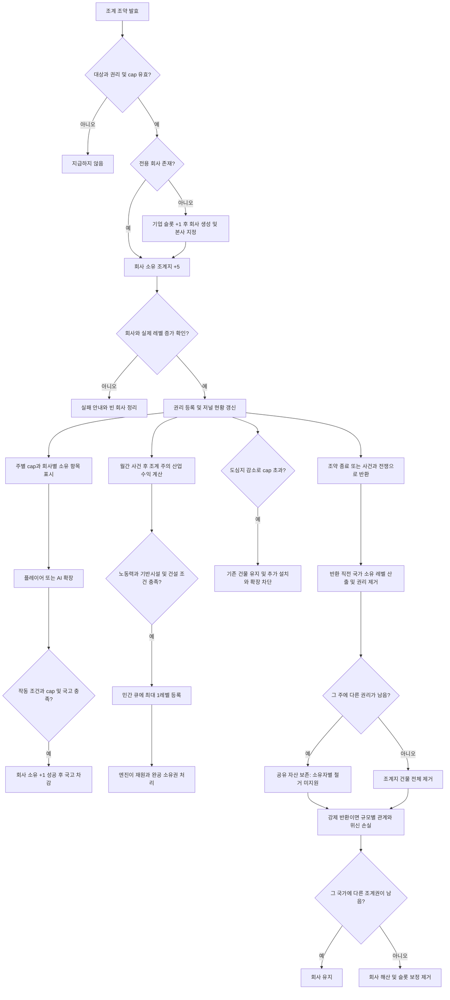

# 중국 조계지 건물·기업 개편 계획과 구현 명세

수정일: 2026-11-08. 사용자 지시에 따라 게임 검증 없이 코드 연결을 진행했다. 조약 지급 경로는 전용 기업 소유 조계지 +5다. 아래는 현재 코드의 동작 명세다. 지원 경로가 확인되지 않은 부분은 11절에 구분한다. 설치 파일·생성 문서 조사 근거는 [엔진 조사 기록](china_concessions_engine_audit.md)에 보존한다.

2026-11-10 변경: 중국 소유국 국고에서 조계 보유국 국고로 매주 돈을 직접 옮기던 이전금(`concession_payment`/`concession_paid` modifier)을 정의·번역·구 세이브 정리까지 모두 삭제했다. 보유국 수익은 조계지 무역과 조계회사 배당뿐이다. 7절 참조.

최신 수량 변경: 조계 1레벨 = 무역소 1레벨, 새 국가의 주별 조계권 획득마다 +5레벨, 주별 상한 = 도심지 ×5. 이미 조계지 건물이 있는 주에도 새 보유국의 회사 지분 5레벨을 더한다. 저널 유료 확장은 기존 +1레벨·£50,000을 유지한다. 반환 충격의 분모는 실제 도심지 레벨을 유지하고 상한 계산과 분리한다. 구 세이브의 기존 레벨 자동 증설은 하지 않는다.

## 1. 구현 범위

| 요구 | 현재 코드 |
| --- | --- |
| 국가별로 건물을 분리하지 않음 | 실제 state마다 공통 `building_eafp_concession`, 복수 국가 회사의 지분 |
| 무역소 대체 | 조계 1레벨에 바닐라 무역소 1레벨 상당 고용·무역 처리능력·투입량 |
| 조약 획득 | 기존 조약 발효 효과에서 회사 생성 및 회사 소유 +5, 성공 후 권리 등록 |
| 회사 수명 | 보유국마다 공통 일반 기업 유형 1개, 첫 설치 시 생성·마지막 권리 소멸 시 해산 |
| 기업 슬롯 | 회사 존재 중 국가에 `country_max_companies_add = 1`, 번영도와 무관 |
| 저널 확장 | 보유국 국고 £50,000, 실제 +1 성공 후 과금. AI도 같은 효과 |
| 도시 한도 | 신규 획득 `T + 5 ≤ 5U`, 저널 확장 `T + 1 ≤ 5U`. 이후 U 감소 시 기존 건물 유지 |
| 자동 산업 투자 | 국제 저널 월간 계산으로 적격 조계 주마다 최대 1레벨 민간 건설 큐 등록 |
| 현황 GUI | 실제 총량·cap·여유·초과·무역소 환산·회사 소유 항목·국가 권리·확장 버튼 |
| 반환 충격 | 반환 전 국가 소유 레벨과 도심지 대비 비율에 따른 관계·위신 손실 |
| 미지원 부분 | 공유 지분의 소유자별 철거/생산 정지, 민간 공사의 회사 지정은 11절 참조 |

관내18성은 `geographic_region_china_proper`, 권리 저장 단위는 실제 state다. 특약 버튼, 소·중·대 구분, 긴장도, 운영 방침, 공공조계, 규모별 주권 침해, 거점 프로빈스, 개정번호·지급완료·세이브 버전 변수와 구 세이브 변환은 추가하지 않는다. 국가별 건물 유형 풀도 사용하지 않는다.

기존 조약·전쟁 목표·월간 사건과 국제 저널을 수정한다. 새 국가별 저널이나 정기 타이머를 만들지 않는다. 저널에는 `possible`을 추가하지 않고 조약 발효 시 `add_contextless_journal_entry`로 추가한다.

## 2. 전체 흐름



## 3. 원본 데이터와 계산

- 권리: state의 기존 `concession_owner_varlist`.
- 회사: 국가마다 일반 유형 `company_eafp_concession` 인스턴스. 국가 scope에서 `company:company_eafp_concession` 조회.
- 총량 T: 실제 조계지 building의 전체 레벨. **반환 후 공유 건물에 남은 잔여 자산도 포함한다.**
- U: 같은 실제 state의 도심지 레벨 합계. cap C는 `5U`이며 `eafp_concession_urban_cap`이 반환한다. 실제 도심지 레벨은 `eafp_concession_urban_levels`로 별도 조회한다.
- 여유: `max(5U-T, 0)`. 초과: `max(T-5U, 0)`. 무역소 환산: `T`.
- GUI 회사 보유량: `Building.GetBuildingOwnerships`의 실제 회사 소유 항목별 `BuildingOwnership.GetLevel`.
- 기존 `concession_candidate_states_gvarlist`는 주간 및 권리 변경 시 다시 만드는 파생 순회 목록이다.

총량·cap·회사 보유량·주간 수익을 영속 숫자로 복제하지 않는다. 반환 시에는 `levels_owned_by_country` 비교 트리거를 이용한 32회 이진 탐색으로 해당 국가 소유 레벨을 구한다. 범위는 0부터 해당 건물의 실제 레벨까지다. 이는 **기업 하나가 아니라 그 국가의 모든 소유분**이며, 반환 잔여 자산이나 재획득이 있으면 전용 기업 지분과 다를 수 있다. 해당 차이는 11절의 제한이다.

새 영속 변수는 국가의 `concession_loss_prestige_snapshot` 하나다. 자산과 권리를 제거한 뒤에는 이전 손실 강도를 복구할 수 없으므로 현재 적용 중인 과거 위신 충격을 저장한다. 730일 만료이며 modifier가 없으면 기존 refresh에서 제거한다. 지급·규모·cap 장부로 사용하지 않는다. 나머지 신규 손실 계산은 효과 체인의 임시 scope value다.

## 4. 조계지 건물과 회사

| 일반 무역 PM 기준 | 무역소 1레벨 | 조계지 1레벨 |
| --- | ---: | ---: |
| 사무원 | 800 | 800 |
| 상점 주인 | 200 | 200 |
| 주간 거래 수 | 1 | 1 |
| 무역 처리능력 | 10 | 10 |
| 일반 무역량의 상선 투입 | 4 | 4 |
| 기반시설 사용량 | 0.5 | 0.5 |

외부무역 원칙과 무역량 생산 방식도 대응 PM을 사용한다. 바닐라의 level/workforce scaling과 기술·원칙 조건을 유지하고 unscaled 비율도 원본과 동일하다. 최초 5레벨의 총 처리능력은 무역소 5레벨 상당이며 실제 매출·이익을 보장하지 않는다. 무역능력은 소재 주의 시장에, 배당은 실제 소유자에게 적용되는 엔진 경로다.

회사는 `flavored_company = no`, 수동 설립 조건은 차단하고 스크립트로 생성한다. 본사는 보유국 수도의 state region에 지정한다. `building_types`에는 조계지만 등록한다. 회사 존재에 따라 슬롯 +1을 유지하고 마지막 권리 소멸 시 `remove_company`를 호출한다. 일반 공장을 직접 제거하지 않는다. 해산 자산 처리와 비용은 엔진에 맡기며 실제 동작은 미검증이다.

최소 자산 5레벨·설립/해산 쿨다운이 동적 `add_company`에 미치는 영향은 미검증이다. 신규 권리의 기본 지급량은 5레벨이지만 회사 생성 시점의 최소 자산 검사 통과는 미검증이다. 전세계 define은 변경하지 않는다. 회사와 실제 레벨 증가를 확인한 후 권리를 등록하고 실패 시 안내하며 빈 회사·슬롯을 정리한다. 실패한 조약 항목의 자동 삭제는 구현하지 않았으므로 안내는 항목 제거 후 재협상을 요청한다.

## 5. 조약 지급·저널 확장·cap

신규 설치는 기존 중국 소유·관내18성·비무역항·열강·이해관계·미보유 조건에 유효 수도와 신규 지급에 필요한 cap 여유 5레벨을 추가한다. 조약 입력 및 발효 효과에서 같은 조건을 재검사한다.

회사 생성 후 `create_building.add_ownership.company`에 유형·보유국·5레벨을 전달한다. 기존 건물이 있으면 해당 건물에 추가하며 기존 PM을 초기화하지 않는다. 새 건물에만 일반 무역량 PM을 지정한다.

`eafp_concession_add_company_level`은 신규 지급과 확장이 공유하며 `LEVELS = 5`와 `LEVELS = 1`을 각각 전달한다. `eafp_concession_expand_effect`는 플레이어 GUI와 월간 AI가 공유한다. 실제 actor의 기존 권리·위신·회사·보유분·여유 cap·국고를 효과 안에서 다시 검사하고 총레벨 증가 후에만 £50,000을 차감한다. AI는 매월 보유국당 최대 한 번, 조건을 충족하고 도시 순이익이 양수인 주 중 순이익이 큰 주를 선택한다.

cap은 진입 조건이다. U가 10에서 7 또는 0이 되어도 T=50과 기존 권리·회사는 유지한다. 초과량만 표시하고 신규 증가를 막는다. cap 초과만으로 영업·산업 투자·반환 충격을 발생시키지 않는다. 기존 주 상속 경로는 권리만 승계하며 건물 보상을 재지급하지 않는다.

## 6. 저널의 민간 산업 투자

기존 국제 저널의 월간 사건 처리 **이후** 실제 후보 주를 한 번씩 순회한다. 국가별 반복으로 같은 주에 여러 공사를 등록하지 않는다.

1. 작동 중인 권리와 회사, 실제 조계지 레벨이 존재해야 한다.
2. 주의 기반시설 여유와 실업률이 양수이고 주 소유국 투자풀 잔액이 양수여야 한다. 투자풀 잔액은 전체 공사비 확보 보장이 아니다.
3. 이미 존재하는 18종 적격 산업 중 `weekly_profit > 0`, 레벨 > 0, `level_after_queued_constructions = level`, `is_under_construction = no`, `can_queue_building_levels = 1`, state의 업종별 `can_construct_building`을 검사한다.
4. `weekly_profit / max(level,1)`이 높은 건물 하나를 선택한다. 미래 추가 레벨의 예상 이익이 아니라 현재 평균 수익 지표다.
5. 해당 state에서 `start_privately_funded_building_construction = building_type`을 한 번 호출한다. 업종별 명시 분기를 사용한다.
6. 공사 진행·재원 지출·완공 소유권은 엔진이 처리한다. 무료 공장 생성이나 별도 국고 지원은 없다.

대상 18종: 식품, 방직, 가구, 유리, 공구, 제지, 화학, 폭약, 합성, 제철, 발동기, 자동차, 전기, 조선, 무기, 대포, 군수품, 예술 학교. 아직 없는 산업, 도심지, 본사·금융지구·장원, 조계지·무역소, 행정·군사 시설은 후보가 아니다. 수입 산정용 도시 건물 필터는 별도로 유지한다.

등록 효과에는 투자 회사나 국가를 지정하는 문서화된 인자가 없다. 따라서 **이 코드는 조계 소재 주의 민간 공사 등록이며 조계회사의 직접 소유를 보장하지 않는다.** 기존 공사 식별·선택 취소 경로도 추가하지 않았다. 권리 소멸 후 신규 등록은 중단하지만 이미 등록한 공사는 엔진 큐에 남는다. 저널 외 회사 자율 투자의 지역 제한을 구현했다고 설명하지 않는다.

## 7. 위신과 국고 이전 삭제

주 소유국 위신이 보유국보다 높으면 그 보유국의 확장·사건 자격을 중단한다. 동률은 작동한다. 저널 산업 투자는 작동 중인 보유국이 하나 이상 있을 때만 진행한다. 권리와 cap 점유는 중단 중에도 유지한다.

공유 건물은 정지하지 않는다.

**주간 이전금은 삭제했다(2026-11-10).** 중국 소유국 국고에서 보유국 국고로 돈을 직접 옮기는 경로가 없다.

- 삭제: script value `eafp_concession_host_debit`·`eafp_concession_state_debit`·`eafp_concession_holder_credit`, refresh 효과의 `concession_payment`(중국 지출)·`concession_paid`(보유국 세입) modifier 부여, 조약 AI 평가의 `EAFP_CONCESSION_AI_INCOME` 항목, 저널의 「주 소유국 주간 부담」 카드와 보유국별 「주간 수취」 표시.
- 삭제: 구 세이브 정리용 `remove_modifier`와 `eafp_chi_modifiers.txt`의 두 modifier 정의, 3개 언어의 `concession_payment`·`concession_paid` 번역. 구 세이브에 이미 붙은 modifier의 처리는 엔진에 맡긴다.
- 유지: `eafp_concession_state_profit`(GUI 표시·AI 확장 대상 정렬)과 `eafp_concession_state_share`(사건 200번대에서 **보유국이 주 소유국에 지급**하는 일회성 배상액 산정). 후자는 반복 이전이 아니며 방향도 반대다.
- 보유국 수익은 조계지 건물의 무역과 조계회사 배당 등 엔진 경로뿐이다.

## 8. 반환과 규모별 충격

모든 반환은 공통 효과를 사용하며 `FORCED = yes/no`를 명시한다. 권리가 이미 없으면 재실행하지 않는다. 변경 전 국가 소유 레벨 L과 `share = L / max(U,1)`을 임시 값으로 산출한다.

- 월간 강제 반환과 반환 전쟁 결과: 강제 처리.
- 조약 철회: 철회국이 현재 주 소유국이고 남은 구속 기간이 양수이면 강제, 나머지는 정상 처리.
- `on_break`에는 반환을 중복 배치하지 않는다. 실제 철회 처리는 `on_withdrawal` 한 곳이다.
- 정상 반환은 추가 외교 충격이 없다. cap 감소는 반환 자체를 발생시키지 않는다.

강제 반환 수치는 다음과 같다.

```text
관계 하락 = min(50, 2L + 10 × share)
위신 감소 = min(30, L + 5 × share), 730일
```

U=10에서 L=1이면 관계 -3·위신 -1.5, L=5이면 -15·-7.5다. 관계 하락은 각 반환마다 적용한다. 위신은 가장 강한 미만료 충격 하나를 유지한다. 더 큰 손실은 강도와 730일을 갱신하고 작은/동일 손실은 기존 강도·만료를 낮추거나 연장하지 않는다.

권리 제거 후 그 주의 다른 권리가 없으면 공유 조계지 전체를 제거한다. 다른 권리가 남으면 다른 국가 자산을 훼손하지 않도록 건물을 남긴다. **이 경우 반환국 자산 일부도 남는 제약이 있다.** 어느 국가의 마지막 전체 권리가 소멸하면 그 회사는 해산한다. 일반 산업 건물은 직접 철거하지 않는다.

## 9. 저널 GUI

국제 저널 한 곳에 500px 폭의 주별 카드를 표시한다. 카드 제목을 누르면 해당 주의 상세 정보가 펼쳐지고 다른 주는 접힌다. 선택은 `GetVariableSystem.SetOrToggle`과 실제 `State.GetIDString`을 사용하는 클라이언트 UI 상태다. 게임 변수·저장 이력·회사별 목록 캐시는 추가하지 않는다.

- 기본 카드: 주 소유국 국기·주 이름, 조계 총량/도심지 5배 cap, 여유·가득 참·초과 상태, 점유 막대, 도시 건물 주간 순이익, 활성 보유국 수·무역소 환산량. (주 소유국 주간 부담 카드는 이전금 삭제와 함께 제거)
- 막대는 `T / max(5U,1)`을 0~1로 제한한다. 초과 시 붉은 막대와 실제 초과 레벨을 함께 표시하며 U=0에도 나누기 오류가 없다. 기존 건물 보존 규칙은 변하지 않는다.
- 상세 권리 목록: 국가별 작동 여부·위신. (주간 수취액 표시는 이전금 삭제와 함께 제거)
- 상세 자산 목록: `Building.GetBuildingOwnerships`의 모든 항목을 순회해 회사·국유·회사 없는 민간 소유를 구분하고 각 항목의 레벨·실제 소유 비중을 표시한다. 회사 본사/지역 본사의 여러 항목을 국가별 합계인 것처럼 오표시하지 않는다. 긴 이름은 말줄임과 전체 이름 툴팁을 제공한다.
- 동작: 주·조계지 건물 패널 바로가기, 자신의 조계 +1 확장 버튼. 확장 조건은 기존 서버 trigger와 효과를 유지하고 권리/위신·cap·국고·소유분의 조건을 번역된 툴팁으로 보여 준다.
- 비어 있는 상태: 조계권이 없을 때 빈 목록 대신 조약으로 조계를 획득하면 표시된다는 안내를 제공한다.
- 반환 잔여 자산과 민간 큐 설명은 상세 영역에 배치한다. 화면 금액은 현재 순이익 기준임을 전체 안내에 명시한다.

### 참고한 로컬 GUI

1. Community Mod Framework 1.67.2의 `gui/com_journal_injects/buildings.gui`: 건물 카드와 직접 이동 버튼, 명확한 데이터 컨텍스트. 외부 모드의 전용 type이나 저장 변수를 의존성으로 가져오지 않았다.
2. new_korea_mod의 `gui/journal_entry_widgets/nkm_manchuria_policy_widgets.gui`: 일정 폭의 두 열 지표와 제목/값 구분.
3. `3338630543/gui/journal_entry_widgets/moh_china_widgets.gui`: 저널 삽입 객체와 정보 계층. 인물 전용 배경·대형 초상화는 이 현황표에는 적용하지 않았다.
4. EAFP의 만한·막번 저널: `section_header_button`과 UI 전용 펼침 상태.
5. 바닐라 `gui/building_details_panel.gui`: 실제 `BuildingOwnership`의 국유/민간 구분과 레벨·소유 비율. `gui/shared/buttons.gui`·`progressbars.gui`: 바닐라 버튼·진행 막대의 블록 정의.

경로 1은 로컬 워크숍 `3385002128`, 경로 2는 `3740653311`에서 읽었다. 사용한 GUI 데이터 함수는 저장소의 `documentation/data_types*.txt`와 교차 확인했다. 게임 실행 및 실제 렌더링 검증은 사용자 지시에 따라 생략한다.

## 10. 수정 경로와 정적 검증

| 경로 | 역할 |
| --- | --- |
| `common/building_groups`, `buildings`, `production_methods`, `production_method_groups`의 `eafp_concessions_*` | 공유 건물과 무역소 동일 수치 PM |
| `common/company_types/eafp_concessions_companies.txt` | 공통 회사 유형 |
| `common/static_modifiers/eafp_concessions_modifiers.txt` | 회사 슬롯·반환 위신 modifier |
| `common/scripted_effects/eafp_concessions_effects.txt` | 부여·확장·반환·refresh·수명 |
| `common/scripted_triggers/eafp_concessions_triggers.txt` | 기존 권리·작동 조건과 신규 cap·회사 조건 |
| `common/script_values/eafp_concessions_values.txt` | 실제 레벨·cap·손실·비용·산업 수익 |
| `common/journal_entries/eafp_concessions_in_china.txt` | 기존 주간 정합화, 월간 사건·투자·AI 확장 |
| 기존 조약·전쟁 목표 파일 | 공통 부여·반환 연결 |
| 기존 scripted GUI와 journal widget | 현황·소유 항목·확장 |
| 한국어·영어·중국어 간체 localization | 명칭·상태·제약·반환 안내 |
| `tools/validate_china_concessions.py` | 참조·중복·인코딩·수치·연결 정적 검사 |

정적 검증 명령:

```powershell
& 'C:/Users/KHG/AppData/Local/Programs/Python/Python310/python.exe' -B tools/validate_china_concessions.py --game-root 'D:/SteamLibrary/steamapps/common/Victoria 3/game'
git diff --check
```

검사기는 정의/참조·3개 언어·BOM/CRLF·자산 존재·무역소 동일 수치 PM·최초 5레벨·도심지 5배 cap·18종 큐 분기·명시적 반환 사유·공용 확장 과금을 확인한다. 정적 성공은 엔진 파싱·경제·GUI 동작 성공과 같지 않다. 이번 요청에서는 게임 실행, 저장 변경, 콘솔 probe, 런타임 로그 검증을 하지 않는다. scratch probe들은 자동 호출되지 않는 실험 자료다.

## 11. 남은 제한과 향후 실행 확인 항목

1. 소유자별 공유 레벨 철거 API를 찾지 못했다. 다른 권리가 남으면 반환 자산이 남고 cap을 계속 점유한다. 같은 국가 재획득 시 과거 잔여 자산까지 국가 보유량/다음 충격 계산에 들어갈 수 있다. 음수 `add_ownership`이나 공유 건물 삭제·재생성을 사용하지 않는다.
2. 공유 건물의 지분별 생산·배당 정지는 미구현이다. 개별 특권 정지와 전체 비활성일 때 건물 정지만 구현했다.
3. 민간 큐의 회사 지정과 회사 기본 자율 투자 지역 제한은 미구현이다. 완료 산업이 조계회사에 귀속된다고 보장하지 않는다. 반환 후 기존 민간 공사도 별도 취소하지 않는다.
4. 첫 5레벨 회사 설립/유지·즉시 재설립·해산 자산 및 비용, 동적 회사 소유 +1과 신설 무역 건물의 실제 수입, GUI 데이터 경로와 표시, 큐 대기 중복 조건, 조약 철회 시 남은 구속 기간 조회는 게임에서 미검증이다.

향후 게임 검증을 허용할 때는 첫 생성→동일 주 복수 회사→유료 확장→cap 감소 보존→민간 공사 대기/완공→부분 반환→마지막 권리와 회사 해산→재획득 순서로 확인한다. 현재 코드는 위 제한을 감춘 완전한 소유자별 철거·회사 직접 투자 구현으로 간주하지 않는다.
