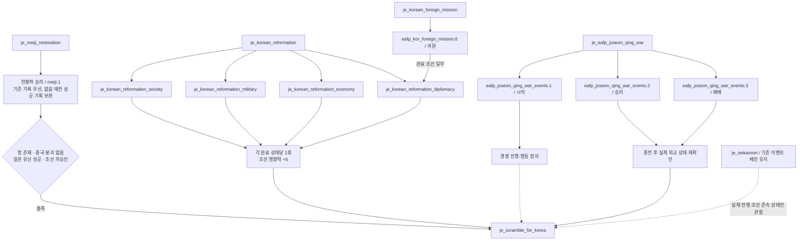
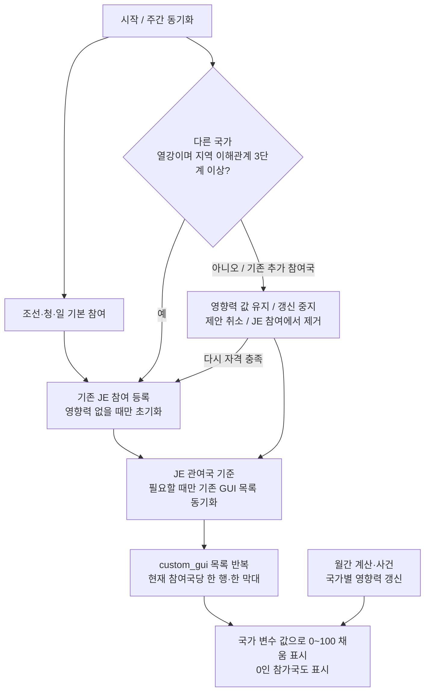
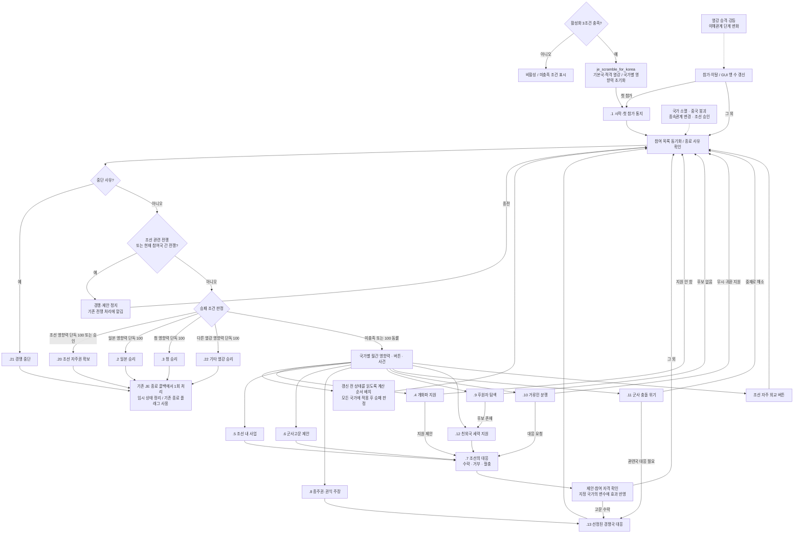

# 조선 쟁탈 일지 구현 계획 — 다국가 참여·동적 custom_gui

작성 기준: 2026-10-12, 현재 로컬 EAFP 및 `Vic3-vanilla` 소스. **구현 전 설계안**이며 게임 스크립트는 변경하지 않았다. 사용자 수정 사항에 따라 열강의 추가 참여와 국가별 동적 `custom_gui` 막대를 적용한다. 청·일 단일 경쟁 막대와 별도 조선 자주권 막대라는 이전 설계는 폐기한다. 활성화 세 조건·추가 참여 조건·GUI 방식은 요구사항이고, 수치·이탈 처리·결말 세부는 구현 제안이다.

수정 기준: 2026-10-13. **기존 체계의 수정·재사용을 우선하고, 필요한 상태와 실제로 반복되는 로직만 추가한다.** 이 원칙은 아래 데이터 구조·이벤트 전달·파일 구성에도 적용한다.

### 구현 원칙

- 먼저 기존 정의·호출부·변수의 설정 및 제거 지점을 확인한다. 기존 일지·이벤트·버튼·modifier·script value의 담당 부분을 고치며, 같은 역할의 새 체계를 옆에 덧붙이지 않는다. 비활성 초안을 활성화할 때도 중복 정의를 남기지 않는다.
- 엔진의 JE 참여 상태, 기존 완료 변수, 실제 외교 관계와 modifier로 알 수 있는 상태는 다시 변수로 저장하지 않는다. 저장이 필요한 값과 한 번의 처리에만 필요한 계산값·이벤트 스코프를 구별한다.
- 한 곳에서만 사용하는 effect·trigger는 해당 JE 콜백·이벤트·버튼에 직접 작성한다. 코드 길이, 이름 붙이기, 향후 재사용 가능성만으로 `scripted_effect`·`scripted_trigger`를 만들지 않는다. **실제로 두 곳 이상에서 같은 의미와 스코프로 반복되는 로직**만 기존 정의의 재사용·수정을 먼저 검토한 뒤 추출한다. 단순 조건 한 줄을 감싸는 래퍼도 만들지 않는다.
- 새 변수는 기존 상태로 구분할 수 없는 이유, 저장 스코프, 쓰는 곳, 읽는 곳, 제거 시점을 설명할 수 있을 때만 추가한다. 캐시·보관 사본·이력 목록·처리 마커·영구 결과 기록을 예방적으로 만들지 않는다.
- 새 파일과 공통화 계층을 먼저 정하지 않는다. 기존 파일에서 요구 기능을 구현한 후 확인된 중복만 정리한다. 아래의 ‘공통 판정·처리’는 같은 규칙을 뜻하며 별도 scripted 정의 생성을 지시하지 않는다.

## 1. 핵심 구조

`je_scramble_for_korea`를 조선·청·일본과 조건을 충족한 다른 열강이 참여하는 국제 일지로 만든다.

- **기본 참여국:** 조선·청·일본. 이 세 국가는 추가 열강 참여 조건을 요구하지 않는다.
- **추가 참여국:** 열강이면서 한반도가 속한 전략 지역의 현재 이해관계가 3단계 이상인 국가. 특정 태그로 제한하지 않는다.
- **국가별 영향력:** 참여국마다 동일한 이름의 국가 변수 `eafp_korea_scramble_influence`를 보유한다. 제안 범위는 각각 0–100이다. 조선의 값은 자주권을 뜻하며 동일한 목록·행 템플릿을 사용한다.
- **동적 표시:** 현재 JE 참여국마다 한 행·한 막대를 생성한다. 영향력 변수의 값은 막대의 채움 정도이고, 막대 개수는 현재 참여국 수다. 값이 0이어도 참여국의 행은 표시하며, 이탈국에 남긴 값은 표시하지 않는다.
- 모든 외국 참여국은 외교·투자·군사고문·조정 내 지원으로 경쟁한다. 조선은 제안에 대응하고 자체 개혁으로 자기 영향력을 높인다.
- 청·일·기타 열강의 승리, 조선 자주권 확보, 경쟁 중단을 국가별 문구로 설명한다.

조선이 청의 종속국이어도 시작한다. 조선의 독립 여부, 일본의 열강 등급·세력권 주도 여부·개항법, 특정 연도는 활성화 조건으로 추가하지 않는다. 조선의 ‘미승인’은 국가 유형이며 ‘개혁 미완료’와 구별한다.

## 2. 바닐라에서 가져올 것

| 원본 | 실제 구현 | 조선에 적용할 방식 |
|---|---|---|
| [류큐 국제 일지](C:/Users/user/Documents/GitHub/Vic3-vanilla/common/journal_entries/01_ryukyu_rivalry.txt:1) | 일·청·류큐 참여, 두 진행도, 네 버튼 | 국제 경쟁과 대응 이벤트 구조를 차용, 다국가 참여로 확장 |
| [진행도 정의](C:/Users/user/Documents/GitHub/Vic3-vanilla/common/scripted_progress_bars/00_ep2_ryukyu_rivalry_progress_bars.txt:3) | 영향력 ±40, 해군력·관계·금전 이전·의무·개입·류큐 위신 반영 | 영향력 산정 소재만 차용, 수치는 국가 변수에 저장하고 custom_gui로 표시 |
| [자주권 진행도](C:/Users/user/Documents/GitHub/Vic3-vanilla/common/scripted_progress_bars/00_ep2_ryukyu_rivalry_progress_bars.txt:362) | 영향력 -20~20에서 월 +0.5, 범위 밖에서는 정지 | 외세의 압력이 낮을 때 조선 영향력이 성장하도록 재설계 |
| [행동 버튼](C:/Users/user/Documents/GitHub/Vic3-vanilla/common/scripted_buttons/ryukyu_rivalry_buttons.txt:1) | 종주권 재확인, 상인 회유, 방어 시찰, 키코에오오기미 예우 | 종주권·권익 주장, 상권 지원, 군사고문 제안, 조정 인사 포섭 |
| [이벤트 .1~.8](C:/Users/user/Documents/GitHub/Vic3-vanilla/events/japan_events/ryukyu_rivalry_events.txt:1) | 상대국 대응·고문 도착·충돌·양국 승리·자주권 확보·시작 | 같은 상호작용 구조를 새 조선 이벤트 체인으로 작성 |
| [연간 충돌 처리](C:/Users/user/Documents/GitHub/Vic3-vanilla/common/on_actions/00_on_actions_yearly.txt:556) | 양국 고문이 있으면 사고 유형 추첨, 5년 재발 방지, 양국에 .6 전달 | 실제 고문 파견국 중 두 국가를 선택해 충돌 생성, 조선도 대응 주체로 포함 |

바닐라의 승리 이벤트 `.5`는 승자의 기존 종속국이면 병합, 상대국 종속국이면 이전, 독립국이면 괴뢰국화한다. 자주권 이벤트 `.7`은 독립시키고 관련 금전 이전 조약에서 탈퇴한다. 이 효과를 그대로 복사하지 않는다. **조선의 기존 종속관계는 승리 판정 전까지 유지하고, 승리해도 자동 병합하지 않는다.**

바닐라의 DLC 표시 조건·이벤트 `dlc`·전용 영상도 별도로 확인한다. 조선 일지의 네 번째 발동 조건으로 DLC 보유를 추가하지 않도록, 기본 제공 아이콘·영상으로 대체 가능한 구성을 우선한다. 국제 일지 기능 자체의 DLC 의존성은 실제 실행 환경에서 확인한다.

## 3. 활성화 조건과 유신 성공 판정

### 확정할 세 조건

| 요구 | 판정 |
|---|---|
| 청나라가 있고 중국 붕괴가 일어나지 않음 | `exists = c:CHI` 및 `NOT = { has_global_variable = china_shatters }` |
| 일본이 유신에 성공함 | 기존 유신 결과 상태를 먼저 확인하고, 천황파 승리의 구분에 꼭 필요한 경우에만 성공 기록 하나 보완 |
| 조선이 미승인국임 | `c:KOR = { is_country_type = unrecognized }` |

청은 현재 콘텐츠의 `CHI` 태그로 판정한다. 별도의 왕조·문화·법률 조건은 추가하지 않는다. [중국 붕괴 이벤트](C:/Users/user/Documents/GitHub/East-Asia-Flavor-Pack/events/warlord_china_events.txt:1125)는 실제로 글로벌 `china_shatters`를 설정한다.

### 현재 변수의 함정

[현재 유신 일지](C:/Users/user/Documents/GitHub/East-Asia-Flavor-Pack/common/journal_entries/eafp_00_meiji_restoration.txt:163)의 성공 경로는 `japan_emperor_restored`와 `japan_restoration_complete`를 설정한다. 그러나:

- `japan_restoration_complete`는 막부 승리 `on_fail`과 군주제 폐지에 따른 `on_invalid`에서도 설정된다.
- `japan_emperor_restored`도 막부 승리 중 `kogi_yoron` 경로에서 설정된다.
- 이전 비활성 스크립트의 `meiji_restoration_complete` 글로벌 변수를 사용하면 현재 활성 콘텐츠와 맞지 않는다.

따라서 이번 계획에서 **‘유신 성공’은 `je_meiji_restoration`의 천황파 승리 `on_complete`**로 정의한다. 유신 이후 경제·군사·외교 등 모든 후속 개혁 완료까지 요구하지 않는다. 공의여론 경로는 별도 성공으로 포함하지 않는 제안이다.

기존 두 변수만으로는 이 성공 정의를 구분할 수 없다. 따라서 성공 전용 변수는 기본적으로 늘릴 상태가 아니라 **기존 기록만으로 판별할 수 없는 경우의 최소 예외**다. 구현 전에 활성 유신 결과 이벤트와 완료 이력 조회 기능까지 확인하여 같은 의미의 기존 기록이 있으면 그대로 읽는다. 그런 기록이 없을 때만 기존 `on_complete`에 다음 국가 변수 하나를 설정한다. 실패·무효 경로까지 바꾸거나 별도 유신 결과 관리 체계를 만들지 않는다.

```txt
set_variable = eafp_meiji_restoration_succeeded
```

성공 기록은 `possible`의 일본 스코프에서 직접 검사하고 일회성 scripted trigger로 감싸지 않는다. 이 변수가 필요해지면 유신 완료 경로가 쓰고 조선 쟁탈 활성화가 읽는 영구 역사 기록 하나로 제한한다. 기존 저장에 기록이 없다고 자동 이행 변수·주기적 복원 로직을 추가하지 않는다. `japan_restoration_complete`만 보고 성공으로 추정하지 않으며, 1차 구현의 기준 검증은 신규 게임으로 한다.

### possible 설계 예시

다음은 성공 기록 보완이 필요한 경우의 예정 코드다. 기존 성공 기록을 확인하면 해당 한 줄을 기존 판정으로 바꾼다.

```txt
possible = {
    exists = c:CHI
    NOT = { has_global_variable = china_shatters }

    exists = c:JAP
    c:JAP = {
        has_variable = eafp_meiji_restoration_succeeded
    }

    exists = c:KOR
    c:KOR = { is_country_type = unrecognized }

    NOT = { has_global_variable = scramble_for_korea_finished }
}
```

일본·조선의 존재 검사는 스코프 접근을 보장한다. 종료 후 재발동 방지에는 비활성 초안에 이미 있는 `scramble_for_korea_finished`를 재사용한다. 초기화는 국제 JE의 `immediate`에서 처리하며 기존 JE 활성 상태와 영향력 변수의 존재를 이용해 중복을 막는다. 별도 `started` 변수는 만들지 않는다.

`is_shown_when_inactive`에서는 세 조건의 충족 여부를 읽을 수 있게 한다. **일지 활성화 조건과 개별 국가의 참여 조건은 분리**한다. 추가 열강이 없어도 조선·청·일 세 나라로 시작한다.

### 참여 자격과 전략 지역

현재 바닐라의 [전략 지역 정의](C:/Users/user/Documents/GitHub/Vic3-vanilla/common/strategic_regions/east_asia_strategic_regions.txt:31)에서 서울·부산·사리원·평양·양호는 `region_northeast_asia`에 속한다. EAFP의 [조선 봉기 일지](C:/Users/user/Documents/GitHub/East-Asia-Flavor-Pack/common/journal_entries/eafp_03_korea.txt:210)에도 같은 지역의 이해관계 3단계 판정이 있다. 따라서 현재 지도에서는 아래 조건으로 ‘한반도 지역 이해관계’를 구현한다. 이는 한반도만 분리된 지역이 아니라 동북아 전체를 대상으로 하는 현행 게임의 단위다. 한반도 전용 전략 지역이 생기면 해당 자격 판정의 지역 참조를 수정한다.

```txt
should_be_involved = {
    OR = {
        c:KOR ?= this
        c:CHI ?= this
        c:JAP ?= this
        AND = {
            country_rank >= rank_value:great_power
            has_strategic_region_interest_tier = {
                strategic_region = sr:region_northeast_asia
                value >= 3
            }
        }
    }
}
```

우선 기존 `should_be_involved`를 이 조건으로 수정한다. 참가·이탈 처리와 예약 이벤트에서 동일한 전체 조건이 실제로 반복될 때만 자격 판정을 scripted trigger로 추출한다. JE 참여 여부만 필요한 곳에서는 JE 참여 상태를 직접 검사한다. 단순 관심 선언 여부나 관여도 원점수로 3단계 조건을 대체하지 않는다. 추가 참여국에도 세력권 주도·문화·대륙·전략적 인접 조건은 붙이지 않는다.

### 참가·이탈·재참가

1. 시작 시 기본 세 나라와 자격을 충족한 모든 추가 국가를 등록한다. 이후 주간 펄스에서 신규 열강·등급 상승을 반영한다.
2. 등록 시 JE 관여국을 추가하고 영향력 변수가 없을 때만 첫 점수를 부여한다. GUI용 목록이 필요하면 같은 처리에서 기존 목록도 갱신한다. 이미 참여 중이면 중복 추가하거나 점수를 초기화하지 않는다. 등록 처리가 실제로 반복될 때만 scripted effect 추출을 검토한다.
3. 추가 참여국이 열강 지위를 잃거나 이해관계가 3단계 미만으로 내려가면 다음 동기화에서 이탈한다. 버튼·예약 이벤트·승리 판정에서는 자격을 다시 검사하므로 그 사이 행동할 수 없다.
4. 이탈 시 JE 참여와 GUI용 목록에서 제거하되 **기존 영향력 값은 그대로 두고 갱신을 멈춘다.** 별도 보관 변수로 복사하지 않는다. 자기 고문 효과·미결 제안만 취소하며 다른 국가의 점수는 바꾸지 않는다.
5. 재참가 시 남아 있는 값을 그대로 사용한다. 영향력 변수의 존재로 첫 참가와 재참가를 구분하므로 별도 참가 이력 플래그도 필요 없다. 첫 참가 보너스·시작 보상을 재지급하지 않는다. 쿨다운은 이탈로 초기화하지 않고 원래 만료까지 유지한다.
6. 추가 국가 소멸은 그 국가만 제거한다. 조선·청·일 소멸과 중국 붕괴는 기존 중단 정책을 유지한다. 전체 종료 때 한 번만 생존 국가 중 이 일지의 영향력 변수를 가진 국가를 찾아 정리한다. 이탈국 정리를 위해 영구 참가 이력 목록을 따로 유지하지 않는다.

기존 JE의 주간 `every_scope_je_involved` / `remove_involved_country` 처리를 수정하여 사용한다. `should_be_involved`의 자동 반영 범위를 확인하고 부족한 신규 참가 처리만 `add_involved_country`로 보완한다. 별도의 참가 관리 체계를 병행하지 않는다. 안전한 제거에 후보 목록이 필요하면 해당 처리 안의 임시 목록을 쓰며 영구 상태로 만들지 않는다.

## 4. 국가 변수·custom_gui·진행도

### 데이터 구조

| 저장 위치 | 이름 | 역할 |
|---|---|---|
| 참가 경험이 있는 각 국가 | `eafp_korea_scramble_influence` | 필요한 새 누적값 하나, 0–100. 이탈 중에는 유지하되 계산·GUI·승리 판정에서 제외, 종료 시 제거 |
| 국제 JE | 엔진의 관여국 상태 | 활성 참가 여부의 기준. 별도 활성 플래그를 만들지 않음 |
| 전역 목록, GUI에서 필요할 때만 | 기존 `scramble_for_korea_participants` | JE 관여국을 직접 GUI에 바인딩할 수 없을 때만 기존 이름으로 표시용 목록 관리. 새 이름의 병행 목록·참가 카운터는 없음 |
| 전역 | 기존 `scramble_for_korea_finished` | 종료·재발동 방지에 기존 플래그 재사용 |
| 처리·이벤트 스코프 | 승자·행위국·대상·변화량 | 해당 실행과 후속 이벤트에 필요한 범위에서 전달. 영구 전역 승자·결과 변수로 저장하지 않음 |

월간 변화는 같은 계산식을 월간 적용과 툴팁에서 읽고 영구 캐시를 두지 않는다. 툴팁은 지난달 적용 기록이 아닌 현재 조건의 예상 월간 증감을 표시한다. 고문 파견 기간은 실제 modifier의 존속 여부·기간을, 행동 대기는 버튼의 기존 쿨다운 기능을 우선 사용한다. 엔진 상태만으로 표현할 수 없는 미결 제안 잠금 등의 상태는 구현에서 필요가 확인된 최소 항목만 추가하고 만료·취소·종료 시 제거한다.

항상 **GUI 표시국 = 유효한 JE 참여국**이며 표시국은 영향력 변수를 보유한다. 반대로 영향력 변수가 있다는 이유만으로 현재 참여국으로 취급하지 않는다. 조선도 같은 기준을 쓴다. GUI용 목록이 필요하면 기존 목록 하나를 JE 상태에 맞춰 관리하며, 매 프레임 전 세계 국가를 검색하거나 GUI에서 상태를 수정하지 않는다.

### custom_gui 구현 방식

JE에 `widget = { gui = ... name = ... container = ... }`로 사용자 정의 GUI를 연결한다. 현재 [막번체제 일지](C:/Users/user/Documents/GitHub/East-Asia-Flavor-Pack/common/journal_entries/eafp_japan.txt:11)가 같은 연결 방식을 사용한다. 여기서 `custom_gui`는 이 사용자 정의 위젯을 뜻하며, 확인되지 않은 `custom_gui = ...` 키를 새로 가정하지 않는다.

로컬 `documentation/data_types_uncategorized.txt`에는 `JournalEntry.GetInvolvedCountries`가 있다. 먼저 기존 국제 JE 화면에서 이 API의 행 데이터 타입·스코프와 정렬 방식을 확인하여 관여국을 직접 바인딩한다. API 이름만으로 반환 타입을 단정하지 않는다. 직접 바인딩이 요구 표시를 지원하지 못할 때만 비활성 초안의 `scramble_for_korea_participants` 목록을 재사용한다.

목록 대안의 `GetGlobalList`는 [로컬 GUI API 문서](C:/Users/user/Documents/GitHub/East-Asia-Flavor-Pack/documentation/data_types_script.txt:62)에 있고, 반복 행과 국가 변수 막대는 [반복 목록 사례](C:/Users/user/Documents/GitHub/East-Asia-Flavor-Pack/gui/eafp_eastasian_expansionism.gui:40) 및 [변수 기반 막대 사례](C:/Users/user/Documents/GitHub/East-Asia-Flavor-Pack/gui/journal_entry_widgets/eafp_je_bakuhantaisei.gui:627)를 참고한다. 아래 코드는 **직접 JE 바인딩이 불가능할 때의 대안**이며 실행 검증 전이다.

```txt
# JE 내부: container는 실제 국제 일지 화면에서 검증
widget = {
    gui = "gui/journal_entry_widgets/eafp_je_scramble_for_korea.gui"
    name = "widget_je_scramble_for_korea_influence"
    container = "custom_widget_container_5"
}

# 위 GUI의 위젯 내부: 하나의 행 템플릿을 목록 수만큼 반복
flowcontainer = {
    direction = vertical
    datamodel = "[GetGlobalList('scramble_for_korea_participants')]"
    item = {
        flowcontainer = {
            datacontext = "[Scope.GetCountry]"
            visible = "[Country.MakeScope.Var('eafp_korea_scramble_influence').IsSet]"
            direction = vertical
            textbox = { text = "[Country.GetName]" }
            green_progressbar_horizontal = {
                blockoverride "values" {
                    min = 0
                    max = 100
                    value = "[Country.MakeScope.Var('eafp_korea_scramble_influence').GetValue]"
                }
            }
        }
    }
}
```

기본 `scripted_progress_bar`로 국가별 막대를 열거하거나 청·일 합성 막대를 남기지 않는다. 국가별 GUI 정의도 복제하지 않는다. 실제 행에는 국기·국명·역할(조선 자주권/외국 영향력)·현재 값·월간 증감·변화 원인 툴팁을 표시하고, 색상 외에도 텍스트로 국가를 구별한다. 숫자와 막대 채움은 같은 국가 변수를 읽는다. GUI 새로고침이나 관전 국가 전환은 게임 상태를 수정하지 않는다.

행 순서는 기존 JE의 안정적인 순서를 우선 사용하고 점수 변화마다 재정렬하지 않는다. 기존 목록 대안을 쓰면 조선을 먼저 넣고 신규 국가는 뒤에 추가하며 이탈 시 제거한다. 최초 참가 순서 보존을 위한 별도 이력 변수는 만들지 않는다. 최대 높이와 세로 스크롤을 두되 행 수 제한은 두지 않는다. **3국이면 3개, 영·러·미가 더 들어오면 6개, 한 국가 이탈 시 5개**가 표시된다. 관전국도 같은 JE 참여 상태를 읽으며 `JournalEntry.GetCountry`를 참가국 저장소로 사용하지 않는다.

### 영향력 산정 제안

`I(c)`는 현재 참여국 c의 영향력 값이다. 각 값은 독립적인 0–100 수치이며 총합 100인 점유율이 아니다. 신규 참가·이탈만으로 기존 국가의 점수나 분모가 바뀌지 않는다. 상대 영향력 감소는 명시된 사건·행동에만 적용한다.

| 요소 | 외국 참여국 I(c) | 조선 I(KOR) |
|---|---|---|
| 첫 참가 | 기본 10, 조선의 현재 종주국은 20. 재참가는 기존 값 유지 | 0 |
| 해군력 | 외국 참여국 중 단독 최강이면 월 +0.5, 동률이면 보너스 없음 | — |
| 조선과 관계 | 50~79이면 월 +0.5, 80 이상이면 월 +1 | — |
| 조선에 대한 금전 지원 | 실제 지급국에 월 최대 +1, 복수 조약 합산 후 상한 | — |
| 조선이 진 의무 | 채권국 월 +0.5 | — |
| 수락된 군사고문 | 파견국 월 +0.5, 24개월 | — |
| 외세 압력 억제 | — | 모든 외국 참여국의 영향력이 50 미만이면 월 +0.5 |
| 조선 위신 | — | 15~29일 때 월 +0.25, 30 이상이면 월 +0.5 |
| 조선 개혁 완료 | — | 사회·군사·경제·외교 각 분야 일회 +5 |
| 사건·행동 | 지정된 행위국/대상국의 값에 증감, 기본 폭 2~5 | 수락·거부·자력 대응에 따라 증감 |

국가별 월간 지속 변화 합계는 -1~+1로 제한하고, 0–100 범위를 보장한다. 사건의 일회 변화는 별도이며 쿨다운을 둔다. 예를 들어 외국이 10에서 월 +1만 얻으면 100까지 90개월이다. 조선은 월 +0.5만 얻으면 200개월, 개혁 보너스 +20이 있으면 160개월이다. 참가국 수별 실제 플레이로 조정할 초기값이다.

모든 국가의 월간 변화는 **같은 갱신 전 상태**를 기준으로 계산하고 전부 적용한 다음 승자를 판정한다. 현재 산식에서 다른 참가국의 영향력을 읽는 조선의 ‘모든 외국 50 미만’ 조건은 외국 점수를 바꾸기 전에 평가한다. 이처럼 읽기·적용 순서로 해결되는 계산에 국가별 영구 변화량 캐시를 만들지 않는다. 향후 서로의 갱신 전 값을 참조하는 항목이 늘어나면 그 실행 안에서만 임시 계산값을 사용한다.

기존 완료 개혁은 영향력 **최초 초기화 블록 안에서** `completed_je_korean_reformation_*`를 읽어 각 +5를 반영한다. 이후 완료되는 개혁은 기존 하위 일지의 `on_complete`에서 쟁탈 진행 여부를 확인하고 +5를 적용한다. 별도 월간 완료 감시나 분야별 `*_counted` 변수를 추가하지 않는다. 초기화와 개혁 완료가 같은 시점에 일어나도 기존 완료 변수 설정과 보상 순서상 중복 지급되지 않도록 확인한다. 이 보너스는 외세 참가 수와 무관하다.

### 행동과 조선의 대응

| 버튼 / 주체 | 조건·비용 제안 | 연결 이벤트와 효과 |
|---|---|---|
| 종주권·권익 주장 / 모든 외국 참여국 | 자기 영향력이 외국 선두보다 낮음, 외교 비용, 36개월 대기 | `.8` → 관련 경쟁국 `.13`; 자기 +3, 대응국은 비용을 들여 해당 증가분 최대 3 상쇄 |
| 상권 지원 / 모든 외국 참여국 | 조선 내 자국 소유 건물, 재정 비용, 24개월 대기 | `.5` → 조선 `.7`; 수락 시 행위국 +3 |
| 군사고문 제안 / 모든 외국 참여국 | 관련 전쟁 없음, 외교 비용, 24개월 대기 | `.6` → 조선 `.7` → 관련 경쟁국 `.13`; 수락 후에만 고문 효과 |
| 조정 인사 포섭 / 모든 외국 참여국 | 지원 가능한 조선 내 정치 집단, 재정 비용, 24개월 대기 | `.9` → `.12` → 조선 `.7`; 친해당국 로비 지원 |
| 자주 외교 / 조선 | 행정력 비용, 24개월 대기 | 조선 +3, 외국 단독 선두 -3. 선두 동률이면 이 감소분만 생략 |

모든 비용과 쿨다운은 툴팁에 표시한다. 청은 종주권, 일본은 조약상 권익, 기타 열강은 자국 권익이라는 국가별 문구를 사용한다. 경쟁국 대응은 직접 피해국 또는 행위국 외 영향력 선두 **한 국가**를 선택하며, 선두 동률은 게임 스크립트의 무작위 선택으로 정한다. 모든 참가국에 동시에 효과 있는 대응 선택지를 보내 점수가 참가국 수만큼 중복 변하지 않게 한다.

세력권 레버리지는 주 진행도로 사용하지 않는다. 기존 `power_bloc.add_leverage`는 제거하거나 실제 세력권 주도국일 때만 부수 효과로 남긴다.

## 5. 관련 일지와 기존 콘텐츠의 연결

이번 일지에 직접 연결할 기존 일지와 경계는 다음과 같다. 다른 조선 콘텐츠 전체의 내부 이벤트를 이 일지로 옮기지 않고, 확정된 완료 상태 또는 실제 외교 상태를 읽는다.

| 기존 일지 | 연결 지점 | 계획 |
|---|---|---|
| `je_meiji_restoration` | 기존 천황파 승리 `on_complete` → `meiji.1` | 활성화 선행 조건. 기존 기록으로 결과 구분이 불가능할 때만 성공 기록 하나 보완 |
| `je_korean_reformation` | 하위 네 일지 생성 및 전체 개혁 완료 | 상위 완료와 분야별 완료를 중복 보상하지 않음 |
| `je_korean_reformation_society` | `completed_je_korean_reformation_society` | 조선 영향력 +5, 한 번 |
| `je_korean_reformation_military` | `completed_je_korean_reformation_military` | 같은 효과, 한 번 |
| `je_korean_reformation_economy` | `completed_je_korean_reformation_economy` | 같은 효과, 한 번 |
| `je_korean_reformation_diplomacy` | `completed_je_korean_reformation_diplomacy` | 같은 효과, 한 번 |
| `je_korean_foreign_mission` | 귀환 → `eafp_kor_foreign_mission.6` → 외교 개혁 조건에 기여 | 외교 개혁을 통해 간접 반영, 별도 중복 점수 없음 |
| `je_eafp_joseon_qing_war` | 시작 `.1`, 전후 승리 `.2`, 패배 `.3` | 전쟁 중 경쟁 정지, 종전 후 실제 종속관계 재확인 |
| `je_seikanron` | 반조선 로비·도발·외교 상태 | 독립적으로 유지. 동일 사건을 다시 발생시키거나 이 일지의 승리만으로 완료하지 않음 |

출처: [조선 개혁](C:/Users/user/Documents/GitHub/East-Asia-Flavor-Pack/common/journal_entries/eafp_korean_reformation.txt:1), [해외 사절단](C:/Users/user/Documents/GitHub/East-Asia-Flavor-Pack/common/journal_entries/eafp_korean_foreign_mission.txt:1), [조청전쟁](C:/Users/user/Documents/GitHub/East-Asia-Flavor-Pack/common/journal_entries/eafp_joseon_qing_war.txt:1), [정한론](C:/Users/user/Documents/GitHub/East-Asia-Flavor-Pack/common/journal_entries/eafp_japan.txt:1099).



## 6. 이벤트 전체 구성

아래 **16개 ID가 이번 구현 범위의 전체 이벤트**다. 접두사는 모두 `scramble_for_korea_events`다. 번호만 표시한 후속 연결도 같은 네임스페이스다. 각 행의 수치·분기는 제안이며 현재 작동하는 콘텐츠가 아니다. 일본·청 전용 결말 외에 기타 열강 공용 결말 `.22`를 추가한다.

| ID | 내용 / 실행 국가 | 발생 원인 → 후속 처리 |
|---|---|---|
| `.1` | 조선 문제의 국제화 / 모든 참여국 | 시작 및 신규 국가 첫 참가 통지. 기존 JE 등록 처리에서 최초 초기화 1회, 재참가 보상 없음 |
| `.2` | 일본 우세 확정 / 모든 참여국 | 일본이 영향력 승자 → 결과 알림; 종속관계 처리는 JE 종료 콜백에서 1회 |
| `.3` | 청의 종주권 재확립 / 모든 참여국 | 청이 영향력 승자 → 결과 알림; 종속관계 처리는 JE 종료 콜백에서 1회 |
| `.4` | 조선 개화파 지원 / 외국 참여국 | 월간 후보 → 지원 선택 시 조선 `.7`, 거부 시 비용·국내 정치 효과만 |
| `.5` | 조선 내 외국 소유 사업 / 외국 참여국 | 상권 버튼 또는 월간 후보 → 투자·노동조건 제안 → 조선 `.7` |
| `.6` | 군사고문단 제안 / 외국 참여국 | 고문 버튼 → 조선 `.7`; 수락 후 고문 상태 설정 및 관련 경쟁국 `.13` |
| `.7` | 외국의 제안에 대한 조선의 결정 / 조선 | 제안 종류·보낸 국가·효과를 저장해 전달 → 수락·거부·절충; 유효한 응답에서만 점수 변경 |
| `.8` | 조선에 대한 권리 주장 / 외국 참여국 | 종주권·권익 버튼 → 비용과 행위국 영향력 변화 → 관련 경쟁국 `.13` |
| `.9` | 조정 내 후원자 탐색 / 외국 참여국 | 포섭 버튼 → 후보가 존재할 때 `.12`; 없으면 비용 부과 없이 종료 |
| `.10` | 거류민 분쟁 / 외국 참여국 | 관련 문화의 실제 조선 팝이 있을 때 월간 후보 → 조선 `.7`, 무시 또는 자발적 귀환 지원; 자동 인구 추방 제외 |
| `.11` | 군사적 충돌 위기 / 먼저 조선, 이후 관련국 | 서로 다른 두 참여국 고문 공존 또는 도발 후보 → 조선 중재·철수 요구 / 관련 경쟁국 `.13`; 두 당사국 변수만 조정, 자동 선전포고 없음 |
| `.12` | 친외국 세력 지원 / 외국 참여국 | `.9` 또는 월간 후보 → 비용 지급과 대상 로비 선택 → 조선 `.7`; 친청·친일·친영 등 국가명 동적 표시 |
| `.13` | 경쟁국의 대응 / 선정된 외국 참여국 | `.6` 수락, `.8`, `.11` → 항의·양보·대응으로 지정 국가 영향력 조정, 원 이벤트로 재귀하지 않음 |
| `.20` | 조선 자주권 확보 / 모든 참여국 | 조선이 영향력 단독 승자 또는 승인국 전환 → 독립 보장 효과와 결과 알림 |
| `.21` | 조선 쟁탈의 중단 / 생존 참여국 | 기본국 소멸·중국 붕괴·조선의 비참여국 종속 → 사유별 문구, 자동 승자 없음 |
| `.22` | 새로운 패권국 / 모든 참여국 | 청·일 외 열강이 영향력 단독 승자 → 승자 국명·국기 및 종속관계 결과 표시 |

`.7`은 제안 종류를 구분하는 공통 대응 이벤트다. 발신국·대응국·필요한 대상은 기존 이벤트 체인처럼 `save_scope_as`와 이벤트 전달 스코프로 넘기고, 제안 종류는 이벤트 체인 안의 값으로 전달한다. 같은 정보를 국가·전역 변수에 다시 저장하지 않는다. **조선당 미결 제안은 하나만** 허용하되 기존 이벤트 대기 상태로 제어할 수 있는지 먼저 확인하고, 불가능하면 잠금 하나만 둔다. 별도 제안 토큰·일련번호·제안 관리 목록은 기본 설계에 넣지 않는다.

응답 시 국가·JE·대상 존속, 현재 참가 자격과 관련 전쟁을 다시 확인한다. 이미 이탈한 국가의 제안은 효과 없이 닫으며, 이탈 후 재참가했다고 옛 제안이 되살아나지 않도록 취소된 이벤트의 수명과 잠금 해제를 함께 검증한다. 발신 이벤트만으로 고문·로비·지속 영향력을 부여하지 않는다. 사망한 인물·사라진 건물은 해당 제안만 취소한다. 필요한 취소 상태를 기존 이벤트 수명으로 표현할 수 없을 때에만 최소 상태 보완을 검토한다.

월간 랜덤 후보는 `.4`, `.5`, `.10`, `.11`, `.12`로 한정한다. 일지 전체에서 월 최대 한 후보를 뽑은 뒤 적합한 외국 참여국을 선택하여 참가 수만큼 사건 발생률이 늘어나지 않게 한다. 후보별 조건·쿨다운을 적용하고, 미결 제안·관련 전쟁·종료 대기 중이면 생성하지 않는다. 기존 아프리카·파타고니아·아마존 이벤트 호출은 제거한다. 류큐의 연간 전역 on_action을 덮어쓰지 않는다.

## 7. 전체 진행·이벤트 흐름도

실선은 이번 일지의 실행 흐름이다. 점선은 외부 상태 변화다. 종료를 일으키지 않는 이벤트 선택은 공통 갱신 단계로 돌아간다.

### 참여국 목록과 GUI 동기화



### 모든 계획 이벤트와 결말



## 8. 승패와 예외 상태

종료 판정은 엔진의 `complete` / `fail` / `invalid` 호출 순서에 맡기지 않는다. 아래 우선순위를 공통 판정에 명시하고, 각 트리거를 상호 배타적으로 만든다.

1. **동기화:** 신규 참가·자격 상실·소멸을 반영한다. 승자를 고를 때도 현재 참여 자격을 다시 확인한다.
2. **경쟁 중단:** 조선 또는 청·일 소멸, `china_shatters`, 조선이 현재 비참여국에 종속. `.21`, 승리 보상과 종속관계 조작 없음. 추가 열강 하나의 소멸·이탈만으로는 중단하지 않는다.
3. **관련 전쟁 중:** 조선이 당사자인 전쟁 또는 현재 참여국끼리의 전쟁이면 나머지 결말을 보류하고 영향력·행동·신규 사건을 정지한다. 종전 후 다시 검사한다. 참여 열강이 비참여국과 치르는 무관한 전쟁만으로는 전체 일지를 정지시키지 않는다.
4. **조선 승인국 전환:** 다른 점수 조건에 우선하여 조선 승리 `.20`.
5. **영향력 승리:** 유효 참여국 중 정확히 한 국가만 100이면 그 국가가 승리한다. 조선 `.20`, 일본 `.2`, 청 `.3`, 기타 국가 `.22`로 분기한다.
6. **동률:** 같은 갱신에서 둘 이상이 100이면 ‘패권 경합’으로 계속한다. 태그·목록 순서·청일 우선권으로 승자를 정하지 않는다. 상대 영향력 감소 행동·사건 또는 이탈로 단독 100이 되면 승리를 확정한다. 동률 상태에서도 사건·대응 행동은 가능해야 한다.

영국·러시아 등이 참여 중이라면 조선이 그 종속국이라는 이유만으로 중단하지 않는다. 현재 종주국이 참여 자격을 상실하면 목록 갱신 후 비참여국 종속에 따른 중단을 적용한다. 초기부터 비참여국 종속 상태인 경우에도 세 활성화 조건을 바꾸지 않고 시작 후 예외 판정으로 정리한다. 이는 이전의 ‘청·일 이외 종속이면 무조건 중단’을 대체한다.

| 결말 | 외교 효과 제안 |
|---|---|
| 청 승리 | 이미 청 종속이면 현재 등급 유지. 독립이면 조공국 관계 제안값으로 생성. 다른 참여국 종속이면 청으로 이전. 청 위신·친청 지지 보상 |
| 일본 승리 | 이미 일본 종속이면 현재 등급 유지. 독립이면 보호국 관계 제안값으로 생성. 다른 참여국 종속이면 일본으로 이전. 일본 위신·군부 만족 보상 |
| 기타 열강 승리 | 이미 승자 종속이면 현재 등급 유지. 독립이면 보호국 관계 제안값으로 생성. 다른 참여국 종속이면 해당 승자로 이전. 승자 스코프로 공통 효과·문구 적용 |
| 조선 승리 | 참여국 종속이면 평시 독립 처리, 독립국이면 유지. 자주권 확보 modifier와 위신 보상. 영향력만으로 국가 유형을 승인국으로 강제 변경하지 않음 |
| 경쟁 중단 | 기존 외교·전쟁 결과를 유지하고 경쟁 전용 임시 상태만 정리 |

종속 관계 생성에는 현재 게임의 실제 지원 외교 관계 유형과 허용 조건을 확인한다. 바닐라에 존재하는 `transfer_subject`, `create_diplomatic_pact`, `make_independent` 패턴을 참고하되, 조공국·보호국의 정확한 키와 권한을 구현 단계에서 검증한다. 승자가 종속국이어서 변경이 불가능한 경우는 **정치적 영향력 승리와 보상만 적용하고 기존 종속관계를 유지**하며 그 사실을 결말 문구에 표시한다.

외국 참여국 승리에 따른 평시 종속국 이전은 류큐 모티브를 따른 설계 제안이다. 조선 플레이어는 진행 중 `.7`과 자체 행동으로 이를 저지한다. 승리 직후 추가 거부·전쟁 체인을 넣는 것은 1차 범위에 포함하지 않는다.

자주권 승리 시 모든 조약을 일괄 탈퇴시키지 않는다. 경쟁에서 새로 생성하고 추적한 임시 지원·고문 효과만 정리한다. 외부 시스템이 만든 조약·관계·정치 로비는 유지한다.

JE의 기술적 종료는 모든 영향력 승리·조선 승인 결말을 `complete`, 경쟁 중단을 `invalid`로 처리한다. 특정 국가 승리를 `fail`에 고정하지 않는다. 기존 JE의 `on_complete` / `on_invalid`에서 결과를 확정하고, 승자는 저장 스코프로, 결과 종류는 이벤트 분기로 전달한다. 이를 위한 영구 전역 변수나 일회성 scripted effect는 만들지 않는다. 각국 결과 이벤트는 플레이 국가에 맞는 승리·패배·관전 문구를 보여 주며 외교 효과를 다시 실행하지 않는다.

## 9. 기존 초안에서 고칠 부분

[비활성 일지](C:/Users/user/Documents/GitHub/East-Asia-Flavor-Pack/common/journal_entries/eafp_scramble_for_korea.disable:1)와 [비활성 이벤트](C:/Users/user/Documents/GitHub/East-Asia-Flavor-Pack/events/eafp_scramble_for_korea_events.disable:1)의 기존 정의를 수정·활성화한다. JE ID·이벤트 네임스페이스·쓸 수 있는 기존 키를 유지하면서 다음 부분을 고친다.

- `is_subject = no`, 세력권 주도국 2개, 구 만주 관심 선언 조건을 제거한다. 기본 3국 또는 열강·동북아 이해관계 3단계 이상이라는 공통 자격으로 대체한다.
- 조선 승인국 전환이 `complete`와 `fail`에 동시에 걸리는 구조를 없앤다.
- 정의되지 않은 `.1`, `.2`를 실제 작성한다. 기존 `.2`, `.3` 현지화도 새 결말 용도에 맞춰 변경한다.
- 실제 연결되지 않은 `.4`, `.5`, `.10`, `.11`, `.12`를 월간 후보·버튼·조선 대응 체인에 배치한다.
- `.4`의 선교 제목과 개화 지원 효과를 일치시킨다.
- `.12`의 `relevant_country`, `primary_culture_scope` 등 대상 스코프와 국고 증감 방향을 고친다. 로비 지원이라는 이름에 맞는 실제 로비 처리를 넣는다.
- 기존 JE의 참여국 관리와 `scramble_for_korea_finished`를 재사용한다. `scramble_for_korea_participants`는 직접 GUI 바인딩이 불가능할 때만 보완해 쓰고, 불필요하면 관련 참조와 함께 제거한다. 수동 참가 카운터 `je_scramble_for_korea_participants_globalvar`는 제거하고 새 카운터를 만들지 않는다.
- 이전 안의 S·A 변수, ±40 판정, `scripted_progress_bar` 원본 구조를 사용하지 않는다. 모든 사건은 지정된 국가 스코프의 `eafp_korea_scramble_influence`에 증분을 적용한다.
- 기존 청·일 하드코딩을 기본 참여·역사적 문구 외에는 제거한다. 참가 자격, 라이벌 선택, 승자, 고문·로비 대상, 종료 통지를 동적으로 처리한다.

## 10. 구현 파일과 순서

이번 작업은 계획서만 수정한다. 아래 경로는 저장소 루트 기준의 구현 대상이며 **기존 정의를 고칠 위치부터 정하고 필요한 파일만 추가**한다. 아직 사용처가 정해지지 않은 빈 파일이나 일괄 분리용 파일을 만들지 않는다.

| 순서 | 파일 | 작업 |
|---|---|---|
| 1 | `common/journal_entries/eafp_00_meiji_restoration.txt` 및 기존 유신 결과 이벤트 | 성공 기록 재사용 가능 여부 확인. 불가능할 때만 기존 성공 콜백에 기록 하나 추가 |
| 2 | `common/journal_entries/eafp_scramble_for_korea.disable` → `.txt` | 기존 JE를 수정·활성화. 초기화·주간 참가 갱신·월간 계산·종료 처리를 각 콜백에 직접 배치 |
| 2 | `common/journal_entries/eafp_korean_reformation.txt` | 기존 네 분야 완료 콜백에 진행 중 보상만 연결. 완료 변수·일지 생성 구조 재사용 |
| 3 | `gui/journal_entry_widgets/eafp_je_scramble_for_korea.gui` | 기존 위젯 문법으로 국가별 행 표시. JE 참여국 직접 바인딩을 먼저 검증 |
| 3 | `common/scripted_buttons/eafp_korea_buttons.txt` | 기존 조선 버튼 정의와 충돌하지 않게 필요한 5개 행동 추가. 단발성 효과는 버튼에 직접 작성 |
| 3 | `events/eafp_scramble_for_korea_events.disable` → `.txt` | 기존 이벤트 수정·연결 후 부족한 ID만 추가. 이벤트 체인 스코프 전달 방식 재사용 |
| 3 | `common/script_values/earp_scramble_for_korea_values.txt` | 월간 계산과 툴팁이 공유하는 계산식 등 실제 공용 값만 배치. 단 한 곳의 상수까지 모두 옮기지 않음 |
| 3 | `common/static_modifiers/eafg_scramble_for_korea_modifiers.txt` | 기존 정의 수정·재사용, 기존 효과로 표현할 수 없는 고문·자주권·승패 효과만 추가 |
| 4 | `localization/korean/eafp_scramble_for_korea_l_korean.yml` | 기존 키 수정 및 새 기능에 필요한 문구 추가 |
| 5 | `documentation/joseon-content.md` | 구현 완료 후 실제 연결도와 설명 갱신 |

`scripted_effects`·`scripted_triggers` 전용 파일 생성은 확정 작업에서 제외한다. 구현 후 실제 중복이 확인되면 기존 관련 정의·파일을 먼저 확인하고, 재사용할 수 없을 때만 필요한 정의를 추가한다. `scripted_guis`도 GUI의 직접 바인딩과 기존 표시 조건으로 처리할 수 없는 요구가 확인될 때만 사용한다. 조건을 분리하기 위한 조건 파일이나 effect를 호출하기만 하는 래퍼를 만들지 않는다.

국가별 `scripted_progress_bars` 파일은 만들지 않는다. 실제 게임 상태인 국가 영향력 변수와 표시용 GUI를 구분한다. GUI 연결부터 작은 시제품으로 검증하여 기본 3국·추가국·0점 국가가 동일한 위젯에 나타나는지 확인한 뒤 이벤트를 연결한다.

종료 처리는 기존 국제 JE의 전체 `on_complete` / `on_invalid`와 국가별 `*_all_involved` 콜백 구분을 따른다. 전체 콜백에서 승자를 이벤트 전달 스코프로 확정하고 기존 `scramble_for_korea_finished`를 설정하며 외교 효과는 한 번만 적용한다. 결과 통지는 JE 관여국 순회 또는 국가별 콜백 중 스코프 전달이 검증된 한 경로를 사용한다. 통지 대상과 승자 스코프를 전달한 뒤 생존 국가 중 영향력 변수를 가진 국가의 값과 경쟁 전용 임시 효과를 정리한다. 순회용 영구 이력 목록이나 영구 결과 변수는 남기지 않는다. 완료·중단 양쪽에 같은 정리가 실제로 반복되면 그 부분만 scripted effect 추출 후보로 삼는다. 흐름도의 결말 이벤트 노드는 이 판정·통지 처리를 뜻한다.

월간 계산은 국제 JE의 전체 `on_monthly_pulse` 한 곳에 둔다. 로컬 `common/journal_entries/journal_entries.md`에 명시된 전체 콜백과 국가별 콜백의 역할을 따르고, 실행 횟수를 확인하기 전에 월별 처리 마커를 추가하지 않는다. 현재 참여국을 대상으로 갱신 전 값을 읽도록 계산 순서를 정한 뒤 모든 적용을 마치고 승패를 판정한다. 국가 변수는 게임 스크립트만 변경하며 UI 프레임·창 개폐·관전 전환에 따라 변하지 않는다. 지연 이벤트는 기존 종료 플래그, JE 진행 여부, 현재 자격과 이벤트 대상의 유효성을 검사한다.

## 11. 구현 완료 기준

| 검증 상황 | 기대 결과 |
|---|---|
| 청 존재, 붕괴 없음, 천황파 유신 성공, 조선 미승인 | 정확히 한 국제 일지 활성화 |
| 위 세 조건 중 각각 하나가 거짓 | 활성화되지 않음 |
| 막부 승리, 공의여론 경로, 군주제 폐지로 유신 무효화 | 제안한 엄격한 성공 정의에서는 활성화되지 않음 |
| 조선이 청 종속, 일본이 세력권 비주도국·열강 미달 | 세 조건이 맞으면 활성화 |
| 다른 나라가 열강 + 이해관계 정확히 3 / 4 이상 | 참가하고 해당 국가 막대 생성 |
| 다른 나라가 열강 + 이해관계 2 / 비열강 + 이해관계 3 | 참가하지 않음 |
| 기본 3국의 열강 지위·이해관계 미달 | 세 나라는 기본 참여 유지 |
| 추가 열강 승격·강등 / 이해관계 2↔3 변화 | JE 관여국과 GUI 행 수 일치. 이탈국의 남은 값은 갱신·표시·승리 판정에서 제외 |
| 3국 / 6국 / 12국 표시 | 각각 3 / 6 / 12개 행, 스크롤 정상, 국가별 하드코딩 없음 |
| 참여국 영향력 0 / 50 / 100, 변수만 남은 이탈국 | 참여국은 빈·반·가득 찬 막대, 이탈국은 행 없음 |
| 같은 국가 중복 등록 / 이탈 후 재참가 | 중복 행 없음, 기존 점수 유지, 보너스·쿨다운 리셋 없음 |
| 조선 개혁은 완료했으나 여전히 미승인 | 활성화, 조선 변수에 분야별 +5 각각 한 번 |
| 시작 전·후·최초 초기화와 같은 시점에 분야 개혁 완료 | 기존 완료 변수와 완료 콜백으로 각 +5 한 번, 추가 counted 변수 없음 |
| 여러 국가 버튼 연속 클릭 / 저장 후 불러오기 | 쿨다운·목록·변수·미결 제안 유지, 중복 초기화·보상 없음 |
| `.7` 응답 전에 발신국 이탈·소멸 또는 전쟁 시작 | 제안 무효화·정지, 이탈국의 점수 조작·중복 비용 없음 |
| 제안 취소 후 새 제안 / 발신국 이탈 후 재참가 | 옛 응답은 무효, 새 제안의 대상·잠금을 덮어쓰거나 해제하지 않음 |
| 조선 / 청 / 일 / 기타 열강 각각 단독 100 | 올바른 승자·결말 이벤트, 외교 효과 한 번 |
| 같은 월에 둘 이상 100 / 이미 100 동률 상태 | 목록 순서에 따른 승리 없음, 경합 표시·대응 가능, 단독 100이 되면 확정 |
| 조선 승인 전환과 외국 영향력 100 동시 | 중단·전쟁 조건이 없으면 조선 승인 결말 우선 |
| 조청전쟁 진행 중 승리 점수 도달 | 외교 관계 강제 변경 없이 보류, 종전 후 재판정 |
| 청 붕괴 / 기본국 소멸 / 추가국 소멸 | 앞의 둘은 중단, 추가국 소멸은 해당 참가국만 정리 |
| 조선이 참여 열강 종속 / 비참여국 종속 | 참여 열강이면 진행, 비참여국이면 중단; 활성화 조건 추가 없음 |
| 모든 외국 승자에서 기존 종속·독립·이전·권한 부족 상태 | 표에 정한 결과, 자동 병합 없음 |
| 종료 후 예약 이벤트·재로딩 | 기존 종료 플래그로 재발동 방지, 이탈국에 남은 영향력·경쟁 전용 고문 효과까지 정리 |
| 조선·청·일·영국·러시아·관전국 전환, 멀티플레이 | 같은 참여국 목록·국가별 값, 타국 행에 플레이 국가 값이 반복되지 않음 |
| GUI 반복 개폐 / 목록 순서 변경 / 참가 수 증가 | 게임 수치·월간 갱신 횟수·전체 랜덤 사건 빈도 불변 |

정적 검증은 이벤트·현지화 키 참조, 중괄호, 잘못된 스코프, 활성 파일의 중복 정의를 확인한다. 추가된 각 변수는 기존 상태로 대체 가능한지와 쓰기·읽기·제거 위치를 확인한다. 새 scripted effect·trigger는 실제 호출부가 두 곳 이상인지, 동일한 의미의 중복을 줄이는지, 기존 정의를 재사용할 수 없는지 확인한다. 쓰이지 않는 옛 코드·참조와 새 코드가 병존하지 않도록 정리한다.

GUI 실행 검증은 국제 일지 위젯 컨테이너·JE 참여국 직접 바인딩(불가능하면 기존 목록의 `GetGlobalList`)·국가별 행 스코프·변수 읽기·동적 행 제거·스크롤을 우선한다. 실행 검증은 게임 로그와 위 시나리오로 진행한다. **현재 단계는 소스 조사와 설계이며, 게임 내 동작·DLC 호환성·밸런스를 검증한 상태는 아니다.**
