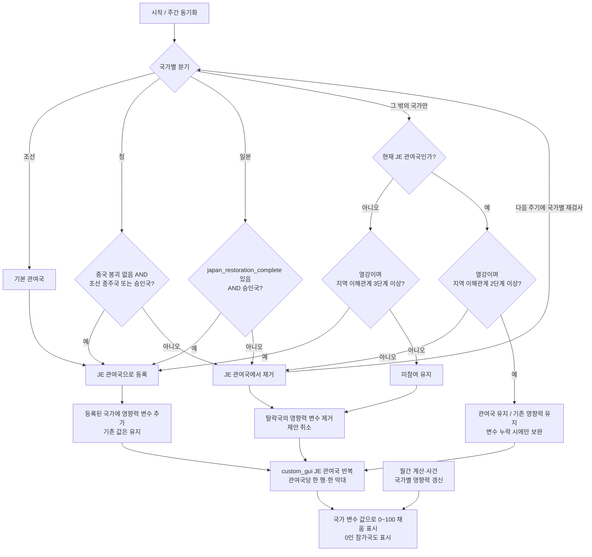
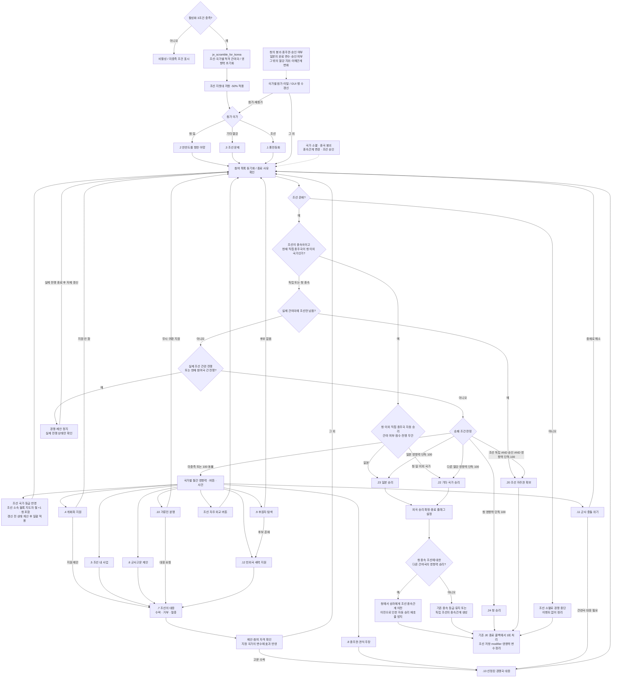

# 조선 쟁탈 일지 구현 계획 — 다국가 참여·동적 custom_gui

작성 기준: 2026-10-12, 현재 로컬 EAFP 및 `Vic3-vanilla` 소스. **이 문서의 설계를 2026-10-13에 게임 스크립트로 구현했다.** 소스 기반 검증을 수행했으며 게임 내 실행은 미검증이다. 사용자 수정 사항에 따라 열강의 추가 참여와 국가별 동적 `custom_gui` 막대를 적용한다. 청·일 단일 경쟁 막대와 별도 조선 자주권 막대라는 이전 설계는 폐기한다. 활성화·참가와 이탈 조건·GUI 방식·개혁 보상·조선 독립 승리 조건·저항 -50%·청을 제외한 종주국 자동 승리·청을 포함한 세력 블록 지도자 보너스 월 +1은 요구사항이다. 국가 등급별 월간 수치·승리 후 보상 세부는 구현 제안이다.

수정 기준: 2026-10-13. **기존 체계의 수정·재사용을 우선하고, 필요한 상태와 실제로 반복되는 로직만 추가한다.** 이 원칙은 아래 데이터 구조·이벤트 전달·파일 구성에도 적용한다.

### 구현 원칙

- 먼저 기존 정의·호출부·변수의 설정 및 제거 지점을 확인한다. 기존 일지·이벤트·버튼·modifier·script value의 담당 부분을 고치며, 같은 역할의 새 체계를 옆에 덧붙이지 않는다. 비활성 초안을 활성화할 때도 중복 정의를 남기지 않는다.
- 엔진의 JE 참여 상태, 기존 완료 변수, 실제 외교 관계와 modifier로 알 수 있는 상태는 다시 변수로 저장하지 않는다. 저장이 필요한 값과 한 번의 처리에만 필요한 계산값·이벤트 스코프를 구별한다.
- 한 곳에서만 사용하는 effect·trigger는 해당 JE 콜백·이벤트·버튼에 직접 작성한다. 코드 길이, 이름 붙이기, 향후 재사용 가능성만으로 `scripted_effect`·`scripted_trigger`를 만들지 않는다. **실제로 두 곳 이상에서 같은 의미와 스코프로 반복되는 로직**만 기존 정의의 재사용·수정을 먼저 검토한 뒤 추출한다. 단순 조건 한 줄을 감싸는 래퍼도 만들지 않는다.
- 새 변수는 기존 상태로 구분할 수 없는 이유, 저장 스코프, 쓰는 곳, 읽는 곳, 제거 시점을 설명할 수 있을 때만 추가한다. 캐시·보관 사본·이력 목록·처리 마커·영구 결과 기록을 예방적으로 만들지 않는다.
- 새 파일과 공통화 계층을 먼저 정하지 않는다. 기존 파일에서 요구 기능을 구현한 후 확인된 중복만 정리한다. 아래의 ‘공통 판정·처리’는 같은 규칙을 뜻하며 별도 scripted 정의 생성을 지시하지 않는다.

## 1. 핵심 구조

`je_scramble_for_korea`를 조선·청·일본과 조건을 충족한 다른 열강이 참여하는 국제 일지로 만든다.

- **조선:** 일지의 기본 관여국이다.
- **청:** `중국 붕괴 없음 AND (조선의 종주국 OR 승인국)`일 때만 관여국이 된다. 조건을 잃으면 기존 관여국에서도 제외한다.
- **일본:** `japan_restoration_complete 변수 있음 AND 승인국`일 때만 관여국이 된다. 조건을 잃으면 기존 관여국에서도 제외한다.
- **그 밖의 국가:** 열강이면서 한반도가 속한 전략 지역의 현재 이해관계가 3단계 이상이면 참가한다. 참가 후에는 2단계에서도 유지하고, 2 미만 또는 열강 지위 상실 시 이탈한다. 청·일은 이 일반 열강 분기로 우회 참가할 수 없다.
- **참여 기준과 영향력:** 현재 참여 여부는 **JE의 실제 관여국 상태**로 판정한다. 관여국이 되면 국가 변수 `scramble_for_korea_participants_influence`를 추가하고, 관여국에서 탈락하면 제거한다. 변수는 영향력 0–100만 저장하며 조선의 값은 자주권을 뜻한다. 변수의 존재로 관여국을 결정하거나 추가·제거하지 않는다. 별도 참여 플래그·전역 참가 목록·영향력 사본은 만들지 않는다.
- **동적 표시:** JE 관여국마다 한 행·한 막대를 생성하고 그 국가의 영향력 변수로 채움 정도를 표시한다. 영향력이 0이어도 행을 표시한다. 관여국인데 변수가 누락된 경우에는 변수를 보완하며, 관여국이 아닌데 변수가 남은 경우에는 변수를 제거한다.
- 모든 외국 참여국은 외교·투자·군사고문·조정 내 지원으로 경쟁한다. 조선은 제안에 대응하고 자체 개혁으로 자기 영향력을 높인다.
- 청·일·기타 열강의 승리와 조선 자주권 확보를 국가별 문구로 설명한다. 조선 소멸에 따른 경쟁 중단은 이벤트 없이 처리한다.

조선이 청의 종속국이어도 활성화하여 경쟁을 진행할 수 있다. **종주국 자동 승리는 현재 직접 종주국이 청이 아닐 때만 적용**한다. 시작부터 청 이외 국가의 종속국이면 첫 판정에서 해당 종주국 승리로 종료한다. 청은 종주국이라는 이유만으로 승리하지 않으며 영향력 승리 조건을 충족해야 한다. 청 종속 상태에서 다른 외국 관여국이 영향력으로 승리하면 종속관계를 그 승자에게 이전한다. 조선 자주권 확보는 **독립국 AND 승인국 AND 영향력 100**을 모두 요구하며 기존 단독 100·동률 보류 규칙을 적용한다. 조선의 ‘미승인’은 국가 유형이며 독립 여부와 별개다.

## 2. 바닐라에서 가져올 것

| 원본 | 실제 구현 | 조선에 적용할 방식 |
|---|---|---|
| [류큐 국제 일지](C:/Users/user/Documents/GitHub/Vic3-vanilla/common/journal_entries/01_ryukyu_rivalry.txt:1) | 일·청·류큐 참여, 두 진행도, 네 버튼 | 국제 경쟁과 대응 이벤트 구조를 차용, 다국가 참여로 확장 |
| [진행도 정의](C:/Users/user/Documents/GitHub/Vic3-vanilla/common/scripted_progress_bars/00_ep2_ryukyu_rivalry_progress_bars.txt:3) | 영향력 ±40, 해군력·관계·금전 이전·의무·개입·류큐 위신 반영 | 영향력 산정 소재만 차용, 수치는 국가 변수에 저장하고 custom_gui로 표시 |
| [자주권 진행도](C:/Users/user/Documents/GitHub/Vic3-vanilla/common/scripted_progress_bars/00_ep2_ryukyu_rivalry_progress_bars.txt:362) | 영향력 -20~20에서 월 +0.5, 범위 밖에서는 정지 | 외세의 압력이 낮을 때 조선 영향력이 성장하도록 재설계 |
| [행동 버튼](C:/Users/user/Documents/GitHub/Vic3-vanilla/common/scripted_buttons/ryukyu_rivalry_buttons.txt:1) | 종주권 재확인, 상인 회유, 방어 시찰, 키코에오오기미 예우 | 종주권·권익 주장, 상권 지원, 군사고문 제안, 조정 인사 포섭 |
| [이벤트 .1~.8](C:/Users/user/Documents/GitHub/Vic3-vanilla/events/japan_events/ryukyu_rivalry_events.txt:1) | 상대국 대응·고문 도착·충돌·양국 승리·자주권 확보·시작 | 같은 상호작용 구조를 새 조선 이벤트 체인으로 작성 |
| [연간 충돌 처리](C:/Users/user/Documents/GitHub/Vic3-vanilla/common/on_actions/00_on_actions_yearly.txt:556) | 양국 고문이 있으면 사고 유형 추첨, 5년 재발 방지, 양국에 .6 전달 | 실제 고문 파견국 중 두 국가를 선택해 충돌 생성, 조선도 대응 주체로 포함 |

바닐라의 승리 이벤트 `.5`는 승자의 기존 종속국이면 병합, 상대국 종속국이면 이전, 독립국이면 괴뢰국화한다. 자주권 이벤트 `.7`은 독립시키고 관련 금전 이전 조약에서 탈퇴한다. 이 효과를 그대로 복사하지 않는다. **조선의 기존 종속관계는 승리 판정 전까지 유지하고, 승리해도 자동 병합하지 않는다.**

바닐라의 DLC 표시 조건·이벤트 `dlc`·전용 영상도 별도로 확인한다. 조선 일지의 네 번째 발동 조건으로 DLC 보유를 추가하지 않도록, 기본 제공 아이콘·영상으로 대체 가능한 구성을 우선한다. 국제 일지 기능 자체의 DLC 의존성은 실제 실행 환경에서 확인한다.

## 3. 활성화 조건과 유신 일지 종료 판정

### 확정할 세 조건

| 요구 | 판정 |
|---|---|
| 청나라가 있고 중국 붕괴가 일어나지 않음 | `exists = c:CHI` 및 `NOT = { has_global_variable = china_shatters }` |
| 일본의 유신 일지가 종료됨 | 기존 `japan_restoration_complete`가 있음. 천황 복권 여부·종료 경로는 제한하지 않으며 새 변수 추가 없음 |
| 조선이 미승인국임 | `c:KOR = { is_country_type = unrecognized }` |

청은 현재 콘텐츠의 `CHI` 태그로 판정한다. 별도의 왕조·문화·법률 조건은 추가하지 않는다. [중국 붕괴 이벤트](C:/Users/user/Documents/GitHub/East-Asia-Flavor-Pack/events/warlord_china_events.txt:1125)는 실제로 글로벌 `china_shatters`를 설정한다.

### 기존 종료 변수 사용

[현재 유신 일지](C:/Users/user/Documents/GitHub/East-Asia-Flavor-Pack/common/journal_entries/eafp_00_meiji_restoration.txt:163)의 성공 경로는 `japan_emperor_restored`와 `japan_restoration_complete`를 설정한다. 다른 종료 경로도 기존 종료 변수를 공유한다.

- `japan_restoration_complete`는 막부 승리 `on_fail`과 군주제 폐지에 따른 `on_invalid`에서도 설정된다.
- `japan_emperor_restored`도 막부 승리 중 `kogi_yoron` 경로에서 설정된다.
- 이전 비활성 스크립트의 `meiji_restoration_complete` 글로벌 변수를 사용하면 현재 활성 콘텐츠와 맞지 않는다.

**새 변수는 추가하지 않는다.** 일본 측 활성화 요건은 기존 `japan_restoration_complete`의 존재만으로 판정하며 `japan_emperor_restored`는 요구하지 않는다. 유신 이후 경제·군사·외교 등 모든 후속 개혁 완료까지 요구하지 않는다. 기존 유신 일지·결과 이벤트에 기록용 코드를 추가하거나 기존 변수의 설정 의미를 바꾸지 않는다.

이 판정은 ‘유신 성공’이 아니라 **유신 일지 종료 기록**이다. 천황파 승리·공의여론뿐 아니라 **막부 유지·군주제 폐지로 일지가 끝나 종료 변수만 있는 경우도 포함**한다. 각 경로를 동일한 역사적 결과로 설명하지 않으며, 천황 복권 기록을 함께 요구하던 이전 설계는 폐기한다.

`possible`의 일본 스코프에서 기존 종료 변수를 직접 검사하고 일회성 scripted trigger로 감싸지 않는다. 새 성공 기록·자동 이행 변수·주기적 복원 로직은 만들지 않는다. 기존 저장도 같은 종료 변수 하나를 읽는다.

### possible 설계 예시

다음은 기존 변수만 사용하는 예정 코드다.

```txt
possible = {
    exists = c:CHI
    NOT = { has_global_variable = china_shatters }

    exists = c:JAP
    c:JAP = {
        has_variable = japan_restoration_complete
    }

    exists = c:KOR
    c:KOR = { is_country_type = unrecognized }

    NOT = { has_global_variable = scramble_for_korea_finished }
}
```

일본·조선의 존재 검사는 스코프 접근을 보장한다. 종료 후 재발동 방지에는 비활성 초안에 이미 있는 `scramble_for_korea_finished`를 재사용한다. 초기화는 국제 JE의 `immediate`에서 처리하며 기존 JE 활성 상태와 영향력 변수의 존재를 이용해 중복을 막는다. 별도 `started` 변수는 만들지 않는다.

`is_shown_when_inactive`에서는 세 조건의 충족 여부를 읽을 수 있게 한다. **일지 활성화 조건과 개별 국가의 관여 조건은 분리**한다. 일본의 종료 변수만 있어도 다른 활성화 조건이 맞으면 일지를 시작할 수 있지만, 일본의 관여에는 기존대로 종료 변수와 승인국 조건을 함께 요구한다. 따라서 시작 시에도 청·일의 관여 조건을 따로 검사하고, 무조건 세 나라를 등록하지 않는다. `japan_emperor_restored`는 활성화·관여 어느 쪽에도 요구하지 않는다.

### 참여 자격과 전략 지역

현재 바닐라의 [전략 지역 정의](C:/Users/user/Documents/GitHub/Vic3-vanilla/common/strategic_regions/east_asia_strategic_regions.txt:31)에서 서울·부산·사리원·평양·양호는 `region_northeast_asia`에 속한다. EAFP의 [조선 봉기 일지](C:/Users/user/Documents/GitHub/East-Asia-Flavor-Pack/common/journal_entries/eafp_03_korea.txt:210)에도 같은 지역의 이해관계 3단계 판정이 있다. 따라서 현재 지도에서는 아래 조건으로 ‘한반도 지역 이해관계’를 구현한다. 이는 한반도만 분리된 지역이 아니라 동북아 전체를 대상으로 하는 현행 게임의 단위다. 한반도 전용 전략 지역이 생기면 해당 자격 판정의 지역 참조를 수정한다.

```txt
should_be_involved = {
    OR = {
        c:KOR ?= this
        AND = {
            c:CHI ?= this
            NOT = { has_global_variable = china_shatters }
            OR = {
                c:KOR ?= { is_subject_of = c:CHI }
                is_country_type = recognized
            }
        }
        AND = {
            c:JAP ?= this
            has_variable = japan_restoration_complete
            is_country_type = recognized
        }
        AND = {
            # 청·일은 국가별 조건을 일반 열강 조건으로 우회하지 않음
            NOR = {
                c:KOR ?= this
                c:CHI ?= this
                c:JAP ?= this
            }
            country_rank >= rank_value:great_power
            OR = {
                # 신규·재참가
                has_strategic_region_interest_tier = {
                    strategic_region = sr:region_northeast_asia
                    value >= 3
                }
                # 이미 참여 중이면 2단계에서도 유지
                AND = {
                    is_involved_in_journal_entry = je_scramble_for_korea
                    has_strategic_region_interest_tier = {
                        strategic_region = sr:region_northeast_asia
                        value >= 2
                    }
                }
            }
        }
    }
}
```

`should_be_involved`와 기존 관여국 제거 로직에 같은 국가별 분기를 적용한다. 청·일은 각 전용 조건을 등록·유지에 동일하게 사용하고, 열강 지위·지역 이해관계 단계는 요구하지 않는다. 청의 종주국 여부는 `c:KOR`가 `c:CHI`의 종속국인지로 확인한다. 승인 여부는 해당 국가 스코프에서 `is_country_type = recognized`로 확인한다.

그 밖의 열강만 **현재 비관여국은 3 이상에서 등록, 현재 관여국은 2 이상에서 유지**한다. 현재 참여 여부는 국가 스코프의 `is_involved_in_journal_entry = je_scramble_for_korea`로 판정한다. 이 트리거는 [로컬 문서](C:/Users/user/Documents/GitHub/East-Asia-Flavor-Pack/documentation/triggers.log:6679)에 정의되어 있다. 이해관계 2는 ‘미참여국은 참가 불가, 기존 참여국은 유지’인 구간이며 영향력 변수의 존재와 무관하다. 동일한 전체 조건이 실제로 반복될 때만 scripted trigger로 추출하고, 세력권 주도·문화·대륙·전략적 인접 조건은 추가하지 않는다.

### 참가·이탈·재참가

1. 시작 시 조선과 각 국가별 조건을 충족한 청·일·그 밖의 열강을 등록한다. 이후 주간 펄스에서 청의 붕괴·종주관계·승인 여부, 일본의 기존 완료 변수·승인 여부, 그 밖의 국가의 열강 지위·이해관계를 다시 검사한다.
2. 참가 조건에 따라 **먼저 JE 관여국으로 등록한 뒤**, 해당 국가에 `scramble_for_korea_participants_influence`를 추가한다. 이미 관여국이고 변수도 있으면 기존 값을 유지한다. 관여국인데 변수만 없으면 0으로 보완하고 시작 보너스는 재지급하지 않는다. 변수 누락을 이유로 관여국에서 제거하지 않는다. 등록 처리가 실제로 반복될 때만 scripted effect 추출을 검토한다.
3. 청은 `china_shatters`가 있거나 ‘조선 종주국’과 ‘승인국’이 모두 거짓이면 제외한다. 일본은 `japan_restoration_complete`가 없거나 승인국이 아니면 제외한다. 그 밖의 열강은 열강 지위를 잃거나 이해관계가 **2 미만**이면 제외하고, 3→2에서는 영향력·GUI 행·참여를 유지한다. 버튼·예약 이벤트·승리 판정도 이 국가별 유지 조건을 검사한다. 유지 조건을 잃은 국가는 동기화 전에도 행동·승리할 수 없으며, 청·일을 일반 열강 조건으로 재등록하지 않는다.
4. 이탈 조건에 따라 **먼저 JE 관여국에서 제거한 뒤**, 해당 국가의 `scramble_for_korea_participants_influence`를 제거한다. 변수만 남은 비관여국을 발견해도 재등록하지 않고 변수만 정리한다. 별도 점수 보관 변수는 만들지 않는다. 자기 고문 효과·미결 제안만 취소하며 다른 국가의 점수는 바꾸지 않는다.
5. 재참가는 새 등록으로 취급해 영향력을 0으로 시작한다. 첫 참가·재참가 이력을 구분하는 변수와 참가 보상은 두지 않는다. 반복 이탈·재참가로 초기 점수를 회복하는 것을 막기 위해 일지 시작 시 한 번만 초기 배치를 적용하고, 시작 후 합류는 모두 0으로 통일한다. 쿨다운은 이탈로 초기화하지 않고 원래 만료까지 유지한다.
6. 청·일을 포함한 외국 소멸은 해당 국가만 제거하며, 중국 붕괴는 청의 관여 자격만 상실시킨다. 남은 관여국끼리 경쟁을 계속한다. 청 이외의 현재 직접 종주국 자동 승리를 우선하고, 그 조건이 없으며 실제 관여국이 조선만 남으면 조선 승리로 끝낸다. 전체 종료 때 영향력 변수와 경쟁 전용 임시 효과를 정리한다.

기존 JE의 주간 `every_scope_je_involved` / `remove_involved_country` 처리를 수정하여 사용한다. `should_be_involved`의 자동 반영 범위를 확인하고 부족한 신규 참가 처리만 `add_involved_country`로 보완한다. **관여국 변경 → 변수 추가·제거 → 영향력 계산·승패 판정** 순서를 유지한다. 엔진이나 다른 이벤트가 관여국을 바꾼 경우에도 동일한 방향으로 누락·잔여 변수를 정리한다. 안전한 제거에 후보 목록이 필요하면 해당 처리 안의 임시 목록을 쓰며 영구 상태로 만들지 않는다.

## 4. 국가 변수·custom_gui·진행도

### 데이터 구조

| 저장 위치 | 이름 | 역할 |
|---|---|---|
| 현재 참여하는 각 국가 | `scramble_for_korea_participants_influence` | 영향력 0–100. JE 관여국이 되면 추가, 탈락·종료하면 제거. 참여 여부의 판정 원본으로 사용하지 않음 |
| 국제 JE | 엔진의 관여국 상태 | 현재 참여 여부의 유일한 기준. 국가별 변수 생명주기와 GUI 행은 이 상태를 따름 |
| 전역 | 기존 `scramble_for_korea_finished` | 종료·재발동 방지에 기존 플래그 재사용 |
| 처리·이벤트 스코프 | 승자·행위국·대상·변화량 | 해당 실행과 후속 이벤트에 필요한 범위에서 전달. 영구 전역 승자·결과 변수로 저장하지 않음 |

월간 변화는 같은 계산식을 월간 적용과 툴팁에서 읽고 영구 캐시를 두지 않는다. 툴팁은 지난달 적용 기록이 아닌 현재 조건의 예상 월간 증감을 표시한다. 고문 파견 기간은 실제 modifier의 존속 여부·기간을, 행동 대기는 버튼의 기존 쿨다운 기능을 우선 사용한다. 엔진 상태만으로 표현할 수 없는 미결 제안 잠금 등의 상태는 구현에서 필요가 확인된 최소 항목만 추가하고 만료·취소·종료 시 제거한다.

**JE 관여국 상태가 기준이고, 변수는 그 결과를 따른다.** 동기화 완료 후에는 관여국·변수 보유국·GUI 표시국이 일치하지만, 불일치를 고칠 때는 관여국 상태를 바꾸지 않고 변수를 추가·제거한다. 조선도 같은 기준을 쓴다. 참여 여부가 필요한 효과·이벤트는 `is_involved_in_journal_entry`로 검사한다. `has_variable` / `IsSet`은 변수 초기화 중복 방지·누락 검사·안전한 값 읽기에만 사용하며 참여 자격이나 참가·이탈을 결정하지 않는다.

기존 `scramble_for_korea_participants` 전역 목록은 병행하지 않는다. 그 목록의 참여 관리 역할은 엔진의 JE 관여국 상태가 담당하고, `scramble_for_korea_participants_influence`는 각 관여국의 숫자 데이터만 담당한다. 이미 활성화된 개발용 저장의 옛 목록과 신규 국가 변수를 그대로 호환된다고 가정하지 않는다. GUI에서 매 프레임 전 세계 국가를 검색하거나 상태를 수정하지 않는다.

```txt
# 아래 예시는 모두 대상 국가 스코프
# 실제 JE 관여국 상태에 맞춰 변수만 보완·정리하는 효과
if = {
    limit = {
        is_involved_in_journal_entry = je_scramble_for_korea
        NOT = { has_variable = scramble_for_korea_participants_influence }
    }
    set_variable = { name = scramble_for_korea_participants_influence value = 0 }
}
else_if = {
    limit = {
        NOT = { is_involved_in_journal_entry = je_scramble_for_korea }
        has_variable = scramble_for_korea_participants_influence
    }
    remove_variable = scramble_for_korea_participants_influence
}
# 이 효과에서는 JE 관여국을 추가하거나 제거하지 않음
```

### custom_gui 구현 방식

JE에 `widget = { gui = ... name = ... container = ... }`로 사용자 정의 GUI를 연결한다. 현재 [막번체제 일지](C:/Users/user/Documents/GitHub/East-Asia-Flavor-Pack/common/journal_entries/eafp_japan.txt:11)가 같은 연결 방식을 사용한다. 여기서 `custom_gui`는 이 사용자 정의 위젯을 뜻하며, 확인되지 않은 `custom_gui = ...` 키를 새로 가정하지 않는다.

[바닐라 국제 JE 화면](C:/Users/user/Documents/GitHub/Vic3-vanilla/gui/journal_entry.gui:691)은 실제로 `JournalEntry.GetInvolvedCountries`를 반복 표시한다. 이 엔진 목록이 행의 생성·제거를 결정하고 각 행의 `GetValue`는 영향력 변수만 읽는다. 변수의 `IsSet`으로 국가 행을 숨기거나 생성하지 않는다. 누락된 값의 읽기 보호는 표시 단계에서만 처리하고 실제 변수 보완은 게임 스크립트에서 수행한다. `GetGlobalList`는 사용하지 않는다.

막대는 [기존 변수 기반 GUI](C:/Users/user/Documents/GitHub/East-Asia-Flavor-Pack/gui/journal_entry_widgets/eafp_je_bakuhantaisei.gui:627)를 참고한다. 아래 코드는 바닐라의 관여국 반복 방식과 국가 변수 표시를 조합한 구현 초안이며, 실제 행의 Country 컨텍스트·레이아웃은 게임에서 검증한다.

```txt
# JE 내부: container는 실제 국제 일지 화면에서 검증
widget = {
    gui = "gui/journal_entry_widgets/eafp_je_scramble_for_korea.gui"
    name = "widget_je_scramble_for_korea_influence"
    container = "custom_widget_container_5"
}

# 위 GUI의 위젯 내부: 하나의 행 템플릿을 목록 수만큼 반복
flowcontainer = {
    direction = vertical
    datamodel = "[JournalEntry.GetInvolvedCountries]"
    item = {
        flowcontainer = {
            direction = vertical
            textbox = { text = "[Country.GetName]" }
            green_progressbar_horizontal = {
                blockoverride "values" {
                    min = 0
                    max = 100
                    value = "[Country.MakeScope.Var('scramble_for_korea_participants_influence').GetValue]"
                }
            }
        }
    }
}
```

기본 `scripted_progress_bar`로 국가별 막대를 열거하거나 청·일 합성 막대를 남기지 않는다. 국가별 GUI 정의도 복제하지 않는다. 실제 행에는 국기·국명·역할(조선 자주권/외국 영향력)·현재 값·월간 증감·변화 원인 툴팁을 표시하고, 색상 외에도 텍스트로 국가를 구별한다. 숫자와 막대 채움은 같은 국가 변수를 읽는다. GUI 새로고침이나 관전 국가 전환은 게임 상태를 수정하지 않는다.

행 순서는 기존 JE의 안정적인 순서를 사용하고 점수 변화마다 재정렬하지 않는다. 순서 보존을 위한 별도 이력 변수·GUI 전역 목록은 만들지 않는다. 최대 높이와 세로 스크롤을 두되 행 수 제한은 두지 않는다. **3국이면 3개, 영·러·미가 더 들어오면 6개, 한 국가 이탈 시 5개**가 표시된다. 관전국도 같은 JE 열거 결과에서 국가별 영향력 변수를 읽으며 `JournalEntry.GetCountry`를 참가국 저장소로 사용하지 않는다.

### 영향력 산정 제안

`I(c)`는 현재 참여국 c의 영향력 값이다. 각 값은 독립적인 0–100 수치이며 총합 100인 점유율이 아니다. 신규 참가·이탈만으로 기존 국가의 점수나 분모가 바뀌지 않는다. 상대 영향력 감소는 명시된 사건·행동에만 적용한다.

| 요소 | 외국 참여국 I(c) | 조선 I(KOR) |
|---|---|---|
| 일지 시작 시 초기 배치 | 기본 10. 이후 신규 합류·재참가는 모두 0. 종주국 초기 +20은 폐기. 청 이외 직접 종주국에만 자동 승리 적용 | 0 |
| 조선에 대한 금전 지원 | 실제 지급국에 월 최대 +1, 복수 조약 합산 후 상한 | — |
| 조선이 진 의무 | 채권국 월 +0.5 | — |
| 수락된 군사고문 | 파견국 월 +0.5, 24개월 | — |
| 외세 압력 억제 | — | 모든 외국 참여국의 영향력이 50 미만이면 월 +0.5 |
| 조선 국가 등급 | — | 강대국·미승인 강대국 월 +0.5, 개발도상국·미승인 지역국 월 +0.25, 열강 월 +0.75, 그 외 0. 서로 중첩하지 않음 |
| 조선의 세력 블록 소속 | 청을 포함한 외국 관여국이 자기 주도 세력 블록에 조선을 두면 월 +1 | — |
| 조선 하위 개혁 완료 | — | 사회·군사·경제·외교 각 일지 완료 시 +5, 합계 +20 |
| 조선 전체 개혁 완료 | — | 상위 `je_korean_reformation` 완료 시 별도 +10, 하위 보상과 합쳐 총 +30 |
| 사건·행동 | 지정된 행위국/대상국의 값에 증감, 기본 폭 2~5 | 수락·거부·자력 대응에 따라 증감 |

국가별 월간 지속 변화 합계는 -1~+1로 제한하고, 0–100 범위를 보장한다. 사건·개혁의 일회 변화는 별도다. 외국이 10에서 월 +1만 얻으면 100까지 90개월이다. 조선은 월 +0.5만 얻으면 200개월, 하위 개혁 +20만 반영하면 160개월, 상위까지 총 +30을 반영하면 140개월이다. 월간 등급 보너스는 제안 수치이고 세력 블록 월 +1·개혁 +5씩·전체 +10은 사용자 요구다. 세력 블록 +1도 다른 월간 항목과 합산한 뒤 기존 -1~+1 제한을 적용한다.

해군력과 조선과의 외교 관계 수치는 영향력 산정에서 제외한다. 월간 계산식·예상 증감 툴팁에도 해당 보너스를 남기지 않는다.

조선 등급은 [국가 등급 정의](C:/Users/user/Documents/GitHub/Vic3-vanilla/common/country_ranks/00_country_ranks.txt:1)의 `great_power`, `major_power`, `unrecognized_major_power`, `minor_power`, `unrecognized_regional_power`를 사용한다. 미승인국도 해당 등급 보너스를 받을 수 있어야 한다. 원시 위신 수치나 세계 위신 순위를 직접 검사하지 않는다. 승인국이 된 독립 조선도 영향력 100에 도달해야 승리할 수 있으며, 그 전까지 등급 보너스 등 기존 산정과 경쟁을 계속한다.

세력 블록 보너스의 판정은 **영향력을 계산하는 외국 관여국** 스코프에서 다음과 같다. 같은 블록의 일반 회원국은 받지 않으며, 청도 블록 지도자이고 조선이 그 블록에 속하면 월 +1을 받는다. 블록 가입·탈퇴·지도자 변경은 다음 월간 산정에 반영하고 별도 보관 변수를 두지 않는다.

```txt
is_power_bloc_leader = yes
is_in_same_power_bloc = c:KOR
```

세력 블록 소속은 외교적 종속과 구별한다. 독립 조선도 다른 국가 주도 블록에 들어갈 수 있으며 이때는 월간 보너스만 발생한다. 청의 종속국인 조선도 경쟁을 계속하고, 청이 관여국이자 조선 소속 블록의 지도자이면 청에 월 +1을 적용한다. 청 이외 국가의 실제 종속국이 되면 점수 누적 대신 그 직접 종주국 자동 승리를 우선한다.

모든 국가의 월간 변화는 **같은 갱신 전 상태**를 기준으로 계산하고 전부 적용한 다음 승자를 판정한다. 현재 산식에서 다른 참가국의 영향력을 읽는 조선의 ‘모든 외국 50 미만’ 조건은 외국 점수를 바꾸기 전에 평가한다. 이처럼 읽기·적용 순서로 해결되는 계산에 국가별 영구 변화량 캐시를 만들지 않는다. 향후 서로의 갱신 전 값을 참조하는 항목이 늘어나면 그 실행 안에서만 임시 계산값을 사용한다.

기존 완료 개혁은 영향력 **최초 초기화 블록 안에서** `completed_je_korean_reformation_*` 네 개를 읽어 각각 +5, 상위 완료 변수 `korean_reformation_complete_var`가 있으면 별도 +10을 반영한다. 진행 중에는 하위 네 일지의 기존 `on_complete`에서 각각 +5, 상위 일지의 기존 `on_complete`에서 +10을 적용한다. 모두 조선이 쟁탈 JE 관여국이고 쟁탈이 종료되지 않았을 때만 지급한다. 보상은 범위 0–100에서 적용한다.

상위 +10은 하위 +20과 별개의 의도된 보상이다. 마지막 하위 완료와 상위 완료가 연속되면 그 시점에 합계 +15가 맞다. 별도 월간 완료 감시나 `*_counted` 변수를 추가하지 않는다. 완료 콜백은 보상을 적용한 뒤 기존 완료 변수를 설정하는 순서 등 실제 기존 흐름을 확인하여, 시작 초기화와 같은 시점의 보상이 두 번 들어가지 않게 한다. 이 보너스는 외세 참가 수와 무관하며, 이미 전체 개혁까지 끝난 조선의 초기 합계는 +30이다.

### 일지 활성 중 조선의 세력 블록 지렛대 저항

사용자가 지칭한 수치는 **세력 블록 지렛대 저항**(`country_leverage_resistance_mult`)이다. [바닐라 한국어 설명](C:/Users/user/Documents/GitHub/Vic3-vanilla/localization/korean/modifiers_l_korean.yml:2475)은 세력 블록의 초대에 필요한 지렛대 기준으로 설명한다. 요구값은 `-0.5`, 즉 이 modifier가 저항에 **-50%**를 제공하는 것이다. 가입 금지나 가입 확률 -50%가 아니라 블록의 초대에 대한 저항을 낮추는 효과이며, 최종 저항에는 다른 modifier도 합산된다.

[기존 modifier](C:/Users/user/Documents/GitHub/East-Asia-Flavor-Pack/common/static_modifiers/eafg_scramble_for_korea_modifiers.txt:17)의 `modifier_kor_foreign_influence`를 재사용하고 `country_leverage_resistance_mult = -0.1`을 `-0.5`로 변경한다. JE 활성화 시 **조선에만** 한 번 적용하고, 활성 기간 동안 유지하며 모든 승리·중단 경로에서 제거한다. 국제 JE의 모든 관여국에 일괄 적용되는 방식은 사용하지 않는다.

기존 `.4`, `.5`, `.12` 등에서 같은 modifier를 재부여·갱신하던 효과는 제거하여 이벤트와 활성 기간 효과가 충돌하지 않게 한다. 이벤트는 지정 국가의 영향력 값을 조정한다. 즉시 종주국 승리로 끝나는 시작 상태에서도 종료 정리로 modifier가 남지 않아야 한다. 새로운 저항 변수·modifier 사본은 만들지 않는다.

### 행동과 조선의 대응

| 버튼 / 주체 | 조건·비용 제안 | 연결 이벤트와 효과 |
|---|---|---|
| 종주권·권익 주장 / 모든 외국 참여국 | 자기 영향력이 외국 선두보다 낮음, 외교 비용, 36개월 대기 | `.8` → 관련 경쟁국 `.13`; 자기 +3, 대응국은 비용을 들여 해당 증가분 최대 3 상쇄 |
| 상권 지원 / 모든 외국 참여국 | 조선 내 자국 소유 건물, 재정 비용, 24개월 대기 | `.5` → 조선 `.7`; 수락 시 행위국 +3 |
| 군사고문 제안 / 모든 외국 참여국 | 관련 전쟁 없음, 외교 비용, 24개월 대기 | `.6` → 조선 `.7` → 관련 경쟁국 `.13`; 수락 후에만 고문 효과 |
| 조정 인사 포섭 / 모든 외국 참여국 | 지원 가능한 조선 내 정치 집단, 재정 비용, 24개월 대기 | `.9` → `.12` → 조선 `.7`; 친해당국 로비 지원 |
| 자주 외교 / 조선 | 행정력 비용, 24개월 대기 | 조선 +3, 외국 단독 선두 -3. 선두 동률이면 이 감소분만 생략 |

모든 비용과 쿨다운은 툴팁에 표시한다. 청은 종주권, 일본은 조약상 권익, 기타 열강은 자국 권익이라는 국가별 문구를 사용한다. 경쟁국 대응은 직접 피해국 또는 행위국 외 영향력 선두 **한 국가**를 선택하며, 선두 동률은 게임 스크립트의 무작위 선택으로 정한다. 모든 참가국에 동시에 효과 있는 대응 선택지를 보내 점수가 참가국 수만큼 중복 변하지 않게 한다.

세력권 레버리지는 주 진행도로 사용하지 않는다. 기존 `power_bloc.add_leverage`는 제거하거나 실제 세력권 주도국일 때만 부수 효과로 남긴다.

## 5. 관련 일지와 기존 콘텐츠의 연결

이번 일지에 직접 연결할 기존 일지와 경계는 다음과 같다. 다른 조선 콘텐츠 전체의 내부 이벤트를 이 일지로 옮기지 않고, 확정된 완료 상태 또는 실제 외교 상태를 읽는다.

**조청전쟁 저널과는 연결하지 않는다.** 해당 저널의 존재·활성·완료·실패 여부나 전용 변수·이벤트 결과를 쟁탈 일지의 활성화·관여·영향력·정지·재개·승패 조건으로 사용하지 않는다. 양쪽 저널이나 이벤트를 서로 호출·완료·실패시키는 연결도 추가하지 않는다. 전쟁 관련 처리는 쟁탈 일지 자체의 일반 규칙으로 실제 전쟁 당사자와 현재 외교 관계만 확인하며, 특정 저널의 시작·종료 콜백을 기다리지 않는다.

| 기존 일지 | 연결 지점 | 계획 |
|---|---|---|
| `je_meiji_restoration` | 천황파 승리 `on_complete` → `meiji.1`, 막부 유지 `on_fail` → `ep2_meiji.8`, 공의여론 → `ep2_meiji.9`, 군주제 폐지 `on_invalid` | 기존 `japan_restoration_complete`만으로 일본 측 활성화 요건 판정. 기록 추가·기존 경로 수정 없음 |
| `je_korean_reformation` | 하위 네 일지 생성 및 `korean_reformation_complete_var` 설정 | 상위 완료 시 별도 조선 영향력 +10. 하위 네 개의 +20과 합산하여 총 +30 |
| `je_korean_reformation_society` | `completed_je_korean_reformation_society` | 조선 영향력 +5, 한 번 |
| `je_korean_reformation_military` | `completed_je_korean_reformation_military` | 같은 효과, 한 번 |
| `je_korean_reformation_economy` | `completed_je_korean_reformation_economy` | 같은 효과, 한 번 |
| `je_korean_reformation_diplomacy` | `completed_je_korean_reformation_diplomacy` | 같은 효과, 한 번 |
| `je_korean_foreign_mission` | 귀환 → `eafp_kor_foreign_mission.6` → 외교 개혁 조건에 기여 | 외교 개혁을 통해 간접 반영, 별도 중복 점수 없음 |
| `je_seikanron` | 반조선 로비·도발·외교 상태 | 독립적으로 유지. 동일 사건을 다시 발생시키거나 이 일지의 승리만으로 완료하지 않음 |

출처: [조선 개혁](C:/Users/user/Documents/GitHub/East-Asia-Flavor-Pack/common/journal_entries/eafp_korean_reformation.txt:1), [해외 사절단](C:/Users/user/Documents/GitHub/East-Asia-Flavor-Pack/common/journal_entries/eafp_korean_foreign_mission.txt:1), [정한론](C:/Users/user/Documents/GitHub/East-Asia-Flavor-Pack/common/journal_entries/eafp_japan.txt:1099).


## 6. 이벤트 전체 구성

아래 **18개 ID가 이번 구현 범위의 전체 이벤트**다. 접두사는 모두 `scramble_for_korea_events`다. 번호만 표시한 후속 연결도 같은 네임스페이스다. 사용자 요구와 구현 제안을 반영한 스크립트 연결이다. 실제 게임 실행은 별도 검증이 필요하다. 일본·청 전용 결말 외에 기타 국가 공용 결말 `.22`를 추가하며, 비관여 종주국의 자동 승리도 이 결말로 전달한다.

| ID | 내용 / 실행 국가 | 발생 원인 → 후속 처리 |
|---|---|---|
| `.1` | 풍전등화 / 조선 | 시작·참가 통지. 재참가도 같은 통지를 사용하며 별도 참가 보상 없음. 이벤트는 영향력을 초기화하지 않으며 관여국 상태를 따르는 변수 처리에서 담당 |
| `.2` | 한반도를 향한 야망 / 청·일 | 시작·참가·재참가 통지, 별도 보상 없음 |
| `.3` | 조선 문제 / 그 밖의 열강 | 시작·참가·재참가 통지, 별도 보상 없음 |
| `.23` | 일본 우세 확정 / 관여국 및 승자 | 일본이 영향력 승자 또는 조선의 현재 종주국 → 결과 알림; JE 종료 콜백에서 1회 처리 |
| `.24` | 청의 종주권 재확립 / 관여국 및 승자 | 청이 영향력 승자 → 결과 알림; 종주국 자동 승리로는 발생하지 않음. JE 종료 콜백에서 1회 처리 |
| `.4` | 조선 개화파 지원 / 외국 참여국 | 월간 후보 → 지원 선택 시 조선 `.7`, 거부 시 비용·국내 정치 효과만 |
| `.5` | 조선 내 외국 소유 사업 / 외국 참여국 | 상권 버튼 또는 월간 후보 → 투자·노동조건 제안 → 조선 `.7` |
| `.6` | 군사고문단 제안 / 외국 참여국 | 고문 버튼 → 조선 `.7`; 수락 후 고문 상태 설정 및 관련 경쟁국 `.13` |
| `.7` | 외국의 제안에 대한 조선의 결정 / 조선 | 제안 종류·보낸 국가·효과를 저장해 전달 → 수락·거부·절충; 유효한 응답에서만 점수 변경 |
| `.8` | 조선에 대한 권리 주장 / 외국 참여국 | 종주권·권익 버튼 → 비용과 행위국 영향력 변화 → 관련 경쟁국 `.13` |
| `.9` | 조정 내 후원자 탐색 / 외국 참여국 | 포섭 버튼 → 후보가 존재할 때 `.12`; 없으면 비용 부과 없이 종료 |
| `.10` | 거류민 분쟁 / 외국 참여국 | 관련 문화의 실제 조선 팝이 있을 때 월간 후보 → 조선 `.7`, 무시 또는 자발적 귀환 지원; 자동 인구 추방 제외 |
| `.11` | 군사적 충돌 위기 / 먼저 조선, 이후 관련국 | 서로 다른 두 참여국 고문 공존 또는 도발 후보 → 조선 중재·철수 요구 / 관련 경쟁국 `.13`; 두 당사국 변수만 조정, 자동 선전포고 없음 |
| `.12` | 친외국 세력 지원 / 외국 참여국 | `.9` 또는 월간 후보 → 비용 지급과 대상 로비 선택 → 조선 `.7`; 친청·친일·친영 등 국가명 동적 표시 |
| `.13` | 경쟁국의 대응 / 선정된 외국 참여국 | `.6` 수락, `.8`, `.11` → 항의·양보·대응으로 지정 국가 영향력 조정, 원 이벤트로 재귀하지 않음 |
| `.20` | 조선 자주권 확보 / 모든 참여국 | 조선이 독립국 AND 승인국 AND 영향력 단독 100 → 자주권 보상·결과 알림 |
| `.22` | 새로운 패권국 / 관여국 및 승자 | 청·일 이외 국가가 영향력 승자 또는 조선의 현재 직접 종주국 → 결과 표시. 자동 승리에는 비관여 종주국도 포함 |

`.7`은 제안 종류를 구분하는 공통 대응 이벤트다. 발신국·대응국·필요한 대상은 기존 이벤트 체인처럼 `save_scope_as`와 이벤트 전달 스코프로 넘기고, 제안 종류는 이벤트 체인 안의 값으로 전달한다. 같은 정보를 국가·전역 변수에 다시 저장하지 않는다. **조선당 미결 제안은 하나만** 허용하되 기존 이벤트 대기 상태로 제어할 수 있는지 먼저 확인하고, 불가능하면 잠금 하나만 둔다. 별도 제안 토큰·일련번호·제안 관리 목록은 기본 설계에 넣지 않는다.

응답 시 국가·JE·대상 존속, 실제 JE 관여국 여부, 현재 참여 유지 조건과 관련 전쟁을 다시 확인한다. 영향력 변수만 남은 비관여국의 제안은 무효다. 관여국의 변수 누락은 스크립트에서 보완한 뒤 값을 적용한다. 추가 참여국이 3에서 2로 내려간 것은 제안 취소 사유가 아니다. 이미 이탈한 국가의 제안은 효과 없이 닫으며, 이탈 후 재참가했다고 옛 제안이 되살아나지 않도록 취소된 이벤트의 수명과 잠금 해제를 함께 검증한다. 발신 이벤트만으로 고문·로비·지속 영향력을 부여하지 않는다. 사망한 인물·사라진 건물은 해당 제안만 취소한다. 필요한 취소 상태를 기존 이벤트 수명으로 표현할 수 없을 때에만 최소 상태 보완을 검토한다.

월간 랜덤 후보는 `.4`, `.5`, `.10`, `.11`, `.12`로 한정한다. 일지 전체에서 월 최대 한 후보를 뽑은 뒤 적합한 외국 참여국을 선택하여 참가 수만큼 사건 발생률이 늘어나지 않게 한다. 후보별 조건·쿨다운을 적용하고, 미결 제안·관련 전쟁·종료 대기 중이면 생성하지 않는다. 기존 아프리카·파타고니아·아마존 이벤트 호출은 제거한다. 류큐의 연간 전역 on_action을 덮어쓰지 않는다.

## 7. 전체 진행·이벤트 흐름도

실선은 이번 일지의 실행 흐름이다. 점선은 외부 상태 변화다. 종료를 일으키지 않는 이벤트 선택은 공통 갱신 단계로 돌아간다.

### 참여국 목록과 GUI 동기화



### 모든 계획 이벤트와 결말



## 8. 승패와 예외 상태

종료 판정은 엔진의 `complete` / `fail` / `invalid` 호출 순서에 맡기지 않는다. 아래 우선순위를 공통 판정에 명시하고, 각 트리거를 상호 배타적으로 만든다.

1. **관여국·변수 정리:** 기존 국가별 등록·유지 조건을 반영한다. 이는 영향력 경쟁의 참가 자격이며, 종주국 자동 승리의 자격 제한으로 사용하지 않는다.
2. **조선 소멸:** 조선이 존재하지 않으면 이벤트 없이 중단하고 종료 플래그와 임시 상태 정리만 처리한다. 소멸한 조선의 종주국을 추정하지 않는다.
3. **청 이외 종주국 자동 승리:** 조선이 존재하고 `is_subject = yes`이며 **현재 직접 종주국이 청이 아니면** 그 종주국을 승자로 확정한다. 영향력·관여국 여부·승인 여부·전쟁 여부와 무관하며 나머지 중단·점수 승리보다 우선한다. 유효한 종주국 스코프가 아직 확인되지 않는 과도 상태는 다음 판정까지 보류한다. 일본이면 `.23`, 청·일 이외 국가면 `.22`다. 청이 직접 종주국이면 이 분기를 건너뛰고 아래 단독 잔류·전쟁·영향력 판정을 계속한다. 새로 청의 종속국이 된 경우도 같은 예외를 적용한다.
4. **외국 이탈과 조선 단독 잔류:** 청·일 소멸 또는 `china_shatters`로 전체 경쟁을 중단하지 않는다. 해당 국가를 제외하고 나머지 관여국끼리 계속한다. 종주국 자동 승리가 없고 실제 JE 관여국에 조선만 남으면 영향력·승인·독립·전쟁 여부와 무관하게 조선 승리(`.20`)로 처리한다. 탈락 예정 국가가 실제 관여국에서 제거되기 전에는 단독 잔류로 판정하지 않는다.
5. **관련 전쟁 중:** 아직 미종료이고 조선이 당사자인 실제 전쟁 또는 관여국끼리의 실제 전쟁이면 영향력 승리·조선 자주권 확보를 보류하고 영향력·행동·신규 사건을 정지한다. 종주국 자동 승리와 조선 단독 잔류 승리는 이 보류의 예외다. 전쟁의 발생 경로와 관련 저널 상태는 검사하지 않는다. 실제 전쟁 종료 후 쟁탈 일지 자체 갱신에서 재판정하며 다른 저널의 종료 통지를 요구하지 않는다.
6. **조선 자주권 확보:** `is_subject = no` AND `is_country_type = recognized` AND 조선 영향력 100을 모두 충족하고, 기존 동률 규칙에 따라 조선만 단독 100이면 `.20`이다. 외국 관여국이 남아 있다면 승인 전환만으로는 종료하지 않는다.
7. **외국 영향력 승리:** 실제 유효 관여국 중 정확히 한 국가만 100이고 그 국가가 외국이면 해당 국가가 승리한다. 청·일이 전용 참여 조건을 잃으면 점수로는 승리할 수 없다. 일본이 실제 직접 종주국이면 3번이 적용되지만 청에는 이 예외가 없다. 조선의 독립·승인 요건이 미충족일 때 단독 100만으로 조선 승리를 처리하는 우회 분기를 두지 않는다.
8. **동률:** 같은 갱신에서 둘 이상이 100이면 경합을 계속한다. 상대 점수 감소·이탈로 단독 100이 되면 승리를 확정한다. 동률 중에도 대응 행동은 가능하며, 청 이외 직접 종주국이 생기면 3번으로 결론을 낸다. 청의 종주권만으로는 동률을 해소하지 않는다.

조선 승리는 두 경로다. **영향력 승리**는 `독립국 AND 승인국 AND 조선만 영향력 100`이며 전쟁 중에는 보류한다. **단독 잔류 승리**는 실제 JE 관여국에서 모든 외국이 제외되고 조선만 남은 경우이며, 영향력·승인·독립·전쟁 조건을 요구하지 않는다. 청 이외 직접 종주국의 자동 승리는 두 경로보다 우선한다. 어느 경로도 조선을 강제로 독립시키거나 승인국으로 변경하지 않는다. 활성화 시 미승인 조건은 진행 중 유지 조건으로 재사용하지 않는다.

청 이외 종주국의 자동 승리는 참가 등록과 별개다. 비관여 종주국을 승자로 알리기 위해 JE에 강제 등록하거나 영향력 변수를 만들지 않는다. 시작부터 조선이 청 종속이면 경쟁을 진행하고, 청 이외 국가의 종속이면 해당 직접 종주국이 승리한다. 청 종속 조선의 영향력 승리는 실제 독립 이후에만 가능하지만, 중국 붕괴 등으로 청을 포함한 모든 외국이 이탈하면 조선 단독 잔류 승리는 가능하다. 활성화 조건에 독립국 조건을 추가하지 않는다.

| 결말 | 외교 효과 제안 |
|---|---|
| 청 승리 | 영향력 승리만 가능. 이미 청 종속이면 기존 종속 등급 유지, 독립 조선이면 조공국 관계 제안값으로 생성. 청 위신·친청 지지 보상 |
| 일본 승리 | 종주국 자동 승리면 기존 종속 등급 유지. 청 종속 조선에 대한 영향력 승리면 청에서 일본으로 종속관계 이전. 독립 조선에 대한 영향력 승리면 보호국 관계 제안값으로 생성. 일본 위신·군부 만족 보상 |
| 기타 국가 승리 | 종주국 자동 승리면 기존 종속 등급 유지. 청 종속 조선에 대한 관여국의 영향력 승리면 청에서 승자로 종속관계 이전. 독립 조선에 대한 영향력 승리면 보호국 관계 제안값 적용. 실제 승자 스코프로 결과 전달 |
| 조선 승리 | 기존 독립·종속 관계와 승인 상태를 유지하고 자주권 확보 보상 적용. 영향력 승리와 모든 외국 이탈 후 단독 잔류 승리 모두 같은 결과 이벤트 사용 |
| 경쟁 중단 | 기존 외교·전쟁 결과를 유지하고 경쟁 전용 임시 상태만 정리 |

종속 관계 생성에는 현재 게임의 실제 지원 외교 관계 유형과 허용 조건을 확인한다. 조공국·보호국의 정확한 키와 `create_diplomatic_pact` 허용 조건을 구현 단계에서 검증한다. **청 종속 조선에 대해 다른 외국 관여국이 영향력으로 승리하면 조선의 종속관계를 청에서 승자에게 이전한다.** [류큐 승리 이벤트의 이전 처리](C:/Users/user/Documents/GitHub/Vic3-vanilla/events/japan_events/ryukyu_rivalry_events.txt:401)를 따라 승자 국가 스코프에서 `transfer_subject = c:KOR`를 적용하는 안으로 잡는다. 이전은 기존 종속 등급을 유지하는 방향으로 구현·검증하며, 독립 후 새 종속관계를 만드는 분기와 구별한다. 기존의 ‘청 종속관계 유지·정치적 승리만 적용’ 안은 폐기한다. 청 이외 국가에 이미 종속된 경우에는 그 직접 종주국이 자동 승자다. 독립 조선에 대한 점수 승자가 관계 생성 권한을 갖지 못할 때의 정치적 승리 대안은 청 종속 조선의 이전에 적용하지 않는다.

독립 조선에 대한 외국 관여국의 영향력 승리 후 종속관계 생성은 류큐 모티브를 따른 설계 제안이며, 청 종속 조선의 관계 이전은 사용자 요구다. 먼저 기존 `scramble_for_korea_finished`로 종료를 잠근 뒤 관계를 생성하거나 이전하여, 변경된 종속관계가 다시 자동 승리·보상을 호출하지 않게 한다. 관계 변경 직전에 조선·승자의 존속과 현재 종주국을 재확인한다. 승리 직후 추가 거부·전쟁 체인은 1차 범위에 포함하지 않는다.

자주권 승리 시 모든 조약을 일괄 탈퇴시키지 않는다. 경쟁에서 새로 생성하고 추적한 임시 지원·고문 효과만 정리한다. 외부 시스템이 만든 조약·관계·정치 로비는 유지한다.

JE의 기술적 종료는 종주국 자동 승리·외국 영향력 승리·조선 자주권 확보를 `complete`, 경쟁 중단을 `invalid`로 처리한다. 특정 국가 승리를 `fail`에 고정하지 않는다. 기존 JE의 `on_complete`에서 승자를 저장 스코프로 확정하고 결과 이벤트에 전달한다. `on_invalid`는 이벤트 없이 종료 플래그 설정과 임시 상태 정리만 실행한다. 이를 위한 영구 전역 변수나 일회성 scripted effect는 만들지 않는다. 각국 결과 이벤트는 플레이 국가에 맞는 승리·패배·관전 문구를 보여 주며 외교 효과를 다시 실행하지 않는다. 자동 승자가 비관여 종주국이면 해당 국가에도 결과를 한 번 전달한다.

## 9. 기존 초안에서 고칠 부분

[일지 구현](C:/Users/user/Documents/GitHub/East-Asia-Flavor-Pack/common/journal_entries/eafp_scramble_for_korea.txt:1)와 [이벤트 구현](C:/Users/user/Documents/GitHub/East-Asia-Flavor-Pack/events/eafp_scramble_for_korea_events.txt:1)의 기존 정의를 수정·활성화했다. JE ID·이벤트 네임스페이스·쓸 수 있는 기존 키를 유지하면서 다음 부분을 고친다.

- `is_subject = no`, 세력권 주도국 2개, 구 만주 관심 선언 조건을 제거한다. 조선은 기본 참여, 청·일은 전용 조건을 만족할 때만 참여, 나머지 열강은 동북아 이해관계 3 이상에서 참가·2 이상에서 유지하도록 대체한다. 일반 열강 분기에서 청·일 태그를 명시적으로 제외한다.
- 조선 승인국 전환이 `complete`와 `fail`에 동시에 걸리는 구조를 없앤다. 승인만으로 종료하지 않고 독립·승인·영향력 100과 동률 규칙을 함께 검사한다.
- 참가 통지는 조선 `.1`, 청·일 `.2`, 기타 열강 `.3`으로 분리한다. 기존 일본·청 승리 통지는 `.23`·`.24`로 옮기며, 참가 현지화와 주석은 사용자 제공 원문을 그대로 사용한다.
- 실제 연결되지 않은 `.4`, `.5`, `.10`, `.11`, `.12`를 월간 후보·버튼·조선 대응 체인에 배치한다.
- `.4`의 선교 제목과 개화 지원 효과를 일치시킨다.
- `.12`의 `relevant_country`, `primary_culture_scope` 등 대상 스코프와 국고 증감 방향을 고친다. 로비 지원이라는 이름에 맞는 실제 로비 처리를 넣는다.
- 기존 `scramble_for_korea_participants` 전역 목록을 없애고 참여 관리는 JE 관여국 상태로 처리한다. 국가별 숫자 변수 `scramble_for_korea_participants_influence`는 관여국이 된 후 추가, 탈락한 후 제거한다. 변수로 관여국을 결정하는 역방향 로직·별도 영향력 사본은 두지 않는다. `scramble_for_korea_finished`는 재사용하고 수동 참가 카운터 `je_scramble_for_korea_participants_globalvar`는 제거한다.
- 이전 안의 S·A 변수, ±40 판정, `scripted_progress_bar` 원본 구조를 사용하지 않는다. 모든 사건은 지정된 국가 스코프의 `scramble_for_korea_participants_influence`에 증분을 적용한다.
- 청·일의 전용 관여 조건과 역사적 문구를 제외한 라이벌 선택, 영향력 승자, 고문·로비 대상은 실제 관여국을 대상으로 동적으로 처리한다. 종주국 자동 승자는 실제 종속관계에서 찾으며, 종료 통지는 관여국과 비관여 자동 승자에게 중복 없이 전달한다.

## 10. 구현 파일과 순서

아래 경로는 저장소 루트 기준의 구현 파일이며 **기존 정의를 고칠 위치부터 정하고 필요한 파일만 추가**한다. 아직 사용처가 정해지지 않은 빈 파일이나 일괄 분리용 파일을 만들지 않는다.

| 순서 | 파일 | 작업 |
|---|---|---|
| 1 | `common/journal_entries/eafp_00_meiji_restoration.txt` 및 기존 유신 결과 이벤트 | 읽기 전용 참조. 기존 종료 변수 확인, 성공 기록·설정 코드 추가 없음 |
| 2 | `common/journal_entries/eafp_scramble_for_korea.txt` | 기존 JE를 수정·활성화. 초기 개혁 보상·조선 저항 modifier·주간 참가 갱신·월간 계산·종료 처리를 각 콜백에 직접 배치. 시작과 갱신 시 실제 종주국 자동 승리를 우선 판정 |
| 2 | `common/journal_entries/eafp_korean_reformation.txt` | 기존 하위 네 완료 콜백에 각각 +5, 상위 완료 콜백에 +10 연결. 기존 완료 변수·일지 생성 구조 재사용, 초기 보상과 중복 방지 |
| 3 | `gui/journal_entry_widgets/eafp_je_scramble_for_korea.gui` | 기존 위젯 문법으로 국가별 행 표시. JE 참여국 직접 바인딩을 먼저 검증 |
| 3 | `common/scripted_buttons/eafp_korea_buttons.txt` | 기존 조선 버튼 정의와 충돌하지 않게 필요한 5개 행동 추가. 단발성 효과는 버튼에 직접 작성 |
| 3 | `events/eafp_scramble_for_korea_events.txt` | 기존 이벤트 수정·연결 후 부족한 ID만 추가. 이벤트 체인 스코프 전달 방식 재사용 |
| 3 | `common/script_values/earp_scramble_for_korea_values.txt` | 월간 계산과 툴팁이 공유하는 계산식 등 실제 공용 값만 배치. 해군력·대조선 관계 보너스 제외. 단 한 곳의 상수까지 모두 옮기지 않음 |
| 3 | `common/static_modifiers/eafg_scramble_for_korea_modifiers.txt` | 기존 `modifier_kor_foreign_influence`의 지렛대 저항을 -0.5로 변경. 일지 활성 중 조선에만 적용하고 모든 종료에서 제거. 기존 효과로 표현할 수 없는 고문·자주권·승패 효과만 추가 |
| 4 | `localization/korean/eafp_scramble_for_korea_l_korean.yml` | 기존 키 수정 및 새 기능에 필요한 문구 추가 |
| 5 | `documentation/joseon-content.md` | 구현 완료 후 실제 연결도와 설명 갱신 |

`scripted_effects`·`scripted_triggers` 전용 파일 생성은 확정 작업에서 제외한다. 구현 후 실제 중복이 확인되면 기존 관련 정의·파일을 먼저 확인하고, 재사용할 수 없을 때만 필요한 정의를 추가한다. `scripted_guis`도 GUI의 직접 바인딩과 기존 표시 조건으로 처리할 수 없는 요구가 확인될 때만 사용한다. 조건을 분리하기 위한 조건 파일이나 effect를 호출하기만 하는 래퍼를 만들지 않는다.

국가별 `scripted_progress_bars` 파일은 만들지 않는다. 실제 게임 상태인 국가 영향력 변수와 표시용 GUI를 구분한다. GUI 연결부터 작은 시제품으로 검증하여 조선·조건을 충족한 청일·그 밖의 관여국·0점 국가가 동일한 위젯에 나타나는지 확인한 뒤 이벤트를 연결한다.

종료 처리는 기존 국제 JE의 전체 `on_complete` / `on_invalid`와 국가별 `*_all_involved` 콜백 구분을 따른다. 전체 콜백에서 승자를 이벤트 전달 스코프로 확정하고 기존 `scramble_for_korea_finished`를 설정하며 외교 효과는 한 번만 적용한다. 결과 통지는 JE 관여국 순회 또는 국가별 콜백 중 스코프 전달이 검증된 한 경로를 사용하며, 자동 승자가 비관여 종주국일 때만 별도로 한 번 통지한다. 승자를 강제 참가시키거나 영향력 변수를 만들지 않는다. 통지 대상과 승자 스코프를 전달한 뒤 생존 국가 중 영향력 변수를 가진 국가의 값과 경쟁 전용 임시 효과를 정리하고, 조선의 `modifier_kor_foreign_influence`도 제거한다. 시작 직후 종주국 승리로 끝날 때도 같은 정리를 수행한다. 순회용 영구 이력 목록이나 영구 결과 변수는 남기지 않는다. 완료·중단 양쪽에 같은 정리가 실제로 반복되면 그 부분만 scripted effect 추출 후보로 삼는다. 흐름도의 결말 이벤트 노드는 이 판정·통지 처리를 뜻한다.

월간 계산은 국제 JE의 전체 `on_monthly_pulse` 한 곳에 둔다. 로컬 `common/journal_entries/journal_entries.md`에 명시된 전체 콜백과 국가별 콜백의 역할을 따르고, 실행 횟수를 확인하기 전에 월별 처리 마커를 추가하지 않는다. 현재 참여국을 대상으로 갱신 전 값을 읽도록 계산 순서를 정한 뒤 모든 적용을 마치고 승패를 판정한다. 국가 변수는 게임 스크립트만 변경하며 UI 프레임·창 개폐·관전 전환에 따라 변하지 않는다. 지연 이벤트는 기존 종료 플래그, JE 진행 여부, 현재 자격과 이벤트 대상의 유효성을 검사한다.

## 11. 구현 완료 기준

| 검증 상황 | 기대 결과 |
|---|---|
| 청 존재, 붕괴 없음, 일본의 유신 종료 변수 있음, 조선 미승인 | 정확히 한 국제 일지 활성화 |
| 위 세 조건 중 각각 하나가 거짓 | 활성화되지 않음 |
| 천황파 승리·공의여론 경로에서 기존 종료 변수가 있음 | 다른 활성화 조건이 맞으면 활성화, 천황 복권 기록 검사·새 성공 변수 없음 |
| 막부 유지·군주제 폐지로 일지가 끝나 종료 변수만 있음 | 다른 활성화 조건이 맞으면 활성화 |
| 천황 복권 변수만 있고 유신 종료 변수는 없음 | 일본 측 활성화 요건 미충족으로 활성화되지 않음 |
| 조선이 청 종속, 일본이 세력권 비주도국·열강 미달 | 세 조건이 맞으면 활성화 후 경쟁 계속. 청 자동 승리 없음, 조선 저항 modifier 유지 |
| 다른 나라가 열강 + 이해관계 정확히 3 / 4 이상 | 참가하고 해당 국가 막대 생성 |
| 미참여 국가가 열강 + 이해관계 2 / 비열강 + 이해관계 3 | 신규 참가하지 않음 |
| 조선의 열강 지위·이해관계 미달 | 기본 관여국 유지 |
| 붕괴하지 않은 청이 조선 종주국이며 미승인국 | 청 참여 |
| 붕괴하지 않은 청이 승인국이며 조선 종주국은 아님 | 청 참여 |
| 붕괴하지 않은 청이 미승인국이며 조선 종주국도 아님 | 청 미참여. 기존 관여국이면 제거 후 영향력 변수 삭제 |
| 중국 붕괴 발생, 청의 종주권·승인 여부와 무관 | 청 관여국 제거·변수 삭제 후 남은 국가끼리 경쟁. 청 이외 직접 종주국이면 그 국가 자동 승리, 그렇지 않고 조선만 남으면 조선 승리 |
| 일본 완료 변수 있음 + 승인국, 천황 복권 변수 없음 | 일본 측 활성화 요건과 관여 조건 모두 충족 |
| 일본 완료 변수 있음 + 미승인국 | 다른 활성화 조건이 맞으면 일지는 활성화되지만 일본은 미관여 |
| 일본 완료 변수 없음 또는 미승인국 | 일본 미참여. 기존 관여국이면 제거 후 영향력 변수 삭제 |
| 전용 조건을 만족한 청·일이 열강 미달·이해관계 미달 | 청·일의 관여에는 해당 일반 열강 조건을 요구하지 않음 |
| 전용 조건을 잃은 청·일이 열강이며 이해관계 3 이상 | 일반 열강 분기로 우회 참가하지 않음 |
| 청이 승인국인 채 종주권 상실 / 미승인국인 채 종주권 상실 | 전자는 계속 관여, 후자는 관여국 제외 |
| 청·일의 관여 조건 상실과 영향력 100 도달이 동시에 발생 | 먼저 관여국 제외·변수 정리, 탈락국의 영향력 승리 없음. 일본이 직접 종주국이면 별도 자동 승리, 청은 제외 |
| 추가 열강의 이해관계 3→2→3 | 참여·기존 영향력·GUI 행 유지, 재등록·초기화 없음 |
| 추가 참여국의 이해관계 2→1 또는 0 | 먼저 JE 관여국에서 제거, 이어 영향력 변수 삭제. GUI는 관여국 탈락에 따라 행 제거 |
| 이탈한 열강의 이해관계 1→2→3 | 2에서는 미참여 유지, 3에서 재참가하며 영향력 0부터 |
| 추가 열강이 이해관계 2인 채 이벤트 응답·월간 갱신·100 도달 | 정상 응답·갱신·승리 판정. 신규 참가 기준 3을 재적용하지 않음 |
| 추가 열강의 지위 강등 | 이해관계가 2 이상이어도 기존 규칙대로 이탈 |
| 3국 / 6국 / 12국 표시 | 각각 3 / 6 / 12개 행, 스크롤 정상, 국가별 하드코딩 없음 |
| 실제 관여국의 영향력 0 / 50 / 100 | 모두 관여국 행 표시, 빈·반·가득 찬 막대 |
| 실제 관여국인데 영향력 변수 누락 | 참여·GUI 행 유지, 스크립트에서 변수 0으로 보완. 참가 보상 재지급 없음 |
| 비관여국인데 영향력 변수 잔존 | 변수 제거, 관여국 자동 등록·행 생성·영향력 승리 없음. 청 이외 직접 종주국의 자동 승리는 변수와 무관 |
| 이해관계 2인 관여국의 변수 누락 / 2인 비관여국의 변수 잔존 | 전자는 참여 유지 후 변수 보완, 후자는 미참여 유지 후 변수 제거. 변수 존재가 2단계 유지 여부를 결정하지 않음 |
| 엔진 또는 다른 이벤트에서 관여국 추가·제거 | 실제 관여국 변경을 따라 영향력 변수가 추가·제거됨 |
| 같은 국가 중복 등록 / 이탈 후 재참가 | 중복 등록은 점수 유지, 재참가는 0부터. 시작 초기 배치·참가 보상 재지급 없음, 쿨다운 유지 |
| 독립 조선이 개혁은 완료했으나 여전히 미승인 | 활성화, 하위 네 완료 각 +5와 상위 완료 +10으로 최초 영향력 +30 |
| 시작 전·후·최초 초기화와 같은 시점에 하위·상위 개혁 완료 | 기존 완료 변수와 완료 콜백으로 하위 각 +5, 상위 +10을 각각 한 번. 추가 counted 변수 없음 |
| 마지막 하위 개혁과 상위 개혁이 연속 완료 | 합계 +15를 반영하되 영향력 상한 100 적용 |
| 조선 국가 등급 변경 / 같은 등급 안에서 위신만 변동 | 등급별 배타적 월간 보너스 적용 / 위신 자체로는 보너스가 달라지지 않음 |
| 다른 산정 조건이 같은 상태에서 해군력·대조선 관계 수치만 변경 | 영향력 월간 증감 불변, 계산식·툴팁에 해당 보너스 없음 |
| 청을 포함한 외국 관여국이 조선과 같은 블록의 지도자 / 일반 회원국 | 지도자만 월 +1, 일반 회원국은 해당 보너스 없음 |
| 청이 조선의 종주국이며 같은 블록의 지도자 / 조선이 블록 탈퇴·지도자 변경 | 청 자동 승리 없이 블록 보너스 월 +1 / 다음 월간 계산에 실제 소속·지도자 반영 |
| 블록 보너스 +1과 다른 월간 증감 동시 발생 | 모든 항목 합산 후 기존 월간 -1~+1 제한 적용 |
| 일지 활성화·반복 갱신·기존 제안 이벤트 응답 | 조선에만 지렛대 저항 -50% 한 번 적용, 갱신·제안으로 중첩하거나 만료 기간을 덮어쓰지 않음 |
| 여러 국가 버튼 연속 클릭 / 저장 후 불러오기 | 쿨다운·목록·변수·미결 제안 유지, 중복 초기화·보상 없음 |
| `.7` 응답 전에 발신국 이탈·소멸 또는 전쟁 시작 | 제안 무효화·정지, 이탈국의 점수 조작·중복 비용 없음 |
| 제안 취소 후 새 제안 / 발신국 이탈 후 재참가 | 옛 응답은 무효, 새 제안의 대상·잠금을 덮어쓰거나 해제하지 않음 |
| 독립·승인 조선 / 청 / 일 / 기타 관여 열강 각각 단독 100 | 종주국 자동 승리·중단·전쟁 보류가 없으면 올바른 승자·결말 이벤트, 외교 효과 한 번 |
| 같은 월에 둘 이상 100 / 이미 100 동률 상태 | 목록 순서에 따른 승리 없음, 경합 표시·대응 가능, 단독 100이 되면 확정. 청 이외 직접 종주국이 생기면 자동 승리 우선, 청의 종주권은 동률을 해소하지 않음 |
| 독립 조선의 승인 전환과 외국 영향력 100 동시 | 조선이 100 미만이면 단독 100 외국의 승리, 조선도 100이면 동률 보류. 승인만으로 우선 승리 없음 |
| 독립·승인 조선의 영향력 99 / 독립·미승인 조선의 영향력 단독 100 | 외국 관여국이 남아 있다면 둘 다 영향력 승리 불가, 경쟁 계속. 승인 전환만으로 일지 무효화하지 않음 |
| 독립·승인 조선이 영향력 단독 100 도달 / 독립·단독 100 조선이 승인 획득 | 중단·전쟁 보류가 없으면 모두 자주권 확보. 세 조건의 충족 순서 무관 |
| 승인국이며 영향력 단독 100인 조선이 청 종속 / 청 이외 국가 종속 | 외국 관여국이 남아 있다면 전자는 경쟁 계속, 후자는 직접 종주국 자동 승리. 모든 외국이 이탈한 전자는 조선 단독 잔류 승리 |
| 실제 조선 관련 전쟁 또는 관여국 간 전쟁 중 승리 점수 도달 | 점수 승리는 보류, 실제 종전 후 자체 갱신에서 재판정. 청 이외 직접 종주국이면 전쟁 중에도 자동 승리, 청은 제외 |
| 실제 외교·전쟁 상태는 그대로 두고 조청전쟁 저널 상태만 변경 | 쟁탈 일지의 활성화·관여·영향력·정지·재개·승패에 변화 없음, 상호 이벤트 호출 없음 |
| 관련 전쟁 저널 없이 실제 전쟁 시작·종료 또는 종속관계 변경 | 실제 게임 상태에 따라 쟁탈 일지의 일반 규칙만 적용 |
| 청 붕괴·청/일 소멸 / 조선 소멸 / 추가국 소멸 | 외국 이탈은 해당 국가만 정리하고 경쟁 유지. 조선 소멸만 중단. 청 이외 직접 종주국 자동 승리 우선, 그 외 조선만 남으면 조선 승리 |
| 조선이 청 이외 참여 열강 종속 / 청 이외 비참여국 종속 | 모두 현재 직접 종주국 자동 승리. 비관여 종주국 강제 등록·변수 추가 없이 결과 통지 |
| 청 이외 종주국 영향력 0·변수 없음·미승인·비열강 / 다단계 종속관계 | 자격·점수와 무관하게 자동 승리 / 직접 종주국으로 판정. 직접 종주국이 청이면 상위 국가가 누구든 자동 승리 없음 |
| 진행 중 새로 청 종속이 됨 / 청의 영향력 단독 100 | 종주권만으로는 자동 승리하지 않음 / 유효 관여국이고 중단·전쟁 보류가 없으면 청의 영향력 승리 |
| 청 종속 조선에 대해 일본 또는 다른 외국 관여국이 영향력 승리 | 조선의 직접 종주국이 청에서 실제 승자로 변경되고 기존 종속 등급 유지. 이전·보상은 각각 한 번 |
| 외국의 자동 승리 / 독립 조선에 대한 영향력 승리 / 독립 조선의 관계 생성 권한 부족 | 각각 기존 종속 등급 유지 / 제안된 종속관계 생성 / 정치적 승리만 적용. 청 종속 조선의 이전에 마지막 대안을 재사용하지 않음, 자동 병합 없음 |
| 영향력 승리 효과로 종속관계 생성·이전 / 종료 후 예약 이벤트·재로딩 | 관계 변경 전 기존 종료 플래그 설정으로 이중 승리·이전·재발동 방지. 모든 영향력 변수·경쟁 전용 고문 효과·조선 저항 modifier 정리 |
| 조선·청·일·영국·러시아·관전국 전환, 멀티플레이 | 같은 참여국 목록·국가별 값, 타국 행에 플레이 국가 값이 반복되지 않음 |
| GUI 반복 개폐 / 목록 순서 변경 / 참가 수 증가 | 게임 수치·월간 갱신 횟수·전체 랜덤 사건 빈도 불변 |

정적 검증은 이벤트·현지화 키 참조, 중괄호, 잘못된 스코프, 활성 파일의 중복 정의를 확인한다. 추가된 각 변수는 기존 상태로 대체 가능한지와 쓰기·읽기·제거 위치를 확인한다. 새 scripted effect·trigger는 실제 호출부가 두 곳 이상인지, 동일한 의미의 중복을 줄이는지, 기존 정의를 재사용할 수 없는지 확인한다. 쓰이지 않는 옛 코드·참조와 새 코드가 병존하지 않도록 정리한다.

GUI 실행 검증은 국제 일지 위젯 컨테이너·JE 관여국 직접 바인딩·국가별 행 스코프·영향력 값 읽기·동적 행 제거·스크롤을 우선한다. 변수 누락·잔존이 관여국 상태나 행 수를 결정하지 않는지 확인한다. 새 성공 변수, 옛 참가 전역 목록, 별도 영향력 사본이 추가되지 않았는지도 확인한다. 실행 검증은 게임 로그와 위 시나리오로 진행한다. **스크립트 구현과 정적·조건 검증을 완료했으며, 게임 내 GUI·콜백 순서·DLC 호환성·밸런스는 아직 검증하지 않았다.**


## 12. 구현 기록과 실행 확인 범위

- 국제 JE의 초기 관여 콜백에서 최초 점수(외국 10, 조선 기존 개혁 최대 30)를 적용한다. 이후 참가 콜백은 0부터 시작하며, 주간·월간에 공유하는 동기화 처리로 자격을 갱신한다.
- 실제로 반복되는 자격·전쟁·승리 검사와 점수 증감·동기화·종료 정리·제안 시작/닫기·결과 통지만 기존 `eafp_kor_triggers.txt`와 `eafp_korea_effects.txt`에 추가했다. 전용 scripted GUI나 진행도 정의는 추가하지 않았다.
- 추가 상태는 조선의 `scramble_for_korea_pending_offer` 한 개다. 엔진 문서에서 미결 이벤트를 취소·조회할 수단을 찾지 못했으므로 현재 제안국 스코프를 저장한다. 이탈·전쟁 때 취소 flag 값으로 바꾸되 기존 창이 닫힐 때까지 잠금을 유지한다. 신규 제안은 그동안 차단하므로 재참가 후 옛 제안이 새 제안을 덮어쓰지 못한다. 각 창은 `duration = 1`, 전달은 지연 없이 이루어지며 잠금은 365일 후에도 만료한다. 정상 응답·취소·일지 종료에서도 제거한다. 별도 일련번호·참가 이력은 없다.
- 버튼은 엔진 `cooldown`을 사용한다. 상권·로비·개화 지원·거류민 협의 제안은 £10,000, 고문은 외교력 50/730일, 권익 주장은 외교력 50/1,095일, 자주 외교는 행정력 50/730일을 적용했다. 제안 거부는 이미 지출한 비용을 돌려주지 않는다. 절충은 양국 +1만 부여하고 고문·로비 등의 지속 효과를 만들지 않는다.
- 거류민 귀환 지원은 재정 비용과 국내 지지 효과로 표현하며 팝을 강제로 이동시키지 않는다. 고문단 충돌은 현재 고문 파견국 중 두 국가만 고른다.
- GUI는 JE 관여국 데이터 모델을 직접 반복한다. 국가별 역할·점수·현재 월간 예상 증감과 원인 툴팁을 표시하며 상위 일지 패널의 스크롤을 사용한다.
- 한국어·영어·중국어 간체 현지화가 연결되어 있다. 조청전쟁 저널·전용 변수·이벤트를 참조하지 않는다.
- 검증 명령: `python tools/validate_korea_scramble.py`. 인코딩·괄호·중복 정의·18개 이벤트 호출·현지화와 실제 트리거를 읽는 조건 사례를 검사한다. 게임 실행 파일/실행 환경을 확인하지 못했으므로 GUI 표시, 국제 JE 콜백 순서, 이벤트 만료 및 종속관계 이전 후 등급 유지는 게임 안에서 확인해야 한다.

### 2026-10-14 종료 조건 갱신

- 청·일 소멸과 중국 붕괴는 전체 중단 사유에서 제외했다. 최초 활성화 조건은 유지한다.
- 실제 JE 관여국에 조선만 남으면 청 이외 직접 종주국 자동 승리 다음 우선순위로 조선 승리를 처리한다. 영향력·승인·독립·전쟁 여부는 요구하지 않는다.
- 조선 소멸 시 중단 이벤트는 삭제하고 조용히 종료한다. `.20` 설명과 한·영·중 저널 안내를 두 조선 승리 경로에 맞췄다.
