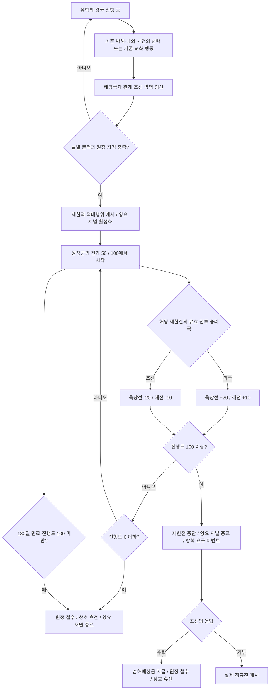

# 유학의 왕국 연계 양요 시스템 설계안

작성일: 2026-11-03. 상태: 설계 문서이며 게임 스크립트는 아직 변경하지 않았다.

## 1. 확정 요구사항과 설계 범위

- 새로운 반복 이벤트를 추가하지 않는다. 월간 무작위 사건, 주기적인 외교 사고, 전투마다 나타나는 팝업을 만들지 않는다.
- 진행도 100 도달 시에만 조선에 **항복 요구 이벤트를 해당 양요당 한 번** 표시한다. 이는 반복 사건 풀이 아닌 분쟁의 결말 선택이다.
- 양요의 **발발 전**에는 새로운 위기 변수나 진행도를 만들지 않는다. 기존 관계·악명과 실제 외교·군사 상태를 조합해 판정한다.
- 제한전이 발생하면 조선에 **양요 저널 하나**를 표시한다.
- 이 저널에는 **해당 양요 제한전의 전투만 집계**하여 외국 승리 시 상승하고 조선 승리 시 하락하는 **진행도 하나**를 둔다.
- 진행도가 임계치에 도달하면 제한전을 중단하고 조선에 항복 여부를 묻는다. **수락하면 원정국에 손해배상금을 지급하고 철수**, **거부하면 실제 정규전으로 확대**한다.
- 진행도가 **0에 도달하면 즉시 철수**한다. 0에 도달하지 않아도 **180일 동안 확대 임계치에 도달하지 못하면 철수**한다.
- 진행도는 저널의 `scripted_progress_bar` 자체에 저장한다. 국가 변수에 같은 점수를 복제하지 않는다.
- 기존 ‘유학의 왕국’의 세계 인식도는 그대로 유지한다. 양요 발발이나 전과 점수로 전용하지 않는다.

발발 전의 ‘별도 최후통첩 이벤트 → 응답 → 원정’ 단계는 제외한다. 기존 사건의 강경 선택이 발발 조건을 충족하면 제한전과 저널을 함께 시작한다. 항복 요구 이벤트는 제한전 진행도 100 도달 후에만 표시하며, 사전에 기존 선택지와 저널 설명으로 이 분기를 안내한다.

수정 기준: 2026-11-03. 해당 제한전의 양측 승패에 따른 증감, 0 도달 시 즉시 철수, 180일 내 임계치 미달 시 철수, 100 도달 후 항복 요구와 수락 시 배상·거부 시 정규전은 확정 요구사항이다. 시작값 50, 전투당 증감 폭, 관계·악명 문턱, 배상액 산식과 응답 기한은 초기 조정값이다. 시작값을 50으로 두어 개시 직후 0점 철수가 발생하지 않도록 한다.

## 2. 전체 흐름

월·주 단위 판정은 저널 수명 관리에만 사용할 수 있다. 별도 사건을 추첨하거나 전과를 자동 누적하지 않는다.

## 3. 발발: 기존 수치와 기존 사건만 사용

### 3.1 연결 지점

우선 기존 `eafp_effect_catholic_purge`에 연결한다. 이 효과를 호출하는 기존 역사 사건과 ‘집중 교화’ 행동이 동일한 발발 판정을 이용한다.

현재 확인된 연결점:

- `eafp_kor_mainline.120`: 기해박해 관련 선택.
- `eafp_kor_mainline.125`: 프랑스 함선 관련 기존 사건. 실제 선택·효과를 정비할 경우 대외 대응 연결점으로 사용한다.
- `eafp_kor_mainline.126`: 김대건 판결 관련 선택. 실제 처분과 외국 피해 여부에 따라 연결한다.
- `eafp_kor_mainline.128`: 대남의 비보에 대한 박해 선택.
- `eafp_kor_mainline.170`: 기존 집중 교화 행동의 결과.

기존 사건이 존재한다는 이유만으로 모두 같은 악명과 발발 효과를 주지는 않는다. **외국인 피해 또는 특정국과의 외교 충돌이 있는 선택**에만 해당국을 연결한다. 국내 신자만 대상으로 한 처분에서 임의로 외국 피해국을 만들어내지 않는다.

기존 반복 가능한 교화 행동은 유지하되, 새로운 반복 이벤트나 새 사건 공급용 버튼은 만들지 않는다. 따라서 사용자의 기존 행동으로 재차 위기가 생길 수는 있지만, 시스템이 주기적으로 새 사건을 생성하지 않는다.

### 3.2 관계·악명 문턱

사건의 효과를 적용한 뒤 다음 세 분기 중 하나를 충족하면 발발 수치 조건을 만족한다.

| 조선의 현재 악명 | 사건 당사국과 조선의 현재 관계 |
|---|---:|
| 10 미만 | −70 이하 |
| 10 이상, 25 미만 | −55 이하 |
| 25 이상 | −40 이하 |

이 표를 `OR`와 구간별 `AND` 조건으로 직접 판정한다. ‘양요 위험도’, ‘외교 긴장’, ‘원정 의지’ 등의 별도 계산 점수·저장 변수는 추가하지 않는다.

- 관계는 해당 국가와 쌓인 갈등을 나타낸다.
- 악명은 무력 개입에 대한 국제적 부담이 낮아지는 요인이다.
- 악명만 높거나 관계만 나쁜 상태에서는 새 사건 없이 양요가 자동 생성되지 않는다.
- 악명은 조선의 수치를 사용한다. 상대국 악명과 혼동하지 않는다.
- 발발 후에는 관계·악명으로 전과 진행도를 올리거나 내리지 않는다.

### 3.3 당사국과 원정 자격

수치 조건에 더하여 다음을 모두 만족해야 한다.

1. 조선에 ‘유학의 왕국’ 저널이 진행 중이다.
2. 후보국은 이번 사건의 외국인·선박·사절과 연결된 실제 당사국이다.
3. 후보국이 존재하며, 자체 원정을 수행할 수 있는 독립 외교 주체다.
4. 조선이 위치한 전략 지역에 관심이 있으며, 해군을 보유하고 실제 원정 능력이 있다.
5. 조선과 후보국이 동맹·휴전 관계가 아니고, 후보국이 조선의 종주국이 아니다.
6. 조선에 이미 양요 저널이나 항복 요구 응답 대기가 없고, 양국 사이에 정규전 또는 진행 중인 외교전이 없다.
7. 후보국이 다른 대규모 전쟁이나 내전으로 원정 불가능한 상태가 아니다. 정확한 군사 여력 문턱은 실제 AI 상륙 검증 후 조정한다.

조선이 청의 종속국이라는 이유로 양요 자체를 막지는 않는다. 다만 제한전 단계에서 청을 자동 참전시키지 않는다. 정규전 전환 시 종주국 처리는 7절을 따른다.

복수 후보가 한 사건에서 조건을 만족하면 해당 사건의 직접 당사국을 우선한다. 동률이면 조선과 관계가 더 나쁜 국가, 다시 동률이면 해군력이 큰 국가를 선택한다. 한 사건에서 여러 양요를 동시에 생성하지 않는다.

프랑스를 우선 적용 대상으로 삼되 일반화된 국가 스코프를 사용한다. 미국 등 다른 국가의 경로는 그 국가와 연결되는 기존 사건이 확인될 때 같은 판정을 붙인다. 존재하지 않는 사건을 전제로 반복 사건 풀을 새로 만들지 않는다.

### 3.4 기존 박해 효과의 정비

현재 박해 효과는 선교사마다 관련 국가와 관계 −20을 적용하고 기독교 국교 국가에 추가 −10을 적용한다. 양요를 연결할 때 다음 순서로 정비한다.

1. 선교사가 사라지기 전에 사건 당사국을 판별한다.
2. 같은 국가 출신 선교사가 여러 명이어도 해당국의 사건당 직접 관계 페널티는 한 번만 적용한다.
3. 광범위한 종교적 반감에 따른 관계 하락과 실제 피해국을 구별한다. 관계가 떨어진 모든 기독교 국가가 원정 후보가 되지는 않는다.
4. 외국인 처형 같은 국제 사건에 한해 소량의 악명 증가를 검토한다. 초기안은 사건당 +2이며 선교사 수에 비례하지 않는다.
5. 관계·악명 변경이 모두 끝난 다음 발발 판정을 한 번 실행한다.

선교사의 문화가 여러 국가의 주류 문화에 해당할 수 있으므로 이를 곧바로 단일 국적으로 간주하지 않는다. 생성·기존 사건에서 보호국을 알 수 있으면 그 스코프를 우선하며, 불명확한 사례는 당사국 선정 규칙을 먼저 확정한다.

## 4. 제한전 개시와 양요 저널

### 4.1 개시 처리

발발 조건을 충족하는 기존 선택의 효과 안에서 다음을 하나의 연속된 처리로 수행한다.

1. 조선과 원정국을 확정한다.
2. 조선에 `je_eafp_yangyo`를 추가하고 원정국을 저널의 대상 스코프로 전달한다.
3. 양국 간 기간 제한 적대행위를 활성화한다.
4. 전과 진행도를 50으로 시작하고, 원정 기한을 180일로 설정한다. 전투나 점수 변화로 기한을 갱신하지 않는다.
5. 필요한 제한전 전투 보정을 적용한다.

새 시작 팝업은 만들지 않는다. 기존 선택지의 결과 툴팁과 저널 등장으로 알린다. 발발 예고 문구에는 선택 적용 후의 관계·악명, 원정국, 정규전 확대 가능성을 표시한다.

저널은 진행도와 실제 분쟁 대상을 보유하는 기능 저널이다. 다른 저널의 활성화만을 위한 중간 저널은 추가하지 않는다.

### 4.2 저널 표시

| 항목 | 내용 |
|---|---|
| 내부 키 제안 | `je_eafp_yangyo` |
| 제목 | 양요 — [원정국 이름]의 무력 시위 |
| 소유국 | 조선 |
| 분쟁 대상 | 저널에 전달된 원정국 |
| 진행도 이름 | 원정군의 전과 |
| 범위 | 0~100 |
| 시작값 | 50, 전과의 누적 승리 횟수가 아닌 양측 전황의 중립 기준 |
| 기간 | 180일, 저널 자체 timeout 사용 |
| 설명의 핵심 | 외국 승리로 상승·조선 승리로 하락. 100이면 항복 요구, 수락 시 배상·철수, 거부 시 정규전. 0 또는 180일 내 100 미달이면 무배상 철수 |
| 조선 관점 색상 | 진행도 증가가 위험임을 나타내는 적색 계열 |
| 새 버튼 | 기본안에서는 없음 |

표시 예시:

> 프랑스 원정군이 조선 연안에서 군사 행동을 벌이고 있다. 원정군의 전과는 50에서 시작하며, 이번 제한전의 전투 결과만 반영한다. 조선이 패배하면 육상전은 20, 해전은 10 상승하고, 조선이 승리하면 같은 값만큼 하락한다. 100에 도달하면 항복을 요구받는다. 수락하면 손해배상금을 지급하고, 거부하면 정규전으로 확대된다. 0에 도달하거나 개시 후 180일 동안 100에 도달하지 못하면 배상 없이 원정군이 철수한다.

원정국·전과·남은 기간·증감 조건·종료 조건을 표시한다. 숨겨진 단계나 부가 위험 게이지는 두지 않는다.

### 4.3 군사적 성격

- 소규모 교전과 제한된 전투 빈도를 지향한다.
- 제한전 단계에는 합병·보호국화·정권 교체를 목표로 삼지 않는다.
- 가능하면 정규전과 구별되는 점령 제한을 적용한다.
- 국가 전체의 육군·해군을 삭제하거나, 동원 해제를 강요해서 규모를 맞추지 않는다.
- 일반 전쟁에도 영향을 주는 국가 단위 전투 보정은 부작용을 확인한 뒤 사용한다. 카를리스타 보정 전체를 복사하지 않는다.

해상으로 떨어진 국가 사이에서도 실제 해전·상륙·육상전이 발생해야 한다. 제한전 기능이 상륙을 지원하지 않는다면 이는 구현상 차단 사항이다. 이벤트로 가상의 승리를 만들어 진행도를 채우거나, 처음부터 정규전을 열고 제한전이라고 표시하는 것으로 대체하지 않는다.

## 5. 전투 승리 진행도

### 5.1 기본 규칙

| 발생 사항 | 진행도 변화 |
|---|---:|
| 원정국이 조선을 상대로 유효 육상전 승리 | +20 |
| 원정국이 조선을 상대로 유효 해전 승리 | +10 |
| 조선이 원정국을 상대로 유효 육상전 승리 | −20 |
| 조선이 원정국을 상대로 유효 해전 승리 | −10 |
| 시간 경과 | 0 |
| 관계·악명·세계 인식도 변화 | 0 |
| 무전투 점령·빈 전투·다른 국가와의 전투·해당 제한전 밖의 전투 | 0 |

진행도는 50을 중립 기준으로 삼는 이번 제한전의 전황이다. 외국의 승리로 상승하고 조선의 승리로 하락한다. 조선은 0까지 낮추어 즉시 철수를 이끌어내거나, 100 도달을 막으며 180일을 버틸 수 있다. 시간 경과에 따른 자동 증감은 없다.

예시:

- 외국의 육상전 3연승: 50 → 70 → 90 → 100(상한 처리), 항복 요구 이벤트 표시. 수락하면 배상·철수, 거부하면 정규전 확대.
- 조선의 육상전 3연승: 50 → 30 → 10 → 0(하한 처리), 즉시 철수.
- 외국 육상전 승리 후 조선 육상전 승리: 50 → 70 → 50, 계속 진행.
- 외국 육상전 1승과 해전 1승 후 추가 전투 없음: 80, 180일 만료 시 철수.
- 실제 전투 없음: 50 유지, 180일 만료 시 철수, 전투 승리 보상 없음.
- 전투를 한 건씩 처리하며, 0이면 철수하고 100이면 전투 집계를 끝내고 항복 요구로 넘어간다. 이후의 전투 결과를 합산해 이 분기를 되돌리지 않는다.

### 5.2 유효 전투 필터

증감하려면 다음 조건을 모두 만족해야 한다. 외국 승리와 조선 승리에 동일한 필터를 적용한다.

1. 조선의 양요 저널이 활성 상태다.
2. 승리국과 패배국의 쌍이 조선·저널의 원정국과 일치한다. 외국 승리면 가산, 조선 승리면 차감한다.
3. 전투가 해당 양국 사이의 **이번 양요 제한전에서 발생한 전투**임을 확인한다. 같은 국가가 참여했다는 이유만으로 다른 전쟁의 전투를 집계하지 않는다.
4. 전투 결과를 처리하는 시점에도 해당 제한전이 유효하며, 항복 요구 응답 대기·철수·정규전 상태가 아니다. 제한전 개시 전 전투와 종료 뒤 도착한 콜백도 제외한다.
5. 양측 전투 부대가 실제로 참여한 전투다. 빈 전투 콜백은 사용하지 않는다.
6. 육상전은 조선이 소유한 지역에서 벌어진 전투다. 해전은 조선 연안 작전과 연결된 해역으로 제한한다. 해역 판별에 필요한 엔진 스코프는 구현 전 검증한다.

임시 적대행위가 분쟁 객체나 식별자를 제공한다면 전투가 그 분쟁에 속하는지 직접 대조한다. 별도 전쟁 객체를 제공하지 않는다면 저널 대상국·승패국·적대행위 유형·전투 위치·전투 발생 시점과 정규전 여부를 함께 확인한다. 단순히 저널이 열려 있다는 조건만으로 집계하지 않는다. 이번 제한전의 전투인지 신뢰성 있게 구별할 수 없다면 구현상 차단 사항으로 남긴다. 다른 전쟁의 전투를 섞어 점수를 바꾸는 방식으로 대체하지 않는다.

### 5.3 중복 증감 방지

- 육상전은 `on_battle_won` 한 경로만 사용한다.
- 해전은 `on_naval_battle_won` 한 경로만 사용한다.
- 승리 콜백 안에서 승리국이 외국인지 조선인지에 따라 가산·차감한다. `on_battle_lost` 등 패배 콜백에서 같은 결과를 다시 반영하지 않는다.
- `on_empty_battle_won`과 기함 전투 콜백에는 점수 처리를 연결하지 않는다.
- 실제 빌드에서 일반 승리 콜백과 해전 승리 콜백이 중첩되는지 확인하고, 중첩된다면 전투 유형 조건으로 배타적으로 나눈다.
- 점수 처리 뒤 즉시 0과 100 도달 여부를 확인한다. 항복 요구로 넘기는 처리는 저널의 단일 종료 경로에서 한 번만 실행한다. 같은 날짜에 다른 전투가 끝나더라도 응답 대기·철수·정규전 상태이면 점수를 변경하거나 이벤트·종료 처리를 반복하지 않는다.

진행도는 0~100으로 상·하한 처리한다. 별도 승리 횟수 변수, 전투 이력 목록, 진행도 사본은 만들지 않는다.

## 6. 제한전 종료 조건

### 6.1 판정 우선순위

1. 국가 소멸 등으로 분쟁을 유지할 수 없는 경우 정리한다.
2. 같은 양국 사이에 정규전이 이미 생겼다면 제한전만 정리하고 기존 전쟁을 유지한다.
3. 전과 100 이상이면 제한전과 저널을 종료하고 항복 요구 이벤트로 넘긴다. 아직 전쟁이나 휴전을 생성하지 않는다.
4. 전과 0 이하이면 원정 기한이 남아 있어도 즉시 철수한다.
5. 전과가 0 초과·100 미만이고 개시 후 180일이 지나면 철수한다.

180일 이내 종료된 유효 전투를 반영한 결과가 100이면 항복 요구 분기를 우선한다. `on_timeout`에서도 점수를 재확인한다. 기한 경계에서의 콜백 순서를 검증하여 기한 내 전투를 누락하거나 기한 뒤 전투를 반영하지 않게 한다. 0 도달과 timeout이 겹치면 같은 철수 처리를 한 번만 수행한다. 이미 0·100에 도달하여 종료된 양요에 뒤늦은 콜백을 적용하지 않는다. 항복 요구로 넘어간 뒤에는 180일 만료를 이유로 무배상 철수를 적용하지 않는다.

### 6.2 진행도 0 또는 기한 만료: 원정 철수

진행도 0 도달 시 즉시, 또는 180일 동안 100에 도달하지 못한 경우 아래 동일한 철수 처리를 수행한다. 0에 도달한 뒤 남은 기간을 기다리지 않는다.

- 양국의 제한적 적대행위를 해제한다.
- 양요에 한정된 전투 보정을 제거한다.
- 양요 저널을 종료한다.
- 양국에 기본 36개월의 상호 휴전을 설정한다.
- 손해배상금을 청구하거나 지급하지 않는다. 100 도달 후 항복 수락에 따른 유상 철수와 구별한다.
- 새로운 철수 팝업이나 재침공 예약 이벤트는 생성하지 않는다.
- 기본안에서는 위신·군부 지지 보상을 자동 부여하지 않는다. 무전투 철수를 승전으로 보상하거나 반복해서 보상을 얻는 문제를 피한다.

추후 기존 결말 사건과 연결할 때에만 실제 전투 성과가 확인되는 사례에 보상을 설계한다. 그 보상을 위해 새 누적 승전 점수를 추가하지 않는다.

휴전 종료만으로 재침공하지 않는다. 이후 기존 사건·행동이 다시 발생하고 발발 조건을 충족해야 새로운 양요가 시작된다. 재활성화 가능 여부는 저널의 재등장 설정과 함께 검증한다.

### 6.3 세계 인식도 완료와 예외

- 제한전 도중 ‘유학의 왕국’이 완료되거나 국교가 변경되어도 이미 발생한 양요는 계속된다.
- 양요의 신규 발발에는 상위 저널이 필요하지만, 진행 중 분쟁의 유지 조건에는 넣지 않는다.
- 원정국·조선 소멸, 두 국가가 동일한 국가가 됨, 원정국이 조선의 종주국이 됨 등 분쟁이 무의미해진 경우 무보상 정리한다.
- 국가가 존재하지 않는 경우 해당 국가에 휴전·관계 변경 효과를 실행하지 않는다.
- 원정국이 다른 전쟁을 시작했다는 이유만으로 즉시 무조건 철수시키지는 않는다. 신규 발발 자격과 진행 중 종료 조건을 구별한다.

## 7. 100 도달: 항복 요구와 조선의 선택

### 7.1 한 번의 결말 이벤트로 전환

전과가 100에 도달하면 제한전을 중단하고 조선에 항복 요구 이벤트를 한 번 띄운다. 이 시점에는 정규전을 자동으로 시작하지 않는다.

1. 원정국과 조선이 유효한지, 양국 사이에 정규전이 이미 생겼는지 재확인한다.
2. 원정국과 손해배상금 액수를 결말 이벤트의 저장 스코프로 전달한다.
3. 제한적 적대행위와 제한전 보정을 해제한다. 휴전은 아직 만들지 않는다.
4. 양요 저널을 종료하고 조선을 수신국으로 항복 요구 이벤트를 표시한다.
5. 이벤트 응답이 끝날 때까지 새로운 양요 발발을 차단한다.

저널 종료로 기존 180일 timeout과 전투 집계를 끝내므로, 선택창이 열린 동안 점수가 내려가거나 기한 만료로 무배상 철수가 발생하지 않는다. 새 후속 저널이나 진행도는 추가하지 않는다. 저널이 사라져도 이벤트의 원정국·배상액이 유지되어야 한다.

응답 대기는 엔진의 대기 이벤트 상태로 조회할 수 있으면 이를 사용한다. 조회할 수 없다면 효과 없는 비중첩 임시 modifier 하나로 재발만 차단한다. 이는 새로운 위험 점수나 누적 변수가 아니다. 응답·무효화 시 제거하며, 이벤트 만료와 modifier 해제 순서를 검증한다. 무기한 방치를 막기 위한 응답 기한은 30일을 초기안으로 하며, 무응답은 거부 선택과 같은 처리로 명시한다. 이 기한·기본 선택은 이벤트 안내에 표시한다.

### 7.2 이벤트 문안과 선택지

- 제목 제안: **포성 뒤의 최후통첩**
- 본문 요지: 원정국은 군사적 우세를 근거로 항복과 손해배상금 지급을 요구한다. 수락하면 원정군이 철수하고, 거부하면 작전을 확대해 정규전을 시작한다.
- 대상: 조선 플레이어 또는 조선 AI. 원정국이 조선을 대신해 선택하지 않는다.

| 선택지 | 결과 |
|---|---|
| **요구를 받아들이고 손해배상금을 지급하라.** | 조선에서 원정국으로 표시된 금액을 일시불 이전, 원정 철수 확정, 36개월 상호 휴전, 응답 대기 해제. 정규전 없음 |
| **굴복할 수 없다. 끝까지 맞서라.** | 손해배상금 지급 없음, 원정국이 공격측인 정규전 개시, 응답 대기 해제. 휴전 없음 |

수락은 이번 원정의 요구에 대한 항복을 뜻한다. 영토 할양·종속국화·정권 교체는 포함하지 않는다. 승전 보상도 지급하지 않는다.

### 7.3 손해배상금 지급

금액은 아직 사용자 확정값이 아니므로 **이벤트 생성 시 조선 GDP의 1%를 1,000 단위로 반올림하고 최소 1,000으로 설정**하는 것을 초기안으로 한다. 예를 들어 GDP가 5,000,000이면 배상금은 50,000이다. 재정 상황을 기준으로 밸런스를 확인한 뒤 비율을 조정한다.

- 이벤트 생성 시 한 번 산정하여 이벤트의 저장 값으로 보존한다. 선택을 미루거나 세율을 바꾸어 금액이 달라지지 않는다.
- 본문과 수락 선택지에 동일한 최종 지급액과 수령국을 표시한다.
- 수락 시 조선 국고에서 그 금액을 차감하고 원정국 국고에 **정확히 같은 금액**을 더한다. modifier만 붙이거나 조선의 돈만 소멸시키는 것으로 대체하지 않는다.
- 금 준비금이 부족하면 실제 엔진의 차입 규칙 내에서 지급할 수 있게 한다. 차입 여력까지 부족해 전액 지급이 불가능하면 수락 선택지를 비활성화하고 부족액을 알린다. 미지급 상태에서 수락·철수로 처리하지 않는다.
- 실제 실행 시 양국 존재 여부와 지급 가능액을 다시 확인한다. 검증 실패 시 일부만 송금하거나 지급 없이 휴전을 만들지 않는다.
- 지급·입금·휴전·대기 해제는 한 선택 처리에서 각각 한 번만 실행한다. 새 국가 배상 누적 변수나 분할 지급 반복 이벤트는 만들지 않는다.

`add_treasury`의 음수·양수 적용은 문서화되어 있으나, 금 준비금 부족 시 차입·한도 처리는 실제 빌드에서 검증해야 한다. 이벤트 저장 액수의 표시 및 저장·불러오기 보존도 확인한다.

### 7.4 거부 시 정규전 전환

거부를 선택하면 원정국·조선·종속 관계·기존 전쟁을 재확인한 뒤 원정국이 공격측인 실제 정규전을 생성한다. 이후 일반 전쟁 UI·전쟁 지지도·평화 협상으로 진행한다. 새 협상 기간이나 확률 판정은 두지 않는다.

전쟁 생성 성공을 확인한 뒤 응답 대기를 해제한다. 생성 실패 시 분쟁이 조용히 사라지는 상태를 허용하지 않는다. 구현 단계에서 실패 시 이벤트 응답을 복구하는 경로를 검증하며, 성공하지 않은 전쟁을 ‘확대 완료’로 기록하지 않는다.

이 전환에서 손해배상금이나 휴전을 생성하지 않는다. 조선이 나중에 정규전에서 패배하여 지급하는 배상은 일반 평화 조건의 결과다.

#### 전쟁 개시 방식

문서화된 후보는 `create_diplomatic_play`의 `war = yes` 또는 실제 외교전 객체에 대한 `set_war = yes`다. 일반 외교전을 생성한 후 수개월을 기다리는 것으로 요구사항을 대신하지 않는다.

초기 구현은 **정규전 직접 생성**을 우선 검증한다. 저장소에 `war = yes` 사용례가 있으나, 생성 주체·대상 문법은 문서와 일부 기존 코드가 다르므로 실제 실행되는 형식을 확인해 작성한다.

카를리스타 전쟁은 이미 존재하는 전쟁의 유격전 단계를 해제하는 방식이다. 양요는 임시 적대행위에서 실제 전쟁을 새로 개시하는 구조이므로, 카를리스타의 보정 제거만 복사해서 전환이 끝났다고 판단하면 안 된다.

### 7.5 목표와 청의 처리

- 초기 전쟁 목표는 조선에 대한 배상 요구를 기본안으로 한다.
- 강제 개방은 사용 중인 게임 버전의 실제 목표·조약 효과가 확인되면 추가할 수 있다. 기본안에 미확인 목표 키를 넣지 않는다.
- 최초 목표에 합병·보호국화·왕조 교체를 자동 부여하지 않는다.
- 조선의 목표는 초기안에서 방어와 원정국의 요구 저지다.
- 정규전이 시작된 뒤에는 점령·전쟁 지지도·평화 협상 등 일반 전쟁 규칙을 적용한다. 제한전의 180일 철수 규칙은 적용하지 않는다.

청은 제한전 단계에는 들어오지 않지만 **정규전 전환 시 조선이 여전히 청의 종속국이라면 기존 종속 관계에 맞게 방어측에 참여**하도록 한다. 청이 전쟁 지도자가 되는 경우도 허용한다. 조선 독립이나 청과의 종속 관계 해제를 몰래 수행해 전쟁 생성 조건을 우회하지 않는다.

직접 전쟁 생성이 종주국·조약상 참전을 자동 처리하는지는 검증 대상이다. 자동 처리되지 않으면 현재 관계에 따른 참전국을 명시적으로 전달한다. 그 밖의 국가를 무작위로 끌어들이는 추가 이벤트는 만들지 않는다.

### 7.6 응답 대기 중 외부 변화

- 국가 소멸·동일 국가가 됨·원정국이 조선의 종주국이 됨 등으로 요구가 무효화되면 지급·새 전쟁 없이 대기 상태를 정리한다.
- 같은 양국 사이에 정규전이 이미 발생했다면 기존 전쟁을 유지하며 해당 이벤트의 배상·새 전쟁·휴전 효과를 실행하지 않는다. 별도 전쟁을 수락 선택으로 종결하지 않는다.
- ‘유학의 왕국’ 완료·국교 변경은 이미 도착한 항복 요구를 취소하지 않는다.
- 선택창 대기 중 저장·불러오기, 이벤트 만료, 같은 날짜의 중복 콜백에서도 배상과 전쟁 생성은 한 번만 실행되어야 한다.

## 8. 반복 이벤트 없이 ‘유학의 왕국’을 보강하는 방법

| 보강점 | 구현 방향 | 새 반복 이벤트 |
|---|---|---|
| 박해의 외교 비용 | 기존 박해 선택지에 관계·악명·양요 발생 예고 표시 | 없음 |
| 프랑스 함선 대응 | 기존 `.125`의 선택과 국가 스코프를 정비해 관계 회복 또는 강경 대응 부여 | 없음 |
| 대남의 비보 | 기존 `.128`에 외세의 위협을 보고 탄압할지 방비·학습을 택할지 구체화 | 없음 |
| 서학과 서양 기술의 구분 | 기존 사건의 선택지에서 종교 정책과 기술 수용을 분리 | 없음 |
| 방비의 실효성 | 실제 군사 기술·편제·시설로 양요의 전투 결과에 영향 | 없음 |
| 유교 질서의 변화 | 기존 완료 사건 `.171`을 현재 법률·이해집단 구성에 따라 다른 문구·효과로 분기 | 없음 |

‘연행사 보고’, ‘이양선 출몰’, ‘유림 상소’ 등을 매월 무작위로 뽑는 새 사건 풀은 제외한다. 100 도달 후 항복 요구 이벤트 한 종류를 추가하고, 그 밖의 서사는 기존 사건과 완료 사건을 고쳐 표현한다.

세계 인식도와 양요 전과의 역할도 구별한다. 세계 인식도는 사회의 대외 이해를 나타내고, 양요 전과는 이번 제한전에서 양측 승패를 반영한 외국의 군사적 우세를 나타낸다. 어느 한쪽의 상승이 다른 쪽을 자동으로 채우지 않는다.

## 9. 상태 저장과 구현 배치

### 9.1 최소 데이터

| 필요한 정보 | 저장·조회 방식 |
|---|---|
| 발발 전 위험 | 현재 관계·악명을 직접 조회, 저장하지 않음 |
| 양요 진행 여부 | 조선의 양요 저널 활성 상태 |
| 원정국 | 저널 대상 스코프 |
| 원정군 전과 | 저널의 단일 scripted progress bar |
| 남은 원정 기한 | 저널 timeout |
| 제한적 적대행위 | 엔진의 임시 적대행위 상태 |
| 항복 요구 응답 대기 | 대기 이벤트 상태 조회, 불가능하면 재발 차단용 임시 modifier 하나 |
| 항복 요구의 원정국·확정 배상액 | 저널 종료 전에 전달한 이벤트 저장 스코프·저장 값, 응답 종료 후 폐기 |
| 정규전 전환 여부 | 양국의 실제 전쟁 상태 |
| 재발 방지 기간 | 실제 상호 휴전 |

국가 변수·전역 변수로 위 정보를 복제하지 않는다. 저널 대상 스코프를 전투 on_action에서 읽는 경로와 저장·불러오기 보존 여부는 먼저 검증한다. 항복 요구의 배상액은 새 위기 수치가 아니라 화면에 제시한 일회성 거래 금액이다. 이벤트 수명 동안만 보존하며, 일반 이벤트의 임시 스코프가 저널 밖에서도 영구 보존된다고 가정하지 않는다.

### 9.2 파일 배치 제안

기존 관련 파일에 확장하는 것을 우선한다. 아래는 구현 위치이며 이번 문서 작성에서 변경한 파일 목록이 아니다.

- `common/journal_entries/eafp_korean_journal.txt`: 양요 저널과 종료 처리.
- `common/scripted_progress_bars/eafp_kor_progress_bars.txt`: 원정군 전과 진행도.
- `common/scripted_effects/eafp_korea_effects.txt`: 기존 박해 효과 정비, 실제 중복 호출되는 발발·전환 처리만 공통화.
- `common/on_actions/korea_code_on_actions.txt`: 육상·해전 승리 연결. 기존 바닐라 승리 콜백을 덮어쓰지 않고 병합되는지 확인.
- `events/eafp_kor_events/eafp_kor_mainline.txt`: 기존 선택지 연결, 100 도달 후 항복 요구 이벤트 한 종류 추가. ID는 기존 정의와 충돌하지 않게 배정. 새 반복 이벤트 정의 없음.
- `common/static_modifiers/eafp_korea_rework_modi.txt`: 필요한 제한전 보정과, 엔진 조회가 불가능할 경우에만 응답 대기용 임시 modifier 추가.
- `localization/korean/eafp_kor_rework_l_korean.yml` 및 대응 언어 파일: 제목·진행도·발발 경고·항복 요구·수락/거부 선택지·배상액·종료 설명.

## 10. 확인된 근거와 검증해야 할 부분

### 10.1 소스에서 확인한 사항

- `common/journal_entries/eafp_korean_journal.txt`: ‘유학의 왕국’과 기존 세계 인식도 연결.
- `common/scripted_effects/eafp_korea_effects.txt`: 기존 박해의 선교사 처형·관계 하락 처리.
- `documentation/effects.log`: `add_journal_entry`의 대상 스코프, `add_progress`, `enable_temporary_hostilities`의 `limited_war`·기간 지정, `disable_temporary_hostilities`, `create_diplomatic_play`의 `war`, `set_war`, 상호 휴전 생성.
- 로컬 바닐라 `common/on_actions/ip4_on_actions.txt`: 카를리스타 전투 승리에서 저널 진행도를 직접 변경하는 사용례.
- 로컬 바닐라 `common/on_actions/00_code_on_actions.txt`: 육상·해전·빈 전투 승리 콜백 구분.
- 로컬 바닐라 `common/journal_entries/06_the_carlist_wars.txt` 및 `common/scripted_buttons/spain_buttons.txt`: 유격전 단계와 전면 작전 단계 전환.

로컬 바닐라 기준 경로: `D:/SteamLibrary/steamapps/common/Victoria 3/game/`.

### 10.2 구현 전 필수 검증

1. 임시 `limited_war`에서 조선·프랑스 사이 해상 이동, 해전, 상륙, 육상전이 실제로 발생하는가.
2. 전투 규모·빈도·점령 제한 중 엔진이 보장하는 범위와 별도 보정이 필요한 범위는 무엇인가.
3. 원정국 AI가 제한전에서 실제 병력·함대를 움직이는가.
4. 승리 콜백의 국가·적국·전투 위치·분쟁 정보가 임시 적대행위에서도 제공되며, 해당 제한전의 전투만 양방향으로 집계할 수 있는가.
5. 해전 승리를 조선 연안 작전으로 한정할 수 있는가.
6. 저널의 대상국을 승리 콜백에서 안전하게 읽을 수 있고, 저장·불러오기 후에도 유지되는가.
7. 실제 전쟁 생성과 청의 방어 참전이 작동하며, 종주국이 있는 조선도 정상적인 전쟁 대상이 되는가.
8. 0·100 도달·timeout·외부 정규전 발생이 겹쳐도 항복 요구·전쟁·휴전이 중복 생성되지 않으며, 종료 뒤 콜백이 무시되는가.
9. 제한전 종료 시 양요 전용 상태만 제거하고 다른 전쟁·modifier를 훼손하지 않는가.
10. 저널 종료 후에도 항복 요구의 원정국·배상액이 보존되고, 응답 대기 중 재발·전과 증감·180일 무배상 철수가 차단되는가.
11. 수락 시 동일 금액이 조선에서 차감되고 원정국에 입금되며, 차입 한도 초과·국가 소멸·중복 선택으로 미지급 철수나 중복 송금이 발생하지 않는가.
12. 이벤트 응답 기한·무응답 거부 처리와 저장·불러오기가 작동하고, 응답 대기용 상태가 모든 결말에서 정리되는가.

위 항목은 설계상의 의도와 엔진 지원 여부를 구분하기 위한 실행 검증 항목이다. 이번 문서 작성만으로 게임 내 작동을 검증한 것은 아니다.

## 11. 수용 기준과 밸런스 점검

| 시나리오 | 기대 결과 |
|---|---|
| 악명 9, 사건 후 관계 −69 | 발발하지 않음 |
| 악명 9, 사건 후 관계 −70, 원정 자격 충족 | 제한전과 저널 발생 |
| 악명 10, 사건 후 관계 −55, 원정 자격 충족 | 제한전과 저널 발생 |
| 악명 25, 사건 후 관계 −40, 원정 자격 충족 | 제한전과 저널 발생 |
| 관계·악명 문턱 충족, 새 사건 없음 | 자동 발발하지 않음 |
| 관계·악명 문턱 충족, 휴전 중 | 발발하지 않음 |
| 동일국 선교사 여러 명 처형 | 사건당 직접 관계 페널티 한 번, 발발 판정 한 번 |
| 제한전 개시 | 진행도 50, 즉시 철수하지 않음 |
| 시작값에서 원정국의 유효 육상전 1승 | 진행도 70, 추가 팝업 없음 |
| 시작값에서 원정국의 유효 해전 1승 | 진행도 60, 중복 가산 없음 |
| 시작값에서 조선의 유효 육상전 1승 | 진행도 30, 중복 차감 없음 |
| 시작값에서 조선의 유효 해전 1승 | 진행도 40, 중복 차감 없음 |
| 빈 전투·제3국 전투·해당 제한전 밖의 전투 | 진행도 변화 없음 |
| 같은 국가가 참여한 다른 전쟁의 승패 | 진행도 변화 없음 |
| 진행도 90에서 원정국의 유효 육상전 승리 | 100으로 상한 처리 후 항복 요구 한 번 표시, 즉시 정규전 없음 |
| 진행도 10에서 조선의 유효 육상전 승리 | 0으로 하한 처리 후 즉시 철수·36개월 상호 휴전 |
| 진행도 20에서 조선의 유효 육상전 승리 | 정확히 0 도달, 기한을 기다리지 않고 철수 |
| 진행도 100 도달 | 제한전·저널 종료, 원정국·배상액 전달, 항복 요구 응답 대기 |
| 항복 요구 수락 | 표시된 배상액을 조선에서 원정국으로 한 번 이전, 철수·36개월 휴전, 정규전 없음 |
| 항복 요구 거부 | 배상금 지급 없이 정규전 한 번 개시, 휴전 없음 |
| 차입을 포함해도 배상 전액 지급 불가 | 수락 비활성화·부족액 표시, 미지급 철수 없음 |
| 항복 요구 응답 대기 중 180일 만료 | 무배상 철수 없음, 이벤트 응답으로 결과 결정 |
| 항복 요구 응답 대기 중 전투 콜백·기존 박해 행동 | 점수 증감·이벤트 재표시·새 양요 없음 |
| 항복 요구 무응답으로 응답 기한 만료 | 안내된 거부 기본 선택 실행, 정규전 개시 |
| 응답 전 원정국 소멸 또는 양국 정규전 별도 발생 | 이벤트 효과 무효화, 배상·새 전쟁·휴전 생성 없음 |
| 진행도 60에서 원정 기한 만료 | 제한전 종료, 36개월 상호 휴전 |
| 무전투로 원정 기한 만료 | 진행도 50에서 철수, 승전 보상 없음 |
| 기한 내 마지막 전투로 100 도달과 timeout 중첩 | 항복 요구 우선, 자동 철수·휴전·정규전 없음 |
| 0 도달과 timeout 중첩 | 철수와 휴전 생성 각각 한 번 |
| 항복 요구 전환·철수·정규전 전환 뒤 늦게 전달된 전투 결과 | 점수 변화·재종료·이벤트 재표시·새 전쟁 생성 없음 |
| 원정 중 ‘유학의 왕국’ 완료 | 양요는 계속 진행 |
| 원정 중 동일 양국의 정규전 별도 발생 | 새 전쟁 생성 없이 제한전 상태만 정리 |
| 정규전 전환 시 조선이 청의 종속국 | 청의 방어 참전과 전쟁 지도자 처리 확인 |
| 저장 후 불러오기 | 원정국·전과·남은 기간 유지, 중복 발발 없음 |
| 항복 요구 대기 중 저장 후 불러오기 | 원정국·제시 배상액·응답 기한 유지, 중복 이벤트·송금 없음 |
| 휴전 만료 후 아무 사건도 없음 | 새 양요 없음 |

밸런스 검증에서는 180일 동안 실제 전투가 몇 번 발생하는지, 양측 승패가 번갈아 발생할 때 진행도가 어떻게 움직이는지 먼저 측정한다. 시작값 50에서 외국의 육상전 3연승 또는 해전 5연승이면 항복 요구, 조선의 같은 연승이면 즉시 철수에 도달한다. 전투 빈도에 비해 항복 요구·즉시 철수가 너무 쉽거나 어렵다면 시작값·전투당 증감 폭을 조정하되 0 즉시 철수·100 항복 요구·180일 기한은 유지한다. 부족한 전투 수를 월간 자동 증감·랜덤 전과 이벤트로 보충하지 않는다.

최종 플레이 목표는 **‘기존 외교 선택이 양요를 부르고, 조선이 이겨 0까지 낮추거나 180일 동안 100 도달을 막으면 무배상 철수를 이끌어내며, 100에 도달하면 손해배상금을 내고 항복할지 정규전을 감수할지 선택하는 것’**이다.
